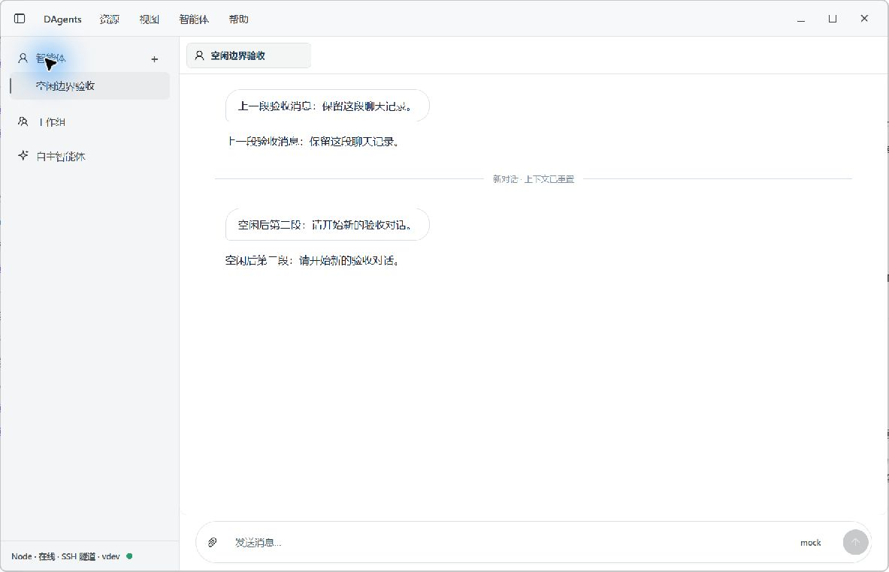
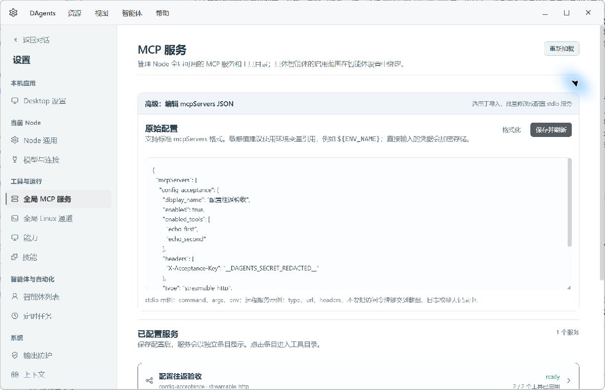
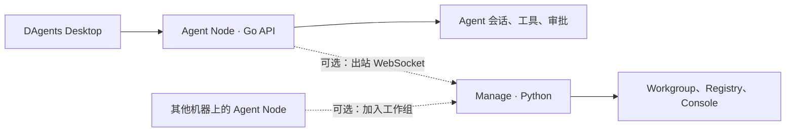

<p align="center">
  
</p>

<h1 align="center">DAgents</h1>

<p align="center">
  本地优先的 AI Agent 工作台
  <br />
  在自己的 Windows 或 Linux 机器上运行助手、工具与工作组协作
</p>

<p align="center">
  <a href="https://github.com/DGS-ai-team/DAgents/releases/latest"><strong>下载最新版本</strong></a>
  ·
  <a href="docs/user/getting-started.md"><strong>五分钟上手</strong></a>
  ·
  <a href="docs/README.md"><strong>阅读文档</strong></a>
  ·
  <a href="CONTRIBUTING.md"><strong>参与贡献</strong></a>
</p>

<p align="center">
  <a href="https://github.com/DGS-ai-team/DAgents/releases/latest"></a>
  <a href="https://github.com/DGS-ai-team/DAgents/actions/workflows/ci-required.yml?query=branch%3Adev"></a>
  <a href="LICENSE"></a>
</p>

当前版本为 **v0.12.0**。DAgents 适合自托管试用、个人开发和内网部署；生产使用前请先阅读[安全边界](#安全边界)与[运维指南](docs/user/operations.md)。

本页描述当前开发线。独立 Desktop、Node API-only 与新的上下文分段尚未发布到 v0.11.0 安装包；下一版范围与验收进度见[发布收束清单](docs/release-readiness.md)。旧版迁移请先阅读[运维指南](docs/user/operations.md#升级与兼容性)，不要直接覆盖正在使用的数据目录。

> DAgents 是一个开源、本地优先的 Agent 控制台：模型负责理解任务，Node 负责会话、工具、权限和审批；数据与执行环境默认留在你的机器上。

## 30 秒看懂

DAgents 把“模型对话”和“可控执行环境”放在一起：你可以先只运行一个本机 Node，随后按需接入 Manage，把多个 Node 上的 Agent 组织成工作组。

| 你要做什么 | 从哪里开始 | 你会得到什么 |
| --- | --- | --- |
| 在自己的电脑上使用 Agent | [Node 快速开始](docs/user/getting-started.md) | 对话、文件与命令、终端、MCP、Skills 和审批 |
| 管理多台机器或多个 Agent | [Manage 与 Workgroup](docs/user/workgroups.md) | Node 注册、工作组协作、集中审计和反馈处理 |
| 运行长期的自主工作 | [Auto Agent 说明](docs/user/long-term-tasks-and-feedback.md) | 自主激活、Todo、Dreaming、经验与运行记录 |

## 产品界面

Desktop 和 Manage 是两个互补入口：Desktop 连接 Node，提供日常对话与执行界面；Manage 面向跨 Node 的治理和汇总。具体设置项放在用户指南中。

| 页面 | 主要内容 | 本地入口或设计稿 |
| --- | --- | --- |
| Desktop Agent 工作台 | Agent 对话、工具结果、审批和终端工作台 | 开始菜单中的 `DAgents Desktop`；Node 只提供 API |
| Desktop 设置 | 本机偏好、Node 连接、模型、工具策略、Auto、Todo 和反馈 | 顶栏 `DAgents → 通用设置`；智能体条目可进入其设置 |
| Manage 控制台 | Node 注册、Workgroup、Auto 汇总和反馈管理 | 运行 Manage 后打开 `http://127.0.0.1:8020/console/` |
| Node / Manage 视觉参考 | 页面骨架、色彩、图标和关键状态的交互式稿 | [UI 视觉审计与方向](docs/design/dagents-ui-audit-and-direction.html) |

产品界面会随版本演进，行为以运行中的 Node、Manage 和契约文档为准；设计稿用于解释信息结构，不代替 API 或用户指南。

以下为 2026-10-17 真实 Windows Tauri 开发构建，使用隔离 Mock 对话与合成 MCP 服务；截图展示当前工作台和配置布局，不代表已经发布的版本或外部模型效果。



<details>
<summary>查看 MCP 设置与工具配置界面</summary>



</details>

Desktop 当前原生验收与界面记录见[日常使用](docs/design/desktop-product/audits/2026-10-15/daily-use/README.md)、[资源工作台](docs/design/desktop-product/audits/2026-10-16/resource-workbench.md)和[空闲后新对话](docs/design/idle-conversation-boundary.md)。这些记录注明了构建与测试条件，不以设计原型代替已接入能力。

## 为什么是 DAgents

DAgents 面向希望掌控数据、工具权限和执行边界的个人使用者；同一使用者可从多台 Desktop 访问自己的 Node，并通过可选 Manage 进行多机协作。当前不提供多人共用 Node 的账号、私人上下文或租户隔离。

- **本机运行**：Go Agent Node 在本地承载会话、工具调用、审批和 API；独立 DAgents Desktop 提供本机工作界面。
- **显式授权**：每个 Agent 独立配置工作目录、模型、工具组、Skills 和策略；危险操作可以要求人工审批。
- **可观察、可恢复**：流式消息、工具结果、审批、取消和刷新恢复都有明确状态。
- **按需扩展**：支持终端、文件、MCP、Skills、浏览器任务、定时触发和 Computer Use 等能力。
- **可选工作组**：需要跨机器协作时，用 Manage 编排多个 Node 上已经存在的 Agent。

DAgents 不是托管式 SaaS，也不是无边界的自动化脚本运行器。它把模型能力放进一个可配置、可审计、可由人接管的本地执行环境。

## 能力概览

| 场景 | 能力 | 说明 |
| --- | --- | --- |
| 对话 | 多 Agent 会话 | 为不同任务配置独立的模型、工作目录和工具权限 |
| 文件与命令 | 文件、Shell、终端 | 在 Agent 工作目录内读写文件、搜索和执行命令；可按策略审批 |
| 外部能力 | MCP、Skills、浏览器 | 通过配置扩展工具和知识，工具结果回到当前会话 |
| 桌面操作 | 截图、Computer Use | 支持截图、坐标网格和受审批保护的键鼠操作 |
| 长期任务 | Auto Agent、Todo、Dreaming | 在同一个 Agent 会话中按频率自主激活，并保留可追踪的运行记录 |
| 触发与反馈 | Triggers、用户反馈 | 通过时间/条件触发任务，Node 反馈可在绑定的 Manage 中处理 |
| 多机协作 | Workgroup | 由 Manage 协调多个 Node，成员在各自机器上执行任务 |

## 工作方式

只使用本机 Agent 时，不需要部署集中服务。需要多机协作时，再增加可选的 Manage 控制面。



| 组件 | 用途 | 是否必需 |
| --- | --- | --- |
| **Agent Node** | 本地 Agent、会话、工具、审批和 API | 是 |
| **Manage** | Node 注册、Workgroup、集中 Console 和发布服务 | 仅多机协作时需要 |
| **DAgents Desktop** | 本机桌面界面、Node 启动和管理 | 推荐的本机界面 |

## 安装

### 使用发布包（推荐）

前往 [GitHub Releases](https://github.com/DGS-ai-team/DAgents/releases/latest) 下载与你的系统匹配的安装包：

| 平台 | 发布产物 |
| --- | --- |
| Windows 64 位 | `windows-amd64` Inno Setup 安装包 |
| Linux 64 位 | `linux-amd64` 本地助手 tar.gz |
| Manage 控制面 | 可选 Manage 离线包 |

下一版 Windows 仅发布 x64 安装包，暂停 x86 完整包，不提供免安装归档；历史 x86 用户不会跨架构接收 x64 安装器。安装完成后，从开始菜单打开 DAgents Desktop 配置本机 Node 与模型；桌面快捷方式和登录自启动均为可选项，默认不勾选，升级时保留原选择。Desktop 需要预先安装 WebView2 Evergreen Runtime。Linux tar.gz 提供 Node API、客户端和 Browser service，不包含 Desktop UI。详细安装与升级边界见 [Windows 安装说明](packaging/windows/README.md)。

### 从源码运行

适用于开发、调试和希望跟随最新 `dev` 分支的用户。

**环境要求**

| 组件 | 要求 | 用途 |
| --- | --- | --- |
| Go | 1.25 或更高 | Agent Node、Client |
| Node.js | 22 或更高 | 构建 DAgents Desktop；使用 Manage 时还要构建 Console |
| Python | 3.11 或更高 | 仅 Manage、测试和部分打包流程 |
| Docker | 可选 | 构建或运行 Manage 镜像 |

**1. 获取代码并准备引导配置**

```bash
git clone https://github.com/DGS-ai-team/DAgents.git
cd DAgents
cp packaging/agent-client/config.example.yaml packaging/agent-client/config.yaml
```

Windows PowerShell 使用：

```powershell
Copy-Item packaging/agent-client/config.example.yaml packaging/agent-client/config.yaml
```

`config.yaml` 是 Node bootstrap 文件，只保存监听地址；Client 另用 `local.endpoint` 指定连接目标。Node 运行时设置默认写入 `.runtime/` 下的 SQLite。该文件已被 Git 忽略，不要提交真实配置或密钥。

**2. 启动 Node API 与 Desktop**

```bash
go run ./node/cmd/dagents-node -config packaging/agent-client/config.yaml
```

Node 默认监听 `127.0.0.1:18765` 并只提供 API。Windows 10 是 Node 基础运行最低版本；完整 Desktop 体验推荐 Windows 11。Windows Server 2019 及更新版本面向服务端部署。Windows 7/8/8.1 与旧版 Server 不受支持。现代 Linux 可运行 Node；较旧的 Linux 主机建议通过 SSH 使用较新的运行环境。从源码启动 Windows Desktop 时，在 PowerShell 设置 `DAGENTS_HOME`、`DAGENTS_CONFIG`，再在 `desktop/tray-tauri` 执行 `npm install` 和 `npm run tauri:dev`。在 Desktop 中配置模型和创建 Agent；真实对话需要配置对应 Provider 的密钥。

**3. 可选：启动 Manage 和 Workgroup**

```bash
python3 -m pip install -r requirements.lock -r requirements-dev.txt
npm ci --prefix manage/console/frontend
npm run build --prefix manage/console/frontend
python3 run_manage.py
```

打开 [http://127.0.0.1:8020/console/](http://127.0.0.1:8020/console/)。Windows 也可以使用 `py -3` 替代 `python3`。本机对话不依赖 Manage；只有 Node 注册、工作组和集中控制功能需要它。

## 第一次配置建议

1. 在“设置 → 连接”创建或选择 LLM 配置，并明确是否启用多模态；多模态开关由你的配置决定，不由 DAgents 代替模型做能力判断。
2. 创建 Agent 时选择工作目录。工作目录创建后作为该 Agent 的固定边界，不能再修改。
3. 只打开当前任务需要的工具组；Shell、终端、Computer Use 和外部工具建议配合审批策略使用。
4. 需要扩展能力时，再配置 MCP 服务或加载 Skills；需要多机协作时，最后再启用 Manage/Workgroup。

完整操作路径见 [用户指南](docs/user/README.md)，工具、策略和配置字段见 [参考资料](docs/reference/README.md)。

## 数据归属

Node 的控制面数据与 Agent 工作区分开保存，便于备份、迁移和审计：

| 数据 | 默认位置 | 说明 |
| --- | --- | --- |
| Agent 元数据和运行设置 | `.runtime/agents.db`、`.runtime/node_settings.db` | Node 管理目录，不属于任何 Agent 工作区 |
| 会话快照与恢复状态 | `.runtime/memory/sessions.db` | 用于重启后的会话恢复 |
| Agent 历史和记忆 | `<workspace>/.dagents/<agent_id>/` | 按 Agent 隔离的审计、记忆和本地状态 |
| 工具结果文件 | `<workspace>/tool_outputs/<agent_id>/` | 过长输出或需要再次查看的结果 |

这些路径属于运行时数据，不应提交到 Git。升级前请备份 `.runtime/` 和所有自定义工作区；完整的升级行为见[运维指南](docs/user/operations.md)。

## 安全边界

DAgents 能够调用本机工具，因此请把它当作一个可以执行操作的本地程序来部署：

- Node 默认只监听 `127.0.0.1`。除非已经配置鉴权、防火墙和反向代理，否则不要直接暴露到公网。
- 工作目录、Shell、终端、MCP 和 Computer Use 都可能读取或改变本机资源；测试时优先使用专用目录和非生产账号。
- 审批是人工确认机制，不等同于进程沙箱或完整隔离环境；当前安全边界主要由工作目录、工具开关、策略和审批组成。
- 模型请求及工具结果可能发送到你配置的模型服务商，请根据组织要求确认数据处理政策。
- 不要提交 API Key、`.runtime/`、SQLite 数据库、构建产物或真实用户数据。安全问题请按 [SECURITY.md](SECURITY.md) 私下报告。

## 文档导航

| 你想了解 | 入口 |
| --- | --- |
| 第一次安装、启动和配置 | [用户指南](docs/user/README.md) · [快速开始](docs/user/getting-started.md) |
| 工作组、成员和审批 | [Workgroup 指南](docs/user/workgroups.md) |
| 安装包、服务和故障排查 | [运维指南](docs/user/operations.md) · [打包说明](packaging/README.md) |
| Node、Session、Turn、Step 和数据流 | [架构文档](docs/architecture.md) |
| API、配置、工具、事件和 Schema | [参考资料](docs/reference/README.md) |
| 开发、测试和发布 | [开发与验证](docs/development.md) · [发布流程](docs/release-process.md) |
| 版本变化 | [CHANGELOG.md](CHANGELOG.md) |
| 未来计划 | [Roadmap](docs/roadmap.md) |

旧版手册章节仍保留为兼容入口，当前文档分层和真相来源以 [docs/README.md](docs/README.md) 为准。

## 仓库结构

```text
node/                  Agent Node API、工具执行、会话与共享设置前端源码
manage/                可选的 Workgroup 控制面与 Manage Console
client/                Node 客户端与远程连接适配
desktop/               独立 Tauri Desktop、工作台与资源界面
shared/                共享 Go 模块、品牌与规范化图标资源
packaging/             安装包、服务和发布资产
docs/                  用户、架构、参考、设计与历史文档
tests/                 Python/跨组件测试
```

Node 是本地运行时的事实源，Manage 是可选治理层；Desktop 负责展示状态和发起操作，不复制后端业务规则。`node/webui/frontend` 现保留为 Desktop 复用的设置和消息组件源码，Node 不再托管 `/ui/`。

## 开发与验证

提交代码前运行完整本地质量门禁：

Linux：

```bash
bash scripts/verify.sh
```

Windows PowerShell：

```powershell
powershell -ExecutionPolicy Bypass -File scripts/verify.ps1
```

常用的局部验证命令：

```bash
npm test --prefix node/webui/frontend
npm run test:ui --prefix desktop/tray-tauri
go test ./shared/config/... ./shared/logfiles/... ./shared/update/... ./node/... ./client/...
python3 -m unittest discover -s tests -p "test_*.py" -v
```

贡献前请阅读 [CONTRIBUTING.md](CONTRIBUTING.md)，跨 Node、Manage、UI、Client 或 Desktop 的变更应同时更新契约和回归测试。

## 参与贡献

欢迎提交 Issue、改进文档、报告 Bug 或发起 Pull Request。建议先从 [贡献指南](CONTRIBUTING.md) 了解模块边界、测试门禁和 PR 要求；行为变化、API/工具变化和安全边界变化都应附带可验证的说明。

## 许可证

DAgents 使用 [MIT License](LICENSE)。
