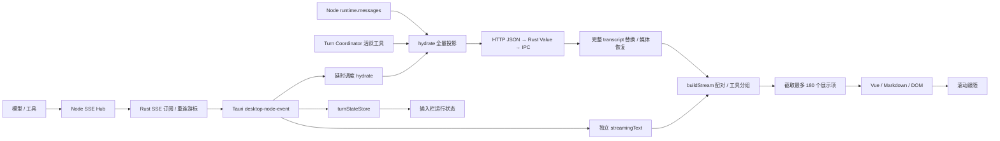
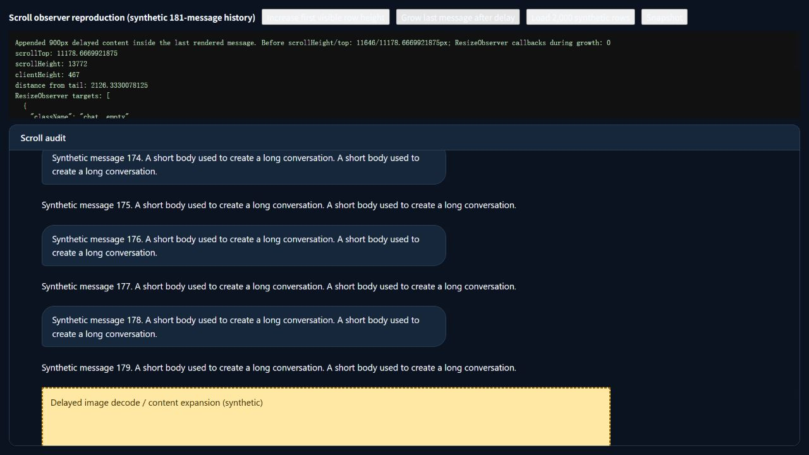

# Desktop / Node 消息链路审计与改造建议

审计日期：2026-11-14。代码基线：`5753a322`（本地 `codex/web-search-fetch`）。范围：普通 Agent 与 Auto 共用的 Desktop 对话、工具与审批展示、Node 消息持久化 / hydrate / SSE、长会话性能和滚动。本文是评估结果，未修改业务实现。

## 结论与证据边界

当前实现能支持短会话的正常执行，但消息的一致性和长会话更新不够稳健。主要复杂度来自三个独立更新源：流式正文、生命周期状态、完整历史快照。它们缺少统一的消息身份与同步完成条件，组件承担了较多配对、补偿和窗口维护工作。

用户反映的三个现象都有对应代码路径。其中，终态刷新失败不补偿、工具临时投影变为最终正文 / 工具投影、异步内容增高后不跟随底部，已用当前源码和受控输入复现。未取得用户发生故障当时的事件序列，因此不能断言每次历史故障都由同一个原因引起；也未发现足以证明“持久化消息随机丢失或乱序”的证据。

本轮方法：源码调用链审查、实际函数的确定性时序探针、Go Hub 满缓冲探针、内置浏览器中的真实 `MainChatPanel.vue` 组件验证。浏览器用例使用合成会话，不是原生 Desktop 的完整真实 LLM 流程验收。所有测试数据均与已有会话隔离。

## 当前完整链路



关键行为：

- `POST /v1/messages` 只确认入队。Desktop 用本地 pending-user 显示发送中的消息；它与已保存消息按文本和原历史长度匹配。
- assistant delta 直接拼接到独立的 `streamingText`；展示时把它放到 transcript 最后。收到最终 `tool_call` 时清空这段正文。
- 工具事件正文不直接插入 Desktop 消息列表，主要触发 hydrate。工具执行状态另从 `turn_state` 更新。
- hydrate 是完整历史，并追加尚未进入历史的 Coordinator 活跃工具。Desktop 接受快照后整体替换，再异步恢复媒体。
- 展示层配对 `tool_call` / `tool_result`，合并相邻工具，最后才截取最多 180 个展示项。
- Composer 的执行状态直接使用生命周期状态，不等待消息快照或渲染完成。

主要源码入口：`DesktopApp.vue:321,665,695,1924`；`workbench-state.js:208`；`MainChatPanel.vue:88,112,151,178,268`；`useStream.js:135`；Node `server_agent_api.go:276`、`hydrate_view.go:30`、`runtime_lifecycle.go:1276`、`hub.go:98`。

## 发现清单

### M01 · P0 · 执行已结束，但结果同步可能永久停在旧快照

**确认的实现和复现：** `DesktopApp.vue:1964` 立即应用终态；`:1979-1980` 调度消息刷新。`:700-702` 的刷新请求失败后仅写入错误，没有安排重试。watchdog 在 `:369-376` 只关注执行中或非终态流式文字，终态后不再对“消息未追上”进行补偿。受控用例让最后一次终态刷新失败一次，旧 transcript 保留，后续没有重试任务；该隔离用例不再发送后续 turn_state，模拟最后一个刷新触发点已经过去的情况。

此外，`orchestrator.go:1094` 在 runtime 提交最终历史前就发布 `turn_finished`；runtime 随后提交、持久化历史，再发布 terminal `turn_state`（`runtime.go:928`；`runtime_lifecycle.go:1279,1472`）。因此第一次 hydrate 可能读到较旧消息，或因生命周期落后而被 Desktop 拒绝。

**限制：** 正常情况下，后续 terminal `turn_state` 会再触发 hydrate，通常能消除这个空档。早发 `turn_finished` 单独不能解释永久不刷新。刷新失败、最后事件缺席、慢请求等组合才会放大问题。当前通用错误通道可能显示错误，但没有独立、明确的“结果未同步”状态。

**建议：** 完成通知带提交后的 `history_revision`；Desktop 维护 `targetRevision` 与 `appliedRevision`，直到追平才结束结果同步。执行终态保持权威，输入是否可继续仍由执行状态决定；同步未完成时轻量提示“正在同步结果”，失败显示“结果同步失败”并提供重试。保留已收到的正文，直到同身份的最终消息接管。

### M02 · P0 · SSE 慢订阅者可以丢关键事件，且 live 流不主动报告缺口

`hub.go:127` 在 channel 满时把关键事件移到锁外补发。期间另一个发布者能把更大 seq 的事件先放入 channel。`:210` 补发最多等待 2 秒，随后只记录警告并丢弃；普通事件也可直接丢弃。临时 Go 探针确认了关键事件被超越、超时丢弃两种情况。

Rust `events.rs:152-156` 把 cursor 推进到最大 seq，并继续转发事件；live 缺口没有触发对账。游标一旦越过缺失事件，按该游标重放也不会再得到它。慢消费者还可能让发布协程等待最多 2 秒，增加执行链延迟。

**已有保护应保留：** SSE 有历史缓存、Agent cursor、进程 epoch、保留窗口截断通知。Desktop 在断线重连时也会请求 hydrate。不能将当前问题描述成“完全没有断线恢复”；缺口主要在连接仍存活时，恢复依赖后续 hydrate。

**建议：** 满队列时明确让该订阅进入 resync / 断开恢复，避免静默越过关键事实；保证每个订阅的事件顺序，不在锁外另开绕过原队列的关键事件投递路径。客户端用可重放事件游标发现缺口后对账。不要仅放大 buffer 或延长等待时间。

### M03 · P1 · 工具先出现，稍后正文插到它前面，看起来像顺序改变

Node `hydrate_view.go:133` 会把 Coordinator 活跃工具追加到旧 transcript 尾部。此时模型结果还可能仅在 Orchestrator 的局部 history 中，尚未提交到 runtime.messages。Desktop `:1982` 又在最终工具事件到来时清掉流式正文。

两个合法的快照因而会是：

```text
执行中：用户 → 活跃工具投影
提交后：用户 → assistant 正文 → 同一个工具及结果
```

实际 `buildStream` 两态 fixture 复现了工具前方后来出现正文的变化。这是临时展示与最终展示缺少共同锚点，不等于数据库把已保存记录随机重新排序。独立 streaming tail 与完整快照还存在重复展示同一正文的条件风险，但本轮不把它当作已验证的正常事件链根因。

**建议：** 首次看到 assistant / 工具意图时即创建稳定的消息锚点；后续正文、参数、结果均更新原项。正文顺序由 Node 定义，工具子行始终保持 call 顺序，结果完成先后只更新状态。现有 SSE 已有 turn / step / assistant-message 元数据，优先利用这些关联；内容摘要本身不应单独作为跨步骤唯一消息 ID。

### M04 · P1 · hydrate 内容与 lifecycle sequence 不是同一个原子快照

`hydrate_view.go:36-51` 在锁内复制 messages、historyRevision 和 lifecycle，解锁后在 `:53` 另读 `lifecycleEventSequence()`。中间发生状态转换时，旧 phase / 历史可能带上较新的 sequence。该竞态由代码可确认，本轮未强制调度复现它。

Desktop `turnState.js:104` 的接受规则主要比较 generation / lifecycle sequence；`:70` 虽读取 history_revision，却没有把它作为 transcript 更新的独立门槛。`DesktopApp.vue:673` 会因状态不被接受而丢弃整份快照，消息与状态绑定过紧。

**建议：** 在同一个快照边界取 lifecycle、sequence、history revision。分别判断状态与消息是否前进，防止旧状态覆盖新状态，也避免旧状态导致本可前进的消息被整包丢掉。`stream_seq_hint` / `agent_seq_hint` 是构建快照后读取的提示值，不能视为覆盖了快照的精确消费水位。

### M05 · P1 · 更新调度依赖 debounce + 并发请求 + 丢响应，慢服务时延迟明显

`DesktopApp.vue:695` 每次事件都取消并重设一个 timer；120ms 内连续事件会持续推迟读取，没有最大等待时间。请求开始后没有 single-flight 限制，后续事件可再发请求。`:667` 只接受最后发起请求的响应，即使较早响应已经包含可用的新消息，也会被丢弃。

受控实际函数探针确认：两个慢请求重叠时，第一个响应被丢弃，直到第二个成功才更新。**这通常是延迟窗口，不是最新请求成功后仍永久丢消息。** 0ms 的终态刷新通常绕开连续 debounce，但不能解决并发及失败补偿。

**建议：** 每个 Agent 同时一个同步请求，执行期间只累计 dirty / target revision；结束后必要时立即补一次。生命周期未改变历史时只更新状态，不重复获取整份消息。重试同步请求必须绑定 Agent / context 身份，切换后不更新错误目标；重试不得重发用户指令或重新执行工具。

### M06 · P1 · 尺寸观察对象错误，异步内容增高不一定滚到底部

`MainChatPanel.vue:74` 初始 stream 为空，`:173` 把首轮构建排到 rAF；`:281` onMounted 已经绑定 ResizeObserver。`:276` 观察的是 `firstElementChild`，实际先选中 `.chat__empty`。消息渲染后这个节点被移除；`:300` 只在滚动元素 ref 改变时重新绑定。列表本身是直接并列的子行，没有统一内容容器（`:351` 起）。即使后来绑定到第一个消息或“加载更早”按钮，也观察不到所有其他消息的高度变化。

**内置浏览器实测：** 当前组件 + 181 条合成消息。首屏稳定后 observer 目标为脱离 DOM 的 `chat__empty` 与定高滚动容器。初始距尾约 0.33px；末行内部异步扩展后，scrollHeight 从 11646 增至 13772，scrollTop 仍为 11178.67，距尾约 2126.33px，增长阶段 observer 回调为 0，也未出现返回底部按钮。截图见本文末尾。

对照实验：增高视口上方的早期消息时，浏览器原生 scroll anchoring 保持了尾部位置。这说明缺陷会受增长位置影响，不能说所有图片加载都必然失败。末行用例模拟内容尺寸变化，未使用真实图片下载。

**建议：** 观察稳定的消息内容 wrapper，统一在渲染提交 / 内容尺寸变化后跟随；保留“原本在底部才跟随”的用户意图。用户在阅读历史时保持消息 ID + 屏内偏移锚点，不能每次更新都强制滚到底部。

### M07 · P1 · 180 项窗口只限制部分 DOM，不是完整长列表方案

`MainChatPanel.vue:88` 为全量 entries 构建包含 text、参数和结果内容的指纹，`:112` 为全量历史配对、分组，最后 `:178` 才 slice 180 项。网络、Node 投影、Rust JSON / IPC、JS 内存和配对工作都没有因此得到上限。

`:258` 的“加载更早”把窗口整体向前移 180，而非增加一页并保留已有内容，也没有虚拟列表的上下占位高度。用户无法通过一段连续自然滚动浏览所有已载入消息；返回新消息需要跳回尾部。工具分组只算一个展示项，展开后子工具不受 180 限制；曾展开的子工具使用 v-show，收起后仍留在 DOM（`ToolGroupRow.vue:109`）。

**建议：** Node 首屏只返回最新一页，历史按稳定游标分页；客户端维护已载入页与稳定锚点。先限制媒体和工具详情的渲染，再用实测决定是否引入可变高度虚拟列表。工具子列表也需独立限制，不能只统计外层气泡数。

### M08 · P1 · 流式长正文反复完整解析 / 净化 / 高亮

`ResourceMarkdown.vue:14` 对每次正文变化调用 `renderResourceMarkdown`。`markdown.js:138` 每次创建 parser 并解析 / 净化整个已生成前缀；代码块还执行同步语法高亮。普通 `renderMarkdown` 的 256 项缓存不覆盖这个 assistant 渲染路径。`MainChatPanel.vue:151` 对文本更新直接 patch tail，没有把所有 delta 统一合并到每帧一次 Markdown 更新。

本机 Node + jsdom / DOMPurify 样本：18,317 字符的合成回复，每次增长 80 字符，共 228 次实际前缀渲染，总耗时约 1.33 秒，平均 5.84ms，p95 14.70ms。它不含完整浏览器布局、绘制、Tauri 和 Node 网络成本，不能直接当成原生 Desktop 的帧耗时；它证明了前缀重复处理的成本。更小的增量会增加重复解析次数。

**建议：** 数据接收与绘制分开；文本可以完整接收，展示合并到一帧一次或设定最大更新频率。稳定 Markdown 块复用，仅处理变化尾块；复杂高亮和资源预览在块闭合或生成结束后处理，始终保留净化。已完成正文按内容版本缓存。

### M09 · P1 · Node 长历史读写和锁等待会放大前端同步延迟

- 每次 hydrate 复制并遍历完整 messages，构建工具索引、转 transcript，再遍历历史重建媒体引用（`hydrate_view.go:36,102`；`transcript_entries.go:30`）。Desktop 收到快照后还要单独加载、恢复媒体 URL。
- `runtime.go:822` 提交历史时对旧、新 messages 做全量 JSON digest，并复制新数组；`model_context_snapshot.go:109` 的 Digest 是 JSON Marshal + SHA256。
- `runtime_lifecycle.go:1279` 持有 lifecycleMu 完成历史提交和持久化；`runtime_persistence.go:24` / `store/sqlite.go:103` 保存全量 messages_json。慢盘、大历史会阻塞同一 Agent 的 hydrate 快照。
- 摘要列表 `store/sqlite.go:179` 读取每个 Agent 的 messages_json 并反序列化，只为计算条数。它与会话读写共用单连接 SQLite 池（`:60`）；列表刷新可与当前消息同步竞争。

**建议：** 将摘要计数 / 最后活动作为写入时维护的轻量字段；避免为列表解码整份历史。缓存已提交版本的展示投影；用 revision / 明确变更替代热路径反复计算整份 digest。后续按测量拆分追加记录与 checkpoint，不能为了减少锁等待直接破坏现有持久化和取消栅栏的一致性。

### M10 · P2 · 消息身份、媒体恢复和诊断仍有维护负担

- `workbench-state.js:210` 为每条消息按数组下标重造 ID。插入、清理、恢复导致下标变化时，Vue key 与实际消息身份不再一致；按 key 计算新增的 `streamUnread.js` 可能把既有项计成新增。展开状态、资源预览可能受重挂载影响，未来也难以建立稳定阅读锚点。工具本身的 call ID 比普通消息稳定。
- `agentMediaRestore.js:10` 每次恢复遍历、复制完整 transcript，完成后又整体替换一次快照。`DesktopApp.vue:645` 的 object URL 缓存只有 64 项；淘汰时直接 revoke，没有与已显示引用寿命绑定。大量历史图片下存在重新读取和失效引用风险，本轮未复现具体图片损坏。
- Rust 全局订阅所有 Agent 事件并转发至 WebView，然后 JS 才过滤非当前 Agent；并行 Auto 的正文 / 工具增量也会穿过这条链（`nodeclient.rs:1052`；`events.rs:154`；`lib.rs:595`；`DesktopApp.vue:1948`）。应在保持全局通知的同时减少不需要的背景高频载荷。
- `performanceDiagnostics.js:102` 有 recordSSEEvent，但当前生产源没有调用点；stream.build 测量也不含入口指纹、分组、Markdown、IPC 与布局。现有诊断不足以定位端到端延迟发生在哪一段。

**建议：** 消息在 Node 提交时获得持久、稳定 ID；客户端只更新变更项。媒体按可见范围和引用生命周期加载 / 释放，使用共享 in-flight 请求。复用现有诊断记录“提交 → 事件 → 收到 → 请求 / 响应 → 应用 revision → 展示”的耗时与丢弃原因，避免新增一组用户配置。

### M11 · P1 · 仅媒体字段变化时，展示可能完全漏更新

`MainChatPanel.vue:88-105` 用手工字段清单构造 entriesInputKey，未覆盖 `images`、`media`、`data.media` 等字段。stream 是独立的 shallowRef，仍保存第一次构建时的 entry 对象。Desktop 在 `:674` 先应用原始快照，随后在 `:685-686` 异步替换为恢复媒体后的快照；如果媒体恢复晚于首次 rAF 构建，正文和指纹都没变，展示层不会重新接收新 URL。

临时实际组件测试确认：相同 id / kind / text，只把图片从 `/raw/media/1` 换成 `blob:restored-media-1`，传入 props 更新后，MessageBubble 收到的仍是旧图片地址。测试运行通过（断言确认缺陷存在），临时测试已移除，没有将旧行为固化为产品要求。

**建议：** 用明确的消息实体版本驱动更新，媒体引用更新也进入同一实体更新路径；减少另存一份可能过期的 entry 对象。不要继续通过逐个补充 stringify 字段来维持手工依赖清单。验收需覆盖“正文不变、图片 / 引用 / 状态元数据变化”的情况。

## API 与职责边界评估

| 现有接口 / 通道 | 判断 | 改造方向 |
|---|---|---|
| `POST /v1/messages` | 异步入队合理；响应缺少可与 pending-user 精确对齐的身份 | 返回稳定 input / message ID；客户端请求带幂等 ID，避免通过文本匹配确认发送 |
| `GET /v1/agents/{id}/hydrate` | 适合首次进入和恢复；不适合所有工具状态变化都拉全量 | 最新一页 + 原子 revision / lifecycle / context 身份；支持条件读取与明确 reset |
| `GET /v1/streams` | SSE 足够，无需仅为这些问题改 WebSocket | 明确有序、补洞、正文 delta 关联及提交水位；可靠事实与高频展示增量分清 |
| `GET /v1/agents/{id}/timeline` | 已有 after_seq 的生命周期审计接口 | 不是用户聊天消息分页接口；不要让 Desktop 把它与 LLM history 再拼成第二套列表 |
| `GET /v1/agents/{id}/context` | 模型上下文诊断有独立价值 | 保持诊断用途，不作为主聊天数据源 |
| `GET /v1/agents/{id}/tool-jobs` | 运行中进程 / 工具诊断 | 主聊天使用 Coordinator 执行事实，避免重新引入工具轮询状态源 |
| Agent 列表 / ack / notification | 与聊天正文职责不同，保留合理 | 列表轻量化；未读确认只针对已经应用 / 已看到的水位 |

问题主要是契约不完整与重复全量工作，不是路由数量本身。建议保留“一个读取展示消息的契约 + 一个有序增量通道”，首次快照与增量用同一批实体 ID / revision。需要分页历史和工具详情按需读取，但不应让 UI 再消费 raw journal、模型 context、生命周期 timeline 三路来拼装普通聊天。

建议展示实体至少有：`id`、会话 / context 身份、`turn_id` / `step_id`、稳定排序位置、实体版本、类型、内容 / 状态、工具关联。消息正文增量必须能定位同一实体并去重；工具结果更新对应工具行。顺序不依据到达时间、客户端时间或结果完成先后计算。history revision、lifecycle sequence、stream cursor 各有职责，不能互相替代。

Node 的 LLM 协议 history 需要满足 tool_call / result 配对和压缩、恢复规则；用户看到的时间线需要稳定身份与分页。建议增加明确的展示投影边界，先复用现有存储与 Coordinator，不要求另建服务、引入消息中间件或重写整个运行时。后续是否采用独立行存储，由全量快照读写的实测收益决定。

## 用户体验应该保持的规则

1. 正文、工具和审批首次出现后有稳定位置；工具结果更新原行。并行工具按调用次序展示，右侧状态可独立变化。
2. 输入栏区分“仍在执行”与“结果正在同步”；后者不能伪装模型仍在工作。同步失败可重试读取，不自动重执行任务。
3. 审批卡片与同一批工具共享关联 ID；刷新不重置勾选、展开、键盘焦点。批准 / 拒绝按钮与执行停止保持不同语义。
4. 用户在底部时跟随文字、图片、代码块与工具高度变化；在看历史时保留原锚点。未读提示与返回底部按钮只提示真实未查看的更新。
5. 加载历史不移走正在阅读的消息；回到对话 / 切换资源页时恢复本 Agent 的位置，跨 Agent 不复用旧位置和正文。
6. 长代码、表格、工具参数按需展开；完成消息不因别的工具状态变化反复重新解析。

## 推荐实施顺序

| 阶段 | 范围 | 完成标准 |
|---|---|---|
| 第一轮：正确性闭环 | M01 / M02 / M04；收拢 M05 调度；修复 M06 / M11 展示更新 | 完成事件只指向已提交版本；同步失败可恢复；live 丢事件能对账；异步增高不漏跟随；媒体替换可见 |
| 第二轮：稳定展示与长会话 | M03 / M07 / M08 / M10 消息 ID；统一 timeline store | 流式正文原位接管、无工具前后跳动；历史游标分页与锚点保留；静态正文不重复解析 |
| 第三轮：Node 热路径与资源 | M09；媒体 / 背景增量 / 诊断 | 常规刷新成本随变化量而非累计历史增长；列表不解码全历史；媒体和队列占用有边界 |

第一轮建议作为一个明确的跨端消息一致性改造，验收期间不混入图标、配色或无关设置调整。单独修一个 debounce 数值、再加一个定时刷新或强制滚动，会继续增加时序组合。

Desktop 侧建议从 `DesktopApp.vue` 提取一个会话消息控制器，统一管理订阅、revision、同步调度和恢复；一个 timeline store 保存实体与顺序；`MainChatPanel` 仅负责展示和滚动意图。保留工具气泡、审批气泡、Markdown、状态栏的独立组件，但让它们读取同一份会话状态。

## 验收矩阵与性能口径

| 用例 | 必须满足 |
|---|---|
| 正文 + 工具 + 正文；串行 / 并行工具 | 各消息实体顺序固定，结果到达不移动子行，流式接管不重复正文 |
| 工具审批、部分批准、拒绝、取消、模型重试 | 阶段变化正确；勾选 / 展开保留；不重复工具；终态后仍能补齐消息 |
| hydrate 延迟 0.5 / 2 / 10 秒，响应乱序 | 同一 Agent 同步并发受控；已接收的较新消息不回退；最终追上 target revision |
| 最终 hydrate 失败一次、多次；SSE 丢关键事件 / 重连 / Node 重启 | 自动对账或显示明确同步失败与重试；已完成的状态不无期限掩盖旧消息 |
| 初始快照与订阅建立交错、快速切换 Agent | 没有订阅窗口漏更新；旧响应 / 旧 delta 不进入新会话 |
| 180 / 181 / 2,000 / 10,000 条历史；大结果 / 大 Markdown / 多图片 | 首屏和增量载荷有边界；最新更新不扫描全部历史；统计实际子工具 DOM 数 |
| 尾部 / 中部图片异步加载、代码展开、工具展开、窗口尺寸变化 | 跟随开启时停在底部；阅读历史时消息锚点不跳；退出底部后返回按钮可靠 |
| 连续加载旧页，再向新页滚动；资源页往返 | 连续阅读、锚点与展开状态不被整页窗口替换破坏 |

先固定一台验收机器，记录消息 / 工具 / 正文大小与网络故障注入，再比较 p50 / p95 / 最大耗时。建议首轮目标：健康本地服务下，已收到最终提交事件到最终消息可见 p95 ≤ 300ms；失败重试不能无限增加并发，重试仍失败时明确提示；跟随开启且布局稳定后距底部 ≤ 2px。它们是待验收目标，不是本轮测得的现有能力。慢服务用例验收恢复性与同步提示，不强套健康响应时延目标。

应分别量：Node 快照锁等待 / 投影 / JSON、HTTP 与 Rust / IPC、前端应用、配对与分组、Markdown、布局 / 绘制、加载媒体。当前 2,000 条短合成消息的浏览器测量仍构建了 2,000 项，只展示 180 项；单次 `stream.build` 约 4.5ms，仅包含 buildStream，不包含入口指纹、分组、Markdown 和布局，不能作为完整页面性能结论。

## 本轮验证记录

- Desktop 相关已有测试：6 个文件、45 项通过，覆盖 MainChatPanel、scrollTail、useStream、turnState、turnWatchdog、agentMediaRestore。
- Node 既有相关测试：`go test ./internal/stream ./internal/session -run 'Test.*(Hub|Hydrate|Transcript)' -count=1` 通过。
- 实际源码函数探针：终态刷新失败无重试、重叠慢刷新丢弃前一响应、活跃工具投影变成最终 assistant-before-tool，3 项通过。
- 临时 Go Hub 探针：critical 超越、critical 超时丢弃后游标越过，两项通过；临时测试文件已移除。
- 临时实际 MainChatPanel 组件用例确认仅图片 URL 改变后仍显示旧 entry；该次运行 11 项通过（含 10 项既有用例），新增探针随后移除。
- 内置浏览器：真实消息组件的末行异步增高漏跟随；另测 2,000 条短合成消息的构建范围。
- 本地复现脚本和原始日志放在被忽略的 `.runtime-test-message-audit-2026-11-14/`，不含真实配置、会话或 API Key：`repro.mjs`、`run.log`、`backend-hub-probes.txt`、`backend-results.log`、`main.js`、`browser-long-history.txt`。这些是当前工作区证据，未纳入生产源码。

以下截图来自本轮组件复现，展示末行异步增高后仍停留在旧滚动位置；顶部为测试测量，并非产品 UI 设计方案。


