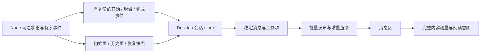

# Codex / DeepSeek Harness 消息链路源码对照

检查日期：2026-11-15。DAgents 基线：`5753a322`，分支 `codex/web-search-fetch`。本文承接 [Desktop / Node 消息链路审计](../audit/2026-11-14-desktop-message-pipeline-audit.md)，重点解释消息顺序、流式到最终消息的衔接、完成状态、断线恢复、长会话与滚动。

## 结论与检查边界

两家的主要参考价值是**用明确的消息身份、事件顺序和提交边界管理消息，而不是让组件通过多次全量刷新推断当前结果**。它们仍使用快照、分页、投影和补偿，复杂度没有凭空消失，但主要落在协议和状态层，展示层有较稳定的输入。

DAgents 当前的核心问题，是独立流式正文、工具临时投影、生命周期状态和完整历史快照缺少共同的更新契约。优先调整这份契约，再优化渲染和滚动；不建议直接移植上游框架，也没有依据要求从 SSE 换成 WebSocket。

| 对象 | 固定版本 | 实际检查范围 |
|---|---|---|
| [OpenAI Codex](https://github.com/openai/codex/tree/3b8bd2ee7e95b058192151b3468093a5a67655f8) | `3b8bd2ee7e95b058192151b3468093a5a67655f8` | app-server 协议、事件分发、历史查询，以及 TUI 的消息与 Markdown 渲染 |
| [DeepSeek Harness](https://github.com/deepseek-ai/deepseek-harness/tree/39163dd30f703a79079e2d2446545cff3c453738) | `39163dd30f703a79079e2d2446545cff3c453738` | Session 日志、assistant stream、服务端 follow、客户端状态、聊天 UI 与滚动 |

本次核查的是官方 GitHub 源码，未执行上游程序、安装其依赖或运行其测试。因此，性能收益是根据算法和调用路径作出的推论，不是两项目的实测跑分。Codex 的结论限定于所检查的公开 app-server / TUI，不能当成 Codex Desktop 界面的直接实现说明。DeepSeek 的仓库包含 Desktop / Web 客户端，可以追踪其实际聊天组件。

## 一、Codex 如何组织消息

### 1. 从开始到完成，更新同一个 Item

app-server 分别发送 `item/started`、`item/agentMessage/delta` 和 `item/completed`。事件带 thread / turn / item 身份；delta 明确指向 `item_id`，completed 携带完整 Item。这样客户端可以在原位置更新同一条消息，而不是先在末尾显示一份临时文字，再等待历史快照决定它应该插到哪里。[协议定义](https://github.com/openai/codex/blob/3b8bd2ee7e95b058192151b3468093a5a67655f8/codex-rs/app-server-protocol/src/protocol/v2/item.rs#L1430-L1580)

TUI 也把完成时的全文当成权威内容进行校正，即使中途 delta 不完整，也不只相信已经拼接出的文字。这里的全文校正发生在 assistant Item 完成处，`turn/completed` 本身只提供终态和可选的最终 assistant 摘要，不是整份 transcript。[全文校正](https://github.com/openai/codex/blob/3b8bd2ee7e95b058192151b3468093a5a67655f8/codex-rs/tui/src/chatwidget/streaming.rs#L289-L304)、[turn 完成载荷](https://github.com/openai/codex/blob/3b8bd2ee7e95b058192151b3468093a5a67655f8/codex-rs/app-server/src/bespoke_event_handling.rs#L1405-L1431)

**对 DAgents 的启示：** assistant 正文、工具调用和工具结果都需要稳定身份。完成事件直接校正相应项，避免每次工具变化都依赖 hydrate 才能看到正文。对应 M01、M03、M10。

### 2. 显式协调正文与工具事件的先后

app-server 对单线程逐个接收事件，并等待当前事件处理完成后再读下一条。终态路径先处理已提交的阅读回执通知，再发布 `turn/completed`；阅读回执不是消息流游标。[线程事件循环](https://github.com/openai/codex/blob/3b8bd2ee7e95b058192151b3468093a5a67655f8/codex-rs/app-server/src/request_processors/thread_lifecycle.rs#L532-L599)

TUI 还有独立的工具生命周期协调：正文仍在输出时将相关事件排队；只要队列已有内容，后续事件继续排队，直到统一按 FIFO 消费，避免结束事件越过开始事件。这说明消息顺序需要专门维护，不能靠时间戳排序或偶然的异步完成顺序。[TUI FIFO 协调](https://github.com/openai/codex/blob/3b8bd2ee7e95b058192151b3468093a5a67655f8/codex-rs/tui/src/chatwidget/streaming.rs#L700-L724)

**对 DAgents 的启示：** Node 定义消息的逻辑顺序，Desktop 按身份和序号更新；工具执行完成的先后，只改变对应工具的状态。不要继续让完整快照和临时工具投影各自决定位置。对应 M02、M03。

### 3. 慢消费者有明确处置，但不是无限可靠

所追踪的 Item / Turn 生命周期通知写入有界队列时会等待；相关 WebSocket 模式下，连接写队列满会断开慢连接，而不是静默丢一条通知后继续前进。另一方面，广播会逐连接等待入队，一个慢连接可能延迟同一轮广播的其他目标。这不是没有代价的可靠多播。另有日志警告使用的非阻塞发送方法，不能将生命周期路径的等待行为推广到所有通知。[通知入队](https://github.com/openai/codex/blob/3b8bd2ee7e95b058192151b3468093a5a67655f8/codex-rs/app-server/src/outgoing_message.rs#L847-L905)、[慢连接与广播](https://github.com/openai/codex/blob/3b8bd2ee7e95b058192151b3468093a5a67655f8/codex-rs/app-server/src/transport.rs#L141-L245)

所检查的 typed Item / Turn 通知没有连续事件序号或通知回放游标。恢复依靠 resume、read 和历史查询，而不能描述成“支持从任意通知断点回放”。DAgents 已有 epoch、缓存和重连 resync，应保留；当前应修复的是连接存活期间静默越过缺失事件的问题，不是推倒现有恢复机制。[resume 协议](https://github.com/openai/codex/blob/3b8bd2ee7e95b058192151b3468093a5a67655f8/codex-rs/app-server-protocol/src/protocol/v2/thread.rs#L353-L500)

### 4. 有真实分页，但仍有旧路径成本

启用 paginated history 的线程从 SQLite 投影查询 turn / item 页，使用 cursor 和受限 page size；旧模式的 turns-list 则明确每次重放整份 rollout。不能因为接口叫分页，就断言所有读取都只做一页的工作。[投影分页](https://github.com/openai/codex/blob/3b8bd2ee7e95b058192151b3468093a5a67655f8/codex-rs/app-server/src/request_processors/thread_processor.rs#L3500-L3568)、[旧模式完整重放说明](https://github.com/openai/codex/blob/3b8bd2ee7e95b058192151b3468093a5a67655f8/codex-rs/app-server/src/request_processors/thread_processor.rs#L3401-L3409)

TUI 请求更早历史有请求中状态和 cursor 校验，并将新页插入既有 transcript 前方。它不是把固定大小窗口整体平移后替换掉之前的内容。[分页请求](https://github.com/openai/codex/blob/3b8bd2ee7e95b058192151b3468093a5a67655f8/codex-rs/tui/src/app/history_pagination.rs#L22-L61)、[历史前插](https://github.com/openai/codex/blob/3b8bd2ee7e95b058192151b3468093a5a67655f8/codex-rs/tui/src/app/history_pagination.rs#L297-L316)

持久历史与查询投影也有边界：live writer 追加并 flush canonical rollout，再更新查询投影；SQLite 投影记录和进度 checkpoint 在同一事务中更新。这里不能进一步推断每条完成通知都经过 OS 级 fsync。[写入路径](https://github.com/openai/codex/blob/3b8bd2ee7e95b058192151b3468093a5a67655f8/codex-rs/thread-store/src/local/live_writer.rs#L427-L472)、[投影事务](https://github.com/openai/codex/blob/3b8bd2ee7e95b058192151b3468093a5a67655f8/codex-rs/thread-store/src/local/thread_history.rs#L107-L130)

## 二、DeepSeek Harness 如何组织消息

### 1. Session 日志与高频流式帧分开

Session 追加事件时分配连续 `seq`，先将整个批次放入内存日志和 surface，再通知观察者。模型的暂态输出走 assistant stream，不要求每个 token 都成为一条独立的 Session 日志事件。[Session append](https://github.com/deepseek-ai/deepseek-harness/blob/39163dd30f703a79079e2d2446545cff3c453738/packages/core/session/src/index.ts#L790-L916)

三个序号不能混用：

| 标识 | 作用 | 不能代替什么 |
|---|---|---|
| Session `seq` | 有序 Session 日志和历史接续 | 不证明已经 flush 到磁盘 |
| assistant stream `revision` / attempt `index` | 进程内帧连续性 / 单次 attempt 的 chunk 位置 | 不是可从磁盘恢复的 Session cursor |
| 客户端连接 `generation` | 拒绝旧连接迟到的更新 | 不是消息排序序号 |

其中 `revision` 由 Agent 持有的计数器分配，`index` 才属于单次 attempt。不能将两者笼统称为 attempt 内序号。[计数器与分配](https://github.com/deepseek-ai/deepseek-harness/blob/39163dd30f703a79079e2d2446545cff3c453738/packages/core/agent-loop/src/agent.ts#L486-L496)、[帧定义与生成](https://github.com/deepseek-ai/deepseek-harness/blob/39163dd30f703a79079e2d2446545cff3c453738/packages/core/agent-loop/src/assistant-stream.ts#L18-L110)

### 2. 最终消息提交在前，对应的流式结束帧在后

`AssistantStreamAttempt.settle()` 先执行 assistant message / attempt 的 Session append；成功后发送 committed end frame，并携带对应的 Session `seq`。append 失败则走 abandoned，不假装已完成提交。这是比“先说结束，再让 UI 猜历史什么时候追上”更清晰的边界。[settle 实现](https://github.com/deepseek-ai/deepseek-harness/blob/39163dd30f703a79079e2d2446545cff3c453738/packages/core/agent-loop/src/assistant-stream.ts#L75-L110)

这里的 committed 是**内存日志提交**。源码将 awaited `session/flush` 另设为持久化屏障；不能把 stream end 解读成“断电也不会丢失”。DAgents 同样需要区分执行结束、结果进入权威消息状态、持久化完成和前端已经应用结果。[append 的 I/O 边界](https://github.com/deepseek-ai/deepseek-harness/blob/39163dd30f703a79079e2d2446545cff3c453738/packages/core/session/src/index.ts#L812-L851)、[flush 契约](https://github.com/deepseek-ai/deepseek-harness/blob/39163dd30f703a79079e2d2446545cff3c453738/packages/session/session-persistence/src/index.ts#L120-L141)

### 3. 初始快照与后续事件是一套接续协议

服务端先注册并缓冲 live 事件，再衔接历史；接收端维护下一条预期 `seq`，旧重复事件可以忽略，跳号会报错。客户端 follow 适配器明确要求相邻日志记录连续；assistant stream 自己另校验 frame revision。[listener 接续](https://github.com/deepseek-ai/deepseek-harness/blob/39163dd30f703a79079e2d2446545cff3c453738/packages/api/session-controller/src/history/listener.ts#L25-L118)、[follow 校验](https://github.com/deepseek-ai/deepseek-harness/blob/39163dd30f703a79079e2d2446545cff3c453738/packages/api/session-controller/src/client/transport.ts#L139-L209)

客户端先安装历史窗口、assistant stream baseline 和 projection baseline，再应用 live 更新；连接 generation 拦截旧订阅迟到的数据。[安装与连接所有权](https://github.com/deepseek-ai/deepseek-harness/blob/39163dd30f703a79079e2d2446545cff3c453738/packages/api/session-controller/src/client/sessions/session.ts#L704-L801)

一致切面的 `asOfSeq` 由 Host 读取历史与 projection 时生成并返回；客户端只安装和比较该水位，较旧更新不能覆盖较新值。这不是给几份独立读取的结果补上同一个标签。[Host live observation](https://github.com/deepseek-ai/deepseek-harness/blob/39163dd30f703a79079e2d2446545cff3c453738/packages/session-query/session-query/src/observation.ts#L303-L335)、[projection baseline 输出](https://github.com/deepseek-ai/deepseek-harness/blob/39163dd30f703a79079e2d2446545cff3c453738/packages/api/session-controller/src/history/controller.ts#L229-L238)、[客户端合并规则](https://github.com/deepseek-ai/deepseek-harness/blob/39163dd30f703a79079e2d2446545cff3c453738/packages/api/session-controller/src/client/sessions/projection-store.ts#L43-L80)

**对 DAgents 的启示：** 快照应说明覆盖到哪里，后续事件应说明从哪里接。发现缺口必须触发修复，不应只把 cursor 提高到目前看到的最大值。注意：只有同一连续序列域才能用 `+1` 检测缺口，不能对过滤后的全局事件序号直接套用该规则。对应 M02、M04、M05。

### 4. 流式和最终正文共用 reducer，保留原锚点

assistant 的 reducer 用 `turn:step` 作为身份。live chunk 和最终 assistant message 更新同一份状态；成功完成时保留最早可见内容的锚点。因此正文从“流式”变成“已提交”不需要先消失，再从另一份历史插回去。[assistant reducer](https://github.com/deepseek-ai/deepseek-harness/blob/39163dd30f703a79079e2d2446545cff3c453738/packages/client/ui-chat/src/client/conversation-nodes/assistant.ts#L303-L365)

接收数据与发布 UI 也分开：高频内容按动画帧合并发布，重要状态立即发布并取消待执行帧。assembly 明确处理 replace、prepend、append 和 settle-assistant，而不是每次都重建全部展示流。[assembly 更新与发布](https://github.com/deepseek-ai/deepseek-harness/blob/39163dd30f703a79079e2d2446545cff3c453738/packages/client/ui-conversation/src/client/conversation/assembly.ts#L107-L158)

这能指导我们把网络接收、状态更新与 DOM 刷新拆开，但不代表应照抄其“跨三次 rAF”的具体参数。对应 M03、M05、M10；媒体字段变化仍要单独保证失效更新，不能因为换了 reducer 就认为 M11 自动解决。

## 三、渲染与滚动最值得借鉴的部分

### Markdown：保留稳定部分，只反复处理尾部

Codex TUI 将已稳定的 source / render 前缀与仍在变化的末块分开；遇到引用定义等会改变前文的结构时，可以退回完整重算。DeepSeek 将前面的 Markdown 块和 React 元素缓存起来，保留最后两个块重新解析，完成时再全文解析。两者都没有把“每次 delta 重算整个不断增长的正文”当作普通路径。[Codex 增量渲染](https://github.com/openai/codex/blob/3b8bd2ee7e95b058192151b3468093a5a67655f8/codex-rs/tui/src/streaming/render.rs#L130-L245)、[DeepSeek Markdown 组件](https://github.com/deepseek-ai/deepseek-harness/blob/39163dd30f703a79079e2d2446545cff3c453738/packages/client/ui-primitives/src/markdown/MarkdownText.tsx#L31-L84)

不能忽略正确性成本：DeepSeek 明确说明，跨冻结边界的引用链接 / 脚注在流式阶段可能暂时显示为原文，到完成后的全文解析才修正；很长的单个未稳定块也会放大尾部工作量。[已知限制](https://github.com/deepseek-ai/deepseek-harness/blob/39163dd30f703a79079e2d2446545cff3c453738/packages/client/ui-primitives/src/markdown/incremental.ts#L1-L59)

**DAgents 建议：** 先合并 delta 的渲染频率，再引入稳定块和变化尾部；最终完成进行一次完整校正，并保留安全过滤。完整表格、未闭合代码块、引用和图片都要进入回归用例。对应 M08。

### 滚动：观察完整内容容器，同时尊重用户意图

DeepSeek 的 ResizeObserver 观察整个内容列、滚动视口和 composer。图片加载、工具详情展开、字体或输入区高度变化，都有机会触发布局测量。阅读状态与滚动动画分离：正在跟随底部时，内容增高才继续跟随；用户上滑阅读时，不因新消息强制拉到底。[观察对象](https://github.com/deepseek-ai/deepseek-harness/blob/39163dd30f703a79079e2d2446545cff3c453738/packages/client/ui-chat/src/client/chat/use-chat-viewport.ts#L117-L150)、[跟随意图与滚动动画](https://github.com/deepseek-ai/deepseek-harness/blob/39163dd30f703a79079e2d2446545cff3c453738/packages/client/ui-chat/src/client/chat/use-scroll-follow.ts#L71-L155)

DAgents 当前观察首个子节点，初始空状态被替换后就可能失去观察对象；应改为稳定的完整内容容器。这比再增加几次 `scrollToBottom()` 延迟调用更直接。DeepSeek 的整个 viewport / folding 系统相当复杂，只需借鉴观察对象、阅读意图、程序滚动区分和布局后测量这些规则。对应 M06。

### 长历史：有加载窗口，不代表有完整虚拟列表

DeepSeek 提供更早历史加载，但主 ChatFlow 仍将所有已加载条目映射为 DOM 行；使用 TanStack virtualizer 的是 TurnNavigator 导航条，不是主消息列表。因此不能借它证明“大历史全量 DOM 没问题”。[历史入口](https://github.com/deepseek-ai/deepseek-harness/blob/39163dd30f703a79079e2d2446545cff3c453738/packages/client/ui-chat/src/client/chat/ChatView.tsx#L253-L272)、[主列表映射](https://github.com/deepseek-ai/deepseek-harness/blob/39163dd30f703a79079e2d2446545cff3c453738/packages/client/ui-chat/src/client/chat/ChatFlow.tsx#L25-L63)

DAgents 当前先处理全历史，再截取 180 个外层项；工具组子行仍可能很多。需要分别解决后端读取范围、前端派生计算范围和已挂载 DOM 数量，不能只调整 180 这个数字。对应 M07、M09。

## 四、针对三个用户问题的对照

| 用户现象 | DAgents 当前对应路径 | 上游可借鉴方式 | 我们应改的核心 |
|---|---|---|---|
| tool / assistant 看起来换了顺序 | 独立 streaming tail；活跃工具临时投影；最终快照插回正文 | Codex 稳定 Item；DeepSeek 同一 reducer 与原锚点 | 首次出现即分配稳定身份和位置，后续就地更新 |
| 状态已完成，但正文没有追上 | 终态与最终快照分开；最后一次刷新失败没有持续补偿 | Item 完成全文校正；Session append 后再 stream end | 完成带提交水位，消息同步直到追平；失败可见且可重试 |
| 偶尔不滚到底部 | 观察对象可能已被移除；异步内容变化没有可靠测量 | 稳定内容列观察；独立阅读意图 | 测量覆盖图片 / 展开 / composer 变化，仅在应跟随时滚动 |
| 长历史放大卡顿 | 全量读取、复制、派生、Markdown 重算；展示截断较晚 | 分页投影；增量更新；稳定 Markdown 前缀 | 从存储读取到 DOM 的每一层分别限制工作量 |

以上是基于两份源码和本地审计的设计推论，不表示已复现上游同场景，也不表示 DAgents 已落地这些改动。

## 五、建议 DAgents 采用的简化方案

建议保留现有本地 Node / Desktop 和 SSE，建立一个统一的会话状态入口。目标路径是：

1. **统一消息契约。** Node 提供稳定的 message / item ID、turn、step、工具调用 ID 和逻辑顺序。purpose、参数、正文和结果是这些项的字段；审批状态也更新对应项。UI 分组可以保留，但不负责补造真实消息顺序。
2. **明确结束与同步。** 最终消息进入权威状态后发布对应完成事件与 history revision。Desktop 分别维护执行状态和已应用消息水位；刷新失败保持结果同步任务，提供轻量重试提示，不伪造“还在执行”。
3. **统一应用路径。** snapshot 与增量都进入同一个 reducer；旧 generation、重复事件和旧 revision 不覆盖新值。流式正文始终属于稳定项，最终全文直接接管，去掉单独尾部正文与快照之间的猜测配对。
4. **恢复而不静默跳过。** 队列溢出使订阅明确进入 resync 或断开恢复；连续性检查使用协议定义的序列域。瞬时 delta 与可恢复消息事实可分开，不要求逐 token 持久化。
5. **降低正常更新成本。** 工具状态和正文更新不再每次请求整份历史。快照主要用于打开会话、重连和缺口修复；加载更早内容使用真正的分页，保留阅读锚点。消息列表摘要不再解码整份历史以计算计数。
6. **展示只处理变化。** 状态接收与渲染发布分开；按帧合并高频正文，Markdown 保留稳定部分；观察稳定内容容器，统一管理阅读意图和底部跟随。工具组和媒体也要遵守相同身份与字段更新规则。

不建议为此引入通用事件总线平台、完整复制 DeepSeek 的插件 / projection 框架，或重写为另一套前端技术栈。这些并非修复当前问题的必要条件。

### 落地顺序与验收重点

| 阶段 | 工作 | 必须证明的结果 |
|---|---|---|
| 第一阶段：一致性与恢复 | 终态提交边界、最终消息校正、快照原子水位、补偿重试、慢订阅 resync | 最后一次同步失败可恢复；慢响应不使新消息退回；工具与正文位置稳定 |
| 第二阶段：前端状态收敛 | 稳定消息 store、增量 reducer、去除独立 streaming tail 与重复配对 | delta / completed / reconnect 多路径得到同一结果；旧连接和重复事件无副作用 |
| 可独立交付：滚动修复 | 完整容器观察、用户阅读意图、布局后测量 | 底部图片加载与展开可跟随；阅读历史不被拉走；加载更早历史不跳位 |
| 第三阶段：长会话成本 | 实际后端分页、增量派生、Markdown 尾部处理、按需工具详情与列表窗口 | 会话增长时，普通追加不再读取和重算全部历史；大工具组与媒体不绕过限制 |

验收需要覆盖工具并行完成、审批等待 / 拒绝、失败重试、最终正文为空、断线、服务端变慢、旧连接迟到、终态刷新失败、长 Markdown、图片延迟加载及向上阅读。应同时记录事件到达 / 应用 / 渲染水位和耗时，以区分“执行结束了”与“界面还没显示出来”。

本文新增的是源码对照和建议，没有修改 DAgents 业务实现。
