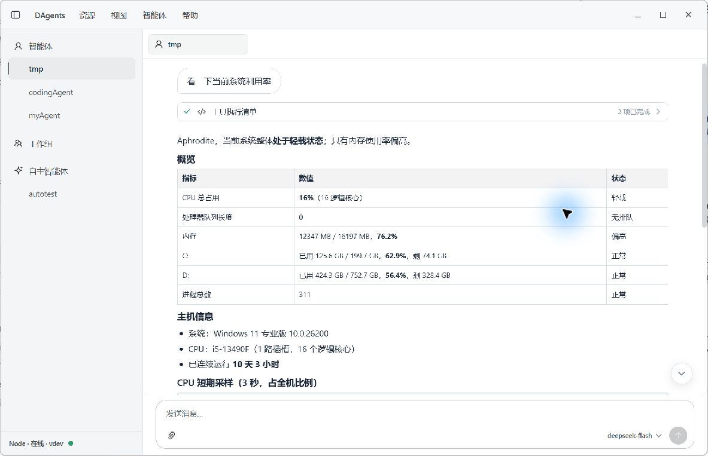
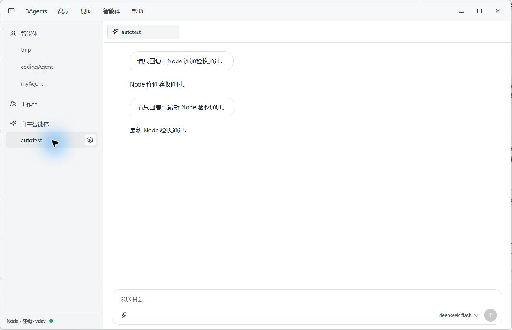
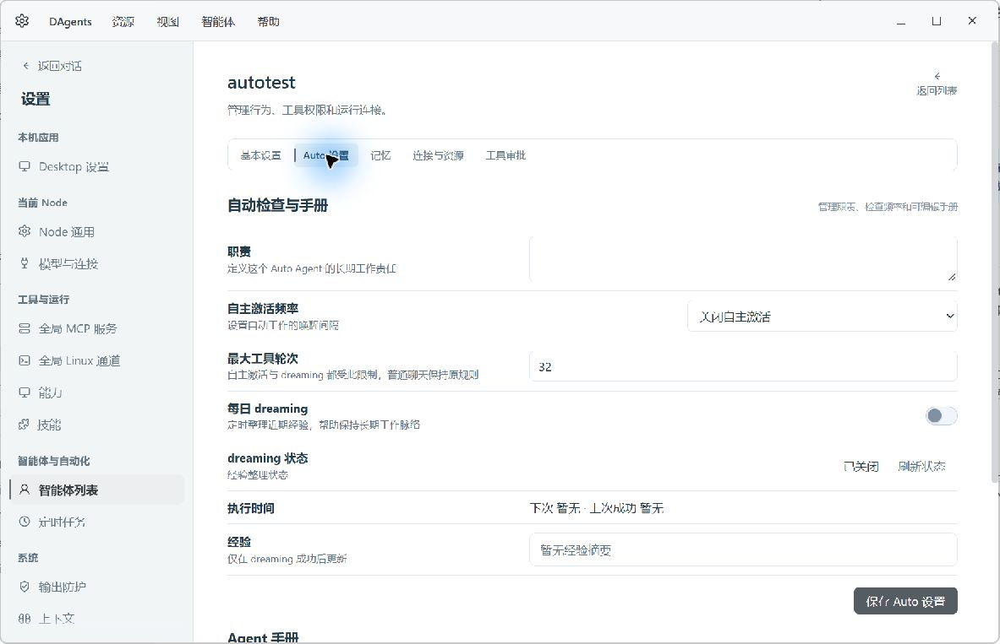
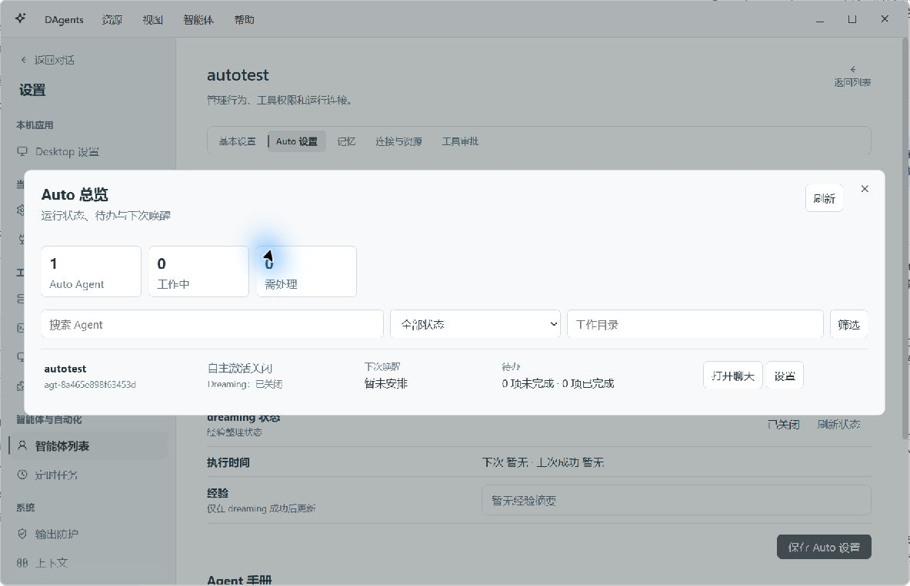
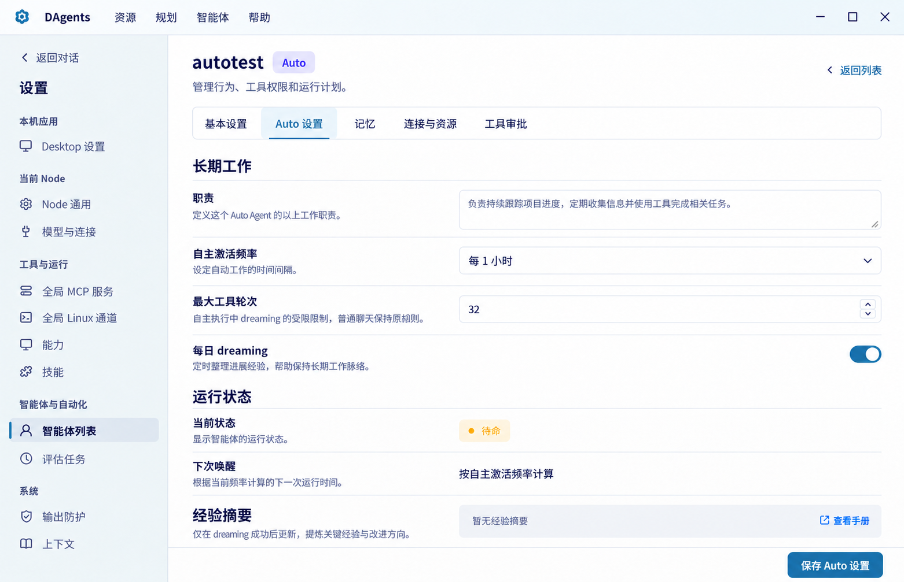
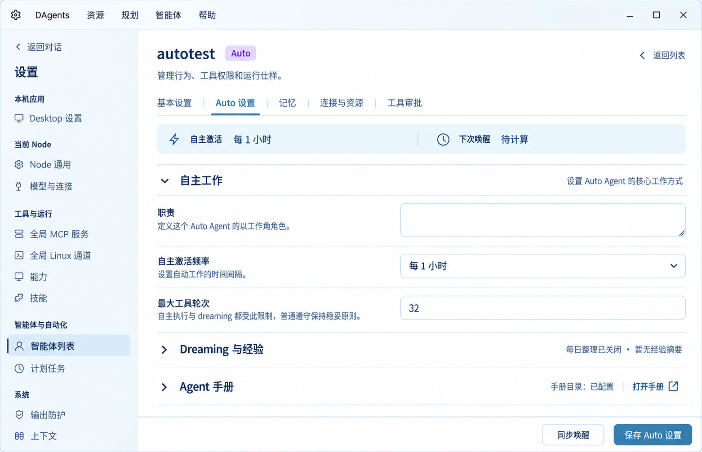
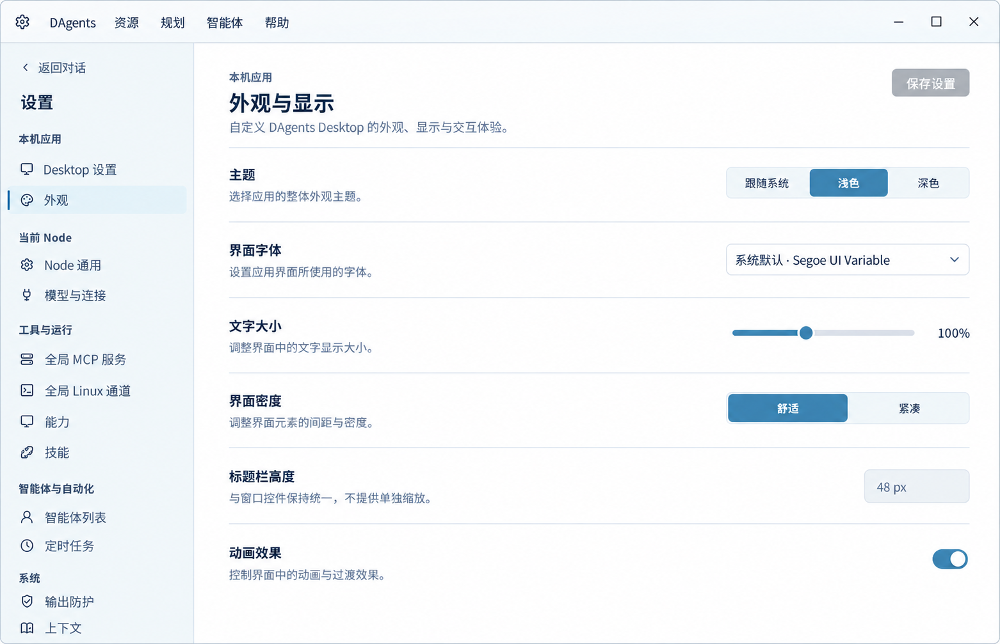
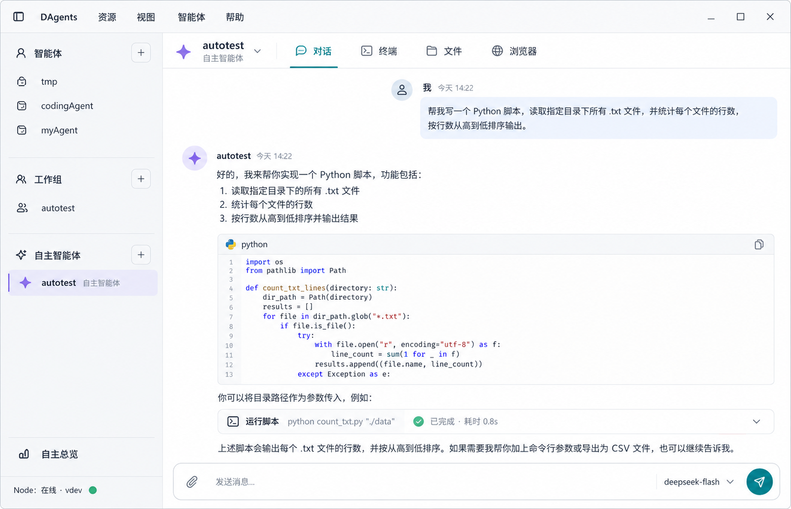
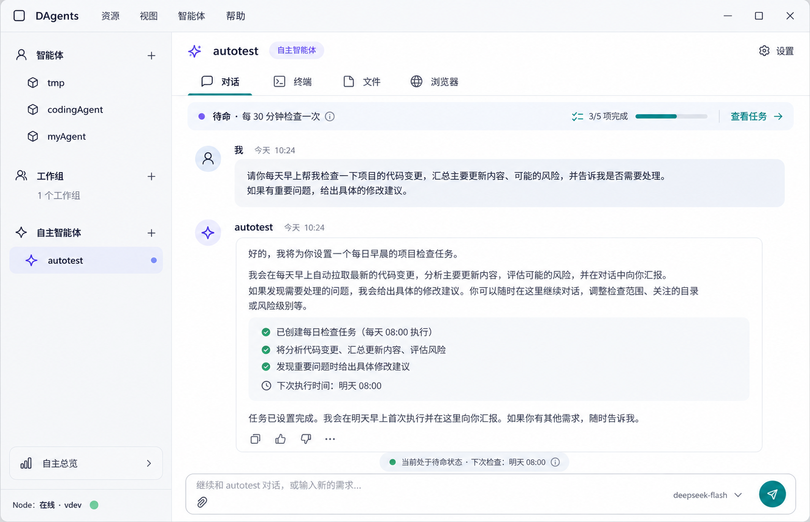
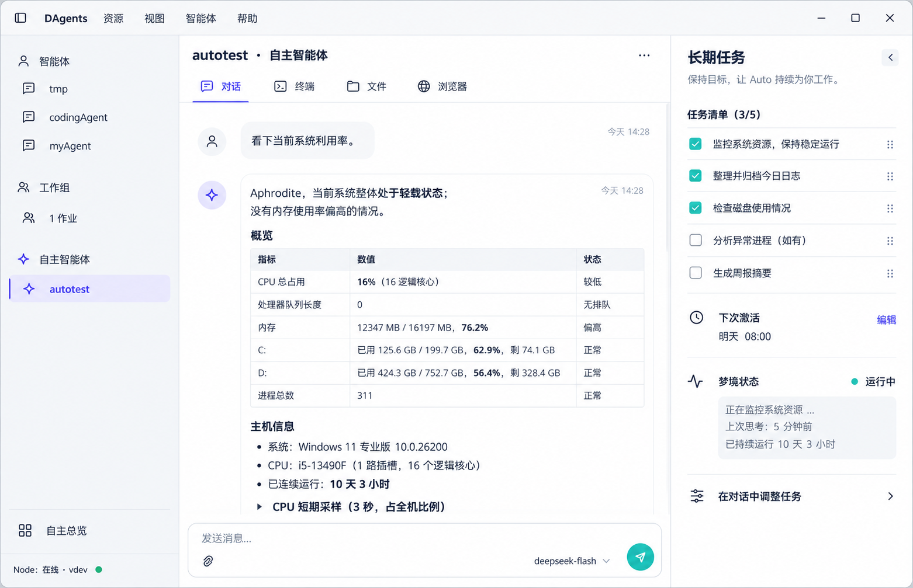

# DAgents Desktop UI/UX 审计

审计日期：2026-10-26
审计对象：DAgents Desktop 主聊天、Auto Agent 对话、Desktop 设置、Auto 设置与 Auto 总览
实际窗口：1183 × 763，浅色主题，本机 Node 在线（vdev）

## 审计步骤与界面证据

1. **普通 Agent 聊天与长回复**：核心对话可读，工具执行信息能够折叠；文件、终端和浏览器入口在初始视图中不够明显。整体健康度：**可用，导航待改进**。

   

2. **Auto Agent 对话**：Auto 与普通 Agent 共用同一聊天工作区，符合“空闲时也可对话”的设定；对话页只通过侧栏分组和小型雪花/星光图标提示 Auto 类型，唤醒频率、下次执行和待办进度没有持续显示。整体健康度：**交互成立，自治状态不够可见**。

   

3. **Auto 设置**：职责、频率、工具轮次和 dreaming 采用一项一行，标签与控件对齐，基础表单结构清楚；运行状态、执行时间、经验与可编辑设置仍沿用近似的行样式，手册紧接在设置后面，页面纵向较长。整体健康度：**字段易扫描，内容层级可再拆分**。

   

4. **Auto 总览**：从顶部“智能体”菜单进入。总览以宽模态展示计数、筛选和 Agent 行，信息齐全，但入口隐蔽，且“需处理”的事项没有成为列表的第一视觉焦点。整体健康度：**功能齐全，发现性与任务优先级不足**。

   

## 整体判断

当前 Desktop 的视觉基调克制，聊天区和固定输入框已经足够承载真实工作；侧栏的“智能体 / 工作组 / 自主智能体”三组也容易理解。主要问题在信息架构：聊天、资源、设置和 Auto 管理分布在侧栏、顶部菜单、内容标签与设置页多个入口中；Auto 的长期工作状态又主要留在配置页和总览弹窗，回到聊天时缺少工作脉络。产品因此更像功能完整的工作台，还没有把“数字员工”体验贯穿到日常对话中。

## 主要问题与建议

### P1：资源切换藏在全局菜单，聊天页缺少清晰的工作区导航

初始聊天标签只显示当前 Agent；终端、文件、浏览器只有在打开后才以资源标签出现，主要入口是顶部“资源”菜单。用户需要先猜菜单归属，再在顶部标签里切换资源。建议在 Agent 页头提供稳定的“对话 / 终端 / 文件 / 浏览器”切换条；全局菜单继续保留命令和少用动作。侧栏仍保留三组，不增加搜索框。

### P1：Auto 身份和工作状态没有进入聊天上下文

侧栏能看到 Auto 分组，但选中后页头没有明确的“自主智能体”文字，唤醒间隔、下一次唤醒、待办状态也不可见。用户无法快速判断它是在待命、执行还是需要处理。建议在 Agent 标题旁明确显示类型，并在对话页增加一条低干扰状态胶囊，展示当前状态、下一次检查和待办进度；聊天继续使用同一个会话，用户仍可直接通过对话调整任务。

### P1：Auto 总览入口仍藏在顶部菜单

当前侧栏底部只显示 Node 连接状态；“自主智能体总览”放在顶部“智能体”菜单的管理区。此前确定的常驻悬浮入口没有体现在当前界面中。建议在侧栏底部、Node 状态上方放置清晰的“自主总览”按钮，继续打开总览，而不是再新增一组顶层导航。

### P2：总览强调筛选和统计多于“下一步要处理什么”

宽模态里的计数、过滤条件和五列 Agent 行平铺展示；当 Auto 数量增加时，用户仍需逐列阅读才能识别异常。建议把需处理的 Auto 排在首位并直接说明原因，其次显示待命/工作中；每行优先呈现名称、运行状态、下一次唤醒和未完成待办，目录和状态筛选收进次级工具区。

### P2：Auto 设置中的“编辑配置”与“观察运行”视觉权重接近

当前一行式设置本身是合适的，也符合快速扫描习惯。建议保留这一结构，把内容明确分为“职责与激活”“Dreaming 与经验”“Agent 手册”三段；保存操作在有修改时固定出现，运行状态明确标为只读。这样用户不必在同一种行样式里判断哪些是输入项、哪些是诊断信息。

### P2：品牌色和 Auto 类型提示被灰色外壳弱化

当前主界面大量使用灰色图标和灰色选中态，Auto 与普通 Agent 的主要区分依赖分组位置。结合原始笑脸雪花 Logo，建议以雪花轮廓的深蓝与浅冰蓝建立品牌色系，柔和紫色仅承担 Auto 类型提示；图标仍使用同一套中性线性风格，状态颜色仅用于成功、等待、告警。Auto 总览组件目前使用独立硬编码颜色，后续应接入统一令牌，避免主题和页面视觉分叉。

## 推荐落地方向

先采用“对话内自治状态”作为默认结构：保留现有三组侧栏与一项一行的设置；把资源切换变成可见标签；在 Auto 聊天页头和输入区上方显示轻量状态；侧栏下方提供常驻“自主总览”。右侧待办面板可以作为可选增强方向，默认收起，避免普通聊天被长期任务信息挤压。

## 补充：设置页、标题栏与字体一致性

我补看了 Desktop 设置和 Auto 设置两个页面。两者已经共享“左侧标签与说明、右侧控件、行间分隔”的基本表单语法；Auto 设置行布局也在组件中统一定义为左右两列，当前结构值得保留。Desktop 设置页条目较少，留白舒适；Auto 设置页因为职责、激活频率、工具轮次、Dreaming 状态、执行时间、经验与手册连续堆叠，页面长度增加，而且编辑项和运行观察项的视觉权重接近。建议继续使用一项一行，但将其整理成“自主工作 / Dreaming 与经验 / Agent 手册”三个区块；运行状态使用只读状态行或简洁摘要，不与可编辑输入项混排。保存按钮固定在内容底部，仅在有未保存修改时突出。

标题栏高度是 48px，启动页与工作区使用同一尺寸；菜单文字为 13px，窗口控件命中区为 38×32px，整体尺寸在当前 1183×763 窗口中协调，顶部菜单、左侧导航和右侧系统窗口按钮的垂直对齐也基本稳定。当前标题栏的视觉基调与浅色内容区一致，浅灰底、细分隔线和中性图标没有明显冲突。需要补齐的是状态与品牌层级：工作区标题和连接状态在样式中被隐藏，标题栏中间因此留出较大空白；同时 Desktop 主界面把主题令牌中的青蓝品牌色覆盖为灰色，Auto 色也被覆盖为灰色。建议保留 48px 标题栏和当前按钮尺寸，在菜单后方为当前 Agent / 工作区留出轻量上下文，并让雪花蓝承担主操作与选中状态，Auto 类型用低饱和紫色识别。

字体家族目前在 Desktop 外壳和共享 Workbench 样式中都有重复定义。外壳使用 Segoe UI Variable、Segoe UI、PingFang SC、Microsoft YaHei；共享令牌还包含 Apple 与 Noto Sans 回退项，外壳又通过覆盖变量把界面拉回自己的字体栈。实际页面仍能保持相近字形，但重复的回退顺序会让不同平台和嵌入页面出现细微差异。建议收敛为一个全局 UI 字体令牌，并按 Windows 优先顺序加入 Microsoft YaHei UI / Microsoft YaHei，再保留 macOS、Linux 回退。字号也建议统一到 12 / 13 / 14 / 16 / 20px 五级：12px 用说明文字，13px 用导航与次级操作，14px 用正文和表单标签，16px 用区块标题，20px 用页面标题；10–11px 仅用于时间戳等低频元数据。当前 CSS 中同时散布 10、11、12、12.5、13、13.5、17、19、20px 等多种值，阅读层级总体成立，但缺少可持续维护的明确刻度。

Desktop 设置页当前实际有“通知”和“更新”配置，未提供独立外观选项。下面的“外观与显示”图仅作为视觉方向稿，展示如何让主题、字体、字号、密度与标题栏规格也遵守同一行式布局；图中尚未实现的选项不代表现有产品能力。

### 雪花品牌配色修订

原始 Logo 是白色笑脸雪花，以深蓝轮廓和浅冰蓝细节形成识别度，整体气质友好、清爽。它更适合作为品牌图像保留在程序图标、托盘和启动场景中；界面无需把雪花轮廓扩展成按钮，也不需要铺雪花纹理或把所有图标染成蓝色。现代线性图标与像素风 Logo 可以并存，关键是用同一组冷蓝色、圆润控件与克制留白连接它们。

| 颜色角色 | 建议色值 | 使用位置 |
| --- | --- | --- |
| 雪白底色 | `#F7FAFC` | 主画布与大面积页面背景 |
| 冰雾蓝 | `#EAF3F8` | 选中行、轻提示与悬停底色 |
| 雪花蓝 | `#36799E` | 主按钮、链接、焦点和选中状态 |
| 按压蓝 | `#2F6388` | 按下态与更强的交互反馈 |
| 深蓝灰 | `#253C50` | 正文、标题与图标默认色 |
| 冷灰蓝边线 | `#D8E3EC` | 分隔线、输入框与容器边界 |
| Auto 柔紫 | `#7869DB` | Auto 类型标签和相关状态提示 |

主按钮和开关使用浅一档的雪花蓝 `#36799E`，按压态用 `#2F6388` 加深。标题栏可以采用几乎察觉不到的雪白到冰蓝渐变（`#FBFDFE` → `#EEF5F9`），选中项使用纯冰雾蓝底色；渐变只出现在标题栏，不延伸到整页和每个控件。青绿色 `#1598B7` 可作为次级强调色保留在少量数据可视化或品牌细节中，避免它与雪花蓝同时争夺主操作层级。成功、等待、警告和错误继续使用语义色。整体保持简洁的 Windows 桌面基调，不增加装饰性冰晶、雪花纹样或额外渐变。

### 设置原型一：分离配置与运行状态

职责、激活频率、工具轮次和 Dreaming 开关沿用一项一行；运行状态、执行时间与经验摘要移到单独区域，降低配置与诊断信息混淆。

### 设置原型二：分组折叠长页面

自主工作区默认展开，Dreaming 与经验、Agent 手册可折叠查看。适合字段较多、希望减少滚动的情况；应保留清楚的区块摘要，避免折叠后隐藏重要的失败状态。

### 设置原型三：统一外观设置行

以现有 Desktop 设置页为基础，展示主题、字体、文字大小、密度、标题栏规格和动画等配置共用的行高、控件尺寸与字号规则，并以雪花蓝、雪白和冰雾蓝表达品牌。外观选项属于探索内容，可根据产品是否计划开放主题/密度设置再决定是否落地。

### 原型方向一：清晰会话轨道

侧栏分组、资源标签与会话保持同一条导航轴，Auto 通过轻量类型提示和常驻总览入口识别。

### 原型方向二：对话内的自治状态

把唤醒频率、待办进度和调整任务入口放在对话页头的单行状态条里，不另开任务会话。

### 原型方向三：可收起的任务侧栏

在 Auto 对话旁提供可折叠待办与唤醒信息，适用于需要频繁检查长期任务进度的用户；桌面空间不足时应默认收起。

## 证据边界

本次对实际运行界面做了截图检查，并核对了 Desktop 的 Vue 模板与样式实现。截图来自 v1.0.0 的运行窗口；侧栏、设置与总览相关实现和当前 `origin/dev` 的 Desktop UI 文件一致。此次没有进行键盘全流程、屏幕阅读器或自动化对比度测量，因此不将视觉观察表述为 WCAG 合规结论。设置页的小字与焦点可见性仍建议在实现后做键盘和对比度专项检查。

相关实现：

- [desktop-ui.css：48px 标题栏、菜单和窗口控件](</D:/workspace/worktrees/main-to-dev-sync/desktop/tray-tauri/src/ui/desktop-ui.css:196>)
- [desktop-ui.css：Desktop 主界面覆盖品牌色与 Auto 色](</D:/workspace/worktrees/main-to-dev-sync/desktop/tray-tauri/src/ui/desktop-ui.css:985>)
- [SimplifiedAutoPanel.vue：Auto 配置行与左右列布局](</D:/workspace/worktrees/main-to-dev-sync/desktop/tray-tauri/src/ui/components/SimplifiedAutoPanel.vue:46>)
- [tokens.css：共享色彩、字体与字号令牌](</D:/workspace/worktrees/main-to-dev-sync/desktop/tray-tauri/src/ui/styles/tokens.css:1>)
- [DesktopApp.vue：侧栏分组与资源工作区](</D:/workspace/worktrees/main-to-dev-sync/desktop/tray-tauri/src/ui/DesktopApp.vue:1939>)
- [workbench-state.js：Auto 总览位于智能体菜单](</D:/workspace/worktrees/main-to-dev-sync/desktop/tray-tauri/src/ui/workbench-state.js:237>)
- [AutoOverviewPanel.vue：统计、筛选与 Agent 行](</D:/workspace/worktrees/main-to-dev-sync/desktop/tray-tauri/src/ui/components/AutoOverviewPanel.vue:28>)
