# Desktop / Node 会话消息链路改造方案

2026-11-25 流式快照协议清理：生产端仅发布 `conversation_delta`，但 Hub 草稿快照投影仍兼容旧 `assistant` / `reasoning` 事件名，且测试继续用旧可重放事件模拟增量文本。现已移除该旧投影分支，将快照生命周期测试改为真实 ephemeral delta，并增加旧事件不会进入 assistant 草稿快照的回归；`go test ./internal/stream -count=1` 通过。通用事件 Hub 仍可按原契约分发 `assistant` 事件，这次只移除其对新草稿快照协议的过时兼容。

2026-11-25 Windows PowerShell 启动器报错复核：用户粘贴的报错仍显示 `Start-Process -Environment`，而当前隔离启动器 `start-full-typewriter-acceptance.ps1` 已使用进程环境继承、不含该参数，SHA-256 `FCE5A7F36EA9A93C0C050BBC66520F2237436703A1F2D1C76D0E37E5408C0B51`，Windows PowerShell AST 语法检查通过。当前有两套隔离 Desktop 已运行，启动器会因多个现存窗口拒绝重复启动；本轮没有再次启动或关闭它们。

2026-11-25 最新源码 Node + Native Desktop 流式验收：最新 Node 源码 PID 10260（18772）连接独立 Native Desktop PID 24464，候选 SHA-256 `ECBF4B7742381543412AAAEC8E696985E37257E5360148D5630EB5D2AF2B6851`。使用隔离 Agent 与临时本机 SSE 假模型（20 段、每段间隔 250ms）：发送后原生窗口首帧已显示 assistant 的部分文本和“正在生成回复”，后续帧显示完整 20 段；最终 turn completed、队列 0、transcript synchronized=true。测试后将模型 endpoint 恢复到该隔离环境原有 `127.0.0.1:18769/v1`，停止临时服务并 reload Agent；Node 与旧 Node PID 43600 上的 P1c 待人工审批状态相互隔离，未触碰 P1c。首帧与后续截图证明原生窗口能增量展示并收敛最终文本，但不构成逐帧字符速率基准。用户报告的 `Start-Process -Environment` 错误栈指向的旧行号与当前启动脚本不符；当前文件使用进程级环境变量继承且不含该参数，已用 Windows PowerShell 5.1 本体解析通过。当前 Native Desktop 保持打开用于查看验收结果。

2026-11-25 当前工作树全量门禁复核：README 范围 Go 全量 `go test ./shared/config/... ./shared/logfiles/... ./shared/update/... ./node/... ./client/... -count=1` 与同范围 `go vet` 通过。Desktop Vitest 首轮因 DOCX preview 单测 5 秒门限超时为 819/820；该用例独立复跑 1.84 秒通过，随后串行复跑全量 Vitest 104 文件 / 820 项通过；UI 合同 128 项、共享图标 7 项、ESLint 通过。Tauri `cargo test --lib` 85 项与 `cargo fmt --check` 通过；Vite production build 成功，只有既有混合动态 / 静态导入及大 chunk 警告；`git diff --check` 通过，仅提示未改动 CentOS 脚本的 CRLF 转换。该门禁确认当前代码树自动化与构建状态，不替代 P1c 未完成的原生混合审批操作或其它压力矩阵。

2026-11-25 并发敏感 Go race 复核：最新工作树对 `node/internal/session`、`turn`、`queue`、`llm` 执行 `go test -race ... -count=1` 全部通过；session 123.2s、turn 38.7s、queue 2.9s、llm 3.7s。该结果补充竞态检测证据，不覆盖长时多 Agent 的原生 DOM / 资源曲线。

2026-11-25 高历史 / 高工具存储路径复测：最新工作树的 `BenchmarkLoadConversationMainWindowHighToolVolume`（100 轮 × 每轮 1,000 次工具调用，固定读取最近 5 轮）以 `-benchtime=5x -benchmem` 复测为 30.63 ms/op、4.37 MB/op、35,182 allocs/op；每次读取 5,000 个调用摘要和 250 个结果正文。`TestConversationMainWindowReadHonorsContextWhileConnectionIsBusy` 连续 5 次通过，验证 SQLite 唯一连接被占用时的历史窗口查询会按请求 context deadline 取消。该证据只覆盖最新代码的 SQLite 存储窗口读取与取消边界，不覆盖 HTTP JSON 编码、Rust IPC、WebView DOM / Markdown / layout，也不等于活跃 1,000 工具轮次下端到端 hydrate 尾延迟。

2026-11-25 消息 API OpenAPI 字段细化：为用户多模态内容、文件引用 / 锚点及 TurnState 工具执行视图增加可复用的字段 schema，并将消息提交、排队消息、重发输入、Hydrate transcript / pending inputs 中对应的泛型对象引用替换为这些 schema；`check_contracts.py` 现在也会解析并检查 OpenAPI 内部 `$ref` 是否都可达。`py -3.13 scripts/ci/check_contracts.py` 与 `py -3.13 scripts/ci/sync_openapi_routes.py --check` 通过；这只细化了本次消息链路直接使用的数据类型，HITL 多态对象、transcript.data 与 Node 其余设置类响应仍保留有意开放的结构，尚未构成全 API schema 的字段级闭环。

2026-11-25 legacy 消息状态项清理：复查发现 Node hydrate 仍计算并返回 `tool_jobs.running`，但 Desktop / Manage / SDK 生产代码没有读取者；它与已移除的 Desktop `toolJobs` store 无关这一历史判断，不足以证明 API 字段仍有价值。现已从 Hydrate response 与 OpenAPI 移除该重复工具计数投影，同时保留 shell 控制 API 内部需要的 `SessionToolJobCounts`，不影响停止 / 回收机制。Hydrate API 回归明确断言不再出现 `tool_jobs`；Node `internal/api` 全包测试（66.645s）与 `go vet ./internal/api`、OpenAPI contract、route sync 均通过。`legacy-items` 仍由历史页真实读取，继续保留。

2026-11-25 最新源码 Node 独立组合验收：从当前工作树构建 Node（SHA-256 `CA4BB8ECE01CCF7D342B1E3159917BED6124FA327A148CE17FE6ACCD299DC5AD`），在独立 home / 18772 端口运行，配置仅指向本机假模型 `18769/v1`。3 个无工具私有 Agent 完成同 Agent 5 条并发排队输入及 60 波三 Agent 并发（共 185 条消息）；5 条队列输入按 `input_seq` 与 transcript 顺序一致，每条新输入均找到同轮 assistant，60 波均以空队列、无 HITL、transcript 同步结束，p50 / p95 / 最大每波 498.5 / 604.4 / 645.8 ms。所有临时 Agent 删除。Node 全量 `go test ./... -count=1` 与 `go vet ./...` 通过。此结果覆盖最新 Node 源码的 API / SQLite / fake-provider 运行路径；未覆盖最新源码 Native Desktop 连接和原生渲染。旧 Node PID 43600 上 P1c 两项审批仍保持原状态，最新 Node 在 PID 10260 独立运行；后续可不打断 P1c 地单独启动连接最新 Node 的 Desktop 候选。

2026-11-25 20 Agent 持续并发验收：隔离 Node 上创建 20 个无工具、私有工作区的临时 Agent，以本机假模型并发完成 120 波（2,400 条消息），总耗时 553.3 秒；每波收敛 p50 3,548.3ms / p95 4,178.3ms / 最大 4,456ms。每波校验 user request ID、同轮 assistant、空队列、无 HITL 与 transcript 同步；所有 Agent revision 均增加 120，未发现失败。20 个临时 Agent 已全部删除；P1c 仍保持 `tool_waiting`、原两项审批 ID、队列 0、transcript 同步，未操作审批。此压力样本运行于隔离 Node PID 43600，其二进制早于本轮 Node 源码更改；它验证当前旧二进制在假模型下的多 Agent 持续并发，不是最新 Node 源码的组合验收，也不是单 Agent 交互延迟基线。用户再次遇到 `Start-Process -Environment` 错误；复查当前启动器不含该参数，使用 PowerShell 进程级环境变量供新 Desktop 子进程继承，解析无错误。用户所运行的内容与当前工作区脚本不一致；最新 Native Desktop PID 45672 已运行，无需重复启动。

2026-11-25 Native 1,000 工具轮次与 hydrate 队列检查：隔离 P2 History QA Agent 完成 1,000 次只读工具调用，用时 312.3 秒；1,000 个结果全部成功，tool_call_id / purpose 均唯一且序号连续，工具详情接口 20 页完整读取。Desktop 主视图按设计仅装载 50 项摘要，另标记 950 项可按需查看；原生窗口截图 `.runtime-test-real-ux/current-node/native-perf-20261119/native-tool-group-1000-summary.png` 目视无重叠，当前流容器距离底部 0.33px、页面约 380 个 DOM 节点。一次执行中 hydrate 请求分别在客户端等待 5 秒与 30 秒后超时；轮次终结后，同一窗口 API 在 387ms 返回。这是高写入期间的时延观察，不能单独证明唯一根因。代码检查确认 Node SQLiteStore 将连接池限制为 1 条连接，且 hydrate 使用 `context.Background()` 进行持久化查询；客户端断开后，等待连接的 hydrate 可能仍留在 SQL 队列中，与工具事件 / 结果写入竞争。现在 HTTP handler 将 request context 传入 hydrate 与 SQLite 查询，保留原 `GetHydrateView` 作为内部兼容包装，并新增“唯一 DB 连接被占用时 hydrate 查询按请求截止时间取消”的回归测试。Node `go test ./... -count=1`、`go vet ./...` 与相关 store/session/API race 子集全部通过。该修正避免取消请求继续排队；尚未再次对 1,000 工具活跃轮次测端到端 hydrate 尾延迟，不能据此宣称原超时根因已经完全闭环。修复尚未装入当前运行中的隔离 Node PID 43600；因 P1c 混合审批仍待人工操作，本轮没有重启它。

2026-11-25 启动命令错误复核：用户执行时看到的 `Start-Process -Environment` 参数错误属于修复前脚本版本。当前隔离脚本已改为进程级环境变量继承，文件中无 `-Environment` 参数；用 Windows PowerShell 5.1 再执行同一路径退出码 0，幂等复用隔离 Node PID 43600、Desktop PID 39764、fake LLM PID 26768，候选 SHA 与 CDP 18888 校验通过，未创建重复窗口。现有窗口无需重新启动。

2026-11-25 Native 主聊天 1,000 工具详情展开：先前展开脚本误选了隐藏的历史预览容器；改为限定当前可见 `.chat__stream` 后，在 P2 History QA 主聊天中将同一工具组从首屏 50 项分页扩展到 1,000 项，19 页共 2.14s，逐页等待 76–141ms。原生截图 `.runtime-test-real-ux/current-node/native-perf-20261119/native-tool-group-1000-expanded.png` 可见 purpose、状态与行图标对齐，无重叠；总 DOM 约 9,369 节点，工具组高约 34,710px，最大 long task 95ms；跟随状态距底部 0px。随后将主聊天及隐藏历史预览的工具组全部收起，回到 368 个 DOM 节点、0 个工具子行和约 0.33px 底部间隙。P1c Agent / 审批 ID 均未操作。此结果证明 1,000 条详情分页及原生布局可完成，不证明 10,000 级消息历史滚动、图片异步增高或并发 hydrate 的尾延迟。

2026-11-25 最新源码 Native 1,000 项工具组复验：独立构建 Desktop 候选 SHA-256 `861E5D91C225A2377A6528F3763186C8C6A822996A254468740A0DCB4F694141`（Vite + Tauri release build 通过）并启动为 PID 45672，隔离 Node PID 43600 未重启。UIA 从首屏 50 项继续分页，按视口位置选择目标组，加载余下 950 项；原生窗口中确认 1,000 个 `Read fixture #NNNN` purpose 控件，末尾行、状态列与展开图标对齐，截图 `.runtime-test-real-ux/current-node/native-final-20261125/native-final-1000-details-visible.png` 无重叠。折叠后重新计数为 0 个 purpose 子行，摘要显示 1,000 项已完成。Native 最新二进制的 1,000 行布局与展开 / 收起路径通过；本次未启用 CDP，因此不报告 DOM 数、long task 或完整分页用时。P1c 两项审批在整个过程保持待处理且未操作。

2026-11-25 工具状态展示收敛：`buildStream` 将 transcript 结果、HITL 队列与 coordinator 执行态投影为单一 `phase`；coordinator call 状态先按 tool_call_id 建索引，工具组对每个 step 只归一化一次 phase，再复用来计算状态计数、当前标题与子行状态。`ToolSummaryRow` / `ToolGroupRow` 不再收到 `executionHint` 与 `lifecycleStatus` 两套字段；移除确认无生产调用点的 `toolStepIsInProgress`、`toolStepIsPending`、`toolStepIsActiveInGroup` 三个 helper。保留集中式 `resolveToolStepPhase` 负责来源归一化与独立行兜底，失败 / 取消 / 拒绝 / 后台语义不变。定向 Vitest 4 文件 / 70 项、完整 Desktop Vitest 104 文件 / 820 项、UI 合同 128 项、共享图标 7 项、全量 ESLint 与 Vite production build 均通过；构建仍有既有动态导入 / 大 chunk 提示及 `form` 的 Vue v-model 编译提示。Node 尚未改成单个展示 phase 字段，因此 R06 / R10 仅完成 Desktop 投影收敛。

2026-11-25 平滑流式复验纠错：当前隔离 Node 的 `default` profile 实际指向 `127.0.0.1:18769/v1` 的 mixed-approval fake LLM；平滑流式 fake LLM 在 `18767`，两者不匹配。本轮原生发送实际命中前者并返回固定验收文本，不计作打字机测试通过。未切换全局 profile 或重启 Node，避免影响仍待人工处理的 P1c HITL；此前 11 月 24 日针对独立 profile 的有效原生流式实测仍以对应记录为准。启动器兼容修复已由 Windows PowerShell 5.1 解析并幂等复用现有进程，当前复验结果不能替代独立 profile 的完整节奏测量。

2026-11-25 Windows PowerShell 5.1 启动复验：用户再次得到 Start-Process -Environment 参数错误，但错误栈指向的旧行号与当前 .runtime-test-real-ux/current-node/native-perf-20261119/start-full-typewriter-acceptance.ps1 不符；当前脚本不含该参数。使用 Windows PowerShell 5.1 本体对当前脚本执行，退出码 0，幂等复用 Desktop PID 39764、Node PID 43600、fake LLM PID 26768；候选 SHA-256 AE0F8D88902EE4C64E3280BFAC02A919FA8ABD4869AF1AF408922935C949F8FF、CDP 127.0.0.1:18888 均校验通过，未创建重复窗口。故本次报错来自过期脚本副本/旧内容；当前本地候选可用，用户无需再次运行启动器。

2026-11-25 当前工作树门禁复验：Node 全模块 go test ./... -count=1、go vet ./... 通过，session / turn / queue / llm race 测试通过；Desktop Vitest 104 文件 / 820 项、共享图标 7/7、UI 合同 128 项、ESLint 通过；Tauri 85 项与 cargo fmt --check 通过；Vite production build 成功（保留既有动态导入与 chunk size 警告）；OpenAPI contract 与 route sync 检查通过。高负载同进程基准复跑：1,000 对 tool call/result 投影 p95 1.66 ms；最近 5 轮 × 每轮 1,000 调用 / 250 结果，5,255 原始项 → 10 个展示项，p95 4.01 ms；Node 最近窗口读取 5,000 个调用摘要 / 250 个结果在三次样本中为 25.6–27.8 ms/op、约 4.37 MB/op。上述均不含原生 DOM/layout。进一步准备单轮 1,000 次只读工具调用的 Native 压力脚本并通过 Node / PowerShell 5.1 语法检查；自动审批审查拒绝启动本地假模型进程（blocked by policy），故未发起该轮。状态复核确认目标 QA Agent 空闲同步、临时 profile / fixture / 18775 listener 均不存在，默认 profile 未改；P1c 原审批 ID 与两项工具调用保持原样。

2026-11-25 Native 200 工具组复核：在当前隔离 Desktop 重新读取 P2 History QA 的 batch 6，工具详情 API 分 4 页返回 200/200 succeeded；调用 ID 唯一，purpose 序号 001–200 连续。展开该组并逐页加载全部记录后，原生 WebView 中有 200 个 .tool-summary-row、约 3,053 个 DOM 元素，scroll gap 为 0.67px；收起时回到约 1,254 个 DOM 元素。截图 .runtime-test-real-ux/current-node/native-perf-20261119/native-tool-group-200-items.png 已重取并目视确认：工具名 / purpose / 状态列结构稳定，无布局溢出；长测试 purpose 被省略号截断，因此新建的 1,000 项测试夹具将使用短且递增的 Read fixture #0001…#1000 标签。此为 200 项展开状态的原生窗口实测，不替代尚未启动的 1,000 项原生压力测试。

2026-11-25 race 补验：Node store 包完整 go test -race 通过；整个 internal/api race 命令被与消息链路无关的 TestScreenAPI_Status 触发第三方 kbinani/screenshot Windows callback checkptr panic 中断（不是 race detector 数据竞争报告）。将消息相关路由单独筛选后，ConversationHistory、ConversationResubmit、PostMessage / queued edit-delete / StopTurn、AgentWatermarks 等 API race 用例通过。该结果证明所选消息链路 API race 子集通过，不声称整个 API 包 race 通过。结束后 Native 200 工具组已收起，CDP 确认所有组 expanded=false、工具子行 0、scroll gap 0；Node 配置和 P1c 审批未改变。

2026-11-25 Native 高工具量端到端验收（修正夹具后）：隔离 P2 History API QA 20261124 在 38.55 秒内完成 200 次 read_file，按调用 ID 顺序查询工具详情 API 的 4 页记录，200 个 call / result 均为 succeeded、ID 唯一且 purpose 顺序连续；终态为 completed、无活动轮次 / 排队 / HITL、transcript synchronized=true。Native Desktop 展示 50 项摘要 + “剩余 150 项”按需加载；将最新组从 50 逐页扩到 200 时 DOM 为 3,055 个元素，滚动间隙 0.33px；收起后降为 1,254 个元素、0 个工具子行。截图保存在 .runtime-test-real-ux/current-node/native-perf-20261119/native-tool-group-200-items.png。Node 进入终态后 UI 短暂显示“正在同步结果”，约 3 秒内 assistant 正文到达且状态清空。Agent 设置、全局 profile、工作区 fixture 均恢复；临时假模型已停止，P1c 两项审批仍待用户操作且未触碰。初次 batch 3/5 运行被测试夹具端口与过度 hydrate 轮询影响，并在 active 时由 finally 提前恢复模型配置而取消；这些批次不计为产品失败或通过。本次安全 Runner 等待假模型最终请求后再 hydrate，因此证据不覆盖 200 工具执行期间并发 hydrate 的时延，也不代替长时间多 Agent / 高延迟 provider / 大媒体压力验收。

2026-11-24 三 Agent 持续背景并发验收：预检确认隔离 Node 健康、默认模型端点为本机假服务 `127.0.0.1:18769/v1`、Auto 激活间隔为 0、Dreaming 关闭且无启用 trigger。排除仍待人工操作的 P1c Agent `agt-7a7ea4872a8060af`，对普通历史 QA、Auto QA、队列 QA 三个空闲 Agent 并发发送 120 波（共 360 条消息），每波都校验 POST 回执、对应 user request ID、同轮 assistant、终态空闲、队列为 0、无 HITL、transcript 同步。耗时 182.7 秒，三 Agent 每波完成耗时 p50 501.7 ms / p95 623.4 ms，0 失败；每个 Agent conversation revision 各增加 120。结束后四个 Agent 均重新 hydrate 核对，P1c 仍是原有活动审批、未改动。此样本补齐约 3 分钟的 Node API / 持久化 / 多 Agent 同步负载证据。Native Desktop 在负载期间保持运行；结束后通过 CDP 只读核对主消息视图展示最后 5 轮 / 10 个 `.msg__bubble`（最新为 wave 120），`chat__stream` 的 scrollTop 为 53.3px、最大滚动距离约 54px，页面共 1,230 个 DOM 元素，说明末轮消息已到达且视图贴近底部。该 CDP 数据是单次末态检查，不能证明全程逐波 DOM 无卡顿或 RSS 稳定；真实供应商高延迟、持续资源曲线和高工具量原生布局仍未闭环。
2026-11-24 PowerShell 启动器错误复核：用户再次粘贴的 `Start-Process -Environment` 报错来自旧脚本内容；当前启动器已用 PowerShell 5.1 支持的进程级环境变量继承，并成功执行。复核时发现隔离 Node 里还有其他 QA Agent，旧脚本的“Agent 集合必须完全相等”检查过严；改为确认本轮目标 Agent 存在，再逐个验证其空闲与同步状态。启动器现幂等复用 Desktop PID 39764、Node PID 43600、fake LLM PID 26768，候选 SHA-256 `AE0F8D88902EE4C64E3280BFAC02A919FA8ABD4869AF1AF408922935C949F8FF` 和 WebView CDP 18888 均校验通过，没有新开重复窗口。Native 界面仍停在 P1c 混合审批卡，两个条目均未选择；本次只读检查，未操作审批。整体目标仍有 P1c 用户操作及计划中 P2/P3 压力验收未关闭。

2026-11-24 三 Agent 持续并发复验：隔离 Node 的普通历史 QA、Auto QA、队列 QA 三个空闲 Agent 使用本地假模型完成 60 波并发输入（180 条用户消息）；总耗时约 25 秒，每波从并发入队到三份 transcript 同步完成约 370–513 ms（p50 403 ms、p95 482 ms）。逐波检查接受结果与三份 hydrate，末尾 5 轮均与输入顺序一致，队列归零、transcript synchronized=true、没有意外 HITL；原生 Desktop 可见 History QA 的 wave 56–60 用户/助手消息按序到达，最新内容贴近输入栏，视觉检查正常。该假模型对每次完成都立即返回固定短回复，因此这是有持续并发的 HTTP→Node→原生 UI 样本，不是高延迟供应商 soak，也不覆盖 1,000 工具调用 DOM / 大媒体租约。P1c 混合审批 Agent 被排除在负载之外，状态未改变。

2026-11-24 Node→原生 Desktop 分段流式复验：临时新增本地 QA 档案指向已运行的平滑假模型 `127.0.0.1:18767`（20 段，每 250ms 一段），只绑定空闲的 History QA Agent；全局默认保持 `default`，P1c Agent 未修改。真实 `/v1/messages` 提交后，在 1.2 秒时取得原生窗口截图，assistant 正文仅增长到前几段及下一段开头；终态 hydrate 显示 291 字完整正文、含第 20 段，轮次 completed、队列 0、transcript 同步。随后先将 History QA 的 `defaults.llm.active` 恢复为 `default`，再从 Node 设置移除临时 profile；复核全局仅剩 default profile、Agent endpoint 恢复 `18769`、测试会话静止且同步。该实测证明流式增量由 Node HTTP 到原生 WebView 可逐步呈现并最终正确收敛；单张中途截图不能测出逐字动画的精确节奏或跨真实供应商的 token 间隔。P2 高工具量 HTTP→WebView、P3 高延迟 provider / 媒体租约与 P1c 人工混合审批仍是未完成项。

2026-11-24 高工具量性能基准复跑：Desktop `npm run bench:message-stream`（5 次预热 / 30 次样本）中，1,000 组 tool call/result（2,000 原始项）投影 p95 0.54 ms；最近 5 轮 × 每轮 1,000 个调用、250 个结果正文的合成窗口 p95 1.54 ms、仅 10 个展示组；10,000 assistant 项 buildStream p95 1.77 ms，10,000 项稳定 hydrate apply p95 11.55 ms、强制投影重建 24.61 ms，300,000 字 Markdown 纯转换 p95 40.46 ms。Node `BenchmarkLoadConversationMainWindowHighToolVolume` 重跑对 100 轮 × 1,000 调用（共 100,000 调用及结果）数据库读取最近 5 轮，3 次样本 12.27 ms/op、4.37 MB/op、35,195 allocs/op，核对加载 5,000 个调用摘要和 250 个结果正文。以上分别是纯 JS 投影 / Markdown 转换和 SQLite 读取基准，不能代替 HTTP→Rust IPC→Vue DOM / WebView layout 的高工具量端到端验收；该 P2 缺口仍开放。

2026-11-24 媒体 URL 数量回归补齐：`mediaUrlRegistry.test.js` 新增 1,000 项租约压力测试，验证超过旧 64 项上限时所有 object URL 仍被 active transcript 保留，刷新复用 URL 不重复加载，只有 owner release 才逐一 revoke。媒体 registry 与 transcript restore 定向 Vitest 为 2 文件 / 14 项通过，ESLint 与 `git diff --check` 通过。该用例验证引用集合规模和回收时机，不等于真实 WebView 同时解码 / 滚动 1,000 张图片；原生高媒体量布局与跨 Agent 图片 URL 寿命仍待测。

2026-11-24 新增租约用例后的 Desktop 全量门禁：默认 worker 并发复跑时 104 文件 / 820 项中，只有 DOCX 预览用例超过既有 5 秒时限（观察 6.2 秒）；该用例单独运行 542ms 通过。未放宽测试超时；单 worker 串行全量 Vitest 104 文件 / 820 项通过，ESLint 与共享图标 7/7 通过。说明该次失败是竞争环境下的测试超时，不是租约回归失败；完整 Native 高工具量和图片寿命仍未覆盖。

2026-11-24 Native 100 轮历史与多 Agent 负载复验：在 `P2 History API QA 20261124` 的原生 Desktop 历史页连续加载更早轮次，完整列表核对为第 1–100 轮、无重复和缺号，选中的第 100 轮正文在分页时保持不变；返回主对话后只显示最近 5 轮，点击“直达底部消息”后滚动入口消失，最新一轮仍为 100。另在隔离假模型 `127.0.0.1:18769` 上对普通 Agent、Auto Agent、队列 QA Agent 做 5 波并发输入（共 15 轮）；每波各 Agent 都按自身输入顺序返回、队列清空且 transcript 同步，主窗口可见 Agent 的 5 条新消息与 5 条回复顺序一致。该轮是低延迟假模型下约 8 秒的多 Agent 并发样本，不代表持续高 CPU / 长延迟 provider soak，也不覆盖高工具量 DOM。P1c 两项审批未触碰；P2 高工具量 HTTP→WebView、P3 长时负载 / 媒体租约仍待验收。

2026-11-24 lifecycle command ID 并发实例隔离：同一会话的 runtime replacement 在构造期间可能短暂与旧实例共存；本地序号各自恢复时若从相同历史值继续，会生成同一个 `session-lifecycle-N`。现在每个 runtime 构造时分配独立 128-bit scope，命令 ID 改为 `session-lifecycle-{scope}-{seq}`；解析器仍按末尾数值恢复旧 / 新格式的序号。新增同 session、相同初始序号的两个 runtime 不再生成相同 ID 回归，并通过旧格式解析断言。session 定向恢复 / fail-closed 测试、Node 进程重启恢复、`go test ./... -count=1`、`go vet ./...` 与 session/turn/store race 测试全通过。此改动消除 runtime 实例间的命令 ID 碰撞路径，但不证明它是用户 2026-11-03 报错的唯一根因；当前可读的 2026-10-30 Node / Agent 日志中均未找到该错误，故原故障仍待同时间段日志复现。隔离 Node PID 43600 未重启到本次代码，避免打断仍待用户操作的 P1c 活跃审批；故该隔离窗口尚未组合验证新的命名空间实现。P1c Native 混合审批仍由用户本人处理，整体目标继续进行。

2026-11-24 Node 活跃工具顺序回归与复验：最终代码审查发现生命周期工具调用可能早于 transcript 结果被观察到；若仅按 batch index 锚定，补入项会被插到已存在的结果之后。现在插入位置同时受 assistant parent、同 batch 调用序和首个同 batch 结果约束；新增反序结果用例，并增加新 Turn 尚无 Step 时不泄漏上一 Turn 工具项的 Coordinator 回归。定向测试、Node `go test ./... -count=1`、`go vet ./...`、`go test -race ./internal/session ./internal/turn ./internal/store -count=1` 均通过；OpenAPI 合同与路由同步检查通过。`git diff --check` 通过，仅提示既有 CentOS 验证脚本 CRLF 转换。启动错误原因仍是 Windows PowerShell 5.1 不支持 `Start-Process -Environment`；当前隔离启动器使用临时进程环境变量供子进程继承，且现有隔离 Node / Desktop 窗口继续保持原状。P1c 审批卡尚待用户手动处理，整体目标仍未完成。

2026-11-24 全量门禁与 P1c 状态复核：在对话 API / OpenAPI 更新后重新运行 Node `go test ./...`，全部包通过；`go vet ./...` 通过；消息链路关键包 `go test -race ./internal/session ./internal/turn ./internal/queue ./internal/llm ./internal/stream ./internal/store -count=1` 全通过；Tauri `cargo test --lib` 85/85 与 `cargo fmt --check` 通过；`check_contracts.py`、`sync_openapi_routes.py --check` 通过。前端最新全量 Vitest 为 104 文件 / 819 项，shared icons 7/7，ESLint 通过；shared/client Go packages 通过全量测试。用户粘贴的 `Start-Process -Environment` 错误对应旧版脚本内容；当前隔离启动器实际使用进程范围环境继承，`Start-Process` 调用不传子进程环境参数，兼容注释也已改写以免混淆，隔离 Node PID 43600 与 Desktop PID 39764 当前仍运行。只读 hydrate 与 Native 窗口 / 无障碍树再次确认 P1c QA Agent 处于活动轮次、队列为空、transcript 已同步；卡片显示 `native-approval-allow.md` 与 `native-approval-deny.md` 两个独立待确认条目、路径和写入长度，两个复选框均未选中，批准按钮因 0 项选中而禁用。批准项必须由用户本人在 Desktop 中操作。其余计划中的高历史 / 高工具全链原生压力、持续多 Agent 背景负载、超大与并发图片租约压力、原 lifecycle command ID 故障的唯一根因仍未关闭，不能因本次全量门禁通过而宣称整项完成。

2026-11-24 Native 脚本兼容复验与 Node 历史量验收：用户执行的旧启动脚本报 `Start-Process -Environment` 不存在；启动器已改为进程环境变量继承，并经 Windows PowerShell 5.1 成功运行，当前隔离候选 SHA-256 与固定值一致。随后在同一隔离 Node 新建临时 Agent，通过真实 `/v1/messages` 连续完成 100 轮假模型对话（12.3s）；hydrate 返回 revision 101、最近窗口仅含第 96–100 轮共 10 条消息、队列为 0 且 transcript 已同步。经 Node HTTP 读取全部 100 个轮次（10 个分页请求）和 200 条消息正文（100 个按轮请求），轮次序号连续无缺；预热后 30 次轮次页读取 p50 1.59ms、p95 12.97ms、单次最大 106.88ms，100 次消息项读取 p50 1.34ms、p95 2.21ms，hydrate 3.16ms。首次采样有一次 106.88ms 冷样本，因此不把它归为稳定尾延迟。另新增 `ConversationHistoryPanel` 100 轮分页回归，加载 10 页后轮次从 1 到 100 无重复，最新选中轮和右侧已加载 transcript 不变；该组件文件 7/7 通过，当前全量前端为 104 文件 / 819 项，shared icons 7/7、ESLint 通过。接口采样覆盖 Node HTTP / SQLite / 窗口 projection，组件测试为 jsdom，不含 Tauri IPC / 原生滚动；Desktop 高历史量原生浏览与滚动压力仍待验收。为了不碰等待人工审批的 P1c 卡片，临时 Agent 暂留隔离环境。P1c 验收将 default profile 临时指向隔离混合审批假模型 `127.0.0.1:18769/v1`（PID 42740），卡片只待用户批准第一项后才能继续；完成后需恢复 profile 到 18767 并清理临时状态。

2026-11-24 对话 API 响应 schema 补齐：OpenAPI 的 hydrate、轮次页、早期记录、revision、轮次 items、正文按需读取、工具步骤和 resubmit-target 不再以空响应或宽泛任意对象描述；新增 hydrate / turn state / 草稿 / transcript / 轮次与 revision / 工具步骤 / 重发目标等可复用 schema。用隔离 Node 的实际 hydrate 与 6 个历史接口响应逐项执行 JSON Schema 校验，字段和嵌套结构均匹配；`check_contracts.py` 与 `sync_openapi_routes.py --check` 通过。新增 Node API 集成测试实际执行一次无审批 `write_file`，验证工具步骤摘要只返回 purpose、不泄露完整参数，按需详情返回完整结果；列表与单项路由普通测试及该用例定向 `-race` 测试均通过。`data`、HITL 与媒体细节继续保持扩展字段，以兼容工具种类和媒体适配器；仍待在 P1c Native 审批卡完成后，用其终态轮次补一份固定 WebView / Desktop API 交互实测。OpenAPI 是 3.0.3，校验时仅为通用 JSON Schema 验证器转换 `nullable` 表达，不改变文档规范。

2026-11-24 Native 长正文与缓冲打字机复验：`ResourceMarkdown.vue` 对超过 24,000 字的已完成回复按安全 Markdown 块切成最多约 16 KiB 的静态批次，分帧解析 / 提交；流式路径保持原有稳定段提交。定向组件测试 24/24、前端全量 Vitest 104 文件 / 818 项、UI 合同 128 项、ESLint、Vite build 与 Tauri `build --no-bundle` 通过。固定 Native 候选 SHA-256 `AE0F8D88902EE4C64E3280BFAC02A919FA8ABD4869AF1AF408922935C949F8FF`。真实 WebView 展开 60k 正文用时 295ms，421 段、1,765 DOM 节点、0 个 long task，阅读锚点偏移 0px；展开 300k 用时 641ms，2,095 段、8,479 DOM 节点、20 个 Markdown roots、0 个 long task，解析 p95 5.1ms / max 5.2ms、layout max 9.1ms，阅读锚点偏移 0px，滚到底 gap 0px。另用隔离假模型在 Native WebView 实测 291 字、20 个每 250ms 到达的 chunk：6.26s 完整呈现、92 次可见正文更新、变化间隔中位数 67ms / max 85ms、单次最多增加 6 字、无超过 100ms 的更新空档；Node 最终 `completed`、队列 0、transcript 同步。另一个单 chunk 13 字样本在 431ms 内产生 5 次可见更新。旧启动脚本误用 `Start-Process -Environment` 且候选哈希 / fake 服务端口已过期；已改为进程环境继承、同步当前候选与隔离 Node 配置，并以 Windows PowerShell 5.1 成功幂等复用 Desktop PID 39764、Node PID 43600、fake LLM PID 26768。测试 profile 已恢复至 `127.0.0.1:18767/v1`，凭据仍在、`mock=false`、多模态关闭；两个临时 fake 服务已退出。另一次五 Agent 同时提交普通消息的短时验收中，五边都完成并同步、未发生跨会话内容串线；完成约 23.9s，属于一次性并发样本，不能代替持续背景负载。只清理了本轮创建的三个临时 P3 Agent。剩余 P2/P3 压力项见下方验收矩阵。

2026-11-24 API / 事件契约归档复核：对照 `server_messages.go`、`conversation_history_api.go`、`conversation_resubmit_api.go` 与 store 表发现详细集成指南仍把待执行消息载荷写成 runtime snapshot 权威，和当前 row-backed `conversation_input_queue` / `conversation_inputs` 实现矛盾；已更新 `docs/api/node-integration.md` 与 `docs/architecture/agent-node-api.md`。OpenAPI 原有 `/v1/messages` 只要求 `agent_id`，且缺失水位、回执、队列 CAS 与所有对话历史读取 / 重发路径；现补齐消息与 resume 的 `oneOf` 契约、队列输入操作及历史页面 API，具体水位 / stream 语义仍以集成指南为详述依据。`scripts/ci/check_contracts.py` 与 `scripts/ci/sync_openapi_routes.py --check` 均通过；这关闭当前消息 API 路径覆盖和已识别的输入持久化文档漂移，不代表所有 OpenAPI 响应 schema 已细化到字段级。

2026-11-24 Native 媒体恢复 / 阅读锚点复验：初次尝试被 QA Node 的 `multimodal_enabled=false` 正确拒绝；随后只在隔离 Node 临时启用该配置，提交本地生成的 384×288 PNG，完成后恢复为 false。Node hydrate 提供 agent-scoped 媒体 URL；本 Agent GET 返回 `image/png`、跨 Agent GET 为 404。原生 WebView 实际把图片解码为 384×288；切换到 Auto Agent 时图片节点数为 0，切回后执行异步恢复。将阅读锚点 ordinal 72 稳定定位于消息视口 y=150px 后，切换 / 返回和 20ms 采样中的图片加载前后锚点均为 y=150px（偏移 0px），scrollTop 保持 501px；图片容器加载前后尺寸一致。截图 `.runtime-test-real-ux/current-node/native-perf-20261119/native-media-async-acceptance.png`。该样本证明当前大小和本地 IPC 媒体恢复路径，不覆盖超大图片、多个并行媒体请求或外部真实模型。

2026-11-24 Windows PowerShell 5.1 启动脚本复核：用户反馈启动时仍遇到 `Start-Process -Environment` 不支持。核对当前工作区 `.runtime-test-real-ux/current-node/native-perf-20261119/start-full-typewriter-acceptance.ps1` 后，发现 `-Environment` 只出现在说明注释中，实际通过进程级环境变量继承。使用 Windows PowerShell 5.1 对同一脚本重新执行成功，幂等复用隔离 Desktop PID 42348、Node PID 43600 与 fake LLM PID 26768，候选 SHA-256 与预期一致，WebView CDP 端口 18888 正常。用户错误输出中的第 86 行与当前文件内容不符，说明其执行时的脚本内容与当前工作区版本不一致；该记录不代表完整消息链路验收关闭。

2026-11-24 lifecycle command ID 冲突防护：检查 runtime 恢复路径发现 `Manager.loadSessionData` 会吞掉 lifecycle projection replay 错误并继续创建 runtime；而 runtime 构造再次恢复失败时也只记录日志，新的进程内 command 序号可能从 1 重新开始，与 SQLite 中已有的 `session-lifecycle-1` 冲突。这提供了一个可复现的冲突路径（损坏 / 不可重放的事件日志），但不能证明它就是用户历史报错的唯一成因。现在投影恢复失败会让 `Manager.Create` 返回带 session ID 的明确错误，阻止空 coordinator 接收新输入；新增回归种入 `session-lifecycle-1` 的 orphan `step.started`，断言恢复失败且 runtime 未注册。专项测试重复 10 次通过；Node `go test ./... -count=1` 全模块通过，session lifecycle race 定向测试重复 3 次通过。保留事项：用户报告的原始运行态冲突仍未复现，需在真实日志中验证是否命中该路径。

2026-11-24 Native ingress / 渲染分段诊断：对 291 字 fake-LMM 流开启 `window.dაგენტsPerf`。本轮共收到 38 个事件（20 个 ephemeral `conversation_delta`、8 个 `turn_state`、1 个 `conversation_patch`、`turn_finished`、通知及心跳）；增量按设计 `agent_seq=0`，可靠 Agent 序号 12–22 连续且 `seqGaps=0`，因此没有把 ephemeral/global 序号误报为 Agent 级缺口。实际测得 hydrate IPC 8.9ms、hydrate 到 DOM 3.8ms，Markdown parse p95 0.9ms、DOM commit p95 2.0ms、Markdown layout p95 1.4ms，long task 为 0。该轻量样本未复现此前偶发的 lifecycle 序号错误，历史故障根因仍不能据此判定已解决；样本也不代表高历史量或超长 Markdown 压力。

2026-11-24 旧消息消费者最终代码搜索：Desktop / Node / client 运行时代码中已无 `statusLines` 与 Desktop `toolJobs` 状态 store、旧 `streamingText` 投影或 `assistant` / `reasoning` SSE 展示别名；旧 `appendActiveToolCalls` 尾部拼接已由生产中的 `mergeActiveToolCallsAtAnchor` 取代。后者是 Node lifecycle 恢复期间的有意回退投影：按 assistant parent / batch index 定位缺失调用，必要时放在同批结果之前；它不替代持久 transcript 的主序事实，也不再无锚点追加到尾部。仍可搜到的 `streamingText` 仅为防止回归的负断言；hydrate `toolJobs` 是 Node 当前工具作业计数，职责不等同已删除的 Desktop 状态 store。`agent_seq_hint` 保留为诊断提示，不推进 snapshot applied watermark；`activeContextStart` 是模型上下文边界；`legacy-items` 是历史 UI 显式分页读取无 round/revision 归属旧记录的兼容接口。未发现第二套 transcript 事实；当时的工具行 phase 收敛尚待复核，已由 2026-11-25 R06 / R10 决策完成：Desktop 将生命周期、结果与 HITL 归一成一个展示 phase；Node 仍各自保存事实来源，不复制 UI 展示优先级到 API。

2026-11-24 最新 Native WebView 流式与阅读锚点验收：固定隔离候选 SHA-256 `EF488B8E5ADF50226E846C917892D6A6E481AC2297CBA55CFF4424C654F0C03E` 连接本机确定性假模型。模型每 250ms 推送一段，291 字回复在 WebView 中约 6.2 秒完整显示，采样平均约 47 字/秒；CDP 每约 50ms 采样时正文持续增长，变化事件平均约 3.26 字，间隔 p50 63ms / p95 65ms / max 73ms，没有按模型 chunk 一段段跳出的现象。最终 Desktop 行退出 streaming，Node hydrate 为 `completed`、`transcript_synchronized=true`、draft / queue 均为空；持久 assistant 文本与假模型预期逐字一致。另在用户主动阅读历史、`scrollTop=120` 时通过 Node API 注入外部 QA 消息；新 user / assistant 内容到达后旧阅读锚点相对视口仅偏移 0.3px，滚动位置保持，出现“直达底部消息，1 条新消息”入口。用户自己从 composer 发送时会切换到新轮次底部，符合送出后查看当前轮次的行为。原生截图：`.runtime-test-real-ux/current-node/native-perf-20261119/native-streaming-acceptance.png` 与 `native-reading-anchor-acceptance.png`。该验收覆盖最新缓冲速度及中等 transcript 的 follow / non-follow 仲裁，不代表高历史量、超长正文、多 Agent 并发和审批组合已关闭；fake LLM 仅用于可重复采样。

2026-11-24 Markdown 重试一致性与验收候选更新：流式 Markdown 原先把同一消息 ID 下所有等长或变长快照都视为追加；模型重试或 provider 改写时，已提交的稳定段可能保留旧答案。现在只在新文本确实以前一快照为前缀时沿用扫描器，并在活跃流的 `attempt_id` 改变时重置分段。新增同消息新 attempt 与同 attempt 非前缀修订两项组件回归。`ResourceMarkdown.test.js` 23 项通过，完整 Desktop `npm run test:frontend` 为 Vitest 104 文件 / 814 项、shared icons 7 项全通过；ESLint、Vite production build 通过。隔离 Native 候选已重新编译并固定 SHA-256 `EF488B8E5ADF50226E846C917892D6A6E481AC2297CBA55CFF4424C654F0C03E`。首次启动暴露出 Windows PowerShell 5.1 不支持 `Start-Process -Environment`；两个隔离启动脚本改为临时设置进程环境、启动后还原，并通过 AST 检查。修复后的同一候选现已实际启动并完成 WebView 流式与阅读锚点验收；仍未关闭的是高历史量、超长正文、多 Agent 并发及审批组合验收。

2026-11-24 当前工作树门禁复跑：Desktop `npm run test:frontend` 串行通过（Vitest 104 文件 / 812 项，shared icons 7 项），ESLint 通过；并行运行时 DOCX 预览测试曾在 5.2 秒超过 5 秒门限，单测独立复跑 0.63 秒通过，串行全量复跑通过，判断为并发负载造成的偶发超时，未改动测试门限。根级多模块 `go test ./shared/config/... ./shared/logfiles/... ./shared/update/... ./node/... ./client/... -count=1` 与同范围 `go vet` 通过；消息链路关键包 `go test -race ./internal/session ./internal/turn ./internal/queue ./internal/llm` 通过；Tauri `cargo test --lib` 85 项及 `cargo fmt --check` 通过。Vite production build 通过，保留已有混合导入与大 chunk 告警。Release 候选构建与 SHA pin 校验通过。`git diff --check` 仅输出既有 CentOS 验收脚本 CRLF→LF 警告，无空白错误。该次复跑后的最新前端门禁为 104 文件 / 814 项；后续 100 轮 Native 历史分页、打字机复验及最终旧消息消费者代码搜索已分别记录在下方；仍待 P1c Native 批量混合审批、P2 Native 超长 Markdown / 异步图片增高压力、P3 持续多 Agent 背景压力与跨 Agent 图片 URL 生命周期验收。可靠序号短流样本已取得且 `seqGaps=0`，旧 lifecycle 错误根因仍未复现，不能称为已修复。

2026-11-24 高工具量 SQLite 首屏基准：新增可单独运行的 `BenchmarkLoadConversationMainWindowHighToolVolume`，种入 100 轮、每轮 1,000 个工具调用（共 100,000 个调用及结果），主窗口仍只取最近 5 轮。3 次读取基准为 15.78ms/op、4.37MB/op、35,200 allocs/op；断言每次保留最近窗口的 5,000 个调用摘要，仅加载 250 个结果正文（每轮连续组首屏 50 个）。`go test ./internal/store -count=1` 通过。该指标只覆盖 Node SQLite 首屏读取 / JSON 解码，不包含 HTTP 传输、projection、IPC、Markdown、WebView DOM 与 layout；因此只关闭大工具量的存储读取子项，完整 P2 端到端高负载仍开放。

2026-11-24 Native 打字机复验与隔离启动器幂等化：Windows PowerShell 5.1 启动脚本已无 `Start-Process -Environment` 参数，并通过 AST 检查；脚本现会核验并复用确切匹配的候选、隔离 home、WebView 父进程及 CDP 端口，遇到不匹配进程仍拒绝启动。使用当前 Native Desktop PID 42348 / 候选 SHA `EF488B8E5ADF50226E846C917892D6A6E481AC2297CBA55CFF4424C654F0C03E` 新发一条假模型回复：291 字在 6.18 秒显示完整，91 次正文变化的中位间隔 67ms、最大 87ms，每次最多 5 字且没有超过 100ms 的变化空档；最终持久文本逐字相等、Node `completed` 且同步、队列为空。该复验继续证明 Desktop 对 250ms 模型 chunk 的缓冲 reveal 平滑；仍不代表真实 provider 网络、超长正文或高负载 WebView 已覆盖。

2026-11-24 Node Hub 多 Agent 并发组件回归：新增 `TestHubConcurrentAgentFanoutPreservesPerAgentOrderAndIsolation`，20 个 Agent 同步启动发布器，各发送 1 个可重放 `turn_state` 和 10 个 ephemeral `conversation_delta`。测试检查全局 `seq` 严格递增、每 Agent 可重放序号递增、ephemeral 的 `agent_seq=0` 协议、delta 身份未串线，以及 Agent 订阅隔离并保序。该测试 `go test -race ./internal/stream -run '^TestHubConcurrentAgentFanoutPreservesPerAgentOrderAndIsolation$' -count=10` 通过；相邻 `go test -race ./internal/stream ./internal/childagent -count=1` 通过。这个结果覆盖 Hub 并发发布与 fan-out 的组件边界，不等同于 Desktop 持续多 Agent 背景负载、跨 Agent 媒体 URL 生命周期或审批组合的原生验收，这些仍开放。

2026-11-24 原生双 Agent 并发 / 背景恢复验收：隔离 Desktop 使用当前固定候选与假模型，Node API 在 162ms 内观察到普通 QA Agent 与 Auto QA Agent 同时 active；两条输入均为普通无工具消息，没有审批或外部副作用。完成后两边 hydrate 分别为 conversation revision 38 / 137、`transcript_synchronized=true`、queue 0、无 active turn / HITL；各自最后一条 user marker 只出现在对应 Agent transcript，291 字 assistant 正文均与假模型逐字相等。随后通过原生窗口分别切换两 Agent，截图 / 下一次稳定无障碍快照均显示各自 marker 与回复；紧邻切换的首个无障碍快照曾短暂保留前一会话内容，下一次窗口采样即与当前标题和截图一致，未在稳定状态复现串线。该证据关闭双 Agent 同时执行与切换后后台会话恢复的原生短场景；不代表 5 / 20 个 Agent 持续负载下的 DB 等待、IPC 字节和输入到可见延迟已量测，也不覆盖跨 Agent 图片 URL 生命周期、批量审批或长时间 WebView 压力。

2026-11-24 Desktop 首屏工具量投影基准：将 Node 首屏形状（最近 5 轮，每轮 1,000 个调用摘要、最多 50 个结果正文）加入 `bench:message-stream`；5,255 个输入记录投影为 5,005 个 stream item，再归为 5 个用户行 + 5 个工具组。30 次样本中位数 1.46ms、p95 3.11ms、最大 4.34ms，分组数量断言通过。此为 Vite 同进程纯 JS `buildStream + groupConsecutiveToolSteps`，不包含 Vue 组件渲染、Markdown、WebView layout 或 IPC，不将其当成原生帧耗时。

2026-11-24 工具详情 DOM 懒挂载：旧 `ToolGroupRow` 用 `everExpanded + v-show`，折叠后仍常驻所有子工具详情 DOM。现在折叠时卸载子行；父组按稳定 step key 保留哪些子项处于展开状态，重新打开时恢复展开并按需重新读取详细参数 / 结果。新增回归证明子行和结果气泡确实从 DOM 卸载、展开状态保留、详情 API 在再次展开时重新请求。`ToolGroupRow.test.js` 9 项、全量 Vitest 104 文件 / 814 项与 shared icons 7 项通过，ESLint 通过。其状态保存以稳定工具组组件为生命周期边界；滚动锚点仍锚在父组，不依赖被卸载的子行。

2026-11-24 Native 消息窗口滚动往返复验：在当前隔离 Desktop / Auto QA 会话（最后序号 57）中，主视图只挂载最近 5 轮的 10 条 human / assistant ordinal 行。点击“直达最新”后，WebView 实测 `scrollHeight=1081`、`clientHeight=566`、`scrollTop=515.33`，距底部约 `-0.33px`；向上滚动时阅读位置保持且出现回底入口，再点击后回到相同尾部窗口。该原生样本确认中等历史下的回底 / 阅读模式切换，不能替代 100 轮及超长正文、图片异步增高的压力验收。

2026-11-24 100 轮 Native 高历史分页与阅读锚点验收：在隔离 Auto QA Agent 中通过 Node API 逐轮提交 100 条本地测试输入，每次只在前一轮已完成、队列清空且 transcript 同步后发送下一条。100/100 轮均出现同一 `round_id` 下按序排列的 human → assistant，逐轮终态同步；最终 `conversation_revision=134`、最后 `conversation_ordinal=259`、无活动轮次 / 队列 / 审批。权威 hydrate 只返回第 125–129 轮共 10 个消息项，并标记存在更早历史；历史页首屏列出第 120–129 轮，点击“加载更早轮次”后扩展至 110–129，选中第 129 轮及右侧内容保持不变。返回主聊天保留其滚动位置；显式点“直达底部消息”后最新第 99–100 条输入与回复位于视口底部、回底提示消失。原生截图由 Computer Use 目视核对，辅助功能树与 Node hydrate 互相印证。该压力轮次使用本地确定性假模型、回复长度约 291 字；证明的是 100 轮历史分页、bounded 主窗口、顺序与锚点，不代表超长 Markdown、图片异步增高或真实 provider 负载已验收。

2026-11-24 消息流基准复跑：脚本预热 5 次、测量 30 次；assistant 10,000 项 buildStream p95 2.00ms，1,000 工具对（2,000 raw entries）分组成 1 个展示组 p95 0.71ms。10,000 项稳定 hydrate apply p95 7.60ms；强制重建流 p95 25.93ms，主要开销来自 stream projection（p95 19.66ms）。10,000 项尾部 patch 更新 / 追加 p95 为 0.02 / 0.12ms；追加每次只访问 1 行，稳定前缀引用保持。300,000 字 Markdown parser p95 46.86ms，60,000 字 p95 14.93ms；均为同进程纯 JS，不含 sanitize、DOM commit、WebView layout、真实 IPC 或滚动。媒体恢复稳定路径在 10,000 项下 p95 0.55ms，仅为 harness 计算，不覆盖真实 blob fetch 与 DOM 引用生命周期。由此保持现有有界主视图设计，不把 benchmark 解释成 Native 高历史 / 超长正文验收。

2026-11-24 审批链路聚焦回归复跑：Desktop `MainChatPanel`、`ApprovalBubble` 与 HITL store 定向 Vitest 49 项通过；Node `TestConversationResubmitRequiresFreshApprovalAndDoesNotRepeatRejectedWrite` 通过，覆盖编辑重发后重新审批、被拒写入不重放等 API / 副作用边界。此自动化不替代当前候选的 Native 批量混合审批卡验收；原生检查仍需用户手动完成实际授权操作。

2026-11-24 跨 Agent 媒体租约回归：新增两条 `mediaUrlRegistry` 测试，验证相同 media ID 在不同 Agent owner 下生成并保留独立对象 URL；释放或丢弃旧 Agent 的异步恢复租约不会撤销当前 Agent 正在使用的 URL。`mediaUrlRegistry` 与 `MainChatPanel` 定向测试共 31 项通过；Node 编辑重发审批副作用集成测试 `-count=3` 通过。新增回归后 Desktop 全量前端门禁通过，Vitest 104 文件 / 816 项、shared icons 7 项。`MainChatPanel` 现有 ResizeObserver 测试还覆盖流结束后内容增长时跟随底部、阅读历史时恢复可见锚点；这属于组件层布局边界证据，仍不替代 Native WebView 的真实图片解码 / 跨 Agent 切换验收。

2026-11-24 长 Markdown 组件路径压力回归：新增 `ResourceMarkdown` jsdom 组件测试，使用超过 80,000 字符、240 个标题的已完成 assistant 消息实际走 Markdown 解析、DOM 更新和布局诊断路径，并验证更新后的最后一段完整可见。测试通过；其后全量前端门禁为 Vitest 104 文件 / 817 项、shared icons 7 项，ESLint 通过。该测试不设主机耗时门槛，避免把 jsdom 性能误当 WebView 帧时间，Native WebView 长正文 / 图片加载增长仍待真实窗口验收。

2026-11-24 多 Agent 交错流 reducer 压力回归：新增 `conversationStore` 测试，按 20 个 Agent × 10 轮交替切换（200 次 scope），每次投影当前 Agent 的 turn 与 assistant delta，再注入上个 scope 的迟到 lifecycle 事件；断言旧事件被 scope fence 拒绝、turn identity 不串线、可见草稿只含当前 Agent。专项 34 项通过。此为 Desktop store 交错事件压力，不等同于 Node / SSE 同时承载多 Agent 的 Native 长时间吞吐验收。随后全量前端门禁通过，Vitest 104 文件 / 818 项、shared icons 7 项；ESLint 通过。

2026-11-24 Node 并发检查：`go test -race ./internal/stream ./internal/childagent -count=1` 与 P1c 重发 / 审批集成用例单测 race 均通过。整包 `go test -race ./internal/api -count=1` 在屏幕检测依赖 `github.com/kbinani/screenshot` 的 Windows `countupMonitorCallback` 中触发 Go `checkptr: pointer arithmetic result points to invalid allocation`，没有生成 `WARNING: DATA RACE` 报告；该失败来自第三方 unsafe monitor callback，而非本轮消息处理栈。此记录不把 API 整包 race 标为通过，也不在本轮改写无关截图依赖。

2026-11-24 本轮最终自动化门禁：新增媒体与长 Markdown 组件回归后，Desktop `npm run test:frontend` 通过（Vitest 104 文件 / 817 项、shared icons 7 项），`npm run lint` 通过；根级共享 / Node / Client 多模块 `go test ./shared/config/... ./shared/logfiles/... ./shared/update/... ./node/... ./client/... -count=1` 与对应 `go vet` 通过。`git diff --check` 无空白问题，仍仅有未改动 CentOS 脚本 CRLF 提示。本门禁通过不替代 Native 混合审批、长正文 / 图片和持续多 Agent 运行验收。

2026-11-24 Native 手工验收接口状态：当前 Computer Use `getState()` 只返回浏览器，`apps=[]`，且窗口枚举 API 未提供；本轮无法对 Native Desktop 做新的 UI 操作或检查待审批卡。未以 CDP / 其他输入通道替代 Computer Use。上述 Native 手工缺口保持开放，后续需在 Computer Use 可见到已启动隔离窗口后继续；涉及批准真实工具请求的最终点击必须由用户本人完成。

2026-11-24 最终自动化与原生构建：当时 Desktop 全量测试通过（Vitest 104 文件 / 812 项、shared icons 7 项、UI 合同 128 项），ESLint 通过，Tauri release build 成功；后续新增的重试回归将当前前端测试数提升为 814。该阶段曾使用 SHA-256 `3F19B72B651C95142449AF083C993AD74E56B66CD14EE6F40735881DBB8E36FC`；最新诊断候选改用 `EF488B8E5ADF50226E846C917892D6A6E481AC2297CBA55CFF4424C654F0C03E`。本段当时提出的 Native 流式与滚动验收，已由上方最新 WebView 记录覆盖；自动化测试和成功构建本身仍不等同于视觉 / 操作验收。

2026-11-24 媒体 URL 生命周期接管：原实现将 `mediaObjectUrls` 限制为 64 项并直接淘汰最早 URL；历史或当前 DOM 仍引用该 blob 时会断图。新增租约式 `mediaUrlRegistry`，同 Agent/媒体共享并发读取，未接受的 hydrate 释放其临时租约，提交的新 transcript 替换 Agent 引用集，切换 Agent / Desktop 卸载释放对应引用；无“到 64 项就 revoke”的任意驱逐。URL 创建失败可重试，最后一个 owner / pending lease 离开时才 revoke。registry 与 restore 定向测试 11 项通过；后续全量 Desktop 测试、lint 与最终 Tauri 构建均已完成。多 Agent 长负载与真实 WebView 图片寿命仍未验收。

2026-11-24 阅读锚点闭环补充：计划中要求以稳定消息项和屏内偏移保存阅读位置，但原实现仅发布 `anchorOrdinal`，且内容 / 图片高度变化只在跟随尾部时补滚。现在消息、工具摘要 / 组、审批和用户询问行带 `streamItemKey`；滚动时按首个可见持久项记录键与相对消息视口的像素偏移，滚动事件以每帧一次合并。非跟随时，ResizeObserver 和加载更早项优先恢复该锚点；无法找到锚点时保留原 `scrollHeight` 补偿回退。阅读窗口改为每 Agent 最多 64 项 LRU，切换 Agent 返回时随 hydrate 重建后恢复，conversation epoch 变化清除失效位置。新增组件 / store 回归覆盖前插、上方内容增高、初次渲染异步后恢复、Agent 往返和失效 epoch。全量 Desktop `npm test`：Vitest 103 文件 / 806 项、shared icons 7 项、UI 合同 128 项通过；lint 通过。原生候选已重建，最新 SHA-256 `3F19B72B651C95142449AF083C993AD74E56B66CD14EE6F40735881DBB8E36FC`；原生滚动与流式验收仍待隔离窗口实际重放。

2026-11-24 流式逐字 reveal 空闲唤醒修复：检查 `MessageBubble` 的时间驱动 reveal 后发现，缓冲文本追平当前 provider 输出时，只要轮次仍为 streaming 就会继续逐帧请求 `requestAnimationFrame`，即使没有待显示字符。现在追平时停止动画循环；新 provider delta 到达时再重新启动，保持已显示文本和终态行为不变。新增组件回归验证追平后无 RAF、流式暂停期间休眠、新 delta 到达后恢复；`MessageBubble` / `textReveal` 定向测试 15 项通过。完整 Desktop `npm test` 通过：Vitest 103 文件 / 803 项、shared icons 7 项、UI 合同 128 项；ESLint 通过。原生修复后重放仍未验收，当前本机隔离 Node 与 Desktop 未运行；该代码变化不应被描述为完成了原生连续打字机验收。

2026-11-24 流式草稿终态字段修复：此前使用隔离假 SSE 每 250ms 返回一段的原生采样里，WebView 文本实际以中位约 33ms、单次最多 3 字符的节奏更新；291 字回复约 6.2 秒显示完毕，Node 已是 `completed` 且最终 transcript 同步，但对应 Desktop 行仍带 `assistant-msg__md--streaming`。切换 Agent 后重新 hydrate 才清除该标记。根因是 `desktopChatItems` 对已有 reactive row 使用 `Object.assign`，final transcript 没有 `streaming` / `partial` / `attempt_id` 等字段时，旧 draft 字段残留。新增统一的 `replaceEntry` 原位替换字段语义，在 draft upsert、transcript patch 和同版本 snapshot 更新时删除输入快照中已不存在的字段，同时保留行对象身份。Store 与 ConversationStore 回归覆盖流式 draft 被省略临时字段的最终 transcript 替换；Desktop 全量 `npm test` 通过（Vitest 103 文件 / 802 项、shared icons 7 项、UI 合同 128 项），ESLint 通过，Tauri `build --no-bundle` 成功，修复候选 SHA-256 `FB6A7BC8F07B2FEE7FF8CBDC8094EC5E8F95E5DF751820D1A6D4F9A1AAA7A347`。首次全量测试的 DOCX 预览单测因超过 5 秒超时而失败，单测重跑通过，随后完整重跑全部通过。新候选的修复后原生复测尚未完成：隔离 Node / fake LLM 已退出；通过工具启动这些隔离服务的动作被自动审批以 `blocked by policy` 拦截，未说明具体原因，未尝试绕过。故上面的节奏与残留现象是修复前证据，不能算作修复后的原生验收；消息行替换的单元与集成回归通过，但完整目标仍开放。

2026-11-19 流式 Markdown 渲染节流：平滑输出期间，`MessageBubble` 每帧推进约 3–4 个字符，原本会让 `ResourceMarkdown` 对不断增长的整段回复逐帧重新解析并替换 HTML。现在将流式 Markdown 解析频率限制为最多每 48ms 一次（约 20 次/秒），期间合并最新文本；回合结束、消息身份变化或流式展示关闭时立即刷新并取消旧定时器。独立 Markdown 源文本 ref 避免 entry 对象替换本身使解析 computed 失效。新增测试验证更新合并、最终 Markdown 即时刷新和消息切换取消旧缓冲。全量 Desktop 前端测试 102 文件 / 795 项、shared icons 7 项、lint 与生产构建通过。之前 291 字符 Native Desktop 节奏采样测量的是该节流前版本；此更改已通过定时器行为测试和生产构建，本条不声称重新做过原生逐帧采样。既有大 chunk 与混合导入构建警告仍在。

2026-11-19 流式 Markdown 稳定块复用：再将 `ResourceMarkdown` 拆为稳定段与变化尾段；扫描器只处理新到达的完整行，按最多 16 个已闭合 Markdown 块或 16 KiB 批量固定已完成 HTML，未闭合尾段按 48ms 合并刷新。工具／文件资源和 HTML/SVG 预览仍由独立内容组件负责，稳定段追加后不重建原 DOM；消息切换、内容回改与终态完整刷新均有边界处理。删除内容组件里重复的一层流式定时器，避免两级缓冲互相竞争。新增集成回归证明稳定段 DOM 引用不变、尾段更新且已有文件资源链接仍可操作；扫描器覆盖代码围栏、渲染包装、列表、引用、行内代码与修订重置。最终 Desktop `npm test`：103 个 Vitest 文件 / 800 项、shared icons 7 项、UI 合同 128 项通过，ESLint 与 Vite production build 通过。隔离 Tauri Native build 成功（SHA-256 `3452CB7BE993899587C400BA4B77F7BF76F716A21E936CE94E2D9B0028C0FCEE`），原生窗口能显示已有长回复且段落 / 资源布局正常；本次未在该窗口提交新的生成请求，因此新增方案的实时逐帧和长正文 DOM / layout 数据仍未验收。单独运行 `bench:message-stream` 的全量解析基线：约 60.0k 字 p50/p95 5.87/19.86ms，约 300.1k 字 40.12/70.63ms；这是纯 Node 整体解析，不代表增量 WebView 收益或可接受的长正文最终延迟。更长内容仍需原生测量。

2026-11-19 长正文解析边界复测：本机对当前 `renderResourceMarkdown`（Node 无 DOMPurify 的解析环境，因此不是完整 WebView 成本）做 warm p50：约 5.7k 字 1.30ms、约 8.5k 字 4.15ms、17.2k 字 7.01ms、28.8k 字 10.74ms、58.8k 字 40.26ms、302.8k 字 780.84ms。该采样表明 48ms 的节流适用于中等正文，但长至约 60k 时已耗满多数渲染间隔，约 300k 的回复仍不可接受；P2 长正文压力仍开放，需继续采取增量 / 分层 Markdown 渲染策略并在真实 WebView 验证，不能将本轮节流宣称为长消息优化完成。

2026-11-19 Markdown 长正文二次增长修复：上项基准揭示 `renderResourceMarkdown` 的自定义扩展 `start()` 每处理一个 Markdown 块都在剩余 source 上搜索 `<dagents-render>`；正文没有该标记时，扫描成本随块数重复累加。移除该全尾扫描，让扩展 tokenizer 在当前块检查；普通链接分支也不再先 parseInline 后再委托基础 renderer 重复解析。新增可复现的 `bench:message-stream` Markdown 样本（5 次预热 / 30 次测量），约 5.1k 字 p50/p95 0.57/1.09ms，60.0k 字 6.22/22.02ms，300.1k 字 42.83/65.43ms；此前相似 297.8k 字样本约 714.75ms。这个约 16.7 倍中位数改善是 Node 解析基准，不包含 WebView DOMPurify / DOM / layout；长正文稳定块复用及原生 DOM / layout 压力仍未验收。`npm test` 全部通过：Vitest 102 文件 / 795 项、shared icons 7 项、UI 合同 128 项；lint 与生产构建通过。

2026-11-19 双 Agent 切换与正文恢复原生验收：隔离 Native Desktop 连接本机确定性 SSE 假模型，分别在普通 QA Agent 与 Auto QA Agent 中发送带唯一标记的测试消息；生成期间切换前台 Agent，再返回核对。两侧都只出现各自的 human 输入与完整 assistant 回复，消息顺序正确；Node hydrate 最终分别为 `conversation_revision=30`、`has_active_turn=false`、`transcript_synchronized=true`。该次原生检查覆盖双 Agent 状态隔离、切换后完整回复可见，不具备精确到两个 LLM 请求重叠时段的时间采样，因此不称为并发压力验收；更高 Agent 数与长时间背景负载仍待 P3。

2026-11-19 当前工作树回归复跑：Desktop `npm run test:frontend` 通过（Vitest 102 文件 / 793 项，shared icons 7 项），`npm run lint` 与 `npm run build` 通过；Vite 仍报告既有混合动态 / 静态导入和大 chunk 警告。Node `go test ./... -count=1` 全模块通过，消息链路相关 `go vet` 通过；Tauri `cargo test --lib` 85 项与 `cargo fmt --check` 通过。`git diff --check` 无空白错误，仅对未改动 CentOS 验收脚本提示 CRLF→LF 工作树警告。该回归不替代本节仍开放的 P1c 外部副作用审批原生组合、P2 高历史量长正文滚动压力和 P3 事件 / 媒体寿命验收。

2026-11-19 原生历史分页与阅读位置验收：在隔离 Native Desktop 的 Auto SSE Recovery QA 会话中，从主对话“查看更早的对话历史”打开只读历史页。首次显示第 14–23 轮；滚动左侧轮次列表到底部后请求“加载更早轮次”，列表扩展为第 4–23 轮，视口仍停留在原来的第 17–23 轮附近，当前选中的第 23 轮、右侧 transcript 与其修订状态保持不变。返回主对话后原来的阅读位置仍保留；点击“直达底部消息”后最新输入与回复末尾进入视口，回底按钮消失。原生截图与 UIA 文本树确认上述状态。该会话当前共 23 轮，故只证明一页历史分页、历史列表锚点 / 选择稳定和显式回底，不代表高历史量 DOM、长正文、收到新消息时的滚动仲裁或多 Agent 压力已通过；这些 P2 项继续开放。

2026-11-19 P1b 原生队列 / CAS / 重启联合验收：在同一隔离 Native Desktop（PID 42384）与 Node home 中，Dock 生成中排队后按 FIFO 完成；主 composer 生成中 Stop 后保留 1 条 queued 输入并暂停，随后通过“继续处理”恢复并完成。再通过真实右键菜单编辑 paused 输入；用另一个 revision 制造 CAS 冲突，Desktop 保留本地草稿并提示“这条消息已被更新”，按新 revision 重试成功。接着保留这条已编辑输入（seq 23 / revision 2 / queued / paused）重启 Node：PID 49916 → 50376，Node ID 不变，重启前后 conversation/history revision 保持 27/25；同一 Desktop 从 SSE 重连后仍显示该条输入和恢复按钮，点击恢复后该编辑内容进入最终 transcript，conversation revision 前进至 28、history revision 保持 25、`transcript_synchronized=true`、队列归零。该组合使用本机 fake SSE 模型，未调用真实 provider 或工具。由此关闭 P1b 的主 / dock composer、FIFO、Stop / Resume、queued CAS 冲突恢复和带持久队列的 Node 重启 / Desktop 恢复验收。

2026-11-19 原生队列停止 / 恢复与 Node 重启组合复验：使用隔离 Native Desktop 候选（SHA-256 `987458AD217783B1EDEAD08959DA84038CFBA7767F1558ADAD5A5B514ADE4034`）、隔离 Node 和本机延迟 SSE 假模型。首轮生成时通过主 composer 加入第二条消息，Node hydrate 观察到 1 条 queued 输入；点击“停止本轮”后轮次进入 `cancelled`、`has_active_turn=false`，待处理队列仍为 1 且 `queue_paused=true`；随后从 Desktop 点击“继续处理 1 条待处理消息”，两条 human 输入按 FIFO 顺序完成，队列清空且恢复未暂停。测试期间没有调用真实 provider 或工具。随后在两 Agent 均空闲、同步、无待审批 / 排队、Auto 唤醒关闭且 trigger 全禁用时，重启隔离 Node（PID 29740 → 49916，18766，Node ID 保持 `b7792c13-82b5-4433-a7eb-20ab081a1c64`）；同一个 Desktop PID 42384 重新建立全局 SSE 订阅，并自动读取当前 Agent 与列表、设置、水位。重启后两个 Agent hydrate 均 `transcript_synchronized=true`、无 active turn / queued / paused 状态；该次记录未捕获精确的重启前后 revision 配对，不能据此声称 revision 不变。消息发送去重在同一隔离会话日志中另行复核：12:11:26.890 POST 后仅 12:11:26.989 一次 hydrate，12:11:28.329 第二个 POST 后仅 12:11:28.427 一次 hydrate；此前旧路径曾在单次 POST 后 48ms 内出现 3 次 hydrate。组合验收仅覆盖主 composer；dock composer、队列编辑冲突及高历史量 / 长正文滚动仍需单独验收。

2026-11-19 流式正文平滑显示：Desktop `MessageBubble` 将模型增量作为本地展示缓冲，按时间推进 Markdown 正文，默认约 48 字符/秒；有积压时渐进追赶，最高约 108 字符/秒，并把每帧推进限制在约 3–4 个字符。turn 结束后继续排空缓存，不改 Node SSE、持久记录或最终消息内容；切换到已运行中的长回复时直接接续当前前缀，避免重播。新增时间推进、积压上限、Unicode 字符边界和完成后排空测试。前端全量 102 文件 / 791 项、shared icons 7 项、ESLint 通过；Tauri `build --no-bundle` 成功。隔离 Native Desktop（SHA-256 `C975B09042989F5CF4C5F4F21E9D18F6FA4C7D99CB5B6EA94CCCB91F804BEBE7`）中观察到生成期间先显示短前缀，随后完整正文收敛；使用本机确定性 SSE 假模型控制返回块，未调用真实 provider。该视觉检查只确认首段与最终态，逐帧节奏由定时器单测覆盖；本轮不因此宣称整个消息管线原生验收结束。

2026-11-19 Native Desktop 流式节奏与固定窗口性能采样补齐：最新隔离候选 `.runtime-test-real-ux/current-node/native-perf-20261119/cargo-target/release/dagents-shell.exe`（SHA-256 `D194452FE680EE0CCCD0114BF28B011FCA2B0551CF2D9C76574F0F77D6FC343D`）连接隔离 Node `127.0.0.1:18765` 和本机确定性假模型 `127.0.0.1:18767`，没有调用真实 provider。原生 UI 发送一条 291 字符测试回复；假模型的 20 个 `conversation_delta` 约每 250ms 到达，Desktop 的 Markdown 正文在两个模型增量之间仍以约 32–35ms 间隔递进，采样覆盖 76 字符 / 1.56s（约 49 字符/秒）；Node 的 `turn_finished` 比最后一字显示早约 1.0s，缓冲会在终态后继续排空，此时 composer 已恢复可输入且没有“已完成”文案。turn 完成后 buffer 和 unrevealed 字符均归零，最终完整文本、输入栏空闲状态与会话终态均可见。诊断累计：`markdown.parse` 201 次 / 平均 0.64ms / 最大 1.6ms，`markdown.dom_commit` 200 次 / 平均 0.89ms / 最大 6ms，`markdown.layout` 201 次 / 平均 0.93ms / 最大 2.5ms；流布局 6 次 / 最大 7.7ms，hydrate IPC 3 次 / 最大 27.8ms，hydrate 应用到 DOM 最大 5.1ms；发现一项 65ms Long Task。序列诊断记录 1 个 lifecycle seq gap（57 → 59），但本轮最终 transcript 已完整同步、没有内容缺失；gap 的来源仍需在专门事件场景中归因，不能把它解释为已证明无丢事件。性能指标来自一个短小的确定性回复和固定窗口，不代表超长正文、高历史量或多 Agent 压力结论。完整回归复验：Go 多模块测试通过、Vitest 102 文件 / 793 项、shared icons 7 项、UI 合同 126 项、ESLint、Tauri Rust 85 项与 `cargo fmt --check` 通过；`git diff --check` 通过（只有未改动 CentOS 脚本的换行提示）。

2026-11-19 事件序号诊断校正：复核发现 `recordSSEEvent` 原先位于 Desktop 的有序应用路径内，而非 Node 事件到达 WebView 的入口；hydrate 快照覆盖缓冲事件时，该事件不会进入应用 reducer，旧采样的 `57 → 59` 只能说明“未逐项应用”，不能据此判定 SSE 丢失。现将计数移至 `desktop-node-event` 监听器回调中、先于快照缓冲和有序 reducer；增加 UI 合同测试锁定入口只计一次且早于缓冲 / reducer。`npm test --prefix desktop/tray-tauri`（102 文件 / 793 Vitest、shared icons 7、UI 合同 127）与 ESLint 通过。旧 57 → 59 样本不作为传输缺口证据；新的原生 ingress 序列样本仍待采集。

2026-11-19 发送后刷新去重：Node 日志显示一次发送后 48ms 内有 3 次完整 hydrate 请求；代码复核发现成功发送路径会对当前 Agent 调用 `selectAgent`，额外执行 hydrate 和无关的模型元数据刷新，与 SSE 生命周期事件安排的 hydrate 重叠。改为提交成功后经现有 controller 安排 80ms 的单次兜底 hydrate，乐观用户行与自动滚到底部行为保留；同 Agent 的重复调度由 controller 的 single-flight / dirty-target 合并。新增 Desktop UI 合同锁定不再重新选择 Agent，完整 `npm test`（Vitest 102 文件 / 793 项、shared icons 7 项、UI 合同 128 项）、lint 与 Vite production build 通过。独立 Cargo target 的 `tauri build --no-bundle` 成功，候选 `.runtime-test-real-ux/current-node/native-followup-20261119/cargo-target/release/dagents-shell.exe` SHA-256 `987458AD217783B1EDEAD08959DA84038CFBA7767F1558ADAD5A5B514ADE4034` 已在隔离 Node / QA 数据下打开；原生截图确认会话最终文本与输入区布局正常。WebView CDP 端口未开启，因此本候选尚无实时请求数采样；旧候选记录中的 3 次 / 48ms 不能当作修复后的对比结果，P1b 组合验收仍开放。

2026-11-19 高历史量 JS 基准复跑：对当前工作区同一 `bench:message-stream` 脚本做 3 轮外层复跑（每轮内部 5 次预热 / 30 次样本），assistant-only 的 `buildStream + groupConsecutiveToolSteps` p95 区间：180 项 0.09–0.16ms、2,000 项 0.61–0.96ms、10,000 项 1.58–2.95ms；1,000 组工具 call/result 为 0.76–0.85ms。10,000 行稳定 hydrate 投影 p95 7.08–9.34ms，强制重建投影 25.93–30.83ms。该数据是纯 JS 同进程 CPU，稳定快照仍遍历高历史行；主 UI 返回有界最近轮次，完整 10,000 行不应当作常规视图成本。它不覆盖 Vue DOM、长 Markdown、媒体、滚动锚点或真实屏幕布局，P2 的原生高历史量 / 滚动压力验收仍未闭环。

2026-11-19 Auto 全轮 SSE 静默恢复原生验收：在隔离 Auto QA Agent `agt-7465011674424e9c`（工具组为空）上将默认唤醒临时设为 60 秒，并让 Desktop 仍连着的本机反向代理丢弃 `/v1/streams`；代理累计拒绝 15 次 SSE 请求且期间保留普通 HTTP。Node 自动触发一次后，hydrate 从 conversation/history revision 6/5 前进至 7/6，`completed`、transcript 已同步、无 active turn / queue / HITL；同一 Native Desktop 依靠水位恢复显示自动触发消息和完整答复。随后已把唤醒频率恢复为 0、默认 trigger 禁用并恢复代理 `pass`。使用本机确定性 fake SSE 服务，不调用真实 provider；源码进程级测试已另外覆盖相同恢复边界。

2026-11-19 继续验收状态：Node 全量 `go test ./... -count=1` 与手动压缩后进程重启专项均通过；压缩持久化失败现已原子回滚并返回结构化 API 错误。隔离 Node PID 45784 健康，QA Agent hydrate revision/history revision 为 27/23、终态同步且无活动轮次、队列或审批。用于可见验收的 CDP 候选为 `.runtime-test-real-ux/current-node/native-cdp-20261119/target/release/dagents-shell.exe`（SHA-256 `B07C5420E5CA2AE4E86E061FC24F76F2F111040DB5C5CFCD7BFDEF0A9A01C8A4`），仅额外包含临时 WebView 调试端口支持，产品源码中的临时诊断改动已撤回。复核时 Desktop 未运行、18888 未监听；因此同窗口 Node 重启/重连、IPC → DOM / Markdown / layout 分段量测仍未完成；Auto 全轮 SSE 丢失后的原生可见恢复已在后续验收中补齐。启动脚本 `.runtime-test-real-ux/current-node/native-cdp-20261119/start-cdp-candidate.ps1` 会核对隔离路径、候选哈希、Agent 空闲同步状态，并验证 CDP；当前工作区未提交。

2026-11-19 最新增量验收：前端完整检查通过（Vitest 101 文件 / 786 项、shared icons 7 项、UI 合同 126 项、ESLint）；Go 1.26.11 全量模块测试、`go vet`、`gofmt`、Staticcheck、Govulncheck（无代码可达漏洞；Node 依赖树有 1 项未被调用的模块漏洞提示）、`go test -race ./internal/session ./internal/turn ./internal/queue ./internal/llm` 和 Tauri Rust 85 项 / `cargo fmt --check` 通过；`TestProcessRestartRecovery` 的 4 个子场景通过，含所有 SSE 遗失后的 hydrate 终态和 Auto 默认 trigger 无 SSE 恢复。非 lifecycle Node 事件（如 `tool_result`、`error`、未知事件）现在明确不进入 turn lifecycle reducer，新增回归验证其不会改变 lifecycle state。Tauri `build --no-bundle` 已用独立 Cargo target 重建成功，候选 `.runtime-test-real-ux/current-node/background-event-filter-20261119/target/release/dagents-shell.exe`，SHA-256 `70D2ECA76ACDEE5AB9EFA1C7B1C4F15A213D97E8592E3A9F5C5D8246E0D8BFC5`。当前仍有旧 release Desktop（PID 47596）占用同一隔离 `perf-home`，所以最新候选未启动；需先关闭该测试窗口，再运行同目录 `start-candidate.ps1`。自动审批曾拒绝工具侧启动（`blocked by policy`），因此不代为关闭或启动 GUI。隔离 Node 当前仅有 QA Agent `agt-184da683c5ec12d0`，hydrate 显示 revision 27 / history 23、completed、无 active turn / queued / HITL，transcript 同步；QA Agent 的自动唤醒间隔为 0 且默认 trigger 当前关闭，Auto 原生丢 SSE 测试前须临时启用并在验证后关闭；源代码 Node 已重建到 `source-build/bin/dagents-node.exe`。Node restart helper 的 `$home` 与 PowerShell 自动变量冲突已修为 `$nodeHome` 并通过解析，但未执行 stop/start。前述原生 Node 重启 / 重连、Auto 整轮 SSE 遗失恢复及 IPC → DOM / Markdown / layout 分段采样仍未获得最新候选窗口的原生证据。

## 历史验收记录（截至 2026-11-19；当前状态见 §14）

2026-11-19 最新原生组合状态：隔离 Native Desktop 候选（SHA-256 `987458AD217783B1EDEAD08959DA84038CFBA7767F1558ADAD5A5B514ADE4034`，PID 42384）仍打开并连接源码 Node PID 50376。P1b 主 / dock composer FIFO、Stop / Resume、queued CAS 冲突恢复、存在已编辑暂停输入时重启 Node 并从同一 Desktop 恢复，均已隔离原生验收；重启前后 conversation/history revision 为 27/25，恢复该输入后 28/25，最终 transcript 同步且队列归零。打字机逐步 reveal 有 Native 250ms fake SSE 分块对约 32–35ms UI 递进的样本，终态会排空缓冲。发送后补偿刷新日志样本为每次 POST 一次 hydrate。仍未闭环：批量审批 / 外部副作用卡片组合、超长正文 / 高历史量滚动压力、多 Agent 背景压力、媒体引用寿命、校正后 ingress 序号缺口来源样本、API / 事件契约归档及最终旧路径清理。

2026-11-19 补充复核：Rust scope 会拒绝低 generation 及相同 generation 的不同 Agent；另外以独立 WebView generation 隔离 reload 前未完成的旧选择命令，避免它覆盖新页面 scope。Tauri 全量库测试 85/85、EventBridge 定向 9/9、Desktop UI 合同 126/126、Vitest 101 文件 / 785 项、shared icons 7 项、ESLint、Rust 格式检查与 git diff --check 通过。独立 release 候选位于 .runtime-test-real-ux/current-node/background-event-filter-20261119/target/release/dagents-shell.exe，SHA-256 7B5F0149765A00D10FBCD6C7F7FCF67125AA3BE23BA3A19DE62B84A0658360FD；候选已重建但尚未启动。原生 scope 切换、多 Agent 背景负载和 IPC → DOM / Markdown / layout 分段采样仍未验收。
同日追加复验：go test ./node/cmd/dagents-node -run ^TestProcessRestartRecovery$ -count=1 -v 的 4 个子场景全部通过，包含所有 SSE 遗失后的 hydrate 终态及 Auto 默认 trigger 无 SSE 恢复。新 Desktop 候选仍未启动；现有运行窗口仍是旧 release。
2026-11-19 Desktop 过期状态收敛：store 对 stale turn_state / HITL 明确标记 stale；UI 仍消费其 Agent 序号，但跳过多余 hydrate、worker 投影与 draft 退休。缺少序号或无效 payload 仍请求权威 hydrate。全量前端 101 文件 / 785 项、UI 合同 126 项和 Rust 85 项通过；独立 release 候选已重建，SHA-256 7B5F0149765A00D10FBCD6C7F7FCF67125AA3BE23BA3A19DE62B84A0658360FD，尚未启动。
2026-11-19 HITL / hydrate 生命周期边界收敛：hydrate 接纳先同时检查 lifecycle 序号与当前 turn 身份，冲突快照只允许更新较新的 transcript，不再先暴露 pending HITL / 子 Agent 字段再回滚；TurnState 在同一 Store 更新中应用。删除延迟回滚入口 `applyHydrateTurnStateSnapshot` 与无运行时调用者的 `applyTurnEvent` 包装层。新增同序号冲突 turn 身份回归；Desktop 全量 Vitest 101 文件 / 785 项、UI 合同 126 项、图标 7 项、lint 通过；Tauri release `build --no-bundle` 成功。最新隔离候选 `.runtime-test-real-ux/current-node/background-event-filter-20261119/target/release/dagents-shell.exe`，SHA-256 `7B5F0149765A00D10FBCD6C7F7FCF67125AA3BE23BA3A19DE62B84A0658360FD`。启动脚本已修复 PowerShell `$HOME` 变量冲突并通过解析，但需先关闭旧隔离 Desktop；新候选尚未启动。
2026-11-19 性能复验（Windows / i5-13490F，5 次预热、30 次测量或 Go `-count=3`）：Node 最近窗口查询在 2,000 轮为 0.478–0.580 ms/op、10,000 轮为 0.447–0.483 ms/op，均约 61 KB / 822 allocations；runtime working-set hydrate 在 2,000 与 10,000 条消息分别约 0.285–0.330 / 0.276–0.283 ms/op，均约 13 KB / 232 allocations。Desktop 合成基准中，10,000 项稳定 hydrate apply p95 5.07 ms；强制每次重建投影 p95 22.97 ms（36 次 stream build）；稳定尾部 patch 更新/追加 p95 0.02 / 0.04 ms，分别访问 0 / 1 条 transcript row 并保留稳定前缀；10,000 项 + 258 个待处理输入投影 p95 0.72 ms。以上是 Store / JS 合成数据，不含 HTTP 等待、Rust IPC、Vue DOM、Markdown、浏览器 layout 与绘制；原生性能分段采样仍待候选窗口启动后验收。

本轮 release Desktop（`desktop/tray-tauri/src-tauri/target/release/dagents-shell.exe`）正在隔离 `perf-home` 中运行（PID 47596）；隔离 Node PID 47240 使用 `.runtime-test-real-ux/current-node/home/.runtime`，本地 fake SSE 服务在 `127.0.0.1:18767`，Node API 在 `127.0.0.1:18765`。原生 UI 已验收空闲发送、生成中排队与顺序续接；最后两轮经 hydrate 核对为 batch-first → assistant → batch-second → assistant，revision 27、history revision 23，持久同步完成且无活动回合 / 排队项。当前 Node 进程仍是旧二进制；本轮源码 Node 已构建到隔离 `source-build/bin/dagents-node.exe`，并保留旧二进制和 `.runtime` 备份。

当前仍待完成的原生组合项：在同一打开的 Desktop 窗口观察当前源码 Node 重启、断线重连与持久会话恢复；固定 WebView 的 IPC → DOM / Markdown / layout 分阶段性能实测。Auto 全轮 SSE 丢失后的原生可见恢复已通过隔离验收（代理 drop、15 次 SSE 拒绝、Node 与 Desktop 最终 hydrate 一致），不再列为缺口。尝试重启隔离 Node 时自动审批审查返回 `blocked by policy`，操作未执行且未改用其他路径；当前隔离 Node PID 29740、Desktop PID 26088 仍运行。源码进程级 `TestProcessRestartRecovery` 和 Desktop 水位协调测试可证明各自的后端 / reducer 行为，但不能替代剩余两项原生组合证据。

本轮从当前工作区重跑：README 范围 `go test ./shared/config/... ./shared/logfiles/... ./shared/update/... ./node/... ./client/... -count=1`、`go vet`、Desktop 完整 `npm test`（Vitest 101 文件 / 783 项、shared icons 7 项、UI 合同 124 项）、`cargo test --lib`（81/81）、lint 和 Vite production build 均通过。另重跑 `go test . -run '^TestProcessRestartRecovery$' -count=1 -v`（4 个子场景通过）与 `npx vitest run --config vitest.config.js src/ui/utils/conversationWatermarks.test.js`（18/18 通过）。

2026-11-18 补充验收：`performanceDiagnostics` 与水位协调定向测试 22/22 通过。重新跑 5 次预热 / 30 次测量的 JS/store 基准：10,000 条 stream 投影 p95 1.76 ms；10,000 transcript 的稳定 hydrate apply p95 8.07 ms（单次 stream build），强制全量重建 p95 23.00 ms（36 次 build）。这些数据不包含 Rust IPC、Markdown/DOM、浏览器 layout 或绘制。已构建并短暂启动隔离 Debug Desktop 检查 WebView2 调试通道；本机 Computer Use 未提供原生应用窗口绑定，WebView2 CDP 18889 也未监听；尝试启动独立 WebView2 profile 的额外隔离窗口被策略拒绝。测试进程已正常退出，release Desktop 与 Node 未受影响。固定窗口 IPC → DOM / Markdown / layout 实测仍未完成。

2026-11-18 P3 背景正文分流首段：Rust `EventBridge` 现在只过滤非当前 Agent 的 ephemeral `conversation_delta`，不截断活动 Agent 的 reliable 序号，也保留后台 patch、摘要、审批和通知。Desktop 切换 Agent 前以 `activeHydrationSequence` 调用 native scope command；Rust generation fence 拒绝乱序旧选择，WebView reload 时重置 scope 后重新选择并 hydrate。验证：EventBridge 定向 7/7、Tauri `cargo test --lib` 83/83、Desktop `npm test`（Vitest 101 文件 / 783 项、shared icons 7 项、UI 合同 124 项）、ESLint 通过；独立 Cargo target release `build --no-bundle` 通过，候选 `.runtime-test-real-ux/current-node/background-event-filter-20261118/target/release/dagents-shell.exe`，没有替换运行中的 Desktop。仍需原生切换 / 多 Agent 流量延迟验收；native IPC → DOM / Markdown / layout 性能量测、Node 源码重启组合、Auto 全 SSE 丢失的 Desktop 端组合尚未闭环。

自动审批审查拒绝了本轮停止隔离 Node 并以源码二进制重启的命令（`blocked by policy`）；Node 未停止、未替换。已准备语法检查通过的隔离操作脚本 `.runtime-test-real-ux/current-node/restart-source-node-for-qa.ps1`，仅在唯一 QA Agent 空闲、同步且无 HITL / queued 状态时操作该 Node，并保留旧运行时和二进制回退副本。

2026-11-18 R07 / R20 稳定输入与 transcript 身份：新增消息以 `client_request_id` 贯穿 Desktop optimistic 行、Node 持久输入队列、已提交 user 消息及 transcript；hydrate 只按 `item_id` / `input_id` / `client_request_id` 去重，移除正文 / transcript 长度 watcher、历史数组下标 key，以及 Node 重启恢复时按正文 / name 判断重复的逻辑。Node 对 legacy assistant 消息由持久 `RecordID` 派生正文 / reasoning ID，并为用户、工具结果和上下文边界投影稳定 ID；Desktop 缺少 Node 身份时明确拒绝错误数据。LLM provider payload 不包含 `client_request_id`。验证通过：CI 覆盖的 Go modules 全量测试、`go test -race ./internal/session ./internal/llm`；Desktop `npm test`（Vitest 101 文件 / 774 项、shared icons 7 项、UI 合同 124 项）、ESLint、Vite production build。独立消息投影基准（5 次预热 / 30 次计时）中 10,000 transcript + 258 pending rows p95 0.75 ms；同进程数据不含 Vue / DOM / IPC。`git diff --check` 无空白问题，仅报告未改动 CentOS 脚本的 CRLF 提示；工作仍在本地未提交。

状态：分阶段实施中，变更仍在本地工作区、未提交。P0 一致性修复、P1a 持久轮次 / checkpoint / 终态事务与 P1b 输入队列已由 Go / Desktop 自动化及隔离 Native 流程验收。P1c 编辑重发与文件 / fake MCP 副作用矩阵的 Node API 集成回归通过；Native 已验收主流程与单项只读审批，但当前隔离 Node `18765` 的 Agent `agt-7a7ea4872a8060af` 仍有两项 `write_file` 审批等待人工决定，故混合审批卡片的批准 / 拒绝 Native 交互未闭环。P2 最近轮次窗口、分页历史、稳定引用和滚动锚点已落地；Native 已验收 100 轮历史分页、1,000 条工具详情展开 / 收起、60k / 300k 长正文以及 384×288 图片异步恢复时的阅读锚点保持。仍待高历史与高工具量组合下完整 HTTP→IPC→DOM / layout 测量、多并行 / 大图片恢复以及长会话中新内容与异步图片共同增长时的滚动仲裁压力。P3 的媒体 URL 租约、背景事件过滤与诊断均有实现和自动测试；Native 已有 5 Agent 单次并发、旧版 Node 20 Agent × 120 波（2,400 条）以及最新源码 Node 3 Agent × 60 波（185 条）的假模型样本，并验收过全轮 SSE 静默后水位恢复、Node 重启重连及跨 Agent 图片引用锚点场景。最新源码 Native Desktop 还验证了 20 段 SSE 假输出逐步显示并收敛，Node 终态与 transcript 同步；这不等于持续 20 Agent 新源码负载的资源曲线。尚待持续并发下 DB / IPC / WebView 资源曲线与逐波渲染量测、更多跨 Agent 并行媒体生命周期样本，以及旧 lifecycle 序号错误的定向复现（目前可靠序号样本连续，不能称根因已定位或已修复）。Node / Desktop / Rust 全量测试、Go vet、关键包 race、ESLint、cargo fmt、Vite production build 与 Tauri release build 均有通过记录；最新源码 Native 候选 SHA-256 为 `ECBF4B7742381543412AAAEC8E696985E37257E5360148D5630EB5D2AF2B6851`。旧隔离 P1c 审批未被本轮操作，整体仍未完成且代码未提交。

2026-11-18 Desktop 活动事件写入边界收敛：将 active Agent 的 `conversation_patch`、`conversation_delta`、Turn 状态应用及 `model_request_started` 草稿退休集中到 `conversationStore.applyActiveNodeEvent`；DesktopApp 只消费 reduction 结果，继续负责 hydrate 调度、资源刷新与 remote-worker 副作用。随后把草稿序号缺口恢复去重键及“等待快照确认后退休”的 item 集合移入同一 store，Agent 切换和清空上下文时由 store 自行清理。新增 store contract 覆盖事件分派、过期 scope 拒绝与恢复去重；更新 UI 源码契约以锁定新边界。隔离原生窗口目视确认 composer 发送按钮右侧没有多余空槽；窗口进程使用 `perf-home` 并连接隔离 Node。`npm test` 全部通过（Vitest 101 文件 / 773 项、shared icons 7 项、UI 122 项），ESLint 通过。该切片将状态写入的入口收口，但 DesktopApp 仍掌握外部副作用时序，完整 controller/store 责任边界仍未结束。

2026-11-17 并行工具显示顺序复核：新增 UI 回归，模拟 B 先于 A 返回，验证显示仍按 transcript 中的调用顺序 A、B，结果分别合并回原调用行，assistant 前后消息不换位。复核发现 SSE 速查曾建议从 hydrate 的 `agent_seq_hint` 续订；该字段是在快照生成后读取的诊断提示，不是快照覆盖水位，文档已纠正。随后补上 G43 的首个端到端实现切片：Node `GET /v1/agents/watermarks` 只读 runtime revision 元数据与 conversation revision 表，不解码 messages/checkpoint/tool payload、不启动会话；响应包含 `stream_epoch`、conversation 与 history revision、`latest_agent_seq` 目标提示和 commit 状态。hydrate 新增独立 `conversation_revision`；Desktop 以它作为 transcript 新旧判断的主版本，保持与 `history_revision` / lifecycle / stream seq 的版本域分离。Desktop 增加单连接级水位探测：前台约 15 秒、失焦 / 后台约 60 秒，重获焦点和服务恢复时立即检查；当前 Agent 的 revision 前进、遗漏 SSE 目标或序号缺口触发既有 single-flight hydrate，后台 Agent 只刷新摘要；相同目标不会反复恢复，也不把目标提示推进为 applied cursor。新增存储层“不读取消息 payload”、API 静态路由 / 活跃序号、hydrate 双版本栅栏与 watermarks 决策测试。全量 Go CI 测试范围、Go vet、Desktop Vitest 96 文件 / 714 项、shared icons 7 项、lint、Vite build 通过；build 仍提示既有 mixed-import / 大 chunk 警告。精确 covered cursor / ready 边界、稳定运行时 Node restart / Auto 全通知丢失的原生窗口验收仍未闭环；隔离 QA 会话保持原状。

2026-11-17 补齐 G15 的快照覆盖基线首个实现：Node Hub 在同一读锁下复制当前 Agent 的 replayable `agent_seq` 与正在生成的 assistant / reasoning 累计草稿；草稿按 `item_id + part` 维护 attempt、原始 chunk 文本片段、连续 `through_chunk_seq` 和对应 `through_agent_seq`，在 assistant canonical lifecycle、重试开始、Turn 终态或上下文边界清理。未完成的 provider tool-call 参数片段改为 ephemeral，不冒充 hydrate 可覆盖事实；完整 tool call 仍 replayable 并由活动工具投影恢复。`GetHydrateView` 在读取 runtime 投影前捕获此边界，hydrate 暴露 `stream_epoch`、`covered_agent_seq`、`assistant_drafts`；旧的 `agent_seq_hint` 仍只作诊断。Desktop 仅对接受的同纪元且未被本地事件游标越过的快照恢复 / 清理草稿并推进 applied cursor；较新的本地 chunk 和已退休 attempt 不会被旧快照覆盖。新增 Hub / hydrate API / draft reconciliation / applied-cursor 测试。当前仍缺 Rust transport ready 与 JS snapshot 期间的显式缓冲回放整合，以及真实 Node restart / Auto 丢通知的原生端验收；本次未操作保留中的隔离 QA 会话。

2026-11-17 最近窗口首个端到端切片：Node `hydrate` 通过索引读取最近 5 个终态所选轮次与活动轮次，不再为了聊天主视图解码整份 transcript；保留紧邻窗口的对话边界标记及 legacy 历史入口，并返回窗口水位元数据。活动 runtime 仅合并窗口内持久记录和带当前活动轮归属的 dirty records，防止模型 working set 中的旧消息重新进入主聊天。Desktop 在用户向上阅读时保留锚定窗口，继续接收最新尾部；回到底部时切回 Node 最新窗口，清空 / 会话 epoch 变化后丢弃旧阅读切片。新增 SQLite 查询索引、窗口查询测试、dirty active item 排序测试、hydrate 水位、阅读切片及主聊天历史入口 / 滚动锚点组件测试；最近窗口 store/session/API 定向测试通过。全量 Go 回归曾发现 idle-context boundary 标记漏出窗口和 v1 migration 索引创建顺序问题，均已修复并通过对应测试。后续已补齐工具详情与超大正文按需读取、工具摘要分页和首屏字节预算；最近一次原生 UI 验收覆盖主聊天、历史、审批、输入栏及资源切换，最新的 Node 首屏工具结果查询优化另由全量 Go/API 测试覆盖。Desktop 当前最多挂载 180 个项目；Node 固定窗口存储读取基准已覆盖 2,000 / 10,000 轮（各轮 3 条记录）及 1,000 工具结果单轮边界。Desktop 进程内 hydrate apply、重复快照与完整 stream 重建已新增合成基准；真实 Tauri IPC、Node 等待、DOM / Markdown / layout 和原生窗口输入到显示仍待量测。

2026-11-17 新增队列控制与首版历史读取：`queue_paused` 使用独立 `queue_control_revision` 并持久化，停止先暂停 claim；失败 / 中断 / 额度耗尽暂停队列，内部审批准备轮取消不暂停。Node 冷恢复、CAS、停止后显式恢复及队列页测试通过。新增只读轮次摘要页与 revision 范围内的轮内 transcript 页；cursor 以真实 round / item ID 锚定，追加新轮不使旧页失效，清空后旧锚点返回 409；API 返回 hydrate 同形态的安全 transcript，而非原始模型上下文。全量 Node 测试已通过。Node 轮次、版本与 item 分页 API、Desktop 只读历史 tab 和旧版无轮次归属记录时间线已落地；历史 tab 使用现有消息渲染器并禁用审批 / 发送，切换查询用请求代次防止旧响应覆盖。末轮编辑重发仍未实现；本地无原生 Desktop 手动验收，全部更改未提交。

2026-11-17 历史读取继续落地：无 round/revision 归属的旧 records 现在有独立 item cursor API，Desktop 历史页将其显示为单独“早期记录”时间线，不猜测对话边界；轮次列表与轮内消息可分页，按请求代次丢弃切换期间的迟到响应。历史条目复用 MainChatPanel 的只读投影，不加载审批队列或发送入口。checkpoint 清理保留当前版本、最新轮次起点，并为 revision 0 写入显式空基点；旧工具副作用与 checkpoint 不会因查看历史而执行或恢复。Node 全量 Go 测试通过；Desktop Vitest 95 文件 / 681 项、共享 icon 7/7、UI Node tests 122 项、lint 与生产构建通过。原生 Desktop 实机验收和编辑重发仍待完成。

2026-11-17 新增历史 revision 浏览：Node 提供 `GET .../rounds/{round_id}/revisions`，只列出该逻辑轮的终态版本并标明当前选中版本；Desktop 历史页只在存在多个版本时显示选择器，选旧版本仅查询该版本的只读 transcript，不改 live selected pointer、不恢复 checkpoint、不重复执行工具。revision list/store/API、Node 全量 Go suite、Desktop 681 项前端测试、UI 122 项、lint 和 build 通过；一次与 Node/build 并发时的既有 DOCX workspace 预览测试超时，单独复跑 66 项通过。重发交易与真实 Native UI 验收仍待完成。

2026-11-17 新增 Node 轮次归属切片：输入被 claim 后，`TurnStarted + StepStarted`、runtime/InputBox claim 快照、`conversation_rounds` 行和 active `conversation_round_revisions` 行通过一个 SQLite 边界提交；失败时 Coordinator 回滚 tentative transition，输入保持未完成且不会启动模型。conversation delta 显式携带 active round/revision，终态事务验证 round/revision/turn/source/generation 并关闭对应 revision；restart 按 Turn 恢复活动映射。逻辑 `round_id`、内容 `revision_id` 与执行 `turn_id/generation` 分离。根级 `go test ./... -count=1` 本轮独立通过。新增终态映射矩阵覆盖 completed / no_work / failed / cancelled / interrupted / budget_exhausted，并验证 revision 指向提交后的 conversation/checkpoint revision；不匹配 generation 的事务回滚测试通过。后置生命周期 observer 若在 start 事务提交后失败，Coordinator 与 round mapping 已持久化，运行时 fail-closed 并保留未完成输入；重启恢复边界，不应把这种情况描述为“事务回滚”。

2026-11-17 新增“执行中继续发送”首个端到端切片：Node POST 回执返回 `input_seq`，hydrate 返回带稳定 `input_id`、正文、附件引用和 queued/claimed 状态的 `pending_inputs`；Desktop 执行中允许 Enter 排队，先显示本地待处理消息，再按回执身份与 hydrate / transcript 对账。Node 通过 InputBox deferred append 先持久化 runtime 快照，成功后才释放队列项给消费者，持久化失败则回滚，不会出现“已接受但消费者先执行”的窗口。API 集成测试覆盖活动 Turn 中接受第二条消息、hydrate 恢复、自动派发和 transcript 身份连续性；InputBox 测试覆盖 deferred commit / rollback 与 pending projection。测试发现并修复了无 SQLite 的内存会话仍应可用的兼容边界；之后 Node `go test ./... -count=1`、Desktop 93 个测试文件 / 666 项、shared icon 7/7、lint 和生产构建均通过。构建有既有的 Tauri 动态 / 静态导入与大 chunk 提示。该切片现为本地已验证，仍未提交。队列仍使用现有 runtime/InputBox 快照，不是最终的专用持久输入表与 CAS 控制面；编辑重发的新 revision、版本选择 / 只读历史 API 仍未完成。不同 TurnSource × terminal 状态组合的恢复矩阵和 round/revision 产品读取 API 也未完成。

2026-11-17 P1c 首版编辑重发落地：Node 提供受 eligibility 与 CAS 保护的 resubmit target / POST；Desktop 历史页仅对最新已选终态 human revision 提供“编辑并重新发送”，编辑文本时保留原图片与文件引用，确认前说明既有工具副作用不会回滚。新输入从轮次起点 checkpoint 恢复，同一逻辑 round 创建新的 revision / turn；旧 revision 只读保留，审批按当前策略重新生效。POST 使用稳定 request ID 与 durable receipt 处理超时重试。API 集成测试覆盖真实 Mock LLM 完成、target 读取、重发完成、旧版保留、重复 POST 去重和 superseded target 冲突；Desktop 的历史面板及 API 定向测试通过。Node `go test ./... -count=1`、Desktop 95 文件 / 685 项、共享 icon 7/7、UI Node 122 项、lint、Vite build 通过。原生 Desktop 隔离环境手工验收已在后续切片完成；隔离 QA 旧 Node 已 claim 的测试消息未从队列撤回，也未删除历史、处理相邻审批请求。所有变更仍在本地工作区、未提交。

仍未闭环的边界：事件表目前没有生产清理策略；在引入生命周期事件裁剪之前，不需要用 checkpoint 覆盖水位证明可删除前序事实，因此该空水位已从运行时和 Go 存储类型移除，SQLite 兼容列与历史终态 payload 保持 0。未来若要裁剪事件，必须另行设计可证明的保留边界。外部工具副作用与 SQLite、post-commit Hook 与 SQLite 仍不是同一跨系统事务。checkpoint 改变时仍复制并序列化整个模型 working set，成本 O(C)，不得宣称整体持久化为 O(Δ)。普通 runtime-backed hydrate 已移除完整 `runtime.messages` 的复制 / 扫描；durable window 解码、非尾部结构变化时的 authoritative reconcile 仍为 O(V)。Desktop 的纯 `buildStream + groupConsecutiveToolSteps`、hydrate 合并 / 引用重用 / store 更新和媒体引用恢复均有可复现进程内基准；稳定 10,000 条同快照应用 p95 约 4.7 ms，必须全量重建流时约 23 ms。此结果仍不包含真实 IPC / Node 等待、Markdown、Vue DOM / layout 或原生窗口输入到显示。完整内容变化仍会扫描当前 transcript 以维护工具配对及消息顺序。row-backed 冷 hydrate 已用 SQL 只读取 user payload、另以 `CountQueuedInputs` 计全类型 queued 数；实测 256 条队列投影从 12.01 ms / 6.52 MB 降至 0.84 ms / 410 KB。活跃 runtime 的 `InputBox.PendingUserInputs` 仍以 Q 扫描有界队列（最多 256 条），目前没有证据值得引入增量队列索引。Node 已提供轮次、revision、轮内 transcript、legacy 记录和超大项 / 工具详情的只读读取；主窗口取最近 5 轮，工具结果首屏按每个连续展示组限制为 50 项，后续可分页读取。主界面历史入口、revision 浏览与最新 human 轮编辑重发已落地。仍需完成真实固定窗口端到端性能基线、明确的 lifecycle event retention 策略、legacy adapter 清理及其余 P1a / P1b–P3。最近 Native UI 验收覆盖当前 Desktop 主流程；本轮 hydrate 与存储查询优化由 Node 全量 Go 回归覆盖，尚未单独在 Native 窗口复测。本文把“已落地”与“目标契约”分开记录，不应将未完成项当作现有接口能力。制定日期：2026-11-15；进度补充：2026-11-18。代码基线：`5753a322`（本地 `codex/web-search-fetch`）。

2026-11-17 G15 Desktop 快照交接切片：把 Node 事件应用提取为可重放的同步入口；活动 Agent hydrate 在途时，JS 侧按 Agent 与 hydration generation 暂存最多 512 条 / 8 MiB 事件。快照安装后以其 stream epoch 与 `covered_agent_seq` 过滤已被快照覆盖的可靠事件，并按 Node 全局流序回放未覆盖事件；ephemeral 事件保留，epoch 不匹配与缓冲溢出标记恢复。活动 Agent 实时事件先检查 per-Agent `agent_seq`：重复项丢弃，连续项应用，跳号项暂存并启动 hydrate，避免先把后续工具 / 生命周期状态应用到消息区；可靠暂存事件按 Node 全局 `seq` 排序，覆盖快照再消解缺口。hydrate 失败时先回放同 epoch 的暂存事件，再按既有退避重试；切换 Agent 会作废旧 generation。新增缓冲覆盖、ephemeral 顺序、epoch、字节 / 数量上限和序列判定单测。Desktop `npm test`：97 个 Vitest 文件 / 734 项、共享 icon 7/7、UI / Node 合同测试 122 项通过；lint、生产构建通过，Rust EventBridge 定向 5 项通过。构建仍有既有混合动态 / 静态导入和大 chunk 警告。此切片尚未在 Native 窗口复验，也未完成真实 Node 重启与 Auto 整轮通知全丢测试。

2026-11-17 G15 序列策略抽取：将活动 Agent 的有序事件 inbox 从 `DesktopApp.vue` 提取为 `conversationEventSequencer`，集中管理 per-Agent seq 分类、有界乱序队列、Node 全局 seq 排序、连续游标回放和 generation reset。快照缓冲仍管理 hydrate 边界与 covered-cursor 过滤，sequencer 管理实时缺口；二者不重复持有同一批正常流事件。专用测试覆盖缺口补齐后的顺序释放、重复 agent_seq 去重、ephemeral 原流序与队列溢出恢复。Desktop `npm test`：98 个 Vitest 文件 / 737 项、shared icons 7/7、UI / Node 合同测试 122 项通过；lint、Vite build、Rust EventBridge 定向 5 项通过。该抽取不等于完整 conversation controller/store；原生窗口、Node restart 与 Auto 整轮通知丢失验收仍待完成。

本轮验证（2026-11-17）：Desktop frontend 93 个测试文件 / 666 项通过，共享 icon 测试 7/7、lint 与 Vite 生产构建通过；构建仍有非阻断的混合静态 / 动态导入及大 chunk 提示。新增 H=2000 真实组件集成测试显示，尾部 assistant draft 的首块插入及后续 7 次增量均未触发快照行遍历、mapper 或 `buildStream` 重建；审批卡和工具分组回归也通过。此前的 MessageBubble / Markdown 前缀更新测试仍仅证明其特定路径没有重新解析前缀，不代表所有路径或运行时压力已覆盖。Node 最终 `go test ./... -count=1` 全部通过；新增终态写点故障注入 / 整体回滚、完整 batch 幂等与变形拒绝、数据库重开后 transcript 和 revision snapshot 恢复、no_work 状态、失败/取消/预算不建完成快照，以及模型预算与取消回归测试。追加的版本投影切片通过 `go test ./internal/session ./internal/store ./internal/api -count=1`，单测覆盖 payload 变更、重复写稳定版本、hydrate 可见类型、SSE 身份衔接，以及活动工具项的重复投影去重和 active→durable 身份连续性；这些切片组合后重新运行 `go test ./... -count=1` 通过。Windows cgo 无法构建 Go race runtime，因此本轮无法完成 `-race` 验证。所有改动仍在本地工作区，未提交。

终态事务补充复核（2026-11-17）：失败事务只在 mailbox 快照副本上设置 `Completed`，不会提前修改 live InputBox；若终态事务成功，则在持有 `persistMu` 时立即同步 live marker，再允许普通 Save 运行，避免下一条排队输入触发 Save 覆盖终态 marker。回归已覆盖“失败后普通 Save / 重启仍恢复未完成输入”和“成功后先追加下一条并普通 Save / 重启只清已完成项且保留新输入”。终态 idempotency digest 绑定规范化 runtime metadata / state 与会话 delta，并使用提交后的 revision；自动生成的创建 / 更新时间不参与摘要，改变同 command ID 的 delta 或 runtime state 会被拒绝。相应 Node 定向测试和全量 Go suite 已通过；此切片未做 race 验证，也不代表整个 P1a lifecycle 连续覆盖已经闭环。

2026-11-17 Desktop hydrate 重复投影收敛：基准先定位到相同稳定快照重复 hydrate 时，store 仍对每一行执行响应式 `Object.assign` 并替换数组；10,000 行压力样本中该 store 阶段 p95 约 71.9 ms。现在 `desktopChatItems` 记住稳定 `item_id + item_version` 对应的源行；有序快照仍是同一批引用 / 版本时直接返回原 revision，不重写行或数组。新引用或版本变化（包括同版本的本地投影变化）仍走完整更新路径。媒体恢复改为消费已接受、已做 transcript 引用合并的快照，并在无待恢复媒体或 URL 已是 `blob:` / `data:` 时保留原快照 / 行引用，避免每次刷新把整段历史浅克隆一遍。

2026-11-17 Desktop hydrate 调度抽取首片：新增 `conversationSyncScheduler`，接管活动会话的 hydrate 请求合并、history / conversation / lifecycle / agent 序列目标水位、脏状态、单个 debounce / max-wait timer、退避 / 手动重试、single-flight 与 Agent generation reset。`DesktopApp.vue` 仍负责 snapshot fetch/apply、SSE buffer 与资源恢复；删掉了散落的请求 timer、retry timer / 计数 / exhausted 状态、flight promise、dirty、first-dirty 时间和 target 副本，并让删除当前 Agent 复用完整会话切换清理。确定性时钟测试覆盖目标合并、终态请求拉前、flight 中排队且结束后只补一轮、切换 Agent 取消旧 timer、epoch 变化仅清 process-local agent seq、五档指数退避、人工重试取消退避，以及耗尽后目标变化恢复。Desktop `npm test`：99 个 Vitest 文件 / 744 项、共享图标 7/7、UI / Node 合同 122 项通过；lint、Vite build 通过，构建仍有既有导入与大 chunk 警告。此次代码抽取未重新手工启动 Native 窗口；此前隔离原生验收仅覆盖合成长消息、多轮顺序、完成态和尾部滚动。该首片后续已把 SSE 订阅、snapshot event buffer 与 release 纳入 `conversationController`；hydrate IPC / 业务快照 apply 仍在组件中。conversationStore 事实状态接管、Node restart / Auto 丢通知验收及全链路性能量测仍待完成。所有修改仍在本地工作区、未提交。

`npm run bench:message-stream --prefix desktop/tray-tauri` 现覆盖 hydrate 合并、transcript 引用窗口、draft reconcile / projection、`desktopChatEntries`、store 与按 revision 决定是否重建 stream；另测初次媒体恢复和稳定本地媒体引用。Windows 本机、5 次预热 / 30 次样本：10,000 条同快照重复应用 p95 约 4.7 ms（不重建 stream），10,000 条强制完整流重建 p95 约 23.0 ms；对应 2,000 条分别约 1.0 ms / 5.3 ms。旧 store 热路径 10,000 条完整重建 p95 约 89.7 ms，其中 store 约 71.9 ms；新路径完整重建约 23.0 ms，其中 store 约 3.8 ms。稳定媒体恢复 10,000 条 / 200 个媒体行 p95 约 0.4 ms，返回同一快照引用。以上为合成 transcript 的 Desktop 进程内基准，不含真实 Tauri IPC / Node 等待、Vue DOM / Markdown、布局绘制或原生窗口输入到显示；完整内容变化仍需全量 `buildStream`，成本按 V 线性增长，不据此宣称全链路已解决。

验证：新增 store 同快照快路径与 same-version 本地投影更新回归，以及媒体恢复的快照 / 行引用保留测试。Desktop Vitest 95 文件 / 704 项、shared icons 7/7、UI Node tests 122 项、lint、Vite production build 通过；build 仍有既有 mixed-import 与大 chunk 警告。Native Desktop 端到端与 IPC / DOM / layout 量测继续开放，全部本地改动未提交。

原逻辑对照补充日期：2026-11-16；复核时 HEAD 仍为 `5753a322`。各节的“原逻辑”描述这一代码基线，不是更早版本的产品印象；“改后”是本地工作区已落地或仍拟实现的契约。P0 已验收；P1a 的身份 / SSE、Desktop 稳定尾部增量和 Node 终态事务等子切片已验收，但 P1a 整体仍未完成；其余 P1a 与 P1b–P3 待完成。对照中的“替换”要求新路径验收后删除对应旧路径，“增强”保留已有能力并补齐边界，“新增”表示基线尚无该契约，“沿用”表示不重复开发。文件链接可直接对照阅读，函数名用于定位；具体缺陷的复现范围和限制见前述审计。

2026-11-16 数据与交互修订：本稿将模型上下文和持久会话记录分离，新增排队输入、编辑重发及独立历史页。下文已替换此前“展示历史仍从 runtime.messages 重建”“P2 才考虑独立持久读取”和“主界面按 80 个展示项截取”的方案，不能继续采用这些旧假设。

范围：普通 Agent 与 Auto 共用的消息读取、流式更新、工具 / 审批投影、终态同步、媒体更新、历史加载与滚动。Workgroup 继续使用其既有契约，本轮只复用通用展示组件，不隐式重构其远端消息协议。

依据：[本地消息链路审计](../audit/2026-11-14-desktop-message-pipeline-audit.md)、[Codex / DeepSeek Harness 源码对照](../comparative-analysis/2026-11-15-upstream-message-pipeline-comparison.md)。沿用现行 [Turn 取消与消息完整性边界](turn-cancellation-message-integrity-plan.md)，有历史描述冲突时以当前代码和测试为准。

非目标：不更换 Vue / Tauri、SSE 或 Node 部署模型；不改工具权限与预算语义；不重新支持远程 Node；不保存逐 token 的永久日志；不更换全项目存储；不改配色、图标与无关设置。暂不引入通用事件平台、独立消息服务或完整复制上游框架。

验证门槛：顺序、完成同步、断线恢复、取消、审批、长历史和滚动测试全部通过，并使用隔离的原生 Desktop 做真实 LLM 验收。文中新增的字段、文件和默认值均为拟定契约，落地时必须同步 OpenAPI / 参考文档和测试。

图解阅读约定：下文 G01–G44 为可维护的 Mermaid 图，直接嵌在对应章节；每个方案表格条目的“图解”列可跳到相关交互。同一交互覆盖多个约束时复用同图，避免重复维护。G01 含原 / 新对照，其余描述目标行为；Node 的 runtime、投影、Hub 和存储按需拆出，Desktop 的 Rust、controller、store 同样按需拆出。箭头文字区分请求、事件、持久化与本地动作；JS 已应用水位不是新增服务端 ACK。构建、迁移和验收图表示阶段流程，不代表新增运行时 API。

## 1. 决策摘要

采用“Node 定义消息事实与顺序，Desktop 统一应用和展示”的方向。快照负责首次打开与恢复；有身份的增量负责正常更新；工具结果更新原工具项；生命周期仍由现有 Coordinator 决定。

核心改动如下：

1. 为用户输入、assistant、工具展示项建立稳定身份，流式和最终内容更新同一实体。（图解：[G08](#flow-g08)）
2. 最终消息提交后才发布指向该提交版本的结果通知；执行终态与结果同步分别表达。（图解：[G10](#flow-g10)）
3. 一个会话控制器处理订阅、快照、补偿和请求所有权；一个 store 保存已应用消息及顺序。（图解：[G14](#flow-g14)）
4. 快照给出准确覆盖水位，队列溢出和序列缺口进入恢复，不静默越过。（图解：[G12](#flow-g12)、[G15](#flow-g15)）
5. 观察完整消息容器并尊重阅读意图；按变化量渲染和读取历史。（图解：[G26](#flow-g26)）
6. 每切换一条新路径，同时删除对应旧路径，不能长期让两套算法相互兜底。（图解：[G34](#flow-g34)）
7. runtime.messages 只承担模型工作上下文；持久会话记录保存原始交互，压缩 / dreaming 不删聊天历史。（图解：[G03](#flow-g03)、[G06](#flow-g06)）
8. 执行中可持续发送待处理消息，Node 在当前轮次安全结束后自动处理下一条；队列支持未执行前编辑 / 撤回。（图解：[G17](#flow-g17)、[G18](#flow-g18)、[G19](#flow-g19)）
9. 已执行的末尾 human 轮次支持编辑重发，以新修订运行，旧结果可查；主界面默认最近 5 个完整轮次，完整历史从菜单查阅。（图解：[G21](#flow-g21)、[G29](#flow-g29)、[G30](#flow-g30)）

实施分四批：P0 先闭环完成与恢复；P1 完成独立会话记录、上下文 checkpoint、身份与增量状态、排队和编辑重发；P2 完成最近轮次主视图、历史页和长会话优化；P3 优化媒体寿命、背景流量和诊断。每批可独立验收，整项完成不能只交付 P0。

最终复杂度 / 可靠性 / 性能复核见 §15。实施范围冻结为这些已列能力；其中最近轮次截断与最简历史入口必须配套交付，高级检索、归档管理界面与显示打磨可以后置，不能用“历史页尚未完成”导致旧记录无法查阅。

整体链路对照：

```text
原逻辑：独立 streamingText + 独立执行状态 + 多次全量 hydrate
       -> 前端配对 / 分组 / 指纹 -> 截取展示窗口 -> 滚动补偿

改后：有身份的消息 / 工具转换 + 有序增量 + 一致恢复快照
     -> 一个会话 store -> 局部更新 / 按需历史 -> 统一阅读与滚动
```

下文对照逐项说明如何完成这一转换；不把“拆出新文件”本身当成架构收益。

<a id="flow-g01"></a>

**交互图 G01：原逻辑与新链路对照**

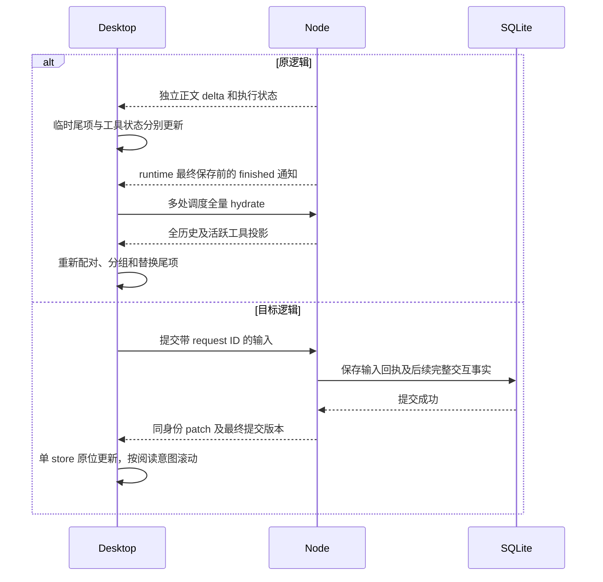

对照目标：旧流程依赖前端拼接和多次 hydrate，新流程由 Node 提交事实后发布有序投影；此图是设计目标，不是现状。

## 2. 必须保持的行为

| 编号 | 不变量 | 图解 |
|---|---| --- |
| C1 | 同一消息从首次可见到最终完成，其 ID 和逻辑位置不变；重连不重造身份 | [G08](#flow-g08) |
| C2 | 并行工具按调用顺序展示，结果先后只更新状态 / 内容，不重新排序 | [G08](#flow-g08)、[G24](#flow-g24) |
| C3 | 重复消息、旧响应、旧连接和旧模型 attempt 不能覆盖较新状态 | [G09](#flow-g09)、[G15](#flow-g15) |
| C4 | “执行已结束”不等于“结果已同步”；同步重试只读取，不重新执行模型或工具 | [G16](#flow-g16) |
| C5 | 最终通知指向已经进入权威消息状态的版本；持久化失败必须可见，不能伪装保存成功 | [G10](#flow-g10) |
| C6 | 草稿可展示但不可直接成为 provider history；取消不得保存不完整工具参数或制造孤儿结果 | [G11](#flow-g11) |
| C7 | 审批唯一依据仍是 Coordinator；刷新不重置勾选 / 展开，也不擅自重新发起审批 | [G25](#flow-g25) |
| C8 | 用户正在阅读历史时不强制跳底；跟随开启时，异步尺寸变化也能保持尾部 | [G26](#flow-g26) |
| C9 | 分页后正常追加不扫描全部已保存历史；工具子项和大结果不能绕过渲染上限 | [G29](#flow-g29)、[G41](#flow-g41) |
| C10 | 元数据、媒体和状态变化与正文变化一样能使对应实体更新 | [G14](#flow-g14)、[G28](#flow-g28) |
| C11 | 模型压缩 / dreaming / 单纯重置上下文不删除持久交互记录；展示不从压缩后的消息恢复原文 | [G06](#flow-g06) |
| C12 | queued 输入未被 claim 前可 CAS 编辑 / 撤回；claim 与编辑只能有一个成功，不能既改旧内容又执行旧版本 | [G18](#flow-g18) |
| C13 | 编辑重发创建新的输入 / Turn / attempt 身份，不修改旧执行事实，不撤销或自动回滚工具副作用 | [G21](#flow-g21) |
| C14 | 下一条输入必须等当前轮次终态、记录 / checkpoint 提交及消费确认闭环后启动；错误 / 停止后的队列策略明确 | [G19](#flow-g19) |
| C15 | 展示窗口按完整根轮次选择，不按原始消息条数切断 user / assistant / tool 关联 | [G29](#flow-g29) |
| C16 | 新输入开始的新轮次之前，已提交且未被显式修订的前缀在语义上不变；未变化实体保持对象引用与正文缓存。稳定边界按轮次提交 / 修订判断，不按最新 human 的数组位置判断；父列表可做有界协调，但不能因此重建旧项或重解析旧正文 | [G42](#flow-g42) |
| C17 | 即使 Agent 原本空闲、整轮 Auto 通知全部丢失，也通过独立于业务事件的轻量批量水位校验发现变化；探测只更新同步目标，不冒充已应用消息或重新执行任务 | [G43](#flow-g43) |

## 3. 所有权和数据边界

| 层 / 性质 | 原逻辑与入口 | 改后职责 | 旧逻辑处理 / 边界 | 图解 |
|---|---|---|---| --- |
| Coordinator / runtime · 沿用并增强 | 已统一执行、审批和取消事实，但最终 UI 通知还来自 Orchestrator；[runtime_lifecycle.go](../../node/internal/session/runtime_lifecycle.go)、[sse_publish.go](../../node/internal/turn/sse_publish.go) | 保留执行权威，收口 history 提交和最终结果通知 | 不另建执行状态机；不根据前端刷新决定执行结果 | [G02](#flow-g02) |
| Node 展示投影 · 替换并新增 | hydrate 每次从 messages 重建 transcript，再追加活跃工具；活动正文另走 SSE；[hydrate_view.go](../../node/internal/session/hydrate_view.go) | 从独立会话记录、已接受生命周期 facts 和活动草稿构建稳定实体 | 不再以 runtime.messages 作为完整历史来源；partial call 不进入模型可恢复上下文 | [G02](#flow-g02) |
| SSE Hub · 增强 | 已有 seq、Agent cursor、epoch 和回放；队列满时有丢弃 / 锁外补发；[hub.go](../../node/internal/stream/hub.go) | 有序投递、有限回放、明确慢订阅恢复 | 保留现有恢复基础；删除绕行补发，不参与业务状态判断 | [G13](#flow-g13) |
| Rust transport · 增强 | 全局订阅、维护传输 cursor、转发 WebView；[events.rs](../../desktop/tray-tauri/src-tauri/src/events.rs)、[nodeclient.rs](../../desktop/tray-tauri/src-tauri/src/nodeclient.rs) | 连接所有权、ready 握手、有限缓冲和类型化转发 | 不将“已收到”冒充“JS 已应用”；不在 Rust 拼正文或造消息 ID | [G15](#flow-g15) |
| Desktop controller / store · 替换 | DesktopApp 的 hydrate、streamingText、pending map 与多个 store 共同驱动展示；[DesktopApp.vue](../../desktop/tray-tauri/src/ui/DesktopApp.vue) | 一个入口管理应用、同步目标、请求与恢复 | 删除对应 watcher / timer / 临时消息来源；不按文案猜身份 | [G14](#flow-g14) |
| 聊天组件 · 收窄 | MainChatPanel 构造全量指纹、配对分组、窗口和滚动；[MainChatPanel.vue](../../desktop/tray-tauri/src/ui/components/MainChatPanel.vue) | 展示摘要 / 详情、Markdown 与阅读意图 | 消息事实移到 store，不在组件重建第二份权威数组 | [G02](#flow-g02) |

展示投影可以丢弃并重建，但其来源改为独立的持久会话记录及 lifecycle facts；模型上下文不是完整聊天历史的事实来源。P1 引入这份低频记录，不存逐 token 永久日志。分页 / 检索索引仍可重建。新的会话记录承担内容保存，Coordinator 继续承担执行状态，不复制第二套执行权威。

<a id="flow-g02"></a>

**交互图 G02：Desktop 与 Node 职责**

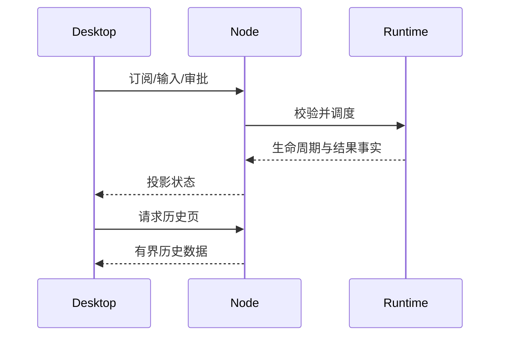

Desktop 负责阅读和交互，Node 保留执行权威；图示为目标职责边界。

### 3.1 模型上下文、会话记录与展示列表

| 层 / 性质 | 原逻辑与问题 | 改后职责与边界 | 图解 |
|---|---|---| --- |
| 模型上下文 · 收窄 | runtime.messages 同时保存模型消息和一部分历史前缀；实际请求取 activeContextStart 后的部分；[active_context.go](../../node/internal/session/active_context.go) | runtime.messages 只保留当前模型工作集，保持 provider 协议合法；可压缩 / 重置，持久 checkpoint 用于恢复，不用于历史菜单分页 | [G03](#flow-g03) |
| 持久会话记录 · 新增 | 压缩会替换活动区间并写回 messages，hydrate 亦从中生成展示；[compression/apply.go](../../node/internal/compression/apply.go)、[runtime.go](../../node/internal/session/runtime.go) `compressContext` | 独立保存用户输入、完整已接受 assistant、工具调用 / 原始结果或资源引用、轮次和修订关联；不被模型压缩替换 | [G03](#flow-g03) |
| 活动草稿 · 沿用边界并增强 | streamingText 与 partial 参数没有统一身份 / 关闭协议 | 进程内有身份的草稿，不作为完整原始历史；只有合法完整响应进入持久记录，取消的半截工具参数不保存成可执行事实 | [G03](#flow-g03) |
| Desktop 展示列表 · 替换来源 | 全量 hydrate + 前端配对 / 截尾 | 从持久轮次、当前执行事实和草稿生成；主界面和历史页使用同一实体 / 组件，读取范围不同 | [G03](#flow-g03) |

一轮是一个根输入启动到终态的逻辑工作单元，不是固定三条消息：

```text
Human 输入
  -> assistant（可能含工具意图） -> 一批工具调用 / 结果
  -> assistant -> 下一批工具 -> ... -> 最终回复或失败 / 取消终态
```

Auto / trigger 根输入也各占一个轮次，标识来源，不伪装成人工输入。子 Agent 结果归入所属父轮次；runtime notice、技能正文、压缩摘要、system prompt 等不会作为普通 human 消息出现在历史。

例如前 100 轮已完成：历史保留原始 100 轮；模型上下文可以是摘要加最近若干合法轮次；主界面默认只加载最近 5 个终结轮次。三者的数量和内容无须相同。

<a id="flow-g03"></a>

**交互图 G03：上下文、原始历史与 UI**

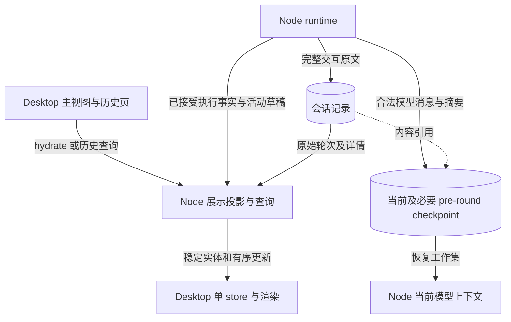

目标设计：原文与模型工作集分开保存；投影只读已接受事实，不反向修改模型 checkpoint。

### 3.2 持久化结构与最小恢复集

沿用当前 SQLite，不新增服务。下表区分已有持久结构、已接入的基础写入和仍待实现的目标结构；不要仅凭名称推断接口已经可用：

| 数据 | 保存内容 | 事实来源 / 保留策略 | 图解 |
|---|---|---| --- |
| conversations | Agent、conversation ID、创建 / 归档状态、当前轮次 head、会话 revision | 明确区分当前对话与已归档对话；显式删除有独立路径 | [G04](#flow-g04) |
| conversation_rounds（已落地基础写入） | 稳定 round ID、逻辑顺序、当前选中 revision、pre-round checkpoint 引用 | claim/Turn 启动时创建逻辑轮次；当前只支持创建时选中首个 revision，尚无重发版本切换 / 读取接口 | [G04](#flow-g04) |
| conversation_round_revisions（已落地） | round / revision ID、turn ID、source / generation、状态 / 终结原因、提交后的 conversation / checkpoint revision | 初始运行、重发新 revision、CAS 更新 selected revision 与终态事务均已实现；历史 API 可读取保留的旧版本 | [G04](#flow-g04) |
| conversation_records（增量写入已落地） | 稳定 message / item ID、round / revision（可空）、内容 / 资源引用、可见性来源、工具关联、实体版本 | 新增记录和活动轮次写入显式归属；旧记录或无法证明归属的记录不回填。queued 编辑 / 撤回、原始工具输出与精简版本分离仍待实现 | [G04](#flow-g04) |
| conversation_inputs | input ID、queue seq、message 引用、输入 revision、queued / claimed / consumed / cancelled 和去重回执 | InputBox 的持久接收与消费事实，不重复存一份正文；内存 InputBox 保留调度职责 | [G04](#flow-g04) |
| context_checkpoints | conversation / round / revision 归属、当前模型消息工作集、context revision / lineage、相关消息 ID、最新可编辑轮次的 pre-round checkpoint | 用于恢复和末轮重发；可以沿用有界 JSON 表示，不为所有旧轮次永久复制整份 context | [G04](#flow-g04) |

普通正文可共享内容引用；大工具原始结果只保存一次，模型 checkpoint 可引用或保留精简后的 model payload。资源引用沿用现有本地读取链路，不重新引入 Node 传输文件二进制。

Agent 的队列暂停 / 控制 revision 与当前 conversation 归属在同一持久控制记录中保存，不在每个 input 上复制 paused 标志。输入 CAS 使用 input_revision；停止 / 继续 / claim 使用队列控制 revision 与运行 generation 栅栏。具体表名可合并到现有运行控制存储，不能同时保留两份可独立决定调度的状态。

**轮次归属与执行身份约束（2026-11-17 复核补充）**：`round_id` 表示逻辑对话轮次；`revision_id` 表示该轮次当前或历史内容版本；`turn_id/generation` 表示一次具体执行。编辑重发保留 `round_id`、创建新的 `revision_id` 和 `turn_id`，不能把 `round_id` 直接设为当前 `TurnID`。输入在队列接收 / 排队时尚未属于某个轮次；只有 claim 与 Turn 建立成功的持久边界才分配归属。当前 Node 已将 claim/InputBox 状态、Turn + 首个 Step 事实、round 与 active revision 在一个 SQLite 事务提交后再运行模型；若 post-commit lifecycle observer 失败，则 durable boundary 不回滚，runtime fail-closed 并等待恢复。delta 按 item 显式带归属，不能给一整个 delta 猜一个默认轮次；continuation Step 复用当前 round/revision，新的 side-effect 根执行才开新轮次。终态事务校验其 round/revision/turn/source/generation 与生命周期终态一致，并将记录、checkpoint、修订终态和完成快照一并提交。`record_revision` 必须采用存储层实际提交后的 conversation revision，不能拿 runtime 的 `HistoryRevision` 代替；checkpoint 未变化时沿用现有 checkpoint revision。失败、取消和未知工具结果不得被标为 completed；Auto `no_work` 可有明确终态修订，但不得合成普通 human/assistant 消息。旧记录和无法证明归属的旧快照保持空关联，禁止根据内容、数组顺序或 opaque item ID 推断。初始 round/revision 持久化、终态关闭、末轮重发新 revision、selected revision 切换与读取 API 已落地；原生 Desktop 验收和完整 side-effect / approval 矩阵仍待完成。

保留当前 checkpoint、正在执行的 pre-round checkpoint，以及最新具备编辑资格轮次的 pre-round checkpoint；更老 checkpoint 可按引用清理。原始历史仍保留，因此“历史可读”不等于“任意旧轮次都能恢复当时模型上下文”。首版不提供任意历史分叉执行。

<a id="flow-g04"></a>

**交互图 G04：持久结构与 checkpoint**

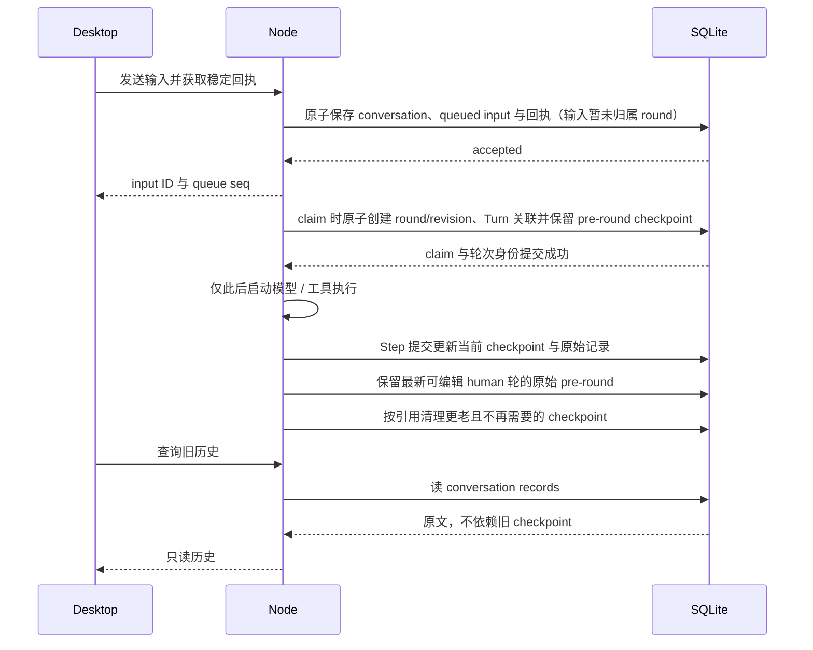

目标设计：保留当前、在途及最新可编辑基点，不为所有历史轮次复制完整模型工作集。

### 3.3 双用途提交与一致性

同一次完整响应按身份关联两条用途不同的数据：会话记录保留原文；模型工作集按 provider 规则接收合法消息、精简结果与后续压缩摘要。写入当前 checkpoint、记录 / 轮次、输入消费位置时尽量使用同一 SQLite 事务，不做两次彼此不检查结果的保存。

持久化入口按数据变化分开，不能保留一个不分场景的 `Save(full runtime snapshot)` 并在每次调用时扫描 / 序列化全部消息：

| 写入入口 | 接收内容 | 不应触碰 | 典型触发点 |
|---|---|---|---|
| `SaveRuntimeState` | 队列控制、InputBox / Ack、未改变 transcript 时的运行元数据 | `conversation_records`、未变化的 context checkpoint | unread / notify 水位、运行控制状态等不改消息内容的更新 |
| `CommitConversationDelta` | 本次新增 / 修改 / 删除的 Item ID、预期版本、轮次与 revision 关联 | 不相关历史 Item 与已完成正文 | 接受 human 输入、assistant Step 完成、工具结果落定、恢复时明确校正占位 Item |
| `CommitContextCheckpoint` | 新 checkpoint、独立 context revision / lineage 与消费边界 | 展示记录正文（除非同一事实也带来对应记录 delta） | provider 工作集改变、压缩或 dreaming reset、恢复基点提交 |

这些入口可共享一个 SQLite 事务实现，但调用契约必须表达哪些事实发生了变化；checkpoint / records / 队列 Ack 需要共同提交的边界显式组合调用。Item dirty set 仅在相关事务成功后清除；失败继续保留待提交 delta 并进入恢复状态。禁止用“每次全量读出再比 JSON hash”冒充增量写入，因为其数据库写量虽下降，CPU 与内存扫描仍是 O(H)。

生命周期保留独立 durable facts。普通中间 Step / Tool facts 仍各自持久化；本地终态切片已把最终 records / checkpoint、InputBox Completed marker、最后 Step / Turn facts 和 revision-bound snapshot 放入同一 SQLite 事务。失败时 Coordinator 批量迁移回滚，提交后才发布对应 turn_state / Hook / 完成通知。事件表没有生产清理路径，checkpoint 生命周期也独立于 event retention；原先无消费者的 `lifecycle_covered_seq` 运行时状态已移除，数据库兼容列维持 0。SQLite 也不能覆盖已经发生的外部工具副作用；工具执行结果未知时仍须暂停核实。

完整 assistant tool intent 可在工具执行前写入记录；工具结果完成时更新其关联结果，终结轮次最后提交。模型可恢复工作集继续遵守合法调用 / 结果闭合规则。自动 next 只能在终态、内容 / checkpoint 和 InputBox Ack 均提交后发生，不能在“工具返回了”时抢先启动下一输入。

<a id="flow-g05"></a>

**交互图 G05：双用途提交**

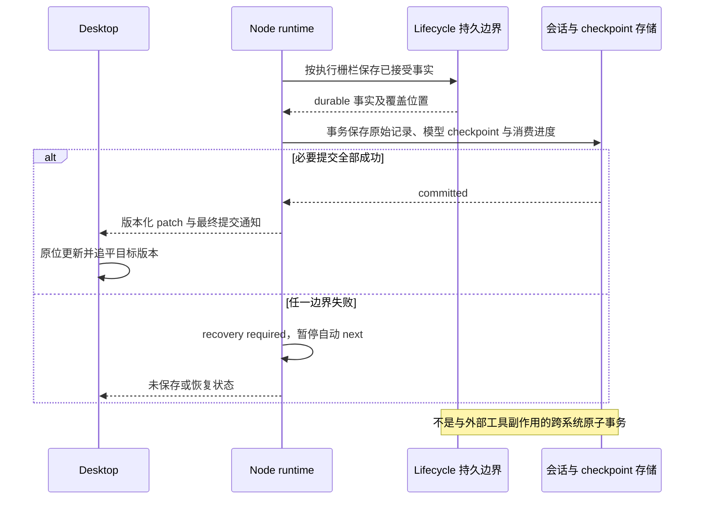

双用途提交共享消息事实/checkpoint，但生命周期边界须单独处理失败；历史读取不从模型工作集重建。

### 3.4 压缩、重置、新对话与清空

| 动作 | 原逻辑 | 改后模型工作集 | 改后持久历史与队列 | 图解 |
|---|---|---|---| --- |
| 压缩 | 替换 active messages，展示原文来源可能消失 | 只替换模型工作集为摘要 / 保留区间，context_revision 前进 | 原始记录 / 轮次不删，不使历史 cursor 因压缩失效 | [G06](#flow-g06) |
| dreaming / 单纯重置模型上下文 | activeContextStart 移动，旧前缀仍可能驻留 runtime.messages | 开始新的 context lineage，应用新的经验 / prompt；旧全量前缀不必常驻工作集 | 历史保留，可用轻量边界标记；未处理人工输入保留，下一轮使用新上下文；跨 lineage 的末轮重发不开放 | [G06](#flow-g06) |
| 新对话（新增） | 目前没有本方案中的独立 conversation 归档模型 | 新 conversation + 新工作集 | 旧对话可从历史页读；有待处理输入时先显式处理其归属，不静默搬到新对话 | [G07](#flow-g07) |
| `/clear` / 清空当前对话 | 当前 ClearContext 同时清空 messages 和展示；[manager.go](../../node/internal/session/manager.go) | 保持“清空当前对话”的既有含义，取消活动执行后清空工作集 | 清除当前 conversation 可见内容 / 修订和队列并换代，不能从历史索引偷偷恢复；不等于“归档”，不删除已在磁盘发生的工具副作用 | [G07](#flow-g07) |

新对话遇到未处理输入时，默认阻止切换并提示先处理 / 撤回；只有用户选择“取消待处理并新建”才取消旧队列。新对话不是自动归档在途任务；须先停稳活动 Turn。清空操作继续使用显式破坏性操作语义，检索、资源引用与缓存也同步失效；需保留的执行审计只保留恢复 / 审计必要范围，不冒充仍可查询的聊天历史。

<a id="flow-g06"></a>

**交互图 G06：压缩与 dreaming**

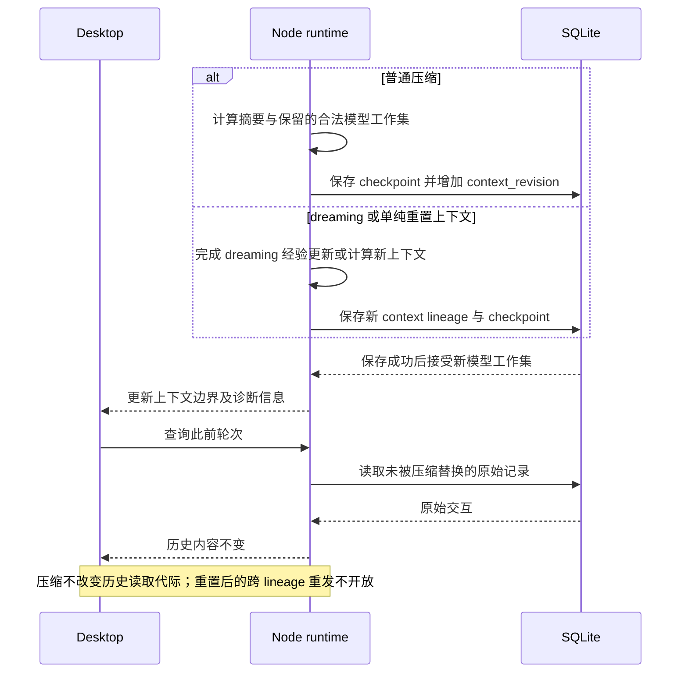

先计算压缩结果和新 lineage，再持久化 checkpoint，成功后才替换工作集；dreaming/压缩不删除永久历史。

<a id="flow-g07"></a>

**交互图 G07：新对话与 clear**

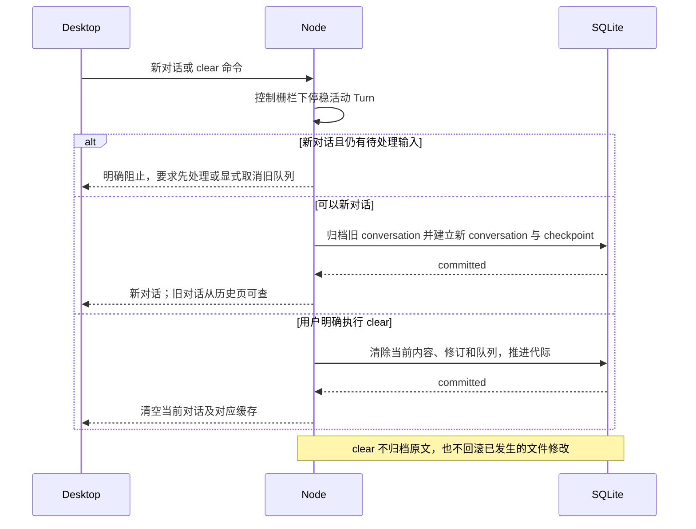

新对话归档旧记录；clear 是显式破坏性清空当前内容和队列并换代。两者都先停稳执行，不能混用或隐式触发。

## 4. 身份、顺序与版本

### 4.1 稳定身份

稳定 identity 在会话记录 / 输入接收 / Step facts 中分配，内部模型消息只携带关联引用。provider 出站剔除这些字段，不再从模型工作集反推历史身份。记录层单独定义展示类型与来源；不让所有 provider adapter 理解一套 UI 可见性状态机。

压缩摘要和临时注入只使用 context 内身份，不能被识别成新的原始 human 记录。历史的完整性不要求把这些模型内部消息展示给普通用户。

| 实体 / 性质 | 原逻辑与入口 | 改后分配方式与寿命 | 图解 |
|---|---|---| --- |
| 用户输入 · 替换 | 入队有 InputBox seq；UI pending 使用本地 ID，历史条目按数组下标造 ID，并按正文 / 原长度确认；[workbench-state.js](../../desktop/tray-tauri/src/ui/workbench-state.js) `desktopChatEntries`、[input_box.go](../../node/internal/session/input_box.go) | 接收时分配 message / input ID 并持久保存；queued 编辑只增输入版本，已执行的编辑重发生成新 message ID 与轮次 revision | [G08](#flow-g08) |
| assistant · 替换 | `CommandAssistantReceived` 当前使用 `Digest(assistant)`，UI 历史仍按下标标识；[orchestrator.go](../../node/internal/turn/orchestrator.go) `runOneStep` | Step 首次执行前分配并持久保存内部 ID，成功后才请求模型；整个 Step 保持，不用正文 Digest 作身份 | [G08](#flow-g08) |
| 模型 attempt · 增强 | 已有模型重试状态 / 次数，但 Desktop delta 只按活动 Agent 拼到 streamingText，没有本方案的 attempt + chunk 应用栅栏；[DesktopApp.vue](../../desktop/tray-tauri/src/ui/DesktopApp.vue) `desktop-node-event` listener | 每次重试分配 attempt ID；拒绝旧 attempt 的迟到 chunk，不改变 assistant 位置 | [G08](#flow-g08) |
| 文本 / reasoning · 替换 | assistant 使用 `${agent}:live-assistant` 临时尾项，历史另有下标 ID；历史 reasoning 当前被隐藏；[MainChatPanel.vue](../../desktop/tray-tauri/src/ui/components/MainChatPanel.vue) `liveAssistantEntry`、[useStream.js](../../desktop/tray-tauri/src/ui/composables/useStream.js) `shouldSkipEntry` | 用 assistant ID + part 派生身份，流式和完成共用；沿用原可见性规则，不因此新增历史 reasoning 展示 | [G08](#flow-g08) |
| 工具项 · 增强 | 主要用 blockId / tool_call_id 配对；partial 参数和最终调用再触发 hydrate；[transcript_entries.go](../../node/internal/session/transcript_entries.go)、[useStream.js](../../desktop/tray-tauri/src/ui/composables/useStream.js) `buildToolResultMatches` | 内部 ID 使用 assistant + 工具槽位；验证完成后绑定 provider call ID，不替换 UI key | [G08](#flow-g08) |
| 审批 · 沿用并增强 | 已有 interaction / batch / call 关联，组件另存选择状态；[ApprovalBubble.vue](../../desktop/tray-tauri/src/ui/components/ApprovalBubble.vue)、[coordinator.go](../../node/internal/turn/coordinator.go) | 保留既有关联，把选择 / 展开绑定稳定身份；不创建第二套授权 ID | [G08](#flow-g08) |

provider call ID 只在对应 conversation / round revision / Step / assistant 范围内关联，不能假定跨历史全局唯一。工具参数未完整时只允许作为活动草稿，不进入可执行 / 可审批状态。编辑重发不复用旧 turn、generation、attempt 或审批选择。

排序使用 Node 分配并保存的逻辑位置，至少区分根输入、Step 和 Step 内部分（reasoning、正文、工具序号）。活动正文和工具在同一 Step 锚点下；工具完成时间、正文长度、数组下标、客户端时间均不参与排序。

待处理输入在主消息序列末尾作为“待处理”区展示，属于同一 store 的 pendingInputs；进入执行轮次时复用输入 / message ID，并从待处理区移除，不能出现两份。当前轮次后续 assistant / 工具仍留在其轮次内，不与排队卡片交错。详见 §6.4。

| 改动 | 原逻辑 | 改后 / 旧逻辑处理 | 图解 |
|---|---|---| --- |
| 逻辑顺序 | 旧 `appendActiveToolCalls` 把活跃工具追加到 transcript 尾部，流式正文独立放末尾；[hydrate_view.go](../../node/internal/session/hydrate_view.go) | 持久记录使用 Node 分配的会话序与轮内序；生命周期补投影按 assistant parent / batch index 锚定，缺少 parent 时确保位于同批结果前。测试覆盖结果先出现及上一回合调用不泄漏；流式正文继续由稳定 assistant draft 接管 | [G08](#flow-g08) |
| 排队输入 | `pendingUserByAgent` 直接补入 chatEntries，匹配到同文本 user 后移除；[DesktopApp.vue](../../desktop/tray-tauri/src/ui/DesktopApp.vue) pending watcher | store.pendingInputs 记录排队状态，按回执 ID 接管；删除文本 / 长度匹配和独立 pending map | [G08](#flow-g08) |

<a id="flow-g08"></a>

**交互图 G08：稳定 ID、工具顺序与 attempt**

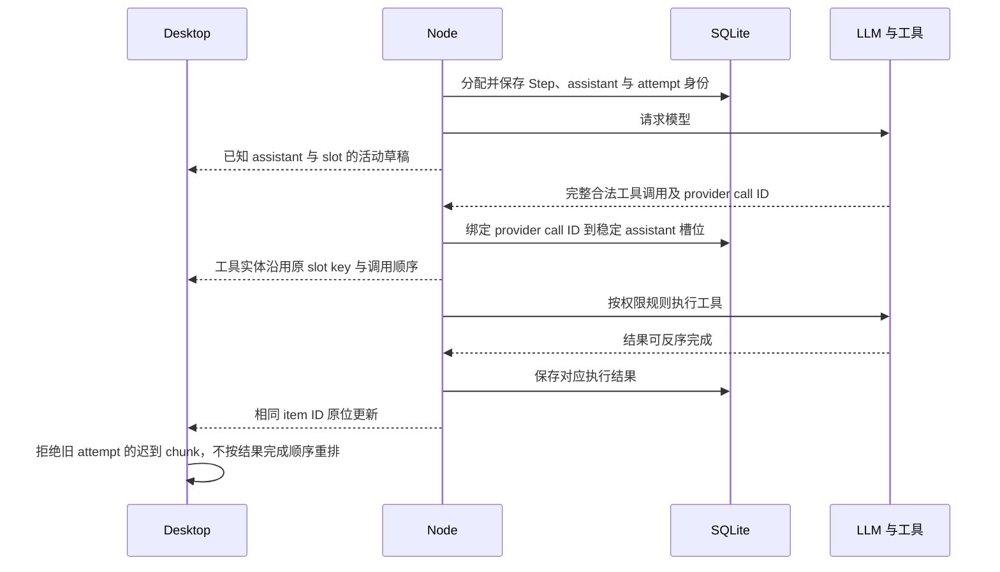

assistant item、展示 slot、provider call ID、attempt/step 各有职责；迟到 attempt 只能被过滤，不能把不同身份简单视为同一 ID。

### 4.2 版本各自只解决一个问题

| 标识 / 性质 | 原逻辑 | 改后用途 | 图解 |
|---|---|---| --- |
| `stream_epoch + agent_seq` · 增强 | Hub 已提供；Rust 当前全局路径主要推进最大 seq，live 缺口未主动对账 | 完整 Agent 域接续与缺口恢复；不当作跨重启永久位置 | [G09](#flow-g09) |
| `history_revision` → 独立 context / conversation revision · 拆分 | 当前 history_revision 同时受模型消息压缩和历史提交影响 | P0 临时沿用；P1 context_revision 表示模型工作集，conversation_revision 表示持久会话变更；Desktop 追平后者，不把模型压缩误认为聊天历史被替换 | [G09](#flow-g09) |
| `round_id / revision_id / context_lineage` · 新增 | 没有本方案中的持久轮次修订与编辑基点 | logical round 定位交互，revision 定位重发版本，lineage 限制跨重置恢复；不是 SSE 序号 | [G09](#flow-g09) |
| `lifecycle_seq / generation` · 沿用 | 已阻挡旧执行状态 / continuation；hydrate 历史是否接受与该状态判断绑定过紧 | 保留执行栅栏，P0 将历史前进与状态前进分开判断 | [G09](#flow-g09) |
| `item_version` · 新增 | 无统一展示实体版本，MainChatPanel 靠手工字段指纹判断变化 | 正文、媒体、状态和详情按同一实体版本更新 | [G09](#flow-g09) |
| `attempt_id + part + chunk_seq` · 新增 | delta 有部分 lifecycle metadata，但 Desktop 没有对应的去重 / 关闭协议 | 草稿去重与缺口检测；不替代 history cursor | [G09](#flow-g09) |
| Desktop 请求 generation · 增强 | 已有 activeId / activeHydrationSequence 检查，但会无条件丢弃较早发起的响应 | 区分过期请求与仍可前进的响应；覆盖分页、详情、媒体和重连 | [G09](#flow-g09) |

版本相关原入口：[hub.go](../../node/internal/stream/hub.go)、[runtime_state.go](../../node/internal/store/runtime_state.go)、[turnState.js](../../desktop/tray-tauri/src/ui/stores/turnState.js)、[DesktopApp.vue](../../desktop/tray-tauri/src/ui/DesktopApp.vue) `hydrateAgentSnapshot`、[MainChatPanel.vue](../../desktop/tray-tauri/src/ui/components/MainChatPanel.vue) `entriesInputKey`。

不新增通用的第五套全局事件日志。顺序判断使用同一域的序号：不得对过滤后的全局 `seq` 做 `+1` 校验，也不得将 `agent_seq_hint` 当成快照已经覆盖的水位。

<a id="flow-g09"></a>

**交互图 G09：版本各自职责**

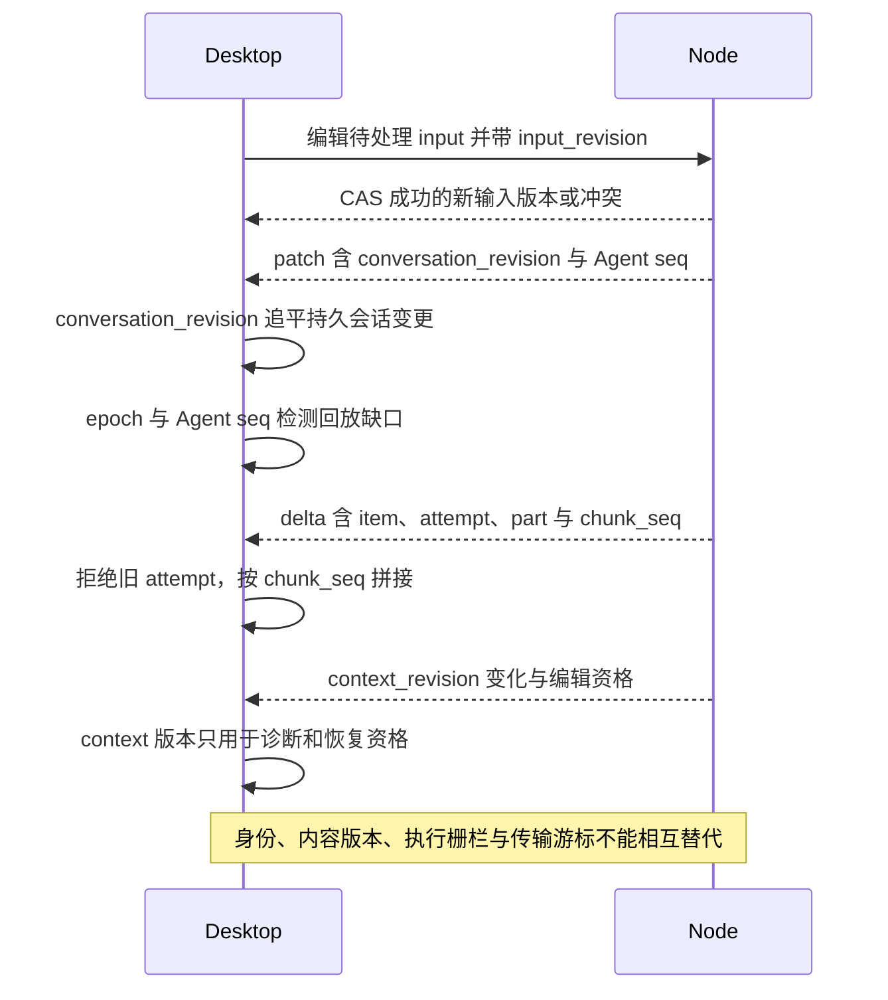

会话、输入、执行和传输版本解决不同问题，不能用一个全局版本替代。

## 5. Node 提交和事件契约

### 5.1 终态只从 runtime 的提交边界发布

| 改动 | 原逻辑与入口 | 改后 / 旧逻辑处理 | 图解 |
|---|---|---| --- |
| 结果通知 · 替换 | Orchestrator 在 Step 返回、runtime 最终提交前发 turn_finished；后续 terminal turn_state 通常再补一次刷新；[orchestrator.go](../../node/internal/turn/orchestrator.go) `runOneStep` | runtime 提交后发布绑定版本的结果通知，删除提前 UI 终态通知；不把所有正常情况描述成必然丢结果 | [G10](#flow-g10) |
| 保存失败 · 增强 | `commitStepHistory` 先改内存 revision，`commitHistoryForLifecycleLocked` 随后 persist 却不返回错误；[runtime_lifecycle.go](../../node/internal/session/runtime_lifecycle.go) | 检查两个持久边界；失败标 recovery / 未保存，不把内存增长当作 durable 成功 | [G10](#flow-g10) |
| 取消后的保存 · 增强 | 多处使用 Background 保存，保存期限未与本轮终态契约统一；[runtime_persistence.go](../../node/internal/session/runtime_persistence.go)、[runtime.go](../../node/internal/session/runtime.go) | 独立、有截止时间的 persistence context；只重试保存同一结果，不重执行副作用 | [G10](#flow-g10) |
| 完成 Hook · 保留并拆职责 | `publishTurnFinishedWithDetails` 同时调用完成 Hook、取指标和发 SSE；[sse_publish.go](../../node/internal/turn/sse_publish.go) | 保留业务 Hook 原语义 / 次数，将结果已提交的通知职责分离 | [G10](#flow-g10) |

P0 将 Orchestrator 中提前发布的最终 UI 通知收口到 runtime。Orchestrator 仍返回 StepOutcome 并运行原有业务 Hook；把“执行完成 Hook”与“对外结果已提交通知”分开，避免移动 SSE 时改变 Hook 次数或副作用顺序。

终态路径应为：

```text
StepOutcome / 取消栅栏确定
  -> 单写者提交合法 history
  -> 检查保存错误，完成既有 durability boundary
  -> 在同一边界捕获 history revision 与 lifecycle 状态
  -> 发布结果通知 / 对应 turn_state
  -> Desktop 追平该结果版本
```

审计发现 `commitHistoryForLifecycleLocked` 当前调用 persist 未向上返回错误，这条路径必须改为可检查错误。现有 lifecycle event 与 runtime snapshot 是两个持久边界，P0 不把它们描述成已经原子提交。只有所需边界均成功才发布 committed 结果；P0 绑定 legacy history_revision，P1 绑定 conversation_revision、context_revision 和完成轮次 revision，不能只根据内存 revision 增长认定保存完成。

保存失败不回滚已经发生的工具副作用。保留合法内存结果和最后成功的持久 checkpoint，标记 recovery required / result_commit_status=failed，界面区分“结果未保存”和“结果未同步”。Node 可对同一快照做有界保存重试，不重新执行任务；不能恢复时不得承诺重启后仍有未保存内容。停止执行后的保存使用独立、有截止时间的 persistence context，不复用已取消的模型 context，也不无限使用 Background 阻塞停机。

P1 的完整 Item 必须已有对应会话记录，不能仅靠 runtime.messages 内存副本证明历史存在；Item 完成不冒充整个轮次已经闭合。最终 Turn 结果通知对应记录 / checkpoint / 终态的提交边界，输入完成确认后才自动 next。错误、停止、预算耗尽、无工作返回和 dreaming 都要覆盖，不能只修改正常结束分支。

#### 5.1.1 P1a 终态原子提交边界（2026-11-17 实现与复核）

本节对照基线逻辑与当前本地实现，并注明仍未覆盖的恢复边界。完成 SSE 晚于持久化只是必要条件；本地实现已把终态事实和对应记录推进到同一 SQLite 提交点。

| 路径 | 原逻辑 / 原缺口 | 当前本地实现与剩余边界 |
|---|---|---|
| 正常 Step / Turn 完成 | `withCommittedHistoryLocked` 分别持久化 dirty records / checkpoint，再依次提交最后 Step、Turn facts；`turn.completed + completed_turn_snapshots` 自成事务 | `CommitTerminalBoundary` 与 Coordinator `DispatchBatchDurable` 将最终 records delta、必要 checkpoint、InputBox durable `Completed` marker、终态所需 Step / Turn facts 和 snapshot 一起提交。普通成功/失败/预算、resume、condition、Auto `no_work` 和取消路径已接入；事务前只构造 Completed mailbox 副本，事务失败时 live 状态不变；事务成功后在 `persistMu` 释放前同步 live marker，物理 InputBox Ack 清理在后 |
| 提交中断 | records 先提交、终态 event 后失败时留下结果已写而 lifecycle 未终结的窗口；Coordinator 的单命令回滚无法回滚前一个 SQLite tx | 写入任一点失败，SQLite 整体事务回滚，Coordinator 的批量内存迁移也回滚；该路径不发布 post-commit Hook / 完成通知。store 注入故障测试覆盖 runtime、records、checkpoint、events、snapshot 写点；同 command batch 幂等与数据库重开恢复已验证 |
| 完成快照来源 | 完成事件事务外按 lifecycle facts 调用 `RebuildTurnMessages`，snapshot 未绑定 records / checkpoint revision | 最终回答此前已作为 durable assistant lifecycle fact 写入；终态事务将重建出的 turn messages、records delta 和最终 lifecycle facts 绑定同一 conversation / checkpoint revision。SQLite 集成测试验证最终 assistant 正文在 snapshot 中且重启后仍可读。此测试不等于所有工具输出 / 资源引用在任意异常窗口都完成等价性证明；失败、取消、中断、预算终态不创建 completed snapshot，Auto `no_work` 使用明确状态 |
| lifecycle 覆盖水位 | 有字段但始终为 0；没有生产路径按该字段裁剪 lifecycle facts | 从 runtime / Go checkpoint 类型移除无消费者字段；事件表不裁剪且 checkpoint 清理不影响 lifecycle facts。SQLite 兼容列与终态 payload 暂时保留 0；若以后要裁剪事件，再单独实现可验证的保留协议 |
| Step 批量持久化 | Coordinator 的最后 Step durable dispatch 与 Turn durable dispatch 各自提交，存在 Step 完成而 Turn 未完成的 crash 窗口 | `DispatchBatchDurable` 先暂存整个命令序列和每个中间 projection，存储回调以一笔事务写入有序 event batch；数据库失败时恢复 Coordinator 的精确 pre-batch 状态。不是通用事件总线 |
| InputBox Ack | 成功历史提交与 in-flight 的消费确认原来通过多次 runtime snapshot 保存 | 最终事务内保存 `Completed` marker；提交成功后才物理 Ack 清除。Ack 的 metadata 更新失败时保留 completed in-flight guard 并停止后续 claim；重启读取 durable marker 后清理而不重跑输入 |
| 外部副作用 / Hook | 工具副作用在 SQLite 之外；Hook 与数据库提交也不是一个跨系统事务 | `started` 无可靠结果仍为 unknown / recovery required，不自动重跑工具。Hook 在提交后运行；数据库提交到 Hook 成功之间的 crash 不宣称 exactly-once，若未来确有需要再单独评估 outbox / 幂等消费 |

当前接口为 `CommitTerminalBoundary(ctx, TerminalBoundary)` 与 `DispatchBatchDurable(commands, persist)`。前者单事务校验并提交 runtime 状态、delta、checkpoint、lifecycle event batch 和完成快照；终态事件保存完整有序 command ID / type manifest，并附带边界摘要，覆盖规范化的 runtime metadata / state 与 ConversationDelta（使用实际提交 revision，忽略自动生成的 CreatedAt / UpdatedAt）。重试时逐项比对 lifecycle 事实，并校验边界摘要与完成快照，拒绝省略、变序、改写事件或修改 runtime / delta 的同 ID 重试。后者只有在存储回调成功后才保留 Coordinator 状态；失败时恢复完整 pre-batch checkpoint。提交之后再运行 Observer、既有 Hook 和通知，保持既有顺序。InputBox 的物理 Ack 不与这些事实重复建模：事务前不改 live mailbox，事务成功后先同步内存 Completed marker，再由消费循环 Ack；durable marker 是重启不重放的依据。

InputBox 从内存 in-flight 状态物理 `Ack` 清除可以在终态事务成功后完成；它不是与已提交消息事实并列的第二个事实源。事务构造 mailbox 副本并先持久化 `Completed` marker；失败时 live mailbox 保持未完成，后续普通保存不会伪造已完成事实。成功后在同一 `persistMu` 临界区同步 live marker，避免事务提交至消费循环 Ack 之间的另一次普通保存覆盖它。若 Node 随后崩溃，恢复看到 marker 后只清除该 in-flight 项、不重新执行输入。物理 Ack 或其 metadata 更新失败时，保留 completed ownership guard 并停止 claim 后续输入，直到恢复边界追平。

Auto `no_work` 也会进入完成路径，但没有常规 human / assistant 记录：保持既有 Hook 次数 / 次序，snapshot 以显式 `no_work` 状态结束。`ToolExecutionStarted` 后缺失可靠结果的恢复路径不进入该完成事务，不自动 claim queued input。工具本身的外部副作用永远不在 SQLite 原子边界承诺内。

<a id="flow-g44"></a>

**交互图 G44：最终 Step、Turn 事实与记录在一个数据库提交点收敛**

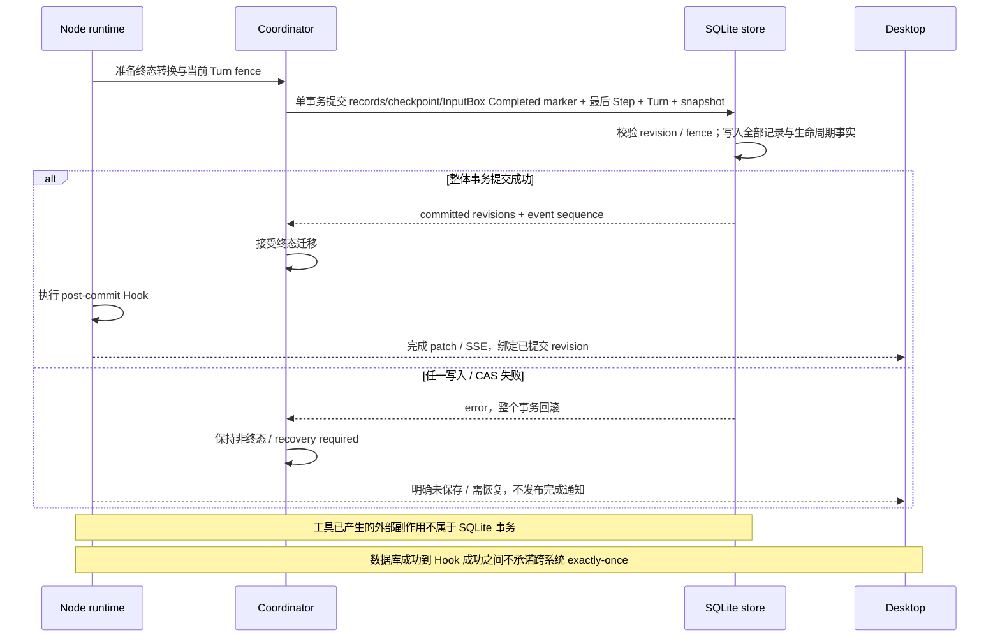

本地实现切片；终态事实、记录 delta、必要 checkpoint 和 snapshot 同事务，Coordinator 失败回滚已验收。生命周期事件当前不裁剪；外部工具副作用的跨系统语义仍未闭环。

<a id="flow-g10"></a>

**交互图 G10：终态提交成功与失败**

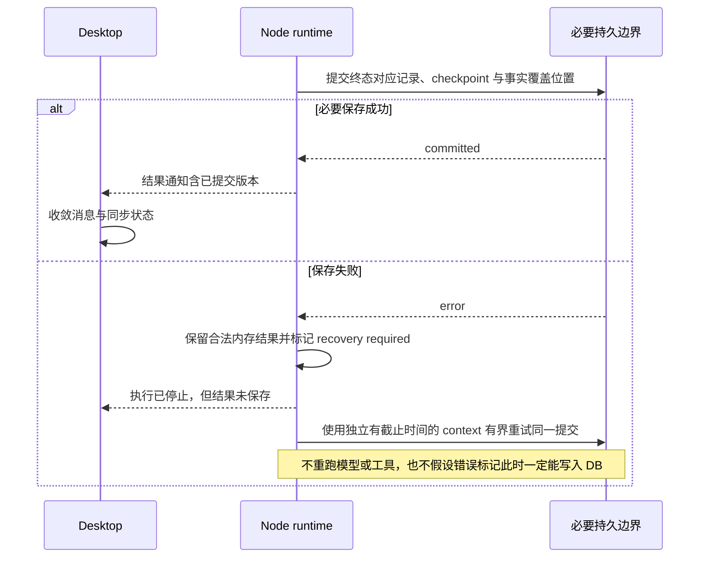

保存失败时不能假设仍可写 DB；先保持内存 recovery 和明确错误，再用有界独立 context 重试，不伪造完成。

### 5.2 统一展示增量

| 改动 | 原逻辑与入口 | 改后 / 旧逻辑处理 | 图解 |
|---|---|---| --- |
| 消息 / 工具更新 · 替换 | assistant、tool_call、tool_result、turn_state、hitl_required 各自发布；Desktop 多数工具事件仅触发 hydrate；[sse_publish.go](../../node/internal/turn/sse_publish.go)、[DesktopApp.vue](../../desktop/tray-tauri/src/ui/DesktopApp.vue) event listener | 正常展示更新收敛为 conversation_patch，就地更新同一实体；删除聊天重复消费旧事件的分支 | [G11](#flow-g11) |
| 高频正文 · 替换 | `publishAssistant` / `publishReasoning` 当前调用普通 Hub.Publish，进入 replayable 路径；UI assistant 直接拼字符串 | 正文用 ephemeral delta，最终完整 Item 校正；保留可靠事实，不永久保留每个 chunk | [G11](#flow-g11) |
| 草稿收尾 · 新增 | UI 在 final tool_call 或部分 hydrate 终态分支清空 streamingText，没有统一 closed attempt / chunk 水位 | 明确 open / completed / abandoned，完成后拒绝迟到 chunk；删除靠工具事件清空全局正文 | [G11](#flow-g11) |
| 大工具结果 · 增强 | tool_result 事件带 content / arguments，hydrate 后又收到相应历史内容 | 摘要 / detail reference 与版本更新，避免相同大结果在状态变化时反复发送 | [G11](#flow-g11) |

拟增加一个低频、可回放的 `conversation_patch` 事件，包含同一逻辑转换中的：

```text
agent_id, stream_epoch, agent_seq
conversation_id, round_id, revision_id（有所属轮次时）
upsert_items[] / remove_item_ids[]
round_updates[] / input_updates[] / queue_state（有变化时）
turn_state（有变化时）
pending_hitl（有变化时）
conversation_revision / context_revision（各自发生变化时）
result_commit_status（有变化时：pending / committed / failed）
```

完整 Item 用 upsert 校正，包括最终正文；工具状态更新原 Item。审批与工具状态涉及同一次转换时，在同一个 patch 应用，不让用户短暂看到失配状态。大结果返回有版本的摘要 / detail reference，不能让整份工具输出在每次状态更新里重复传输。

高频正文使用 ephemeral `conversation_delta`，其 envelope 同样包含 `agent_id、stream_epoch`，数据带 `item_id、attempt_id、part、chunk_seq、delta`。完整接收和 UI 发布分开。流式参数也使用活动 attempt 的槽位关联。

可靠 patch 中明确携带 attempt 的 open / completed / abandoned 标记以及各 part 最终 through_chunk_seq。attempt 切换显式关闭旧草稿；完成 / 放弃后拒绝该 attempt 的所有迟到 delta。只有已知、同 epoch、当前 open attempt 可以接收增量；未知 attempt 不得凭一条 delta 直接创建消息，最多有限暂存等待开始事件，超限则恢复。这样 final patch 先到、旧 chunk 后到也不能使草稿复活。

现有 Coordinator 仍决定工具与审批事实，patch 是其展示投影，不增加可单独修改执行状态的新命令接口。旧 SSE 如还被非聊天功能消费，先盘点调用者；Desktop 聊天切换后不再同时应用旧事件和 patch。

<a id="flow-g11"></a>

**交互图 G11：patch、delta 与关闭栅栏**

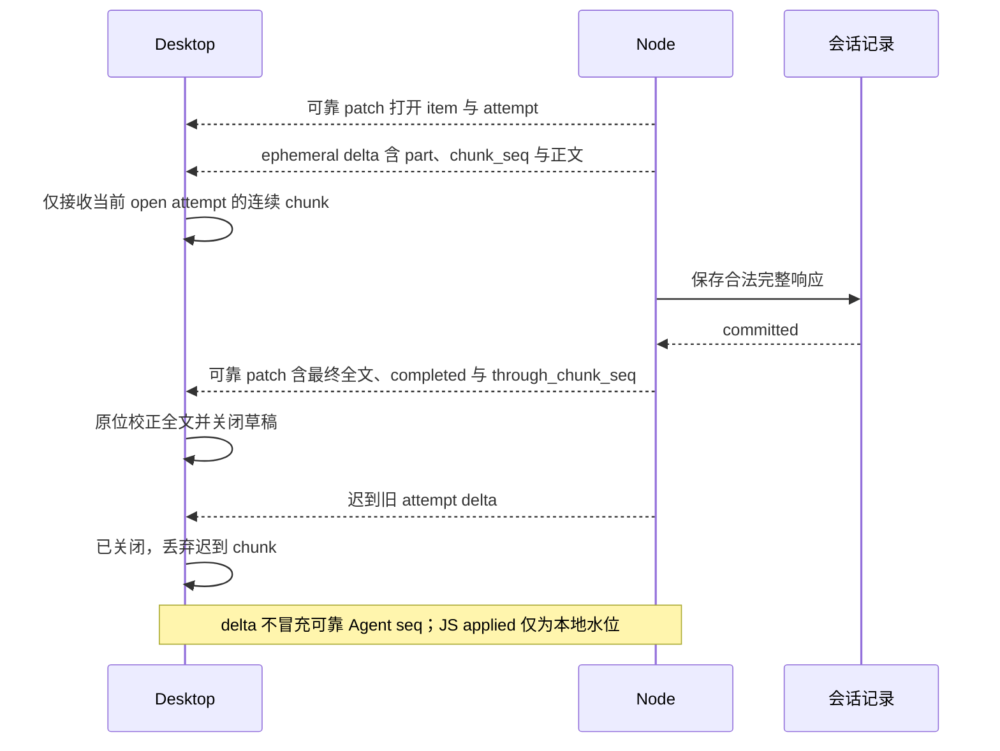

没有额外 Desktop ACK 协议；JS applied 只在 Desktop 本地记录。Node 的事实提交和 projection watermark 独立于本地应用进度。

### 5.3 一致快照和准确水位

| 改动 | 原逻辑与入口 | 改后 / 旧逻辑处理 | 图解 |
|---|---|---| --- |
| 同一快照 · 修复 | `GetHydrateView` 锁内复制历史 / lifecycle，锁外再读 lifecycleEventSequence；[hydrate_view.go](../../node/internal/session/hydrate_view.go) | P0 同边界捕获；P1 从一致 projection 读，不拼旧状态与新序号 | [G12](#flow-g12) |
| 快照覆盖水位 · 新增 | API 构建 view 后另读 Hub CurrentSeq / CurrentAgentSeq，字段已命名为 hint；[server_agent_api.go](../../node/internal/api/server_agent_api.go) `handleAgentHydrateImpl` | 新 covered_agent_seq 来自投影实际覆盖切面；保留 hint 诊断语义，不直接改名冒充精确水位 | [G12](#flow-g12) |
| 发布所有权 · 替换 | Orchestrator、runtime、notify、skills 和 API 各自 Hub.Publish；[sse_publish.go](../../node/internal/turn/sse_publish.go)、[notify.go](../../node/internal/session/notify.go)、[runtime_skills_boundary.go](../../node/internal/session/runtime_skills_boundary.go) | 完整 Agent replayable 域统一入口，相关变化形成 patch，无关变化作为 no-op 推进；删除绕行发布 | [G12](#flow-g12) |
| 观察者与锁 · 分类增强 | `onLifecycle` 在 lifecycleMu 下调用，当前还承担 Goal Run 持久绑定，失败会阻断继续执行；[runtime_lifecycle.go](../../node/internal/session/runtime_lifecycle.go) `lifecycleDispatchLockedErr` | 纯通知锁外交付；业务持久边界保留严格语义，不能一概异步化；固定锁方向 | [G12](#flow-g12) |
| 活动草稿恢复 · 新增 | hydrate 返回历史和活跃工具，没有带 chunk 水位的正文 draft baseline | snapshot 带 active_drafts；与可靠事件 cursor 分开衔接，不把草稿伪装为已落盘 history | [G12](#flow-g12) |
| 无通知时的变化发现 · 新增 | stream_heartbeat 当前只带 stream_epoch，连接存活不能证明客户端已收到全部变化；[server_messages.go](../../node/internal/api/server_messages.go) | 独立 HTTP 批量查询轻量水位，覆盖空闲 Auto 的整轮通知丢失；心跳继续判断存活，不将其当作消息收敛证明 | [G43](#flow-g43) |

在 Node 内增加每 Agent 的展示投影边界。有关展示的转换在该边界中更新投影、发布有序事件并记录其 `agent_seq`；读取快照时在同一边界复制实体引用和状态。不能先独立读历史 / 生命周期，再到 Hub 读取一个较新的数字作为标签。

由一个 projection writer 接收不可变的已接受 fact batch，按既有生命周期顺序更新；不能从几条异步 SSE 回调反向拼装快照。拟定锁方向为 lifecycle 边界 → conversation projection → Hub 内存队列，r.mu 在复制源事实后释放；snapshot 只读 projection，不反向获取 lifecycle 锁。新事件写入 Hub 仅做短时序号分配和非阻塞内存入队，socket 写入、等待消费者、onPublish 等可重入回调均在相关锁外。取消 / clear / 外部输入路径也必须沿同一方向，不单独开旁路写者。

`onLifecycle` 等旁路观察者同样不能在 lifecycle / projection 锁内任意重入 runtime：在边界内形成有序、不可变的通知 batch，释放锁后交付 observer。权威 projection 的短时更新不依赖旁路 observer 完成；确实参与业务决定的 Hook 先分类并保留既有语义，不能一概改成异步观察者或由通知回调偷偷修改执行事实。

最终 hydrate 新增拟定字段：

```text
schema_version
conversation_id
stream_epoch
covered_agent_seq
conversation_revision / context_revision / context_lineage
result_commit_status
rounds[] / items[] / pending_hitl / turn_state
pending_inputs[] / queue_state / edit_eligibility
active_drafts[] { item_id, attempt_id, part, through_chunk_seq, text }
page { older_history_available, history_cursor, index_generation }
```

`covered_agent_seq` 是展示投影实际应用到的精确切面，不是 Hub 当前最大值。JSON 编码、HTTP 和耗时文件处理移到复制快照后。大块文本 / 结果使用不可变值或版本引用，不能用浅拷贝包着仍会被并发修改的 map / slice。

本方案选择复用 Hub 的完整 Agent replayable 域：活动会话必须接收该 Agent 所有有 agent_seq 的事件，聊天不关心的类型作 no-op 消费。P3 的背景流量优化不得过滤掉活动会话域中的某些序号后仍声称可以连续 `+1` 校验。以后若增加按事件类型过滤的独立通道，必须另行定义其 cursor，不能沿用此保证。

因此该域的所有发布者也统一走同一 writer / dispatcher 入口：包括 Orchestrator、runtime turn_state、session notify、skills 边界和 API 的 memory / config 变更。与聊天无关的 notice 在 writer 中作为原载荷事件和 no-op 投影一起推进水位；禁止绕过 writer 直接为该域调用 Hub.Publish。全局无 Agent 域的通知另行处理。该约束要通过发布调用者清单和跨路径并发测试验证，而不是仅改聊天的三个事件名。

P0 尚未建立完整展示投影时，只修复同锁捕获的 lifecycle / history 一致性，旧 hint 字段继续仅作诊断；不能先把 hint 重命名成 covered cursor。P1 契约就绪才启用精确接续。

<a id="flow-g12"></a>

**交互图 G12：一致快照与发布 writer**

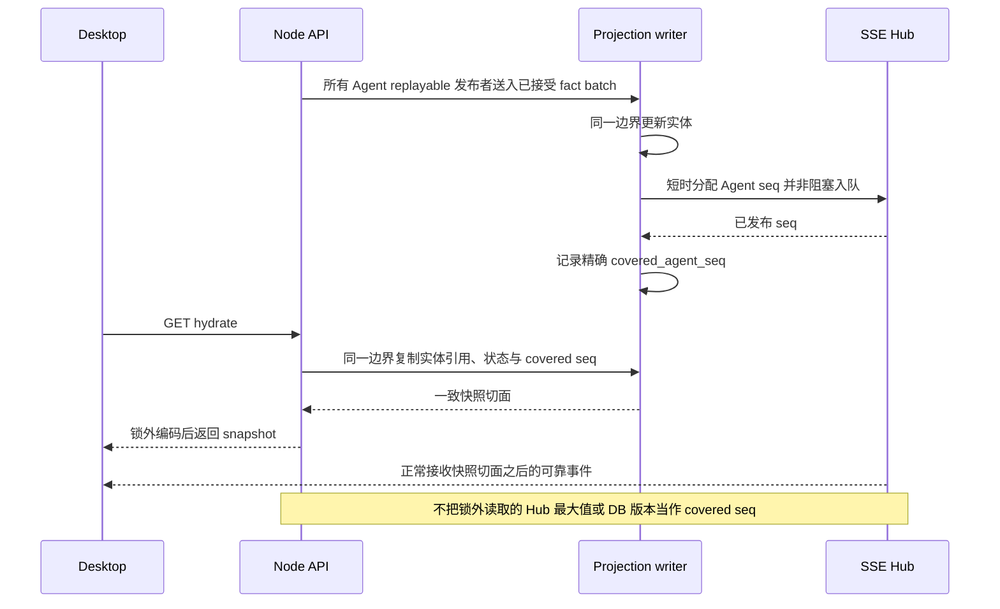

asOfSeq 来自 Node projection 的一致复制边界；DB 不把 Hub seq 当作独立事实源，Desktop 只按快照和后续序列应用。

### 5.4 慢订阅者

| 改动 | 原逻辑与入口 | 改后 / 旧逻辑处理 | 图解 |
|---|---|---| --- |
| 满队列 · 替换 | 普通事件可丢弃，critical 锁外等待最多约 2 秒再补发，仍可能丢失或被较新事件超越；[hub.go](../../node/internal/stream/hub.go) `publish` / `deliverCriticalSSE` | 入队失败标记 resync / 断开，停止正常投递；删除锁外补发和静默越过 | [G13](#flow-g13) |
| 回放与容量 · 保留并增强 | 已有按条数的历史 / 订阅缓冲、Agent cursor、epoch、retention resync；没有本方案的统一字节界限 | 保留既有重连能力，增加字节边界和 live 缺口处理；不只扩大 buffer | [G13](#flow-g13) |

删除锁外 `deliverCriticalSSE` 绕行。可靠事件入队失败时，标记该订阅 resync 并停止正常投递；通过独立控制信号或关闭订阅，让 HTTP handler 通知恢复。socket 已阻塞时以写超时断开，不能等待无限 flush。

不能为了补发让较小序号落到较大序号后面。缓冲按条数和字节设界限；ephemeral delta 可合并，但发现 chunk 缺口后必须校正草稿 / 最终正文。沿用既有保留窗口、epoch 和 after_agent_seq；不把 buffer 放大当作修复。

<a id="flow-g13"></a>

**交互图 G13：慢订阅与 resync**

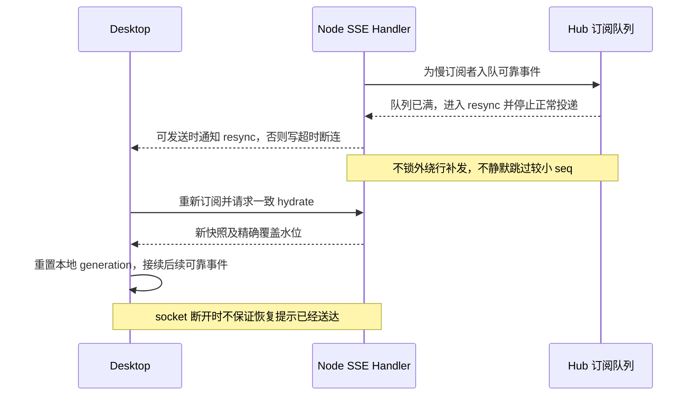

队列溢出进入明确 resync；不静默跳过序列缺口。

## 6. Desktop 状态与恢复

### 6.1 一个 controller、一个 store

| 改动 | 原逻辑与入口 | 改后 / 旧逻辑处理 | 图解 |
|---|---|---| --- |
| 状态归属 · 替换 | hydrate、streamingText、pendingUserByAgent 在 DesktopApp，执行 / 工具 / HITL 还有独立 store，MainChatPanel 再保存派生 entry；[DesktopApp.vue](../../desktop/tray-tauri/src/ui/DesktopApp.vue)、[MainChatPanel.vue](../../desktop/tray-tauri/src/ui/components/MainChatPanel.vue) | conversationStore 接管同一会话实体；保留执行权威，移除重复时间线和过期 entry 副本 | [G14](#flow-g14) |
| 同步所有权 · 替换 | 事件、watchdog、终态局部重试等在 DesktopApp 调度 hydrate | controller 统一订阅、请求、buffer、重试与释放；删除相应散落 timer / watcher | [G14](#flow-g14) |
| 完成含义 · 新增独立维度 | Composer 主要依据 turnState phase 展示运行状态，未持续表达“终态但消息未追平”；[workbench-state.js](../../desktop/tray-tauri/src/ui/workbench-state.js) `desktopComposerStatus` | phase 继续表示执行，syncStatus / resultCommitStatus 表示读取和保存；不冒充仍在执行 | [G14](#flow-g14) |

已新增 `conversationController.js` 与 `conversationStore.js` 的首批实现。当前 controller 接管活动 hydrate 调度 / 重试、single-flight / generation 栅栏和 SSE 订阅 / 快照缓冲生命周期；store 集中持有 hydrate 投影、消息 Item / pending input、assistant draft、阅读窗口和 per-Agent 同步水位。`DesktopApp.vue` 已改为消费这些所有者，但仍协调 Node API 调用与业务 snapshot apply。此为分阶段迁移，不能按下方目标字段清单视为完整接管。

store 保存：`roundsById、selectedRevisionByRound、itemsById、orderedIds、activeDrafts、pendingInputs、queueState、pendingHitl、turnState、resultCommitStatus、appliedCursor、appliedConversationRevision、targetConversationRevision、syncStatus`。context revision 只作为诊断 / 编辑资格关联，不驱动原始历史替换。`pendingInputs` 接管 sending / queued / claimed / failed / unknown 等状态，通过 request / message ID 与执行轮次合并，不保留第二份 pending-user 时间线。展开 / 勾选 / 阅读位置按 conversation + round revision + Item 身份保存；切换重发版本不能带入旧审批选择。

同步状态采用 `opening / live / catching_up / retrying / failed`。执行状态保留现有 phase；两个维度分开。终态后同步仍可以继续，不再让“当前是否执行中”决定补偿任务是否存在。

同一实体缓存服务主聊天和只读历史，但两者的已加载 round IDs、revision 选择、分页 cursor 和阅读锚点独立。历史查询只填充其视图，不把返回的旧 turn_state / queue 覆盖活动会话；主视图最近 5 轮的 selector 不扫描全部会话历史。

controller 的目标契约是统一处理：订阅就绪、buffer、快照、patch / delta、请求取消、重试和释放。首版已收敛订阅与 hydrate 调度 / retry / buffer 生命周期；snapshot 取数和业务投影尚在组件中，组件仍能协调 hydrate 请求。详情和媒体请求也携带 Agent / conversation / item version，迟到结果不得覆盖新实体。

<a id="flow-g14"></a>

**交互图 G14：单 controller 与 store**

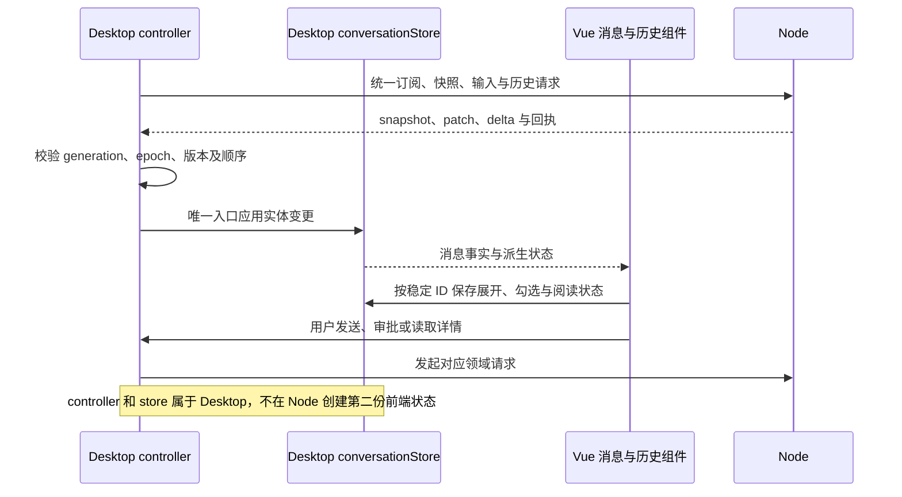

一个 Desktop controller 收口订阅、快照、补偿和请求所有权，避免多源竞争。

#### 6.1.1 稳定前缀、活动后缀与更新粒度

**关于“最新 human 之前是否会被反复渲染”的明确结论。** 正常追加新一轮时，已提交且未被显式修订的旧轮次不应因新消息或 token 到达而重新构造、重新解析正文。需要区分三个不同的列表 / 生命周期：

| 数据 | 用途 | 新一轮生成期间是否变化 | 是否是 Desktop 历史视图的来源 |
|---|---|---|---|
| Node `runtime.messages` | 当前模型调用的 working context；会受压缩、context reset、prompt 组装与恢复影响 | 可能因上下文维护而变化，范围不等于 UI 的“最新 human 之后” | 否。不能再用它重建完整聊天历史 |
| Node 持久 conversation records | 原始、可查阅的交互事实，按 round / revision / item 身份保存 | 普通追加只新增当前轮事实；已提交旧轮不写回，编辑重发只增加目标轮的新 revision | 是。Node 从这里提供有序的历史窗口与活动投影 |
| Desktop 已加载的 `orderedIds` 与 Item 实体 | 当前窗口的显示顺序、实体引用和局部 UI 状态 | 新输入追加新 ID；流式正文只更新活动 Item；工具 / 媒体 / 状态只更新对应 Item | 是。稳定 Item 沿用原对象和正文缓存 |

因此，用户说的“最新 human 之后变化”只是一种普通单轮对话的直觉模型，不能作为实现边界：queued human 尚未进入 runtime；若 A 轮还在执行时已经排队 B，A 的 assistant / tool 仍会继续变化。实现必须以 `round_id + selected revision + item_id/item_version` 为准，而不能仅按 human 在数组中的下标切分。Vue 父列表可能为新尾项做有界协调，布局也可能改变；验收禁止的是把旧前缀重新映射成新实体，或对未变正文重复运行 Markdown / 高亮解析，不要求浏览器完全不触碰旧 DOM。

**把用户观察到的前缀直接映射到实现。** 若当前正在执行的轮次从 human 输入 `Hₙ` 开始，那么 `Hₙ` 之前已提交且未被编辑重发的轮次就是稳定前缀：普通 token、工具状态变化、审批往返、完成通知和同版本 hydrate 都不得重新创建这些 Item、替换其顺序引用或重新解析其正文。只有 `Hₙ` 所属活动轮次的 assistant / tool / media Item，以及独立的 queued input 会变化。Desktop 可以因列表追加而进行一次有界协调；但稳定消息组件应继续拿到相同 Item 引用和正文输入，Markdown / 高亮解析调用增量为 0，旧消息 DOM 不应产生与活动后缀无关的变更。这个保证只在普通追加和恢复中成立；用户明确编辑重发时，目标末轮会切换 revision，只有该轮相关 Item 需要更新。排队的 `Hₙ₊₁` 尚未 claim 时不能充当边界，也不能冻结仍在执行的 `Hₙ` 轮次。

| 操作 | 允许变化的范围 | 对稳定前缀的要求 |
|---|---|---|
| 普通 token / reasoning delta | 对应的活动 assistant Item | 旧 Item 引用、正文缓存与顺序保持；不重跑旧正文解析 |
| 工具状态、结果、媒体恢复 | 对应工具 / 媒体 Item 的字段 | 其他 Item 不变；正文未变时复用 Markdown 结果 |
| 当前 human 之后的轮次继续生成 | 当前轮次 assistant / tool / media Item | 当前 human 之前的已提交前缀保持同一对象和顺序；旧正文解析与无关 DOM mutation 增量为 0 |
| 普通新输入 / 排队 | 新 `pending_input`，claim 后新轮次 | 既有轮次不改写；活动轮次不因 queued human 冻结 |
| hydrate / 重连 | 核对已加载窗口的 ID 与版本 | 同版本保留对象引用；快照核对不得为了比较内容而重新解析正文 |
| 编辑重发 | 仅目标末轮切换到新 revision | 其他轮次维持身份、对象引用和正文缓存 |
| clear / 新 conversation | 相应会话实体空间失效 | 旧会话失效属于显式边界，不应混作普通追加 |

例如 A 轮仍在生成回答时用户已排入 B，B 是最新 human，但 A 轮后续的 assistant / tool 项仍会变化，因此不能按 B 的数组下标冻结前缀。边界由稳定 `round_id`、选中 `revision` 和终态提交表达；活动轮次内部逐 Item 判断是否已完成且不可再被后续 Step 改写。

**面向实际聊天的结论。** 正常追加一轮时，Node 不应重写这轮 human 之前的已提交轮次；新输入确认后也不应让旧正文重新解析。可变部分通常是当前轮的 assistant 草稿、工具项的执行状态 / 结果，以及确有版本变化的媒体或引用元数据。队列中的下一条 human 是独立 `pending_input`，在被 claim 前可编辑或撤回，不插进模型 transcript，也不改变当前轮；claim 后它才成为新轮次输入。明确的编辑重发会改变被选中的目标轮次 revision，这是唯一允许回看并替换旧轮展示的正常交互；压缩、dreaming、重连和普通 hydrate 都不能改变原始历史正文。这样把用户的直觉落实为可测试契约，同时避免把“最新 human 的数组下标”误当稳定边界。

**当前代码到底做了什么。** 基线 `5753a322` 的 `MainChatPanel.vue` 已有 `patchStreamingTail`，普通正文 token 在既有尾项上能就地更新，因此不能把旧实现描述成每个 token 都必然重建整段历史。但在首次稳定身份切片中，SSE delta 仍经过 `projectAssistantDrafts`、`desktopChatEntries` 和列表指纹 / `buildStream` 派生；早期真实组件测试只证明稳定前缀气泡 update effect 与 Markdown parser 调用没有增长，不能证明 CPU 派生与 H 无关。当前工作区的 Desktop 按项更新切片已改为 `desktopChatItems` 有序行存储：稳定 ID 的 draft 首块插入对应行，后续 delta 原位更新该 reactive 行；`MainChatPanel` 对首块只在尾部或 reasoning/content 配对位置增量插入 stream，后续 chunk 不调用 `buildStream`。在 H=2000 集成用例里，首块加后续 7 个 delta 的历史快照行访问、mapper 和 `buildStream` 计数均为 0；审批气泡和工具分组回归通过。Node 正常 runtime-backed hydrate 也已不复制 / 扫描完整 model working set，转而投影有界 durable window V 和显式 dirty delta；Node 内部基准见后文。Desktop 对权威 hydrate、pending user 变化和非尾部结构变化仍可能重建已加载窗口，成本应按 V 单独量测；这不等同于 Node hydrate 仍遍历全部历史 H 或 model context C。上述结果不代表父级 Vue 虚拟 DOM 协调、浏览器 layout 或所有变化路径成本为零。Stable-prefix MessageBubble 更新效应与 Markdown parser 零增量由真实组件集成用例覆盖，新尾项只解析一次。不得将局部证据扩大成“整个 UI 不再触碰稳定前缀”或“所有消息操作均为 O(Δ)”。

**本地 P1a 首个端到端身份切片状态（未提交）。** Node 已为有可信 Step ID 的 assistant content / reasoning 建立稳定 item ID，SSE draft 与最终 / partial hydrate 项共用身份；attempt ID 与按 part 递增的 chunk sequence 为重试增量提供隔离，provider 出站 payload 不包含内部身份字段。Desktop reducer 已消费 `item_id / attempt_id / part / chunk_seq`，按 Agent 与 hydrate generation 隔离状态，拒绝重复、乱序及旧 attempt 的迟到块；发现序号缺口时只触发一次 hydrate 恢复。流式 draft 与最终 / partial hydrate 使用同一 item 身份，快照权威项接管后移除 draft；终态清理使用水位合并后的 lifecycle 状态，避免过期的 `terminal=true` 快照提前清掉新 transcript 的 draft。身份事件缺字段时保留 legacy `streamingText` 路径。Desktop 快照合并按 `item_id + item_version` 忽略旧版本、同版本保留对象引用、新版本只替换目标实体；`desktopChatEntries` 对已归一的稳定项直接复用对象。**Desktop draft 子切片现状（已完成本地验证）。** `desktopChatItems` 保留浅响应式有序行数组，并用 ID / index / version map 寻址；这不是最终的全会话 `orderedIds` store，也没有替换全部 legacy index adapter。对稳定 ID 的 assistant / reasoning draft，首块在尾部或配对行前增量插入，后续 chunk 只更新目标行；H=2000 的真实 MainChatPanel 用例里，插入后继续 7 次更新时 snapshot row visits、mapper calls、`buildStream` calls 都为 0。Node durable `item_version` 使用记录 payload row revision，只有实际 payload 变化才递增；active tool-call projection 先使用同一个 `tool-call/{call_id}` identity，尚未持久化时不声明版本，持久化后由 row revision 接管。该范围覆盖 user、assistant 正文/推理、持久化工具调用与 tool result，SSE assistant item 和工具调用均与 hydrate ID 连续。早期的真实组件测试另外证明稳定前缀 MessageBubble update effect 与 Markdown parse 增量为 0，新增尾项只解析一次。审批卡和工具分组回归已覆盖。Node 正常 hydrate 已去掉完整 working set C 的克隆 / 扫描，Desktop 权威 hydrate、媒体恢复、pending user 与非尾部变化仍可能对有界展示窗口 V 做映射 / stream 重建；不应再笼统标为 O(H)。无可信 Step ID 的 legacy assistant item 与全量旧 adapter 迁移仍未闭环。此切片只证明所测 tail assistant delta 的已知派生计数与 H 无关；父级 Vue 协调、DOM mutation 和 layout 仍要在隔离 Desktop 中量测，P1a 整体仍未完成。

**Hydrate 工作集扫描收敛（2026-11-17，本地实现）。** 正常 runtime-backed hydrate 现在以 durable main window 为展示权威，只叠加 `recordDeltaUpserts` 中显式未提交的记录；不会为每次 hydrate 复制并扫描 `runtime.messages`，也不再对完整 working set 做 `reflect.DeepEqual`。无 store 的嵌入路径和不持久化主数据库的 child session 仍从内存读取；持久化失败的恢复路径保留必要的内存回退。固定 2 条 durable 记录、把未投影的 runtime working set 从 2,000 扩到 10,000 条，本机 Windows / i5-13490F、`-benchtime=2s` 下 `GetHydrateView` 分别约 0.283 ms / 12.5 KB / 222 allocs 与 0.295 ms / 12.4 KB / 222 allocs。child session 有专门回归，确保 manager 持有 SQLite store 时仍保留自己的内存 transcript。该 benchmark 覆盖 Node 内部 hydrate 路径，不含 HTTP JSON 编码、IPC、Desktop reducer、Vue 或 DOM；它证明此处没有随 C 增长而复制 working set，不代表完整端到端 hydrate 与窗口投影成本为零。durable window 本身仍按 V 读取、解码并投影。

目标是：提交轮次及活动轮次中已完成的不可变 Item 保持稳定身份、顺序、对象引用和正文缓存；下一条输入开始的新轮次只使它自己的记录及活动后缀变化。父列表可对追加或恢复窗口做有界协调，浏览器也可能因新内容高度变化重新布局；不变 Item 不应因此重建成新对象、重新计算重型派生或重新解析 Markdown / 高亮。允许“父列表检查了列表”，不允许“每次新消息都把历史重新 map 成一批新对象，再让所有旧正文重算”。稳定 `key` 单独不足以保证这一点，必须同时保留实体 / 分组引用，并限制组件的响应式依赖。

**落地的数据更新形态。** Store 将 `orderedIds`（当前可见顺序）与按 ID 寻址的 Item 实体分开。正常增量只对目标 ID 做版本校验并替换该实体；追加新项时才追加一个 ID；重排 / 切换 revision / clear 才修改相应顺序或实体集合。不能在每个 chunk 上用 `{ ...itemsById }`、`map(allTranscript)`、全量 fingerprint 或重建工具分组来伪装“不可变更新”，因为这些操作即使保留子对象引用仍是 O(H)。列表父层订阅顺序和窗口，单个气泡订阅自身 ID 的实体与局部 UI 状态；只变当前尾项时，稳定前缀子项不应因读取整份 Map / Store 而订阅到该变化。活动草稿 chunk 按 ID 更新，使用帧合并控制发布频率；完成 patch 校正同一实体，快照按已加载窗口做版本核对但不替换未变引用。若实测的 Vue 依赖结构不能保证 item 级失效范围，应调整组件订阅边界，而不是依赖 `:key` 单独解决。

这项语义不等于浏览器完全不触碰旧 DOM。Vue 父列表可能因新增项运行一次有界的列表协调，浏览器也可能因新内容高度变化重新布局；目标是稳定前缀的消息实体、顺序和正文输入不变，旧气泡不因新尾项更新而重新解析 Markdown / 高亮或执行自身的重型派生。换言之，允许“父列表检查了列表”，不允许“每次新消息都把历史重新 map 成一批新对象，再让所有旧正文重算”。稳定 `key` 单独不足以保证这一点，必须同时保留实体对象 / 分组引用，并限制组件的响应式依赖。

稳定边界按以下规则判定：已终态且结果提交的轮次属于稳定前缀；当前正在执行的轮次整体仍为活动轮次，但其中已完成且不可再被后续 Step 改写的 Item 可以各自复用；队列中的输入不属于活动 transcript；编辑重发只允许对符合资格的末轮切换选中 revision，并使该轮的对应展示项更新；clear / 新 conversation 令旧实体空间失效；压缩或 dreaming 只改变模型工作集，不改变展示历史。交互见 [G42](#flow-g42)。

| 改动 | 原逻辑 / 局限 | 目标约束 | 图解 |
|---|---|---|---|
| 普通 token 更新 · 沿用并增强 | 当前 patchStreamingTail 已优先只改流式尾项，不能描述成每个 token 都重建全历史 | 保留局部更新方向，改用有身份 Item；更新活动轮次的变化 Item，不让新 token 触发稳定前缀正文解析 | [G42](#flow-g42) |
| 稳定区边界 · 明确 | 用最近 user 下标判断规则，无法表达独立 queued input 与仍在运行的轮次 | 已提交轮次 + 选中 revision 区分稳定 / active；pending_inputs 独立，不用 human 数组位置冻结活动轮次 | [G42](#flow-g42) |
| 数据对象复用 · 进行中 | 基线 hydrate 经 `desktopChatEntries` 全量 map 生成新 entry；重建 `buildStream` 时可能创建新的列表 / 分组 wrapper。当前 P1a 切片只复用带稳定 ID 且已归一的 entry，旧项仍可能走 index adapter | 完成身份覆盖后，未变化 Item 保留相同对象引用；按 ID / item_version 跳过相同版本，只替换变化项。再逐步移除全量 map / 分组路径，父列表仅做有界协调 | [G42](#flow-g42) |
| 组件依赖 · 收窄 | 稳定 key 主要保证组件复用，不能避免新 entry prop 或全局状态触发更新 | 气泡只订阅自身实体 / 局部 UI 状态；整份 items map、会话 revision、全局 streamingText 不传给每条旧气泡 | [G42](#flow-g42) |
| 增量数据结构 · 明确 | 对象引用复用尚与全量 transcript map、列表 fingerprint、工具分组混用；相同对象不代表更新成本与 H 无关 | `orderedIds` 与按 ID 寻址实体分离；Item patch 只更新目标键，不 spread / map 全体历史；父层只消费顺序，气泡按自身 ID 订阅 | [G42](#flow-g42) |
| 正文依赖 · 收窄 | ResourceMarkdown 的 computed 直接读取 entry 对象，换引用时即使 text 相同也可能重跑解析 | Markdown 输入只依赖正文和渲染配置；媒体 / 状态 / 引用更新只更新对应展示部分，不因通用 item_version 增长失效正文缓存 | [G27](#flow-g27)、[G42](#flow-g42) |
| 恢复快照 · 保留必要核对 | 完整 snapshot 常直接替换 hydrate 对象，媒体恢复后又换一次 | 首次 / 恢复可遍历已加载窗口按稳定身份与版本核对；已缓存且未变化项保留引用与正文结果，不重解析来判断相等 | [G15](#flow-g15)、[G42](#flow-g42) |

正常 patch 只包含受影响的 Item / 轮次元数据与状态，不能为了更新一个工具而捎带整个旧轮次正文。Desktop 处理已知 Item 时，旧版本忽略、同版本沿用原对象、新版本只更新该实体；排序 / 轮次选择未变就保留对应顺序与分组引用。草稿 chunk 通过 item / attempt 独立更新，不能每次复制全体 itemsById 或重新扫描全部已加载历史。列表追加允许必要的有界列表工作，不承诺所有 JavaScript 操作绝对 O(1)。见 [G42](#flow-g42)。

因此一次普通追加的目标复杂度按变化量 Δ 计算：实体写入与正文派生只随受影响 Item 数增长，列表工作最多随当前已挂载窗口 V 协调；不应随数据库中全部历史 H 增长。首次加载、恢复快照、revision 切换和清空是不同操作，可以处理其实际加载窗口，但也不能为比较正文而对同一旧窗口重复解析。该约束同时适用于一条超长 assistant 回复中的多个 token：chunk 合批可降低更新频率，但不能把 O(H) 的全表派生藏到每个合并帧里。

“保持稳定”不是 v-once 或永久冻结 DOM：旧图片可以异步加载，用户可以展开工具详情，明确的新版本可以补齐引用或状态。它们只改变对应 Item 的展示部分。编辑重发只切换目标轮次版本；clear 作废相应实体空间；渲染配置变化可以使相关正文缓存失效。epoch / 连接重建本身不等于持久正文变了，只有身份和版本仍可验证时才复用；过期草稿仍按原栅栏清理。见 [G28](#flow-g28)、[G42](#flow-g42)。

应分别记录列表派生、组件自身 render、Markdown 解析 / 高亮、DOM mutation 与浏览器布局成本。验收时明确区分“前缀实体未变”“父列表发生有界协调”“旧正文是否重新解析”三种指标；用稳定前缀子组件更新计数及 `ResourceMarkdown` 解析调用计数确认 Markdown / 高亮增量为 0，并单独记录 DOM mutation 和 layout。父组件检查列表或浏览器因高度变化重排，不等同于所有旧正文重新解析，反过来 DOM 最终未改变也不能证明没有重复解析。不能把完整 stringify / 深比较放到每个 patch 中，作为“旧消息没变”的检查。目标是稳定前缀 Markdown / 高亮调用增量为 0，而非声称整个 Vue 树完全没有 render / reconciliation。见 [G41](#flow-g41)、[G42](#flow-g42)。

**把“消息更新”和“重新渲染”拆成四层验收。** 用户看到的消息顺序稳定，并不自动证明内部没有重复工作；反过来，父组件或 Vue 做了协调，也不代表旧消息正文又被解析了一遍。方案按以下层次分别判断：

| 层次 | 普通新轮 / 流式更新的预期 | 旧前缀是否应重复处理 | 允许的例外 |
|---|---|---|---|
| Node 事实变化 | 新 human / queued input 新增；活动 assistant、tool 或媒体事实按身份更新 | 已提交、未修订的 Item 不再写回 | 明确编辑重发切换目标 revision；真正补齐旧 Item 的元数据 |
| Desktop store 合并 | 按 ID / version 接受目标 Item patch；同版本跳过；仅追加或目标实体替换 | 不重新 map、normalize 或 fingerprint 全部已加载历史 | 首次加载 / hydrate 需要在已加载窗口 V 内核对身份与版本；clear / conversation 切换重置实体空间 |
| Vue 组件更新 | 活动气泡订阅到自身正文或状态；父列表可能为尾部新增项做有界协调 | 未变化旧气泡不应因新尾项收到全局状态依赖而更新 | 窗口变化、明确的 revision 切换或旧 Item 自身 UI 状态改变 |
| Markdown / 高亮与 DOM | 只处理正文输入实际改变的消息；单条消息内部按稳定块 / 尾部增量处理 | 普通追加时稳定前缀解析调用增量为 0；浏览器仍可能重新布局 | 正文 / 渲染配置真正变化、相关缓存被淘汰后按需重建；异步图片尺寸变化可触发布局 |

因此，对“是否会重复多次渲染前面不变的部分”的回答是：目标设计不应重复重建稳定前缀实体或重复解析它们的正文；列表父层仍可能检查可见顺序，浏览器也可能因新内容改变布局。当前代码已有局部尾项更新，并非每个 token 都重建全部历史；但现有路径仍有全量投影 / 列表派生、hydrate 窗口核对等成本，只有对这些层分别计数，才能判断具体路径是否重复做了工作。方案不承诺所有旧 Vue 组件绝不调度，而承诺普通追加时旧 Item 引用与顺序稳定、旧正文 Markdown / 高亮调用增量为零，并把 hydrate 的比较成本限制在已加载窗口 V，而不是数据库全量历史 H。验收必须分别报告四层指标，不用“没有肉眼闪烁”替代性能证据，也不把一次父列表 render 误报为整段历史正文重新渲染。

<a id="flow-g42"></a>

**交互图 G42：稳定历史复用与变化项更新**

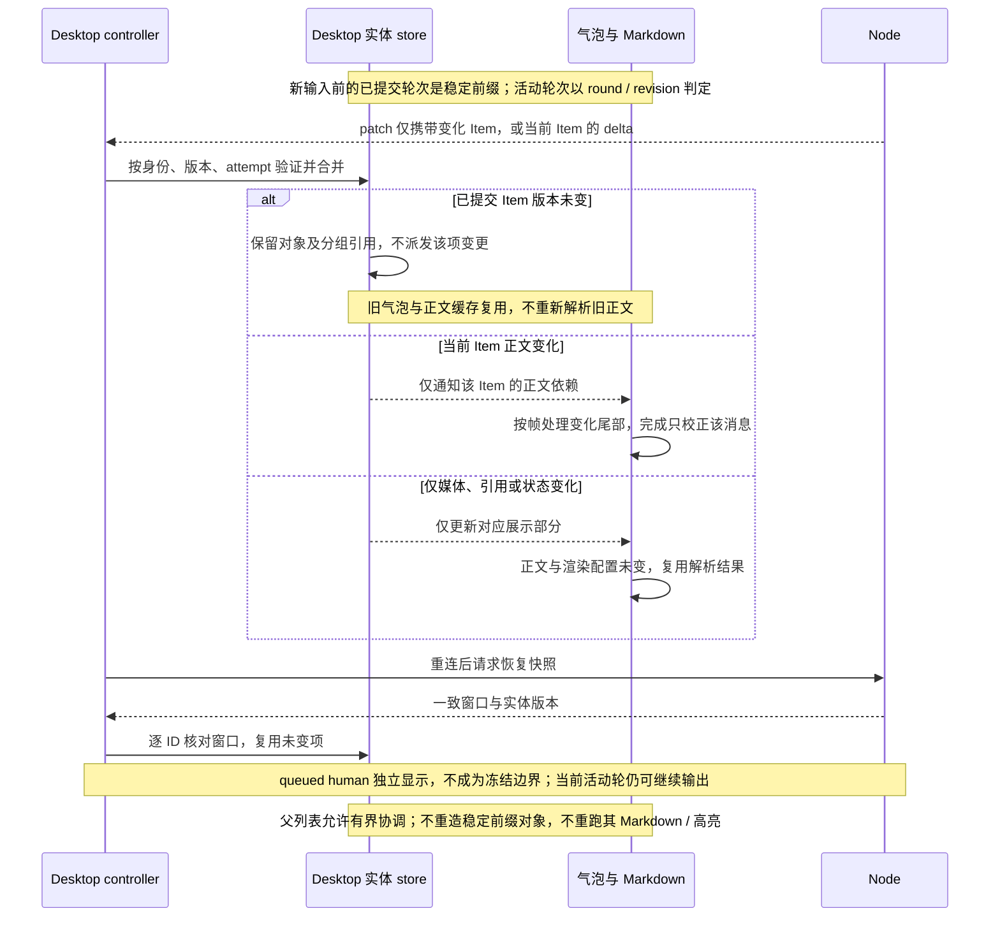

目标设计，非现状：保留稳定前缀及已完成 Item 的对象与解析结果；明确的新实体版本、局部 UI 操作和布局变化按各自范围处理。该图不承诺旧组件永不被 Vue 调度，只约束不变消息的身份、正文派生和实际 DOM 更新范围。

### 6.2 打开、重连和恢复算法

| 改动 | 原逻辑与入口 | 改后 / 旧逻辑处理 | 图解 |
|---|---|---| --- |
| 首次接续 · 增强 | 已有注册事件、hydrate 和重连 resync，但没有本方案的 ready + 精确 baseline 接续契约；[DesktopApp.vue](../../desktop/tray-tauri/src/ui/DesktopApp.vue)、[events.rs](../../desktop/tray-tauri/src-tauri/src/events.rs) | ready 后缓冲、安装 snapshot、按覆盖水位回放；不把 JS listener 注册等同订阅就绪 | [G15](#flow-g15) |
| live 缺口 · 增强 | Rust 把 cursor 推至目前最大 seq，Desktop 活动 delta 直接拼接；断线后可 hydrate，但 live 没有主动补洞 | 区分 transport / applied cursor，在完整 Agent 域检测 gap；重复幂等，缺口恢复，不静默 max 跳过 | [G15](#flow-g15) |
| 迟到响应 · 增强 | hydrate 已检查 activeId / requestSequence；缺少统一分页 / draft / 详情版本协议 | 所有异步结果按 generation / conversation / epoch / item version 校验；旧连接不能复活草稿 | [G15](#flow-g15) |
| 无后续事件 · 增强 | watchdog 仅在执行中或非终态 streamingText 时判断卡住；[DesktopApp.vue](../../desktop/tray-tauri/src/ui/DesktopApp.vue) `createTurnWatchdog` | 已接收输入、dirty 或目标未追平也持续有界对账；不因 terminal 单独停止补偿 | [G15](#flow-g15) |
| 空闲时整轮通知缺失 · 新增必选检查 | Desktop 不知道 Auto 曾启动，既没有活动任务标记，也没有下一事件可暴露跳号 | 周期批量读取 Node 水位，覆盖前台与后台 Agent；变化才触发对应同步，不依赖先收到业务事件 | [G43](#flow-g43) |

1. 创建新的客户端 generation，注册事件接收，并等待 transport 明确“订阅已就绪”；其间先缓冲。（图解：[G15](#flow-g15)）
2. 请求一致快照。应用时校验 Agent、conversation、epoch 和请求 generation。（图解：[G15](#flow-g15)）
3. 安装 snapshot；回放同 epoch 中 `agent_seq > covered_agent_seq` 的缓冲事件。可靠序列在本 Agent 域连续，重复忽略，缺口进入恢复；无关事件可以作为 no-op 消费以推进该域。（图解：[G15](#flow-g15)）
4. 草稿只应用同 epoch、当前 open attempt 且大于 `through_chunk_seq` 的 chunk。完成 / 放弃标记是栅栏；缺口时请求恢复，不在错误前缀上继续拼接。（图解：[G15](#flow-g15)）
5. 保留窗口不足、epoch 变化、buffer 溢出或显式 resync 时，作废旧 generation、清理旧 active drafts，重新安装快照。旧请求 / 旧 chunk 不能越过这一边界。（图解：[G15](#flow-g15)）

仅注册 JS listener 不算订阅已就绪，Rust 需给出明确 ready 握手。传输“已收到”的 cursor 与 store“已应用”的 cursor 分开；重连 replay 与新快照都必须由 store 幂等处理。

同一活动会话最多一个 snapshot 请求。执行中再次要求同步，只记录 dirty / 目标水位；当前响应可前进则先应用，再决定是否补下一次，不因为“又启动了一个请求”就无条件丢弃可用结果。切换 Agent 和销毁组件时中止旧请求，迟到返回仍须校验 generation。

controller 保留有界的任务停滞对账：存在已接收输入、活动 Turn、dirty 或未追平目标时，即使一段时间没有新事件也应检查状态，覆盖“最后一条通知没有到达，之后再无事件可触发跳号检测”的窗口。执行与同步均收敛后可停止该任务的快速对账，但不能停止 §6.2.1 的连接级轻量水位校验。心跳只证明近期有通信，不证明消息已追平；任何探测到的最新水位都只能提示需要同步，不能直接当成已应用水位。

<a id="flow-g15"></a>

**交互图 G15：ready、snapshot、buffer 重连接续**

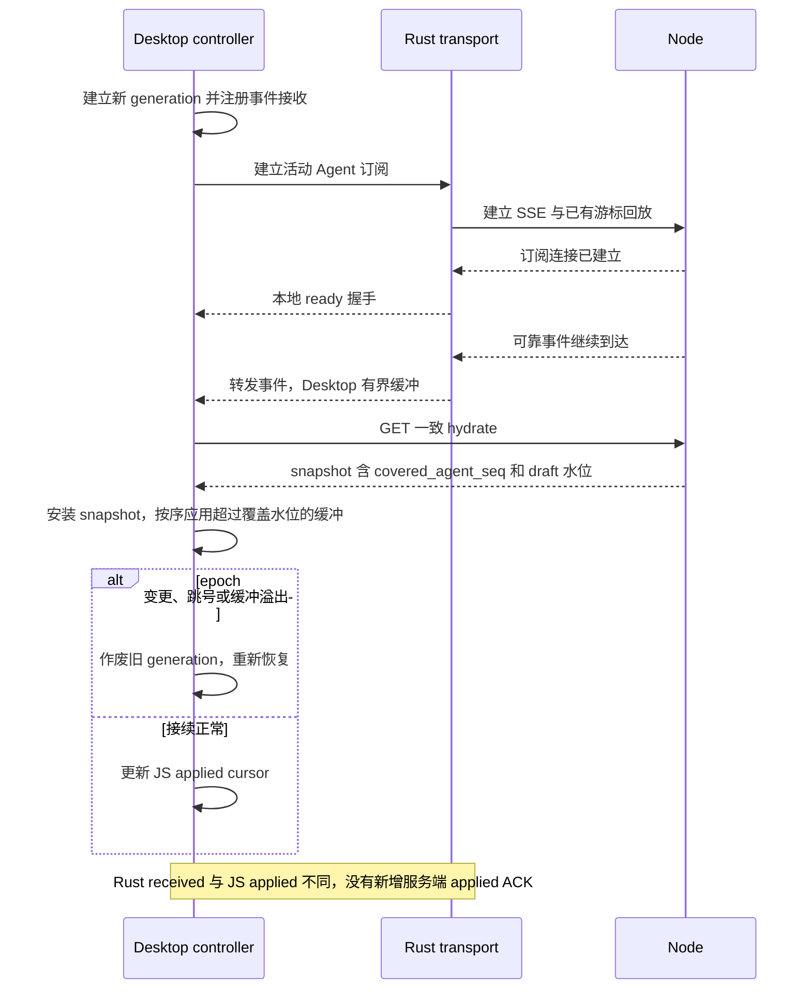

重连区分 Rust 收到与 JS 应用；不虚构 Desktop->Node applied ACK。

#### 6.2.1 无通知、通知延迟与轻量水位校验

水位校验是必选机制，不依赖 Desktop 已知“正在执行”。关键反例是空闲 Auto 在 Node 自行完成一轮，但开始、工具、正文和完成通知全部未到达 Desktop；此时没有序号跳变可观察，普通执行 watchdog 也不会启动。只有独立探测到新的会话版本 / 水位，才有机会发现这轮工作。交互见 [G43](#flow-g43)。

| 场景 / 机制 | 原逻辑或局限 | 必选处理 | 图解 |
|---|---|---|---|
| 中间可靠事件缺失 | 有后续事件才可能观察到跳号；不能跳到最大已收序号 | 停止越洞应用，通过原会话 controller 回放或读取一致快照 | [G15](#flow-g15)、[G43](#flow-g43) |
| 最终通知缺失 | 不一定还有下一条事件，已显示 terminal 也不等于结果已同步 | 已知未收敛任务保留停滞对账；轻量水位作为独立后备 | [G16](#flow-g16)、[G43](#flow-g43) |
| 空闲 Auto 整轮通知缺失 | 没有 pending / active 标记，心跳仍可能正常 | 周期校验全部本地 Agent 的轻量元数据，比较前台与后台各自的会话版本 / 水位 | [G43](#flow-g43) |
| 通知延迟、重复或旧 epoch 到达 | 迟到事件可能引起状态回退、草稿复活或重复消息 | 依现有 epoch、Agent seq、Item / attempt 栅栏去重；快照已经覆盖的事件不再应用 | [G09](#flow-g09)、[G15](#flow-g15) |
| 仅正文 delta 缺失 | ephemeral 不保证逐 chunk 回放，不能一直在缺片的前缀上拼接 | 读取当前草稿基线或由最终完整 Item 校正；控制事件和可靠事实仍按各自序列恢复 | [G11](#flow-g11)、[G43](#flow-g43) |
| 后台更新与窗口恢复 | WebView 定时器可能被限速，窗口休眠期间不能承诺准点检查 | 后台保持低频检查；恢复焦点、联网、重新打开或切换 Agent 时立即对账 | [G32](#flow-g32)、[G43](#flow-g43) |

拟新增 `GET /v1/agents/watermarks`，一次返回 `stream_epoch` 和轻量 `agents[]`；各项至少包含 agent_id、当前 conversation_id、conversation_revision、latest_agent_seq 和 result_commit_status。读取已维护的摘要 / 投影水位，不读取完整 messages_json、原始正文、大工具结果，也不为了探测而启动 Agent。静态 watermarks 路由优先于动态 Agent ID 解析，schema 不支持时明确报错，不静默退回只依赖通知的模式。见 [G43](#flow-g43)。

响应用于发现变化：它不是一致 hydrate，也不是已应用 cursor；latest_agent_seq 是待核对的目标提示，不能替代 covered_agent_seq。字段在各自 Agent 的明确读取边界采集，不声称所有 Agent 共用一个全局事务快照。同 epoch / conversation 的迟到低水位不能回退 target 或清除尚未完成的 dirty。若会话 ID / epoch 变化，先获取新的权威快照；不能拿不同 conversation 的 revision 比大小，或直接用水位响应切换 UI 对话。列表成员变化先通过现有轻量 Agent 列表核对。见 [G43](#flow-g43)。

由同一个 conversation controller 管理连接级探测与任务同步，复用现有 Node HTTP 客户端；不新增后台消息服务、第二个 reducer 或每 Agent 一个轮询 timer。初始内部策略：Desktop 可见时约每 15 秒批量校验一次，后台 / 最小化约每 60 秒一次，加入小幅抖动；启动、恢复焦点 / 联网、重连和 Agent 切换立即触发并合并重复请求。SSE 心跳正常也不关闭独立 HTTP 校验，以覆盖业务事件或 Native → WebView 转发漏投。休眠 / UI 阻塞时不承诺该时限，恢复后立即补查。数值通过同机验收调整，不增加普通用户设置。见 [G43](#flow-g43)。

探测请求 single-flight、有超时、旧 generation 丢弃；失败按既有退避规则降频，持续故障时上限不高于每分钟一次连接级探测并展示连接 / 同步异常。对活动会话，发现新目标后合并到既有 dirty / target，进入回放 / 快照恢复；对后台 Agent 只标脏并按需刷新轻量摘要 / 通知，不立即 hydrate 全部 Agent，打开时再 ready + snapshot。水位未变不重建列表、不触发消息组件或 Markdown。见 [G16](#flow-g16)、[G32](#flow-g32)、[G43](#flow-g43)。

连接级轻量探测可以长期存在，但不能让每次相同水位响应都重置“结果读取”的有界重试预算。某目标已耗尽自动恢复时保留可操作错误；新目标、明确连接恢复、用户重试等才按合并规则开启下一轮。探测和同步只读取事实，不重新 POST 用户任务、不重跑工具、不决定 Node 是否自动 next。持续无法通信时只能显示尚未同步，不能承诺在固定时间内必定看到结果。见 [G16](#flow-g16)、[G43](#flow-g43)。

<a id="flow-g43"></a>

**交互图 G43：空闲 Auto 通知全丢与独立水位恢复**

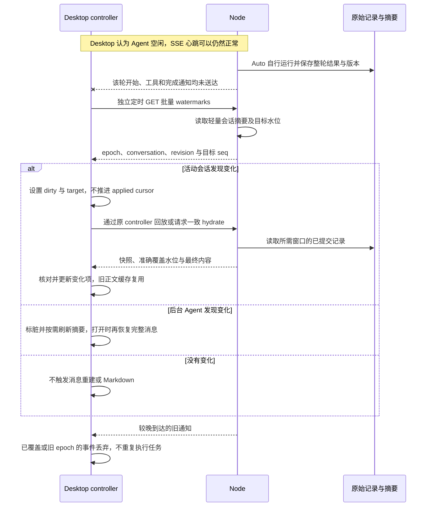

目标设计，非现状：独立轻量查询发现“从未收到任何业务通知”的更新；可靠事件仍负责低延迟展示，最终数据以已提交记录与一致快照为准。

### 6.3 重试与用户提示

| 改动 | 原逻辑与入口 | 改后 / 旧逻辑处理 | 图解 |
|---|---|---| --- |
| 请求调度 · 替换 | 每次事件重设 timer，无 maxWait / single-flight；只接受最后发起请求的响应；[DesktopApp.vue](../../desktop/tray-tauri/src/ui/DesktopApp.vue) `scheduleActiveAgentHydrate` / `hydrateAgentSnapshot` | 一个请求 + dirty / target；有最大等待，先应用仍可前进的结果，再补请求 | [G16](#flow-g16) |
| 失败恢复 · 替换 | 最后一次 hydrate 失败写入通用 error，没有统一重试；仅有 incomplete 的局部一次补偿 | 有界退避、重连 / 手动重新触发；删除局部补丁，不重发用户任务 | [G16](#flow-g16) |
| 用户提示 · 增强 | 已有输入栏状态和错误展示，但缺少专门“执行结束、结果未同步”的状态 | 复用底栏，延迟显示同步提示及重试 icon，区分保存失败；统一停止仍只控制真实执行 | [G16](#flow-g16) |

P0 就实现 single-flight、明确 dirty 标志、最大等待和失败重试，不再使用可无限后移的裸 debounce。初始建议：普通同步最多延后 250ms；终态立即请求；失败按 0.5 / 1 / 2 / 4 / 8 秒退避并加抖动。一轮自动重试失败后保持可操作的失败状态；手动重试、恢复联网、重连或新提交目标可重新触发，不能残留无穷定时器。

复用输入栏底栏状态区域，字体和动效沿用当前统一风格：短暂同步不闪提示；持续超过约 600ms 显示“正在同步结果”；失败显示“结果暂未同步”和带悬浮说明的重试 icon。界面不用 Node / lifecycle / revision 等术语。

停止按钮只控制真实执行。同步重试不占用停止按钮，不自动切换模型，不重复发送用户输入。真实模型错误沿用已实现的错误恢复入口；“重新执行任务”与“重试读取结果”必须分开。

<a id="flow-g16"></a>

**交互图 G16：singleflight 重试与用户提示**

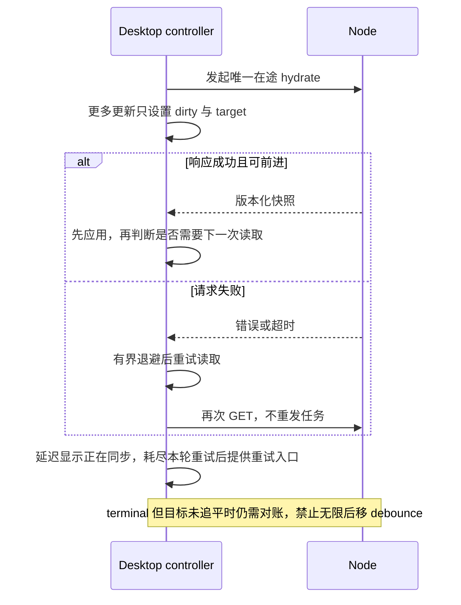

同步重试只读取结果；连接级水位探测不能不断重置同一目标的重试预算，也不扩大为外部操作 exactly-once 保证。

### 6.4 工作中发送、队列编辑与自动下一条

| 改动 | 原逻辑与入口 | 新方案 | 图解 |
|---|---|---| --- |
| 工作中发送 · 打通前端 | Node 已有 InputBox 与消费循环；Desktop `send` / `sendMessageToActiveAgent` 在 agentGenerating 时返回，pending map 仅保留一条；[DesktopApp.vue](../../desktop/tray-tauri/src/ui/DesktopApp.vue)、[runtime.go](../../node/internal/session/runtime.go) | 保留 Node 单消费者，前端允许排队发送，序列尾部显示多条有稳定 ID 的待处理输入 | [G17](#flow-g17) |
| 输入类型 · 拆清语义 | 当前底栏在 user_information 时会把普通发送转成询问回答，其他 HITL 会阻挡发送 | 底栏普通发送始终是新输入；询问回答 / 审批通过其卡片明确提交，不因输入正文像回答就隐式 resume | [G17](#flow-g17) |
| pending 编辑 / 撤回 · 新增 | InputBox 有 Append / Pop / Ack，没有公开的 queued CAS 编辑或撤回；[input_box.go](../../node/internal/session/input_box.go) | 仅 queued 可 edit / cancel；与 claim 共用调度与持久边界，已 claim 返回冲突 | [G18](#flow-g18) |
| 自动 next · 增强并补 UI | Node 已有 Pop、持久 ownership、MarkCompleted、persist、Ack 的闭环，前端缺少用户可管理队列 | 保留安全顺序，成功终结后自动下一条；停止 / 错误 / 恢复失败时保留并暂停待处理输入 | [G19](#flow-g19) |

#### 输入状态与视觉位置

```text
本地 draft -> sending -> queued -> claimed / running -> consumed
                 |         |             |
             failed/unknown edited/cancelled   round terminal + durable Ack
```

普通发送在主消息序列尾部形成 pending card，显示正文 / 附件摘要及“发送中”或“待处理”。服务端 accepted 后才确认队列位置；重连从 pending_inputs 恢复。当前轮次的 assistant / 工具继续在其组内更新，排队输入不进入模型 messages，不影响当前任务。

pending 区使用与消息相同的排版，按队列顺序排列；较多时仅展开最近几项并显示待处理总数，完整待处理列表按需展开。队列项右键菜单提供“编辑”“撤回”，不增加侧边栏悬浮动作。claim 后原消息成为新轮的输入，移除 pending 状态，不能同时在两个区域显示。

发送请求采用不可变 payload + client_request_id；同一发送 RPC 未确定结果前不重复 POST 或创建另一个同内容请求。文本框仍可编辑下一份草稿；成功时只清除已提交且未被再次修改的草稿 / 附件，不能清掉 RPC 期间新输入。网络超时标记 unknown 并按原 request ID 对账，不盲目换 ID 重发。

<a id="flow-g17"></a>

**交互图 G17：工作中排队发送与对账**

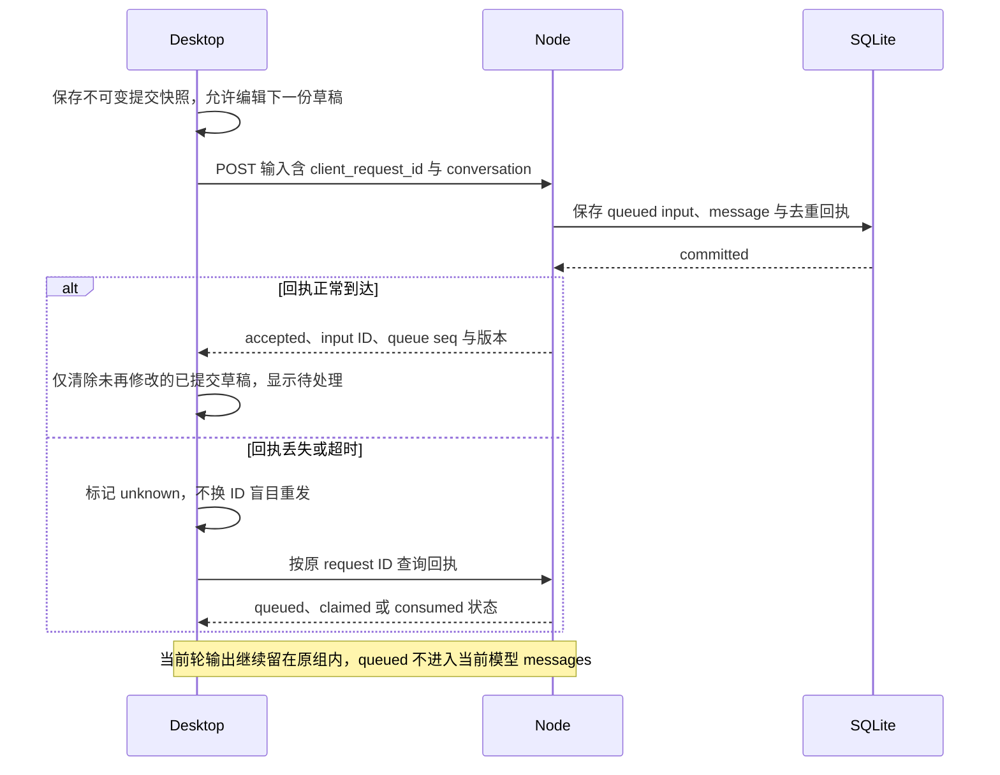

排队发送使用原 request ID 和 receipt 对账；只有当前轮闭环后才 claim 下一条，不能以 UI 发送成功代替执行。

#### 编辑、撤回与 claim 的一致性

- queued 编辑保留 input ID / queue seq，携带 expected_input_revision；保存正文 / 附件引用后 revision 前进，旧版本不会被 consumer 误执行。（图解：[G17](#flow-g17)）
- 撤回同样做状态 CAS；返回成功意味着之后不可 claim。若 claim 已先提交，返回 409 和当前状态，保留用户编辑草稿，提示该消息已经开始处理。（图解：[G17](#flow-g17)）
- claim、queued edit / cancel、去重回执与 InputBox 内存镜像不能各自独立保存；以 §3.2 的持久输入行为权威，用 execution gate + 输入操作边界串行化，事务成功后才唤醒 consumer。旧 Append 先 wake、persist 忽略错误的窗口必须收口。（图解：[G17](#flow-g17)）
- 用户输入之间保持 FIFO。沿用现有 PopForIdle 的有限例外：只允许人工输入越过队首连续 system_auto 段，不跨越普通 trigger / child-agent 屏障，也不抢占已 claim 的输入。不新增拖拽重排或“立即插队执行”。（图解：[G17](#flow-g17)）
- 复用现有 256 条和单记录大小边界，正文 / 附件修改后重新校验。UI 给明确的队列满 / 输入过大错误，不让网络失败吞掉草稿。（图解：[G17](#flow-g17)）

<a id="flow-g18"></a>

**交互图 G18：queued 编辑撤回与 claim CAS**

```mermaid
sequenceDiagram
participant Desktop
participant Node
participant DB
Desktop->>Node: edit/cancel(input_id,expectedRevision)
Node->>DB: CAS queued revision
alt CAS成功
DB-->>Node: updated/cancelled
Node-->>Desktop: new state
else 已 claim
DB-->>Node: conflict
Node-->>Desktop: cannot edit old input
end
```

编辑和撤回只作用于未 claim 输入；claim 与编辑必须由同一持久边界裁决。

#### 自动推进策略

| 当前状态 | 新输入 | 自动 next | 图解 |
|---|---|---| --- |
| 正常生成 / 工具执行 | 可追加 queued，不抢占 | 当前完整轮次提交、消费 Ack 成功后自动继续 | [G17](#flow-g17) |
| 等待审批 / 询问 | 可追加 queued；卡片决策独立 | 等当前交互解决并终结；普通新消息不能绕过审批 | [G20](#flow-g20) |
| 本轮正常完成（含工具失败后模型已正常收尾） | 可追加 | 自动继续下一合法输入 | [G19](#flow-g19) |
| 用户点击停止 | 保留队列，停止命令同时先暂停 claim | 不自动开始下一条；显示“待处理已暂停”，用户显式“继续处理”才恢复 | [G19](#flow-g19) |
| 模型失败、预算耗尽、中断 / unknown recovery、记录保存失败 | 可保留草稿或追加 queued，明确暂停原因 | 暂停；先处理错误，再显式继续。恢复运行不能重做已成功工具 | [G19](#flow-g19) |
| Desktop 关闭 / 重连 | 已 accepted 输入仍在 Node | 不因 UI 断开自动取消；正常队列仍继续，已暂停队列重启后也保持暂停 | [G19](#flow-g19) |

停止时“暂停 claim”与“取消 active Turn”在同一控制边界建立，防止完成信号恰好触发下一条。该暂停作用于 Agent 的新根输入消费，trigger 配置本身不被禁用；未来投递仍受现有容量、过期和 delivery identity 规则约束。继续队列不复活已取消 Turn，而是从下一条 queued 输入开始。

<a id="flow-g19"></a>

**交互图 G19：自动 next、Stop 原子暂停与错误暂停**

```mermaid
sequenceDiagram
participant D as Desktop
participant N as Node execution gate
participant DB as 持久队列与执行事实
alt 正常完成且未暂停
N->>DB: 保存终态、记录、checkpoint 与消费 Ack
DB-->>N: 闭环成功
N->>DB: 同 gate 验证控制版本并 claim 下一条
N-->>D: 下一轮开始
else 用户停止与完成竞争
D->>N: Stop 当前任务
N->>DB: 同一控制边界持久暂停 claim 并建立取消栅栏
N->>N: 取消活动 Turn，阻止新的 claim
N-->>D: 队列保留且已暂停
else 模型失败、额度耗尽或保存失败
N->>N: 暂停消费；保存失败则 recovery required
N-->>D: 原因与显式继续入口
end
Note over D,N: 迟到回执不能恢复已再次暂停的队列
```

Stop 必须在 claim 前与队列控制边界原子暂停；错误分支自动暂停并保留队列，不能画成用户再次发 stop 才暂停。

#### 输入栏与审批互不抢锁

把 `agentGenerating / busy` 的混合语义拆为 turnRunning、submitPending、approvalSubmitting、cancelPending、queuePaused。主聊天和资源页的 dock 都遵守同一逻辑：工作中可编辑 / 发送待处理输入，不能因为正在生成就把整条输入栏 disabled。

发送（执行中含义为“加入待处理”）与停止使用位置固定的两个 icon 槽位，悬浮显示说明，不把同一按钮瞬间从箭头换成方块。底栏固定高度显示当前状态和待处理数量，使用已有字体 / 动效与 aria-live=polite，减少布局跳动。

审批只锁其当前提交请求 / interaction，不借全局 busy 锁住普通输入；网络超时先读取审批权威状态，不能自动重复批准。询问卡片承载明确的回答入口，底栏排队输入不被截走当成回答。

<a id="flow-g20"></a>

**交互图 G20：普通输入与审批独立锁**

```mermaid
sequenceDiagram
participant D as Desktop
participant N as Node
participant DB as 输入与审批事实
N-->>D: pending interaction 与稳定 call IDs
D->>N: 普通输入 POST
N->>DB: 仅保存 queued 输入与回执
N-->>D: 待处理，不替代审批或询问回答
D->>N: 用户在卡片明确批准、拒绝或回答
N->>DB: 按 interaction 验证并保存决定
N-->>D: 审批回执与当前轮更新
D->>D: 卡片提交只锁该 interaction；发送和 Stop 槽位稳定
Note over D,N: 当前轮终结并提交 Ack 后，普通输入才可被消费
```

普通输入和审批共享事实存储但锁边界独立；审批等待期间普通输入只能排队，不能 claim 新 turn。

### 6.5 编辑重发最后一条已执行消息

| 改动 | 原逻辑 | 新方案 | 图解 |
|---|---|---| --- |
| 编辑重发 · 新增 | 没有原消息修订、pre-round checkpoint 和替换轮次契约；直接改 messages 会影响工具配对与已执行事实 | 末尾 human 轮次建立新 revision，创建新输入与新 Turn；保留旧 revision 原文、回复和工具结果 | [G21](#flow-g21) |
| 重新执行上下文 · 新增 | 压缩后的 messages 可能已无原 human 和此前精确工作集 | 恢复持久 pre-round checkpoint，再加入修改后的输入；不能截数组 / 摘要反推基点 | [G21](#flow-g21) |
| 历史版本 · 新增 | 没有 UI 选中版本与执行身份的分离 | logical round ID / 位置不变，revision 与真实执行 ID 全新；旧版本在历史中只读可查 | [G21](#flow-g21) |

首版范围刻意有限：

1. **未执行输入**走 §6.4 的 queued 编辑，不创建“重做任务”。（图解：[G21](#flow-g21)）
2. **已执行输入**仅允许当前对话末尾、由 human 发起且已终结的逻辑轮次编辑重发；其后不能有独立 Auto / trigger / human 轮次，当前不能有 active Turn / 未处理队列，且 pre-round checkpoint 存在并与 context lineage 兼容。（图解：[G21](#flow-g21)）
3. 正在执行的 human 不能直接改写；先停止并完成终态 / 保存收尾。已有后续独立轮次、已跨 dreaming reset 或 checkpoint 不兼容时，只提供“复制为新消息 / 发送补充”，不假装支持任意历史分叉。（图解：[G21](#flow-g21)）

eligibility 由 Node 返回，不由 Desktop 扫“最近一条 user 文本”判断。human 气泡的右键菜单提供“编辑并重发”；进入后输入栏有轻量编辑状态和退出 icon，提交动作说明为“保存并重发”。旧轮执行过工具时展示简短事实“此前操作不会撤销”，不做文件回滚或复用旧审批授权。

请求携带 command_id、target round / selected revision、expected conversation revision、编辑后的正文 / 附件引用。Node 在 execution gate 内重验资格和预期 head，将新 revision / 输入 / 回执事务提交并保留运行预约，避免校验后被 Auto 抢先插入新轮；旧修订只标为非选中，不修改其真实 completed / failed 状态。

重发先持久提交 prepared revision、其唯一输入、pre-round checkpoint 引用、选中版本与运行预约；此时不靠内存改写当前工作集，也不声称模型已运行。claim 在同一 gate 内按预约验证 head / queue control revision，持久绑定全新 Turn / generation 和恢复基点后才发起模型请求；Step / attempt 在实际创建时持久分配新身份。崩溃发生在 prepared 与 claim 之间时，从该输入 / 预约恢复，不再创建第二个修订；已 claim 则走现有执行恢复栅栏，不因“回复尚未显示”重跑工具。预约是可恢复的持久状态，不是永久占住的进程锁；无法安全恢复时暂停并显示原因。

若队列已暂停，“保存并重发”明确表示启动该修订，须同时 CAS 当前控制 revision 并显式恢复消费；该操作不在已存在其他 pending 输入时开放。先提交的预约优先于之后到达的 Auto 输入；随后到达的用户停止仍以更新后的控制 revision / generation 阻止启动，不允许重发的迟到响应悄悄恢复已再次暂停的队列。

开始新运行时恢复该逻辑轮次的 pre-round checkpoint，创建新的 turn_id / generation / attempt_id 和工具 / 审批身份。system prompt / 当前权限仍遵守当前配置；允许使用当前模型，但不回滚记忆、手册、配置或文件。若恢复与当前上下文策略不兼容，明确拒绝，而不是悄悄把重发追加到包含旧答案的上下文。

给模型注入可信的重发说明：用户修改了该轮输入，先前工具操作可能已生效，应检查实际资源状态。该说明不把旧 assistant 答案自动带回新上下文，不提供绕过审批的权限，也不保证模型能自动消除重复副作用。

提交成功后主界面选择新 revision；历史页仍能查看旧版本并标识“已被重发替代”，不混排到当前因果链。新运行失败也不自动切回旧答案或再次重发；用户可以查看旧结果，后续继续使用新版本已形成的真实状态。重发完成后允许再次编辑同一末尾 logical round，复用其原始 pre-round 基点，不一层层把失败答案带入上下文。

旧版本的附件 / 结果引用仍需可读；修改新输入不删除旧引用。取消编辑只退出本地编辑模式，不取消已执行任务，也不覆盖用户原本的普通草稿。

<a id="flow-g21"></a>

**交互图 G21：末轮编辑重发：prepared、claim 与新修订**

```mermaid
sequenceDiagram
participant D as Desktop
participant N as Node execution gate
participant DB as 会话与 checkpoint 存储
D->>N: resubmit 含 command ID、预期 head 与新输入
N->>N: 复核末轮资格、无 active 或 queued、lineage 兼容
N->>DB: 原子保存 prepared revision、唯一输入与持久运行预约
DB-->>N: committed
N-->>D: 新 revision 与 input 回执
N->>DB: claim 验证预约及控制版本，保存新 Turn 与恢复基点
DB-->>N: claimed，重启可按同一身份恢复
N->>N: 恢复原始 pre-round，上下文不含旧答案
N->>N: 使用当前 prompt、权限与新 attempt 运行
N->>DB: 保存新版本结果与终态
N-->>D: 同一逻辑轮位置更新新修订
D->>N: 查询旧 revision
N-->>D: 旧正文与工具结果只读返回
Note over D,N: 旧工具副作用不撤销，新调用不继承旧审批
```

目标设计，非现状；说明末轮重发的资格复核、prepared 持久化、claim、新执行身份及旧版本保留，不增加新契约。

## 7. API 调整

以下为目标契约，P0 的完成水位增强可以先交付，P1 由同一 Desktop 版本切换读取。

| 接口 / 性质 | 原逻辑与入口 | 改后 / 旧逻辑处理 | 图解 |
|---|---|---| --- |
| `POST /v1/messages` · 增强 | message 请求没有 client_request_id / conversation_id；响应为 accepted、agent_id、priority；[server_messages.go](../../node/internal/api/server_messages.go) `postMessageRequest` / `postMessageResponse` | 增加输入幂等 ID 和预期 conversation，返回 input / message ID、input_revision、queue_seq、queued / claimed 状态；执行中仍可接收；入队、记录与去重同一持久边界 | [G17](#flow-g17)、[G22](#flow-g22) |
| `GET /v1/agents/{id}/hydrate` · 替换响应契约 | 返回完整 transcript、turn_state、pending_hitl、history_revision 和 Hub hints；[server_agent_api.go](../../node/internal/api/server_agent_api.go) `sessionHydrateResponse` | 保留入口，精确快照含最近 5 个终结轮次、active、pending_inputs、queue_state、编辑资格及独立 conversation / context revision；不返回全量旧历史。`transcript_synchronized` 只有当持久记录读取成功且最新结果提交没有失败时才为 true；读失败时仅用活内存解释 recovery 状态、或记录读取成功但本轮写入失败，均不得宣称历史已追平 | [G12](#flow-g12)、[G29](#flow-g29) |
| `GET /v1/streams` · 增强 | 已有 SSE、Agent 过滤、after_agent_seq、live 和 resync；[server_messages.go](../../node/internal/api/server_messages.go) `handleStreams` | 保留 SSE 和回放基础，增加 patch / delta / ready；修复 overflow 与 live 缺口 | [G11](#flow-g11)、[G15](#flow-g15) |
| `GET /v1/agents/watermarks` · 新增 | 已有心跳只证明连接存活，没有不依赖通知的批量会话变化发现接口 | 返回 epoch 与各 Agent 的轻量 conversation / revision / 目标 seq / 保存状态；发现变化才调度原同步路径，不返回正文、不更新 applied cursor | [G43](#flow-g43) |
| `GET /v1/agents/{id}/conversations` · 新增 | 没有本方案的当前 / 归档对话列表 | 历史页读取对话摘要，不加载所有正文 | [G23](#flow-g23)、[G30](#flow-g30) |
| `GET /v1/agents/{id}/conversations/{cid}/rounds` · 新增 | 原“加载更早”移动内存窗口，没有独立历史页；[MainChatPanel.vue](../../desktop/tray-tauri/src/ui/components/MainChatPanel.vue) | 历史页按 round cursor 查询，支持日期 / 来源 / 状态等定位条件；不采用裸 message offset | [G23](#flow-g23)、[G30](#flow-g30) |
| `GET .../conversations/{cid}/rounds/{round_id}/revisions` · 新增 | 无消息重发版本记录 | 只读版本元数据与关联项入口；默认选中当前 revision，旧执行事实不覆盖 | [G23](#flow-g23)、[G30](#flow-g30) |
| `GET .../conversations/{cid}/rounds/{round_id}/items` · 新增 | 工具大组全部随 transcript 载入 | 在明确 revision 内查询轮内项 / 工具摘要页，保留父轮次与总数，不截断调用 / 结果关联 | [G23](#flow-g23)、[G30](#flow-g30) |
| `GET .../conversations/{cid}/messages/{item_id}` · 新增 | 参数 / 结果主要随事件和 hydrate 一起传入；[transcript_entries.go](../../node/internal/session/transcript_entries.go) | 正文 / 参数 / 结果详情按需获取，返回 item_version；减少大载荷，不引入工具状态轮询 | [G23](#flow-g23)、[G30](#flow-g30) |
| `GET .../conversations/{cid}/inputs` · 新增 | hydrate 只有 queue_pending 数量，没有完整人工输入回执查询 | 获取待处理状态；可按 client_request_id 查 accepted / consumed / cancelled 回执，处理 POST 结果未知 | [G17](#flow-g17) |
| `PATCH / DELETE .../conversations/{cid}/inputs/{input_id}` · 新增 | InputBox 没有外部 edit / cancel CAS | 携带 expected_input_revision / command_id，只修改或撤回 queued 输入，已 claim 明确冲突 | [G18](#flow-g18) |
| `POST .../conversations/{cid}/queue/control` · 新增 | 没有本方案的持久 queuePaused 用户控制 | 显式 pause / resume；停止当前 Turn 与暂停 claim 在同一控制边界，继续不复活旧 Turn | [G19](#flow-g19) |
| `POST .../conversations/{cid}/rounds/{round_id}/resubmit` · 新增 | 无已执行消息编辑重发 | CAS 验证末轮资格，创建新 revision / 输入 / 新执行身份，返回版本与回执 | [G21](#flow-g21) |
| `POST /v1/agents/{id}/conversations`、`DELETE .../conversations/{cid}` · 新增数据边界 | 既有 clear 直接清理 messages；没有独立归档会话实体 | 新建须 CAS 当前 head、停稳活动执行并明确处理旧队列，再归档旧对话；删除清除对应内容和索引，不能把清空解释成隐式归档。既有 clear 入口复用相同清理服务，不重复实现删除 | [G07](#flow-g07)、[G22](#flow-g22) |
| timeline / context / tool-jobs · 沿用职责 | 已分别提供生命周期审计、模型上下文与工具诊断；[server_agent_api.go](../../node/internal/api/server_agent_api.go) 及相关 API handler | 保留这些用途；展示投影接管聊天拼装，不将诊断路由误用成聊天历史分页 | [G23](#flow-g23)、[G30](#flow-g30) |

幂等范围至少是 Agent + conversation + client_request_id。同 ID 同内容返回原回执；同 ID 不同内容返回冲突，内容与附件引用都要校验；成功回执要覆盖服务端已接收、客户端未收到响应后重试的窗口。InputBox seq、message ID 和去重记录同一提交成功才返回 accepted；当前忽略入队保存错误的路径必须改为上报失败并撤销未接受内存输入，不能生成假成功回执。

上述 `...` 均为 `/v1/agents/{id}` 前缀，不是额外路由别名。消息编辑、队列控制和重发统一复用领域事务 / CAS 错误类型，不为每个按钮建立一个独立状态来源。此前计划中的无 conversation 作用域 `/messages` 分页接口尚未落地，本稿直接以作用域明确的 rounds / items 读取替代，不同时实现两套历史入口。

conversation 已清空 / 更换时，旧请求明确冲突，不因去重记录已清理而把旧输入当成新消息执行。记录可随 conversation 清理，不建立无期限独立请求日志。P0 不改变既有控制命令的幂等行为。

入队持久化对照：当前 [runtime.go](../../node/internal/session/runtime.go) `appendInput` 在 InputBox.Append 后调用 persist，但未把该保存错误返回给调用者；改后只有输入、message ID 与去重记录保存成功才 accepted，保存失败撤销尚未接受的内存输入。该改动增强回执可靠性，不修改 InputBox 的 FIFO 或 resume / cancel 控制面语义。

<a id="flow-g22"></a>

**交互图 G22：写 API：发送、队列编辑/撤回、重发与清空**

```mermaid
sequenceDiagram
participant D as Desktop
participant N as Node
participant DB as 会话存储
D->>N: POST 输入含 request ID 与 conversation
N->>DB: 持久接收及去重回执
N-->>D: accepted 与稳定 input ID
D->>N: PATCH 或 DELETE queued input 含预期版本
N->>DB: 与 claim 同边界 CAS 编辑或撤回
N-->>D: 新版本、已撤回或 409 冲突
D->>N: resubmit 含 command ID 与预期 head
N->>DB: 末轮资格通过后保存 prepared 修订与预约
N-->>D: 新修订回执或明确冲突
D->>N: 新对话或明确 clear
N->>N: 停稳活动执行并明确处理旧队列归属
alt 新对话
N->>DB: 归档旧对话并建立新对话
else clear
N->>DB: 清理当前原文、修订和队列并换代
end
N-->>D: 明确动作结果与新边界
```

目标设计，非现状；概括写入口的幂等与 CAS 边界，接口名称和字段以方案契约为准。

<a id="flow-g23"></a>

**交互图 G23：读 API：活动快照、历史、详情与诊断分离**

```mermaid
sequenceDiagram
    participant D as Desktop
    participant N as Node
    participant P as 展示投影
    participant DB as 会话存储
    D->>N: GET hydrate(Agent)
    N->>P: 请求同边界快照与 covered_agent_seq
    P-->>N: 已覆盖实体与精确水位
    N-->>D: 最近轮次、active、queued 与覆盖水位
    D->>N: GET conversations / rounds(cursor)
    N->>DB: 查询历史页，不读取事件序号
    DB-->>N: 指定范围记录
    N-->>D: 历史页数据
    D->>N: GET item detail(item_id, version)
    N->>DB: 读取大正文 / 工具详情
    DB-->>N: 详情内容
    N-->>D: 版本化详情
    D->>N: GET context / timeline / tool-jobs
    N-->>D: 独立诊断或模型上下文
```

目标设计，非现状；区分主视图快照、历史分页、按需详情和诊断读取，不增加额外接口之外的契约。

## 8. 展示、滚动和资源更新

### 8.1 工具与审批的产品样式保持

| 改动 | 原逻辑与入口 | 改后 / 旧逻辑处理 | 图解 |
|---|---|---| --- |
| 摘要 / 详情层级 · 沿用 | 已有 purpose 摘要、tool icon、右侧状态、展开详情；全部完成时父标题显示完成计数；[ToolGroupRow.vue](../../desktop/tray-tauri/src/ui/components/ToolGroupRow.vue)、[ToolSummaryRow.vue](../../desktop/tray-tauri/src/ui/components/ToolSummaryRow.vue) | 保留层级和完成汇总；主要替换数据来源与身份，不重新制作一套气泡布局 | [G24](#flow-g24) |
| purpose 解析 · 收敛 | Node `toolCallSummary` 与前端标签 helper 都会解释工具内容；[transcript_entries.go](../../node/internal/session/transcript_entries.go)、[toolUserLabel.js](../../desktop/tray-tauri/src/ui/utils/toolUserLabel.js) | Node 输出规范 purpose / 展示字段；前端只保留缺省文案，不让每个组件再解释参数 | [G24](#flow-g24) |
| 文案动效 · 新增约束并打磨 | 基线 ToolGroupRow 父标题是普通插值，未包含本方案的扫光 / 垂直切换实现；状态随 selectedStep 重新计算 | 真正执行中才扫光，purpose 变化才切换；不把它写成“现有父气泡动效已完整实现” | [G24](#flow-g24) |
| 审批状态 · 增强 | 已有右侧多选框；selectedIds / expandedIds 在组件 ref 中，requestIdentity 变化时清空，重挂载也会丢失；[ApprovalBubble.vue](../../desktop/tray-tauri/src/ui/components/ApprovalBubble.vue) | 沿用右侧勾选和详情样式；按有效 call / interaction 身份保留 UI 状态，移除对组件重建寿命的依赖 | [G25](#flow-g25) |
| 工具配对 / 状态 · 替换 | buildStream 按分段和 call ID 匹配 call / result，再结合 turnState 与 HITL 补执行提示；[useStream.js](../../desktop/tray-tauri/src/ui/composables/useStream.js) | Node 已整合对应工具实体，UI 只分组与展示，删除反复扫描历史的配对步骤 | [G24](#flow-g24) |
| 停止入口 · 沿用 | 本基线工具摘要组件没有独立工具停止按钮，停止已收口输入区 | 保持单一停止入口，不将其误列为本次需要再移除的新功能 | [G24](#flow-g24) |

沿用已确定的气泡方案：父项显示 purpose 摘要；展开子项显示 tool icon + purpose，右侧显示执行状态；点击子项才展开参数 / 结果。Node 统一从现有 `call_purpose` 等约定解析展示 purpose，不让各组件各自解析或借此重命名工具参数。审批先简要展示，详细参数按需打开，多项勾选仍在右侧。工具项在执行中和完成后占据同一位置，不自动弹出再消失。

扫光只作用于真正执行中的文字；当前 purpose 改变才触发垂直切换。普通状态更新不改变整条文字的深浅，不让气泡高度反复跳动。无单独工具停止按钮；统一使用输入栏停止。审批按钮只处理审批，与停止保持不同语义。

`useStream` / 分组逻辑收敛为轻量投影或局部更新：不再扫描全量 entries 中的 tool_call / tool_result 进行配对。审批请求发生变化时，只有仍有效的 call ID 保留勾选；已提交审批 disable 到明确回执，刷新不能自动重新批准。

<a id="flow-g24"></a>

**交互图 G24：工具同实体：purpose 摘要与按需详情**

```mermaid
sequenceDiagram
    participant D as Desktop
    participant N as Node
    participant R as Coordinator
    participant DB as 会话存储
    R->>N: 工具调用开始 / 状态变化
    N->>DB: upsert 同一 tool item 与版本
    N-->>D: patch(item_id, purpose, status, summary)
    D->>D: 原位置更新摘要与状态
    D->>N: 用户展开工具详情
    N->>DB: 按 item_id / version 读取参数与结果
    DB-->>N: 详情引用内容
    N-->>D: 返回详情与版本
    D->>D: 展示详情，不重建或重排工具项
    R->>N: 工具结果 / 失败终态
    N->>DB: 更新原 item 的结果与状态
    N-->>D: 同 ID 新版本 patch
```

目标设计，非现状；工具调用、状态和结果落在同一实体，摘要先展示、详情按需读取。

<a id="flow-g25"></a>

**交互图 G25：审批：明确决策、批量选择与未知回执**

```mermaid
sequenceDiagram
participant D as Desktop
participant N as Node
participant C as Coordinator
N-->>D: pending interaction 与 call IDs
D->>D: 按稳定 ID 保留勾选和展开状态
D->>N: 用户明确提交批准所选或拒绝
N->>C: 校验 interaction 与有效调用，持久接收决定
alt 回执正常到达
C-->>N: 权威审批状态
N-->>D: 已批准、拒绝或等待的 patch
else 超时，决定是否生效未知
D->>N: 先读取 interaction 权威状态
N->>C: 查询已接受决定
C-->>N: 当前状态
N-->>D: 对账结果
end
Note over D,N: 不自动重复批准，普通 queued 输入不能绕过审批
```

目标设计，非现状；只有用户明确操作卡片才提交审批，未知回执先对账，避免盲目重复批准。

### 8.2 滚动

| 改动 | 原逻辑与入口 | 改后 / 旧逻辑处理 | 图解 |
|---|---|---| --- |
| 观察对象 · 替换 | observe(firstElementChild) + scroll 容器；首个空状态被移除后可能仍观察旧节点；[MainChatPanel.vue](../../desktop/tray-tauri/src/ui/components/MainChatPanel.vue) `bindStreamResizeObserver` | 观察固定 wrapper、视口和 composer，删除首子节点绑定；合并读写布局 | [G26](#flow-g26) |
| 跟随意图 · 保留并增强 | 已有 48px 阈值、程序 pin 期间屏蔽 scroll 误判；[scrollTail.js](../../desktop/tray-tauri/src/ui/utils/scrollTail.js) | 保留这些保护，补 item ID + 屏内偏移锚点，覆盖图片 / 展开 / 旧页前插 | [G26](#flow-g26) |
| 历史加载 / Agent 往返 · 增强 | loadEarlier 用 scrollHeight 差补偿，但整个 180 项窗口会换掉；MainChatPanel 以 activeId 为 key 重挂载 | 主界面只加载最近完整轮次；历史页 prepend 旧轮次并恢复锚点，两页分别保存位置；模型 context 重置不清历史阅读位置 | [G26](#flow-g26) |
| 未读 · 增强 | 按新旧 stream key 集合计数；历史 key 又依赖下标；[streamUnread.js](../../desktop/tray-tauri/src/ui/utils/streamUnread.js) | 只计稳定的新可见项，媒体替换 / 状态更新 / 重放不重复计数 | [G26](#flow-g26) |

`MainChatPanel` 增加始终存在的内容 wrapper，观察 wrapper、滚动视口和 composer；初始空状态也放在 wrapper 内。统一在 Vue 提交 / 内容 ResizeObserver 后测量，合并为每帧一次布局处理，读尺寸和写 scroll 分开。

沿用现有 48px 跟随阈值作为初始值，区分真实用户移动和程序滚动。用户向上阅读时保存 `item_id + 屏内偏移`；异步图片、工具详情、代码展开和前插旧页后恢复锚点。当前锚点被明确删除时才选择相邻项，并记录原因。

发送新消息 / 点击返回底部可主动恢复跟随。普通新事件不改变阅读意图。按 Agent + conversation + 主界面 / 历史页分别保存位置；模型 context 重置不使历史锚点失效，显式清空 / revision 切换按范围作废。未读计数基于稳定的新可见项，不把状态更新、媒体替换或重放计成新消息。

<a id="flow-g26"></a>

**交互图 G26：滚动：跟随尾部与保留阅读锚点**

```mermaid
sequenceDiagram
    participant D as Desktop
    participant N as Node
    participant UI as Vue 布局
    N-->>D: 新消息、图片或工具详情 patch
    D->>UI: 应用实体变化
    UI->>UI: Vue 提交后观测 wrapper / viewport / composer
    alt 用户仍跟随尾部
        UI->>D: 报告布局尺寸变化
        D->>UI: 合并本帧测量并贴近尾部
    else 用户正在阅读历史
        UI->>D: 保留 item_id 与屏内偏移
        D->>UI: 尺寸变化后恢复锚点
    end
    D->>N: 在独立历史页请求更早轮次
    N-->>D: prepend 历史页
    D->>UI: 插入旧轮并恢复锚点
    N-->>D: 新消息提示，不强制跳底
```

目标设计，非现状；布局变化尊重用户跟随/阅读意图，前插历史后恢复稳定锚点。

### 8.3 Markdown 与媒体

| 改动 | 原逻辑与入口 | 改后 / 旧逻辑处理 | 图解 |
|---|---|---| --- |
| 正文渲染 · 替换热路径 | ResourceMarkdown 每次 text 变化全量解析 / 净化 / 高亮；普通 renderMarkdown 有缓存但不覆盖此路径；[ResourceMarkdown.vue](../../desktop/tray-tauri/src/ui/components/ResourceMarkdown.vue)、[markdown.js](../../desktop/tray-tauri/src/ui/utils/markdown.js) | 按帧发布，复用稳定块，仅重算尾部，完成全文校正；保留净化，删除逐前缀全量高亮 | [G27](#flow-g27) |
| 非正文更新 · 替换 | entriesInputKey 手工枚举 text / args / result 等，漏 images / media；shallowRef 仍持旧 entry；[MainChatPanel.vue](../../desktop/tray-tauri/src/ui/components/MainChatPanel.vue) | 实体版本驱动；媒体 / 引用变化也更新原项，删除字段 stringify 名单和过期副本 | [G27](#flow-g27) |
| 媒体恢复 · 替换 | hydrate 后遍历全部 transcript 恢复媒体，再整体换一次 snapshot；object URL 缓存超过 64 项就 revoke 最早项；[DesktopApp.vue](../../desktop/tray-tauri/src/ui/DesktopApp.vue) `restoreAgentMedia`、[agentMediaRestore.js](../../desktop/tray-tauri/src/ui/utils/agentMediaRestore.js) | 按显示引用加载、共享 in-flight、按引用寿命释放；删除全历史扫描与固定数量直接 revoke | [G28](#flow-g28) |

先将高频正文发布合并为每帧最多一次，再实现稳定块缓存与可变尾部。未闭合代码、表格和跨块引用保留正确性回退；完成时全文校正一次。安全过滤不可省略；高亮在块闭合 / 完成时进行，不能每个字符重新高亮整篇。

完成正文缓存按稳定 Item / revision 身份、正文解析输入与渲染配置区分；解析输入包含实际参与 Markdown 渲染的正文，配置包含解析器 / 安全过滤规则等会影响结果的配置。不以包含媒体 / 工具状态变化的通用 item_version 单独决定正文缓存失效，也不要求为此新增一套持久 text_version。相同正文输入和配置复用结果，不缓存所有流式前缀；缓存淘汰后允许按需重建。正文不变但媒体 / 文件引用 / 状态变化时，仍根据 item_version 更新对应展示部分。媒体引用可单独版本化，禁止再维护手工 stringify 字段名单。

完成时的全文校正仅针对本次完成的消息，不遍历此前所有 assistant。当前回复中的稳定块可在语法允许时复用；未闭合代码、表格或跨块引用导致回退时，回退范围限于该消息。列表分组、正文解析、资源加载分别失效，不能用“工具状态变了”触发三者全量重建。见 [G27](#flow-g27)、[G42](#flow-g42)。

媒体按已展示项加载；共享相同引用的 in-flight 请求，只有最后一个展示引用释放后才 revoke object URL。加载失败保留重试入口，不整体替换 transcript，不扫描全历史来恢复每张图片。

<a id="flow-g27"></a>

**交互图 G27：流式 Markdown：按帧发布与完成校正**

```mermaid
sequenceDiagram
    participant D as Desktop
    participant N as Node
    participant M as Markdown 渲染器
    Note over D,M: 未变化的旧消息保留引用和正文缓存
    N-->>D: 同一 item/attempt 的 delta chunks
    D->>D: 按 chunk_seq 去重并合并发布
    D->>M: 每帧最多提交一次变更正文
    M->>M: 复用稳定块，只解析不稳定尾部
    M-->>D: 更新流式视图
    N-->>D: final patch 与 closed attempt 水位
    D->>D: 丢弃该 attempt 的迟到 delta
    D->>M: 只对当前完成消息执行全文校正
    M-->>D: settled 视图与稳定内容
    D->>D: 控制反馈不等待 Markdown 批处理
```

目标设计，非现状；旧正文不因新回复或状态变化重新解析，当前长回复按帧更新，并保留安全过滤和单条最终全文校正。

<a id="flow-g28"></a>

**交互图 G28：媒体：本地读取、版本校验与引用寿命**

```mermaid
sequenceDiagram
    participant D as Desktop
    participant N as Node
    participant B as Native 本地读取桥接
    participant FS as 本地媒体存储
    D->>N: hydrate / patch 获取媒体引用与 item_version
    N-->>D: 引用元数据，不传文件二进制
    D->>D: 仅为可见 item 建立媒体加载引用
    D->>B: 按引用请求本地媒体
    B->>FS: 读取本地文件
    FS-->>B: 媒体字节
    B-->>D: 本地读取结果
    D->>D: 校验 Agent / item_version 后创建 URL
    D->>D: 多处共享同引用的 in-flight 请求
    N-->>D: 媒体或 item 版本更新
    D->>D: 旧响应丢弃，按可见引用计数释放 URL
```

目标设计，非现状；Node 提供引用读取而不是把媒体二进制放入消息事件，URL 生命周期由可见引用管理。

## 9. 长会话读写与分页

| 改动 | 原逻辑与入口 | 改后 / 旧逻辑处理 | 图解 |
|---|---|---| --- |
| 持久读取 · 拆开上下文与记录 | 每 Agent 一份 messages_json；hydrate 全量复制 / 投影；[sqlite.go](../../node/internal/store/sqlite.go)、[hydrate_view.go](../../node/internal/session/hydrate_view.go) | P1 独立持久记录 / 轮次，工作上下文不再充当完整历史；P2 直接 SQL 分页查询记录 | [G03](#flow-g03)、[G31](#flow-g31) |
| 首屏范围 · 替换 | Node 未按聊天页限制返回，Desktop 收到全历史后才切 180 个外层项；[MainChatPanel.vue](../../desktop/tray-tauri/src/ui/components/MainChatPanel.vue) `renderedStream` | 最近 5 个终结完整轮次 + 当前 active + queued tail；不按 80 条原始消息截断，也不全量载入 | [G29](#flow-g29) |
| 工具组 DOM · 增强 | 一组不论多少工具只占一个外层项；everExpanded + v-show 保留已经挂载的全部子行 / 详情；[ToolGroupRow.vue](../../desktop/tray-tauri/src/ui/components/ToolGroupRow.vue)、[ToolSummaryRow.vue](../../desktop/tray-tauri/src/ui/components/ToolSummaryRow.vue) | 工具摘要独立限制 / 分页，详情按需挂载；性能不达标时增加可变高度窗口化 | [G29](#flow-g29) |
| 更早历史与代际 · 替换 / 新增 | 原先只移动本地窗口，没有页 cursor / index_generation / 旧页响应问题的正式契约 | 历史页按完整轮次分页 / 定位，cursor 绑定 conversation / 修订选择代际；旧页跨 clear / 编辑重发返回时校验 | [G30](#flow-g30)、[G31](#flow-g31) |
| 摘要列表 · 替换 | List 取出各 Agent messages_json 并解码，只为计算 MessageCount；SQLite 共用单连接池；[sqlite.go](../../node/internal/store/sqlite.go) `List` | 写时维护轻量字段，列表只查摘要；保留事务和写者边界，不用增大连接池掩盖扫描 | [G41](#flow-g41) |
| 正常历史提交 · 替换 | commitStepHistory 对整份旧、新 history 求 JSON Digest、再复制新数组；[runtime.go](../../node/internal/session/runtime.go) | 普通追加用明确变更集；replace / clear 显式处理，移除热路径全量 Digest 比较 | [G30](#flow-g30)、[G31](#flow-g31) |

### 9.1 主界面默认展示范围

选择“最近完整轮次 + 独立历史查阅”，而不是将全量原始记录长期挂在主界面。默认最近 5 个终结根轮次，按工作发生顺序展示；当前活动轮次始终包含，待处理输入在末尾独立标识。失败 / 取消也算已终结轮次，不因为没有最终 assistant 正文就从历史消失。

“完整”指轮次因果边界、父输入和关联记录完整，不表示所有大正文、1,000 个工具或图片一次性挂载。轮次壳与父输入必须可见，普通正文完整展示；超大正文 / 工具组明确显示展开入口和总数，完整内容按需读取。工具调用和结果归为同一实体，不出现一半配对被分页切走的情况。

不在每次新轮结束瞬间卸载顶部旧轮：用户阅读时保留当前窗口和锚点，新轮更新“有新消息”提示；回到最新或重新进入时才安全换窗。主视图缓存只保留阅读窗口和最新窗口，重型详情有界，不把这一保护实现成不断累积全历史 DOM。

内部起始参数为最近 5 轮、首屏目标不超过 512KiB、每个大组先挂载最多 50 个工具摘要。活动轮次不会被轮次条数上限截掉；字节超限用清楚的摘要 / 详情引用处理，不把缺失内容伪装成完整结果。具体值按同机验收调整，不增加普通用户设置。

<a id="flow-g29"></a>

**交互图 G29：主视图：最近五轮、活动轮、排队输入与大组**

```mermaid
sequenceDiagram
participant D as Desktop
participant N as Node
participant P as 一致展示投影与查询
participant DB as 会话存储
D->>N: GET hydrate
N->>P: 捕获一致轮次选择、active、queue 与 covered seq
P->>DB: 按该切面查询最近 5 个终结轮次摘要
DB-->>P: 有界轮次及原始内容引用
P-->>N: 同一切面的窗口与状态
N-->>D: 最近五轮、active、queued tail 及覆盖水位
D->>N: 展开大工具组或超大正文
N->>DB: 指定 revision 下查询轮内详情页
DB-->>N: 详情与总数
N-->>D: 按需补充，调用与结果保持同实体
N-->>D: 新终态轮次 patch
D->>D: 阅读中保留锚点，返回最新后安全换窗
Note over P,DB: 慢查询不能持锁等待；读取版本校验或一致读保证切面不混合
```

目标设计，非现状；首屏按完整根轮次限制范围，活动与排队项始终可见，大组详情按需读取。

### 9.2 历史入口与历史页

在智能体右键菜单 / 顶部智能体菜单提供“对话历史”；聊天页可以有同一动作的 history icon 与悬浮说明，不增加侧边栏悬浮按钮。主视图更早记录提示也只导航到对应历史位置，不另做一套无限滚动聊天模式。

历史以独立资源 tab 打开，保留主聊天草稿和位置。页内先读当前 / 已归档 conversation 摘要，再按日期、来源、状态与关键词定位轮次；默认只读，复用消息、工具和审批结果组件。内部注入、system prompt、完整 skills 正文不向普通历史页原样展示；专业上下文诊断继续走独立入口。

历史页默认每页 10 个完整轮次，必要时在轮内按工具项分页；滚动加载 prepend 并保留锚点，长列表按实测窗口化。查看旧 revision / 被重发替代的版本有明确标识，不能把旧工具状态当成正在执行，也没有有效审批按钮。只对当前末轮且 Node 仍认定 eligible 的输入开放重发；普通历史项提供复制 / 引用到输入区，不提供任意旧上下文继续执行。

模型新事件不强制把历史页拉到底或切回新版本；显示有新结果的导航提示即可。选择旧 revision 仅影响只读查看，不修改当前运行 head 或把旧回复带回模型。关键词检索用持久记录索引完成，不加载全量原文到前端搜索。

<a id="flow-g30"></a>

**交互图 G30：历史菜单：只读分页、旧版本与复制**

```mermaid
sequenceDiagram
    participant D as Desktop
    participant N as Node
    participant DB as 会话存储
    D->>N: 从 Agent 菜单打开对话历史
    N->>DB: 查询 conversation 摘要
    DB-->>N: 当前与已归档对话列表
    N-->>D: 历史入口数据
    D->>N: 按 round cursor 查询历史页
    N->>DB: 读取轮次、revision 与 item 摘要
    DB-->>N: 只读历史范围
    N-->>D: 历史页内容
    D->>N: 查询旧 revision / 更多轮内项
    N-->>D: 标记为 superseded 的只读结果
    D->>D: 复制 / 引用到输入草稿
    Note over D,N: 历史页没有有效审批动作或任意旧上下文续跑
```

目标设计，非现状；历史页独立只读、可看旧版本，普通历史项只能复制/引用，不能操作过期审批。

### 9.3 存储、分页与失效规则

P0 不等待全库重构。P1 建立 §3.2 的独立记录和上下文 checkpoint；P2 在记录表 / 可重建读索引上按 conversation、round 顺序和 revision 直接查询。不存在“读整份 messages_json 再 slice”的历史分页。保存记录、轮次选择和相关索引水位在同一事务中提交。

cursor 使用稳定 round / item 位置，绑定 Agent、conversation、选中修订代际；不使用数组 offset。普通新轮追加不让旧页 cursor 立即失效；编辑重发改变当前末轮选择时，默认历史流返回明确代际变更，指定旧 revision 的只读查询仍可继续。clear / 删除使对应 cursor reset；模型压缩不使聊天历史 cursor 失效。

分页请求回显客户端 generation、conversation、index_generation 和请求 cursor；旧页跨 clear / 编辑重发 / 索引重建返回时先校验，不能 prepend 到新对话。保持消息 ID 和排序不变的索引重建可保留读代际；真正改变读取空间时才 reset。active round、queued cards 和旧页数据分域合并，历史页不能覆盖当前队列状态。

旧数据迁移只允许一次完整读取，之后追加 / 修改只更新变化项。已压缩删除且没有可信原始存档的正文不能由摘要“恢复”；新结构从升级起保证原文独立保留。显示索引坏了从 conversation_records 重建，不能从当前 runtime.messages 重建。

若 10,000 项 / 大工具组 / 多图场景不能满足指标，本阶段必须落地可变高度窗口化；不能把“最近 5 轮”误当成天然的小 DOM，因为一轮本身可能很大。

Node 摘要列表增加写时维护的会话 / 轮次计数与最后活动字段，List 不再读取与解码 messages_json。context_message_count 留在模型诊断，不能与持久历史条数混用。正常追加通过明确 changed / item version 更新，删除热路径对整份新旧历史做 JSON digest 的判定；clear、压缩、恢复等替换操作显式声明。保留既有 SQLite 事务和单写者边界，不直接放开并发写来掩盖慢路径。

<a id="flow-g31"></a>

**交互图 G31：历史 cursor：压缩保留，清空与修订换代**

```mermaid
sequenceDiagram
participant D as Desktop
participant N as Node
participant DB as 会话存储
D->>N: 请求历史页含 cursor、conversation 与请求代际
N->>DB: 按读取代际查询稳定轮次位置
DB-->>N: 轮次页及 index generation
N-->>D: 返回页面并回显请求身份
Note over N,DB: 模型压缩不改变历史 cursor；普通新轮追加不使旧页失效
D->>N: clear 或删除当前 conversation
N->>DB: 清理对应内容并推进代际
N-->>D: reset 及新代际
N-->>D: 旧请求的迟到页面响应
D->>D: 校验代际，丢弃旧页，不 prepend 到新对话
D->>N: 查询编辑重发后旧 revision
N-->>D: 显式旧 revision 只读可查；默认流旧 cursor 明确 stale
```

目标设计，非现状；压缩不使历史分页失效，清空/删除或读取空间变化会隔离旧 cursor 与迟到页。

### 9.4 背景流量与诊断（P3）

| 改动 | 原逻辑与入口 | 改后 / 旧逻辑处理 | 图解 |
|---|---|---| --- |
| 背景 Agent 流量 · 已落地首段 | Rust 全局接收并向 WebView 转发；DesktopApp 才过滤非活动 Agent，部分事件再触发摘要刷新；[nodeclient.rs](../../desktop/tray-tauri/src-tauri/src/nodeclient.rs)、[events.rs](../../desktop/tray-tauri/src-tauri/src/events.rs)、[DesktopApp.vue](../../desktop/tray-tauri/src/ui/DesktopApp.vue) | native EventBridge 仅抑制非活动 Agent 的 ephemeral `conversation_delta`；所有 replayable facts、摘要和审批通知继续转发，活动 Agent 的可靠序号域不截断。Desktop 切换 Agent 时先用单调 generation 更新 native 范围，再 hydrate；剩余需原生多 Agent 流量 / 延迟实测 | [G02](#flow-g02) |
| 诊断 · 接通并增强 | 已有 performanceDiagnostics，recordSSEEvent 没有生产调用点，stream.build 不含指纹、IPC、Markdown 和布局；[performanceDiagnostics.js](../../desktop/tray-tauri/src/ui/stores/performanceDiagnostics.js) | 复用诊断入口串联接收、应用、目标 / 已应用水位、渲染与失败原因；补观测缺口，不新增普通用户开关 | [G02](#flow-g02) |

背景优化只减少不需要进入 WebView 的载荷，不丢弃 Node 的权威消息与恢复事实；不能将后台静音误写成没有记录后台 Agent 活动。

<a id="flow-g32"></a>

**交互图 G32：背景 Agent：更新自身状态，诊断与主聊天分流**

```mermaid
sequenceDiagram
    participant D as Desktop
    participant N as Node
    participant T as Native transport
    participant BG as Background Agent
    BG->>N: 发布权威 Agent 域事件与投影更新
    N->>N: 保留完整记录、执行事实与恢复水位
    alt Agent 正在活动视图
        N-->>T: 转发完整 replayable 域
        T-->>D: 完整事件，聊天无关项 no-op 推进 cursor
    else Agent 在后台
        N-->>T: 仍保留权威事件与恢复事实
        T-->>D: 压缩高频正文，保留摘要 / 审批通知
    end
    D->>N: 切换到该 Agent 并等待 ready
    N-->>D: 最近轮次快照与投影覆盖水位
    D->>N: 请求 timeline / context / tool-jobs 诊断
    N-->>D: 独立诊断数据，不拼入聊天时间线
    D->>T: 按本地代际应用或丢弃迟到转发
```

目标设计，非现状；活动会话维持完整序列语义，后台流量有界，诊断接口不成为聊天事实源。

## 10. 迁移与删除清单

| 改动 | 原逻辑与入口 | 改后 / 旧逻辑处理 | 图解 |
|---|---|---| --- |
| 旧消息身份 / 数据来源 · 新增迁移 | 持久 Message 没有本方案的 identity；消息与模型工作集共用；[types.go](../../node/internal/llm/types.go)、[workbench-state.js](../../desktop/tray-tauri/src/ui/workbench-state.js) | 受控事务迁入 conversation records、分配稳定身份并生成当前 checkpoint；原先已损失的原文不伪造 | [G33](#flow-g33) |
| provider 元数据边界 · 沿用并增强 | 已有 Source / Provenance / ToolResultMetadata 等内部字段与出站处理规则；[types.go](../../node/internal/llm/types.go) | identity 沿用内部字段原则，并检查 normalize / clone / 压缩 / 恢复不会丢失；不把内部字段发给 provider | [G33](#flow-g33) |
| 发布切换 · 收敛 | DesktopApp 当前使用旧 SSE + hydrate + 独立 tail，没有新 schema 选择 | 配套 Node / Desktop 切换后只应用新契约；不永久保留双 reducer；有真实调用者的旧接口逐个安排退役 | [G33](#flow-g33) |

已发布用户仍可读取现有可恢复历史。P1 在 Agent attach / 执行前，用有版本事务建立 conversation、记录 / 轮次、输入回执和 context checkpoint；旧消息只分配一次稳定 ID。已有压缩 summary 作为明确的旧上下文资料处理，不伪装成原始 human；无法可靠还原的轮次标记为迁移记录，不能开放编辑重发。也不能从正文时间猜造 tool 副作用记录。

迁移前备份，失败回滚，不能边执行边用新旧持久来源双写猜一致。对于同文本用户输入，重启的历史去重由 message / input ID 接管，移除 [runtime_persistence.go](../../node/internal/session/runtime_persistence.go) `historyHasUserMessageLocked` 的文本 / name 猜测。旧 InputBox JSON 在同一受控迁移中转成持久 input 引用，迁移后不继续保留两个可独立执行的队列来源。

内部关联元数据必须经过 adapter / NormalizeAssistant / clone / 压缩 / 恢复 / dreaming 的保留与出站剔除检查。不能只给 Message 加字段，却在某次 normalization 中丢掉它。展示索引从持久记录重建，checkpoint 从其合法版本恢复；两者都不得靠重执行历史工具补齐。迁移后 runtime 不再保留全部已归档前缀，替换 activeContextStart 同时承担 UI 历史 / 模型活动边界的双重用途；只保留必要上下文段引用与恢复栅栏。

<a id="flow-g33"></a>

**交互图 G33：旧数据迁移：事务提交或回滚，不伪造原文**

```mermaid
sequenceDiagram
    participant D as Desktop
    participant N as Node
    participant DB as SQLite
    D->>N: 启动并请求会话
    N->>DB: 检查 schema / migration version
    alt 旧数据可迁移
        N->>DB: 事务迁移 ID、记录、轮次与索引
        DB-->>N: 全部提交
        N-->>D: 新 schema 可用
    else 迁移失败
        N->>DB: 回滚事务并保留备份
        DB-->>N: 原数据未被部分改写
        N-->>D: 明确版本/迁移错误，不 attach
    end
    D->>N: 查询压缩后缺失的历史原文
    N->>DB: 查原始会话记录
    DB-->>N: 原文存在则返回；否则明确 unavailable
    N-->>D: 不从摘要伪造原文
```

目标设计，非现状；迁移失败整体回滚，原文缺失时明确说明，不用模型摘要冒充历史记录。

### 10.1 删除、简化、合并的具体清单

2026-11-16 再核对结论：主要负担是仍在执行的重复状态与补偿链，不能统称为“死代码”。下表的“删除”表示替代路径验收后，在同一批移除旧实现；不是先删保障再等待新实现。未接通的生产逻辑单独标注。

| 编号 / 处理 | 旧路径与问题 | 接管方式与删除条件 | 批次 | 图解 |
|---|---|---|---| --- |
| R01 · 移除 | Orchestrator 提前发 `turn_finished`，runtime 后续又发布终态；前后存在提交空档；[sse_publish.go](../../node/internal/turn/sse_publish.go) | runtime 统一发提交通知；删除提前 UI 通知，保留完成 Hook 的业务语义和次数 | P0 | [G10](#flow-g10) |
| R02 · 移除 | Hub `deliverCriticalSSE` 锁外重试 / sleep / recover，可被新事件超越且仍会超时丢弃；[hub.go](../../node/internal/stream/hub.go) | 满队列进入 resync / disconnect；去掉绕行补发；isCriticalSSEType 若已无其他用途也随之删除 | P0 | [G13](#flow-g13) |
| R03 · 合并 | 多个事件调用 `scheduleActiveAgentHydrate`，再加 watchdog 和 `partialHydrateRetryTurns` 局部重试；[DesktopApp.vue](../../desktop/tray-tauri/src/ui/DesktopApp.vue) | controller 一个 single-flight 调度器，统一 dirty / target / 重试；删除散落 timer、每 Turn 一次的补丁集合与旧调用分支 | P0 | [G16](#flow-g16) |
| R04 · 简化 | turn_state 接受失败就丢整份 hydrate，导致消息与执行状态门槛纠缠；同上 `hydrateAgentSnapshot` | P0 按各自水位合并；P1 一致 patch 接管；移除整包拒绝这一补偿方式，不删除执行取消栅栏 | P0–P1 | [G09](#flow-g09)、[G12](#flow-g12) |
| R05 · 合并 | 独立 `streamingText`、`liveAssistantEntry`、`patchStreamingTail`，又有最终 transcript；清空时机分散；[MainChatPanel.vue](../../desktop/tray-tauri/src/ui/components/MainChatPanel.vue) | 同一 Item 的 draft / final 原位接管；去掉独立临时尾项与基于 tool_call 清空全局正文的逻辑 | P1 | [G11](#flow-g11) |
| R06 · 合并（展示边界已定） | 旧 Node helper 将活跃调用临时追加到 transcript 尾部；Desktop 仍按稳定 call ID 将 call / result 合并为展示行，并从生命周期 / 审批状态派生运行提示；[hydrate_view.go](../../node/internal/session/hydrate_view.go)、[useStream.js](../../desktop/tray-tauri/src/ui/composables/useStream.js) | Node 为未落盘 active call 提供 assistant parent、Step 与 batch index 锚点，并阻止补入项落在同批结果之后；Desktop 的 call/result 分组是 UI 投影所需。Desktop 将 transcript result、coordinator 与 HITL 来源归一化为单一 `phase`，组件复用同一结果。评估后不在 Node 增加第二份 canonical display phase：生命周期、工具结果和审批分别是 Node 权威事实，合并分组及显示优先级属于 Desktop 投影；Node 继续提供原始状态与精确序号 | P1（顺序修复与 Desktop phase 收敛已落地；无需新增 Node 展示字段） | [G08](#flow-g08)、[G24](#flow-g24) |
| R07 · 合并（本地已落地） | `pendingUserByAgent`、按文本 / 长度确认，以及按下标重造历史 ID，共同维持临时发送项；[workbench-state.js](../../desktop/tray-tauri/src/ui/workbench-state.js) | `client_request_id` / input ID + store.pendingInputs 接管；删除文本 watcher 和下标 ID，不删除发送失败草稿恢复 | P1 | [G17](#flow-g17) |
| R08 · 移除 | `entriesInputKey` / `entryValueKey` stringify 手工字段，又漏媒体更新；[MainChatPanel.vue](../../desktop/tray-tauri/src/ui/components/MainChatPanel.vue) | 实体版本与明确更新驱动展示；删除历史指纹字符串，不继续补字段名单 | P1 | [G14](#flow-g14)、[G28](#flow-g28) |
| R09 · 合并 | `applyTurnState` 保存 toolExecutions 后，又通过 applyToolExecutions 回写 `toolJobsStore.runningCallIds`；组件同时观察两份；[turnState.js](../../desktop/tray-tauri/src/ui/stores/turnState.js)、[toolJobs.js](../../desktop/tray-tauri/src/ui/stores/toolJobs.js) | 主聊天从权威工具实体派生 running 索引；移除重复 reactive cache / setter 和双 watcher；toolCallId 等通用解析函数仍有调用，不整文件误删 | P1 | [G14](#flow-g14)、[G24](#flow-g24) |
| R10 · 简化 / 合并（已决策） | 原 `annotateToolExecutionHints` 与 `resolveToolStepPhase` 在生命周期、结果、hint、HITL、running cache 间建立多层优先级，组件重复解析；[useStream.js](../../desktop/tray-tauri/src/ui/composables/useStream.js)、[toolUserLabel.js](../../desktop/tray-tauri/src/ui/utils/toolUserLabel.js) | Desktop `buildStream` 统一计算并携带 canonical phase，coordinator call 状态一次索引，组件消费同一 phase；删除已无生产调用点的三个进度 / active / pending 判断 helper。集中式 resolver 保留来源别名归一化和独立行 fallback，维持超时 / 取消 / 拒绝区别。Node 继续提供分开的持久 transcript result、Coordinator lifecycle 与 HITL 权限事实；不把可派生的展示优先级复制到 API/SSE DTO，避免新旧字段竞态 | P1（Desktop 展示归一化已落地；Node 保留事实边界） | [G24](#flow-g24)、[G25](#flow-g25) |
| R11 · 移除重复规则（已落地） | Node 已按来源隐藏注入 user，前端仍按 name 名单和“当天日期为”正文前缀再隐藏；[transcript_entries.go](../../node/internal/session/transcript_entries.go)、[useStream.js](../../desktop/tray-tauri/src/ui/composables/useStream.js) `shouldSkipEntry` | Node 展示投影统一可见性；Desktop 只保留 reasoning / 空占位规则，不按 user 的 name 或正文猜测过滤。Node 与 Desktop 回归均验证相同日期前缀的真实用户内容可见，而来源标记的注入消息仍由 Node 隐藏 | P1 | [G03](#flow-g03) |
| R12 · 简化 | 分组函数有暂存 / 延后空 streaming thinking 占位的特殊规则，以免拆散工具组；[streamDisplay.js](../../desktop/tray-tauri/src/ui/utils/streamDisplay.js) | 稳定 Step / 工具组身份接管后，移除只服务于旧临时尾项的重排分支；保留工具聚合和真正正文分隔，不直接删整个分组模块 | P1 | [G08](#flow-g08)、[G24](#flow-g24) |
| R13 · 替换 | 首个子节点 observer 与临时滚动触发点分散；[MainChatPanel.vue](../../desktop/tray-tauri/src/ui/components/MainChatPanel.vue) | 一个稳定内容 wrapper + 一个阅读控制器；移除首子节点绑定，合并重复测量；保留现有程序滚动保护 | P1，可提前 | [G26](#flow-g26) |
| R14 · 收窄并验证 | `MAX_RENDERED_STREAM_ITEMS` / streamWindowStart 以 180 项限制 DOM，但旧主界面曾在 Desktop 全量读取历史后才裁窗口 | Node 最近轮次窗口与历史 SQL 分页接管历史读取；保留该 180 项上限作为单轮大工具组的 DOM 保护，不把它当数据分页。量测 `displayStream` 全量构造成本，并验证逐段上移 / 回底时锚点稳定 | P2 | [G29](#flow-g29)、[G30](#flow-g30) |
| R15 · 已落地 | ToolGroupRow / ToolSummaryRow 的 `everExpanded + v-show` 会保留所有曾展开子行 / 详情；[ToolGroupRow.vue](../../desktop/tray-tauri/src/ui/components/ToolGroupRow.vue)、[ToolSummaryRow.vue](../../desktop/tray-tauri/src/ui/components/ToolSummaryRow.vue) | 子行详情随父组折叠而卸载；父组用稳定 step key 记住展开项，重开时恢复状态并按需重新读取详情。父组消息锚点持续存在；组件回归证明详情 DOM 被释放且展开状态保留 | P2 | [G24](#flow-g24)、[G29](#flow-g29) |
| R16 · 替换 | 全历史 `restoreTranscriptMedia` 遍历并整体替换 snapshot，固定 64 URL 淘汰时直接 revoke；[agentMediaRestore.js](../../desktop/tray-tauri/src/ui/utils/agentMediaRestore.js)、[DesktopApp.vue](../../desktop/tray-tauri/src/ui/DesktopApp.vue) | 已接入 Agent/transcript 所有权租约、并发读取共享、过期 hydrate 丢弃、提交后替换引用和最后引用释放；移除数量驱动直接 revoke；媒体寿命 / 多 Agent Native 压力仍须验收 | P1 修漏更新，P3 代码与单测已落地、原生待验收 | [G28](#flow-g28) |
| R17 · 移除热路径全量工作 | 列表解码 messages_json 计数；正常提交前后全量 JSON Digest；[sqlite.go](../../node/internal/store/sqlite.go)、[runtime.go](../../node/internal/session/runtime.go) | 写时维护摘要、明确变更集与版本；去掉这些调用点的全量解码 / 比较，不删除其他边界确实需要的 Digest | P2 | [G41](#flow-g41) |
| R18 · 已接通并补齐 Agent 序列域 | `recordSSEEvent` 已由 [DesktopApp.vue](../../desktop/tray-tauri/src/ui/DesktopApp.vue) 接入，但诊断只保留最近一个 Agent 的 scalar cursor；切换 Agent 后再回来会丢失原有 gap 基线；[performanceDiagnostics.js](../../desktop/tray-tauri/src/ui/stores/performanceDiagnostics.js) | 改为有界的 64 项 Agent cursor LRU；`recentEvents` 带 `streamKey`；仅非零、可重放 `agent_seq` 推进对应 Agent 游标，ephemeral `seq=0` 只计事件不改变可靠序号。回归覆盖 A → B → A 切换后仍能发现 A 的缺口。实现与自动化验证已完成；仍需原生运行期间启用诊断后采集真实事件样本 | P3 | [G32](#flow-g32) |
| R19 · 拆分 | runtime.messages 同时承担模型工作集和历史展示来源，activeContextStart 保留全部前缀；[active_context.go](../../node/internal/session/active_context.go) | 独立记录 / checkpoint 接管；移除 hydrate 从模型列表重建完整历史，以及工作集为 UI 长驻历史前缀 | P1 | [G03](#flow-g03)、[G06](#flow-g06) |
| R20 · 简化并补回执（本地已落地） | 重启按 user 文本 / name 判断输入是否已在历史，且队列持久状态藏在 runtime JSON；[runtime_persistence.go](../../node/internal/session/runtime_persistence.go) | input ID / claim / consumed 回执判断恢复；独立持久行接管后按 RecordID 精确去重，删除文本猜测 | P1 | [G17](#flow-g17)、[G18](#flow-g18) |
| R21 · 拆开 busy | `send` 在 agentGenerating 时 return、HITL 时隐式把底栏内容当询问答案；dock 同样被整体禁用；[DesktopApp.vue](../../desktop/tray-tauri/src/ui/DesktopApp.vue) | turn、发送 RPC、审批、停止、queuePaused 分开；允许 queued 输入，卡片显式回答，去掉全局忙即禁用发送 / 整栏 | P1 | [G20](#flow-g20) |

本轮优先消掉三条重复链：`事件 → 多处 hydrate 补偿`、`streaming tail → 最终快照替换`、`toolExecutions → runningCallIds → executionHint → 展示状态`。这比仅减少文件数量更能减少状态组合与维护成本。

<a id="flow-g34"></a>

**交互图 G34：旧多通道替换：统一 patch 后删除重复展示路径**

```mermaid
flowchart LR
subgraph OLD[原聊天链路]
N0[Node 独立事件和全量 hydrate] --> D0[Desktop 临时尾项与重复状态]
D0 --> W0[配对及多个刷新 watcher]
end
subgraph NEW[配套版本切换后]
N1[Node 权威投影及有序 patch] --> D1[Desktop 单 controller]
D1 --> S1[单 store 和局部渲染]
end
W0 -.->|逐项验收后移除 R01 至 R21| S1
N0 -.->|仍有真实非聊天消费者则明确退役批次| N1
N1 -.->|不与旧算法同时更新聊天| D0
```

目标设计，非现状；先核对旧事件消费者，再切换唯一聊天 reducer 并删除已被接管的旧路径。

### 10.2 需要保留的边界

- **Coordinator、取消 generation fence 和合法 history 校验**：它们承担真实执行安全与恢复，不是为 UI 补丁而存在。（图解：[G35](#flow-g35)）
- **合法模型工作集与活动草稿的区分**：独立历史记录不意味着把半截工具参数当完整消息落盘或发送给模型。（图解：[G35](#flow-g35)）
- **SSE 的 epoch、Agent cursor、有限回放和 resync**：现有保护应增强，不因引入 patch 重做另一套传输。（图解：[G35](#flow-g35)）
- **InputBox FIFO、恢复事实与持久事务**：简化回执和状态来源，不改变输入顺序或忽略保存失败。（图解：[G35](#flow-g35)）
- **工具 / 审批摘要层级、参数详情、必要状态别名归一化、可访问性与 reduced-motion**：属于用户能力或兼容边界，不按“旧代码”一刀切。（图解：[G35](#flow-g35)）
- **资源、终端、浏览器各自必要的刷新**：R03 只合并会话消息同步，不把文件写入后的资源更新等不同职责强塞到同一个 hydrate 定时器。（图解：[G35](#flow-g35)）

<a id="flow-g35"></a>

**交互图 G35：执行权限、取消边界与消费者清理**

```mermaid
sequenceDiagram
    participant D as Desktop
    participant N as Node
    participant C as Coordinator
    participant Q as Input Queue
    D->>N: 用户点击 Stop
    N->>Q: 在同一控制边界暂停下一条 claim
    N->>C: 取消当前 Turn 并应用 generation fence
    C-->>N: 取消终态 / 已知执行事实
    N->>Q: 保留已接受队列，不自动消费
    N-->>D: 停止结果与 paused queue 状态
    D->>N: 用户显式 Continue
    N->>Q: 按 FIFO claim 下一条
    Q-->>N: 稳定 input ID 与当前版本
    N->>C: 用既有权限 / 审批规则启动新 Turn
    C-->>N: 运行结果
    N-->>D: 新轮 patch
```

目标设计，非现状；保留 Coordinator 的执行/审批权威，Stop 同时阻止自动 claim，Continue 只启动下一条。

### 10.3 清理完成的检查方式

交互边界与清理条件见 [G34](#flow-g34)、[G35](#flow-g35)。

每项完成后检查旧符号 / 生产调用者清单、持久回归用例和相关诊断。测试应断言新消息与状态契约，不为了保留旧 helper 而继续复制其行为。通用解析函数、Workgroup 等仍有真实消费者时迁到明确公共边界，不能因为主聊天改造就直接整文件删除。最终不保留新旧算法同时写同一会话状态的双通道。

协议变更随配套 Node / Desktop 一起发布。schema 不支持时给出明确版本不匹配提示，不运行两套 reducer 猜兼容。对确实仍有调用者的旧接口，列出调用者与删除批次；不因为“可能有人用”无限保留无人消费的逻辑。

## 11. 文件级工作包

“拟新增”表示不存在的新文件建议；现有文件以本地基线为准。编码交由 Luna，主负责人负责契约、集成与验收；有接口依赖的任务先串行确定契约，再拆分编码，避免前后端各自设计。

工作包对应的原逻辑已在 §3–§10 就近列出；本表负责把对比落到文件和退出条件。A 对应 §5.1 / §5.3，B 对应 §5.4 / §6.2，H / J 对应 §3.1–§3.4 / §6.5，K 对应 §9，I 对应 §9.4。

| 工作包 | 主要文件 | 产物 / 退出条件 | 图解 |
|---|---|---| --- |
| A：终态与快照 | node/internal/turn/orchestrator.go、coordinator.go、sse_publish.go；node/internal/session/runtime.go、runtime_lifecycle.go、runtime_persistence.go；node/internal/store/runtime_state.go、turn_events.go、conversation_records.go | 终态事务、必要 checkpoint / InputBox marker / Step / Turn facts 与完成快照原子提交已实现；SQLite 写点故障注入、保存/重启、同 command ID 重试和 revision 绑定回归通过。事件表暂无生产裁剪路径，lifecycle coverage 水位已按无消费者逻辑移除；若未来加入 retention，再定义并验证可删边界。 | [G10](#flow-g10)、[G12](#flow-g12)、[G44](#flow-g44) |
| B：流可靠性 | node/internal/stream/hub.go；node/internal/api/server_messages.go、server_agent_api.go；Desktop Tauri events.rs、nodeclient.rs 与 JS sequencer | 有界 ready / resync、覆盖水位、草稿快照、重复 / 缺口处理及 snapshot buffer→install→replay 已实现并经 Node / Rust / Desktop 测试；Node 重启与 SSE 重连有隔离 Native 证据。Auto 全通知静默后的最新 Desktop 可见追平和校正 ingress 序列样本仍待验收 | [G13](#flow-g13)、[G15](#flow-g15)、[G43](#flow-g43) |
| C：身份与投影 | node/internal/llm/types.go；node/internal/turn/history_write.go、coordinator.go；node/internal/session/transcript_entries.go、hydrate_view.go | 稳定 item / attempt 身份、provider 字段隔离、活动草稿与终态记录同位置更新已落地；Go 身份、重试、hydrate 与 Desktop 投影回归通过 | [G08](#flow-g08)、[G11](#flow-g11) |
| D：输入回执与队列 | node/internal/api/server_messages.go；session/input_box.go、runtime.go、runtime_persistence.go；store/conversation_inputs.go | row-backed 队列、幂等回执、编辑 / 撤回 CAS、Stop / Resume、冷恢复已实现；主 / dock 排队、FIFO、冲突后重试及暂停队列重启恢复有隔离 Native 证据，P1b 关闭。后续剩余项属于 P1c 原生外部工具交互矩阵 | [G17](#flow-g17)、[G18](#flow-g18)、[G19](#flow-g19) |
| E：Desktop 状态收敛 | DesktopApp.vue、stores/turnState.js、stores/conversationStore.js、utils/conversationController.js、utils/conversationEventSequencer.js | controller 管理订阅 / retry / hydrate，store 管理双水位、稳定 transcript 引用、draft / HITL 投影与阅读窗口；snapshot 期间事件暂存 / 有序回放及旧 HITL / turn 防回退已有回归。仍需把非草稿事件副作用边界继续收敛，并清理被替代的组件状态分支；桌面最新 Native 回放未完成 | [G14](#flow-g14)、[G15](#flow-g15)、[G16](#flow-g16)、[G42](#flow-g42)、[G43](#flow-g43) |
| F：展示与滚动 | MainChatPanel.vue、composables/useStream.js、ToolGroupRow.vue、ApprovalBubble.vue、utils/scrollTail.js、utils/streamUnread.js | 稳定 item key / 锚点偏移、ResizeObserver 高度补偿、历史分页和 Agent 往返阅读位置已实现并有组件 / store 测试及历史页 Native 证据；最新候选下高历史、长正文、图片增高和新消息滚动仲裁压力仍待实测 | [G24](#flow-g24)、[G25](#flow-g25)、[G26](#flow-g26) |
| G：Markdown / 媒体 | ResourceMarkdown.vue、MessageBubble.vue、utils/markdown.js、utils/agentMediaRestore.js、utils/mediaUrlRegistry.js | 流式 Markdown 稳定块 / 尾部、节流、最终校正及 media URL 租约和并发读取已落地并通过测试；最新 Native 的图片 URL 保留 / 释放、多 Agent 媒体压力和超长正文 DOM / layout 仍未验收 | [G27](#flow-g27)、[G28](#flow-g28)、[G42](#flow-g42) |
| H：记录与上下文分离 | node/internal/store/sqlite.go、runtime_state.go、conversation_records.go、conversation_history.go；session/active_context.go、runtime_turn.go、context_view.go、hydrate_view.go、runtime_lifecycle.go、runtime_persistence.go | 独立会话记录 / checkpoint、round/revision、增量历史写入、只读历史分页、末轮 resubmit 和压缩后历史保留已实现；Node 集成 / 重启测试与写入基准通过。生命周期事件 retention / 容量策略尚未设计，当前保留事件、不裁剪；高负载 Native 查询 / 渲染量测仍归 P2 | [G03](#flow-g03)、[G04](#flow-g04)、[G05](#flow-g05) |
| I：诊断与收尾 | stores/performanceDiagnostics.js；相关 Go / Rust / frontend 测试；OpenAPI 与事件参考文档 | 分阶段诊断与短窗口 Native parse / DOM commit / layout 样本已有记录，Node / Desktop 构建及测试可复现；仍需新候选 ingress 序列样本、长负载多 Agent 量测和最终旧路径消费者审计 | [G32](#flow-g32)、[G37](#flow-g37) |
| J：编辑重发 | node/internal/store/conversation_history.go、turn_events.go、conversation_records.go；session/manager.go、runtime.go、runtime_lifecycle.go；api/conversation_resubmit_api.go；Desktop ConversationHistoryPanel.vue、DesktopApp.vue、api/node.js | 末轮 CAS / 新 revision、恢复 pre-round checkpoint、重复请求幂等和新审批已实现；API 集成矩阵覆盖部分批准、拒绝、连续重发、取消、文件与 fake MCP 副作用不重放，Native 主流程与一条只读文件审批已验收。混合外部工具卡片的 Native 点击 / 视觉矩阵仍待补 | [G21](#flow-g21) |
| K：最近轮次与历史页 | ConversationHistoryPanel.vue、Node 轮次 / revision / item API 与 store；MainChatPanel.vue | 最近 5 个终态轮次 + active 主视图、只读历史 / 旧版本分页、旧记录时间线与锚点恢复已接通并经 API / Desktop 测试及单页 Native 验收；100 轮 × 1,000 工具的 SQLite 主窗口读取已基准验证（15.78ms/op，只取 5,000 个摘要 + 250 个结果正文）；HTTP/API/IPC/WebView 全链、超长正文与滚动负载仍未完成 | [G29](#flow-g29)、[G30](#flow-g30)、[G31](#flow-g31) |

不以“文件拆小了”作为验收标准；拆分后每个模块只能有一个明确状态所有者，不能把旧全局逻辑分散成更多互相补偿的 watcher。

<a id="flow-g36"></a>

**交互图 G36：工作包依赖：每阶段都有 Desktop 与 Node 交付**

```mermaid
sequenceDiagram
participant D as Desktop
participant N as Node
participant DB as 持久存储
D->>N: P0 读取快照与终态恢复
N->>DB: 修复保存错误与终态提交
N-->>D: 同边界状态，旧 cursor hint 仍非精确覆盖
D->>N: P1a 读取新稳定记录与 patch
N->>DB: 独立记录、checkpoint 与身份
N-->>D: 精确投影及单 store 契约
D->>N: P1b 队列；P1c 末轮重发
N->>DB: 输入 CAS、持久预约及修订
N-->>D: 回执、冲突或新执行
D->>N: P2 最近窗口与最简历史入口同时启用
N->>DB: SQL 轮次及详情分页
N-->>D: 有界首屏和可查完整历史
Note over D,N: P3 继续媒体寿命、背景流量和诊断收尾
```

目标设计，非现状；阶段依赖按端到端契约配对，避免把纯 UI 或纯后端改动误称为已交付功能。

## 12. 分批交付与依赖

交付依赖见 [G36](#flow-g36)；各批的消息交互图在下表逐项列出。

| 批次 | 范围 | 交付要求 | 图解 |
|---|---|---| --- |
| P0：一致性闭环（已在本地落地并验收，未提交） | A、B 的现有协议修复、E 的同步调度 | 最后一次终态读取失败也能恢复；慢订阅不会静默漏最终结果；保存错误不会假成功 | [G10](#flow-g10)、[G13](#flow-g13)、[G16](#flow-g16) |
| P1a：独立记录与统一消息 | H 核心、C、E 完整契约，B ready / 接续与轻量水位校验，F 与媒体失效修复 | 模型压缩不删历史；context / conversation revision 分开；最终 Step / Turn lifecycle facts、records / checkpoint / Ack 与完成快照在一个事务内提交；正文 / 工具不换位，恢复同身份；未变实体保留引用与旧正文缓存；空闲 Auto 整轮通知丢失仍可发现，不推迟到 P3 | [G03](#flow-g03)、[G08](#flow-g08)、[G14](#flow-g14)、[G42](#flow-g42)、[G43](#flow-g43)、[G44](#flow-g44) |
| P1b：工作中排队 | D、E 的输入 / 审批锁分离和主 / dock composer | Node 有 row-backed 队列、持久 claim、输入 CAS、回执对账和独立持久 queue control；Node 测试覆盖编辑 / 撤回与 claim CAS、Stop 后暂停 / 显式恢复、冷恢复。Native 主 / dock composer 均通过生成中排队与 FIFO 验收；Stop 后 queue_paused / 保留 queued 输入及 Resume 已通过；队列消息真实右键编辑覆盖 CAS revision 冲突、保留草稿并按新 revision 重试。Node 在已编辑且 paused 的队列输入仍存在时重启，conversation/history revision 27/25 保持，Desktop SSE 重连后显示并恢复该输入；完成后 conversation revision 28、history 25、队列归零。该组合在隔离假模型中通过，P1b 已关闭。 | [G17](#flow-g17)、[G18](#flow-g18)、[G19](#flow-g19)、[G20](#flow-g20) |
| P1c：末轮编辑重发 | J，依赖 P1a / P1b 的记录、checkpoint、输入事务 | 核心 Node / Desktop 流程与自动化回归已在本地落地；旧 revision 可查、失败不回滚副作用。新 API 集成回归覆盖一批两项工具的部分批准与拒绝、编辑重发后全拒绝，以及再次重发在审批等待时取消；每次重发都有新 call ID，文件系统只保留首次已批准写入；fake MCP 发布副作用仅初轮批准时执行一次，重发拒绝 / 取消均不重放。原生 Desktop 主流程与一条只读工具审批的真实终态已验收；不同外部工具副作用的原生卡片交互组合仍未全覆盖 | [G21](#flow-g21) |
| P2：最近轮次与历史体验 | K、H 查询索引、G 增量 Markdown、F 历史锚点与必要窗口化 | Node 稳定锚点的只读轮次 / revision / item 分页、legacy 记录访问、最近 5 个终态轮次 + active 的主视图窗口及阅读锚点保留已落地；新增 512 KiB 首屏 transcript 预算、每个连续工具组最多 50 个首屏摘要、正文与工具参数 / 结果按需读取、按 `tool_call_id` 成对分页。Desktop DOM 挂载上限 180 项，滚动可按 180 项向前读。当前同机纯 JS 基准（3 轮外层复跑）`buildStream + groupConsecutiveToolSteps` p95：180 项 0.09–0.16ms、2,000 项 0.61–0.96ms、10,000 项 1.58–2.95ms；1,000 组工具 call/result 为 0.76–0.85ms。10,000 行稳定 hydrate 投影 p95 7.08–9.34ms，强制重建为 25.93–30.83ms。常规 10,000 行 conversation patch 更新 / 追加 p95 约 0.02 / 0.04ms。新增 100 轮 × 1,000 工具调用 SQLite 主窗口基准：读取最近 5 轮 15.78ms/op，仅解码 5,000 个调用摘要和 250 个结果正文；该结果不含 HTTP、IPC 或渲染。Native WebView 的 60k / 300k Markdown 已通过分段渲染压力验收（见本文顶部数据）；仍需高历史量与高工具量完整 HTTP→projection→IPC→DOM / layout 压力，以及更多异步内容增长的滚动样本。关键词检索 / 高级筛选后置 | [G29](#flow-g29)、[G30](#flow-g30)、[G31](#flow-g31) |
| P3：资源与维护（部分） | 媒体引用寿命、背景事件过滤、I 全链诊断与最终清理 | 背景 ephemeral 正文 native 过滤已落地并经 Rust 单测；Auto 全 SSE 静默后的 Native hydrate 恢复、重启后 SSE 重连及固定窗口性能诊断已分别验收。媒体 URL lease / 并发复用代码与单测已落地；Native 五 Agent 一次性并发普通消息均完成并同步，但持续多 Agent 负载已有约 3 分钟 / 360 条本地假模型样本（波次同步 p95 623 ms），尚缺更长时间的资源曲线及逐波 WebView DOM / layout 观测；仍需 WebView 中图片引用寿命验收、校正后 ingress 序列样本和最终旧路径清理 | [G28](#flow-g28)、[G32](#flow-g32)、[G41](#flow-g41) |

P0 不等待数据库重构；wrapper 观察和媒体字段漏更新可独立提前修复。P1a 先保证独立记录与 checkpoint，P1b 再开放用户队列，P1c 最后开放编辑重发；不能先上线编辑按钮再补上下文基点。P1 不让工具旧路径与新 reducer 同时更新界面。P2 不对返回 JSON slice 冒充分页，也不把“最近几条原始消息”当作完整轮次窗口。

最近 5 轮窗口与完整只读历史入口已在本地接通：hydrate 只读所选窗口，历史页通过稳定 round / item cursor 查旧内容；用户阅读旧窗口时，更新不会把视口强行换到最新尾部。2026-11-17 新增 hydrate 摘要投影：连续工具组只内联前 50 个配对摘要，单条完整参数 / 结果和超长正文通过 revision-scoped API 按需读取；工具结果记录新增 `tool_call_id` 持久化索引，工具组分页不会切开 call / result。测试覆盖 1,000 工具的首屏裁剪与结果成对、source 记录间 50 项分组上限、版本游标分页、单条详情和 schema v2 回填。下一步仍需高消息数场景的 DOM 窗口化、DB / API / WebView 端到端性能量测与原生 Desktop 验收，不回到“hydrate 全历史后在 Desktop 截断”的路径，也不双写旧消息状态算法。

## 13. 验收矩阵

| 验证改动 | 原有证据 / 局限 | 本次要求 | 图解 |
|---|---|---| --- |
| 正确性回归 · 增强 | 11 月 14 日审计运行的既有相关 Go / frontend 测试通过，但仍由受控时序探针确认了终态刷新失败、Hub 超越和媒体漏更新等缺陷；临时探针随后移除 | 将关键失败路径变为持久回归测试，并在新实现上断言恢复成功，而不是保留“缺陷存在”的断言 | [G37](#flow-g37) |
| UI 验收 · 增强 | 本份消息链路审计使用真实 MainChatPanel + 合成数据复现滚动问题，不等同于原生 Desktop 的完整真实模型验收 | 保留组件测量，再增加隔离原生窗口 + 真实模型的工具 / 审批 / 长对话验收 | [G37](#flow-g37) |
| 性能口径 · 增强 | 原 stream.build 计时不覆盖入口指纹、IPC、Markdown 和布局；前缀渲染样本也不含完整原生成本 | 拆阶段并记录端到端耗时、载荷、实际 DOM / 工具子项；同机同样本比较 | [G29](#flow-g29)、[G41](#flow-g41) |

上述原证据详见 [审计验证记录](../audit/2026-11-14-desktop-message-pipeline-audit.md)，不是声称这些测试在 11 月 16 日重新执行。下表将每条改造目标转成落地时的验收场景。

| 场景 | 判定标准 | 图解 |
|---|---| --- |
| 正文 → 工具 → 正文，工具串行 / 并行 / 反序完成 | ID 与顺序固定，无重复正文，结果原位更新 | [G37](#flow-g37) |
| provider 自动重试、旧 attempt / 旧 epoch 迟到、final patch 先于尾部 delta 到达 | 旧 chunk 不能接到新正文，完成的草稿不能复活，最终全文校正正确 | [G37](#flow-g37) |
| 相同正文重复发送、POST 响应丢失后重试 | 不靠文本匹配；同 request ID 只接收一次 | [G17](#flow-g17)、[G37](#flow-g37) |
| 审批等待、部分批准、拒绝、取消、刷新恢复 | 勾选 / 展开 / 状态正确；不自动批准，不重复执行 | [G25](#flow-g25)、[G37](#flow-g37) |
| 模型中断、工具中断、预算耗尽、无工作、dreaming | 合法 history 与既有取消语义不退化；最终版本可恢复 | [G37](#flow-g37) |
| 最终 assistant 为空、仅有工具结果 | 正确结束并表达实际结束原因；不无限等待正文，不伪造模型总结 | [G37](#flow-g37) |
| 最后一次终态 hydrate 失败一次 / 连续失败 | 有退避补偿和失败提示；重试只读取，不重执行 | [G10](#flow-g10)、[G16](#flow-g16)、[G37](#flow-g37) |
| 记录 delta、checkpoint、InputBox Completed marker、最后 Step event、Turn event 或完成快照任一写入失败 | 同一 SQLite 事务无部分提交；Coordinator 不接受终态、不发完成通知 / post-commit Hook；之后即使发生普通 runtime 保存，重启仍应恢复未完成的 in-flight 输入，不丢失或错误丢弃；不自动重跑已知外部副作用 | [G10](#flow-g10)、[G44](#flow-g44) |
| 终态提交成功、物理 Ack 前又收到下一条输入 | live Completed marker 不得被普通 runtime 保存覆盖；重启清理已完成输入且保留下一条 queued 输入；事务失败后的普通保存则保留原未完成 in-flight | [G44](#flow-g44) |
| 原子终态提交后、完成 SSE / Hook 前进程退出 | 重启恢复到同一 conversation / checkpoint revision 和完成 event；不得 hydrate 成 generating，也不得重复消费输入 | [G44](#flow-g44) |
| 终态提交用相同 command ID 重试，或 Auto `no_work` 完成 | 相同边界不重复记录、不虚增 revision；改动 event、delta、runtime / mailbox 状态或 snapshot 的同 ID 重试必须拒绝；no_work 使用明确 snapshot 状态且保留既有 Hook 语义 | [G44](#flow-g44) |
| 工具 `started` 后结果未知 | 不合成 completed、不盲目重跑副作用；要求核实工具的实际结果 | [G40](#flow-g40)、[G44](#flow-g44) |
| hydrate 延迟 0.5 / 2 / 10 秒与旧响应迟到 | 单会话一个请求；新状态不回退；目标水位最终追平 | [G10](#flow-g10)、[G16](#flow-g16)、[G37](#flow-g37) |
| 订阅与快照交错、可靠事件重复 / 跳号、retention 不足、Node 重启 | 明确恢复，无静默越洞；epoch 和旧 generation 正确隔离 | [G13](#flow-g13)、[G15](#flow-g15)、[G37](#flow-g37) |
| Agent 原本空闲，Auto 一轮全部业务通知被丢弃，心跳仍正常且没有后续事件 | 不依赖 active / pending 标记，在下一次成功轻量校验发现新版本；活动会话补齐结果，后台会话标脏；不重复执行模型 / 工具 | [G43](#flow-g43) |
| 只丢最后一条完成通知，或结果同步失败时又持续收到相同心跳 / 水位 | 已知未收敛任务继续有界对账；相同水位不推进 applied、不重置同目标恢复预算；失败有明确提示和重试入口 | [G16](#flow-g16)、[G43](#flow-g43) |
| 最小化 / 休眠后 Auto 已完成，恢复焦点；或已覆盖通知延迟到达 | 恢复后立即合并触发校验，不等后台周期；最终内容 / 状态正确，不因迟到事件回退或复活草稿；不对睡眠时段承诺固定发现时延 | [G15](#flow-g15)、[G43](#flow-g43) |
| 多 Agent 空闲且水位不变；探测失败、Node 重启、迟到探测响应或会话已 clear | 批量元数据读取不加载原始历史、不启动 Agent、不触发旧正文解析；single-flight、有界降频；按 epoch / 请求代际隔离，不把旧会话水位直接应用为新快照 | [G41](#flow-g41)、[G43](#flow-g43) |
| 慢客户端 / WebView 卡顿 / 字节缓冲满 | 不阻塞执行链无上限；有恢复信号，最终正文完整 | [G13](#flow-g13)、[G15](#flow-g15)、[G37](#flow-g37) |
| 清空、压缩、dreaming、Agent 切换 | 会话边界正确；不混入旧消息；仍应保留的展示历史不丢 | [G07](#flow-g07)、[G31](#flow-g31)、[G37](#flow-g37) |
| 正文不变，仅媒体 / 引用 / 工具状态变化 | 对应 Item 更新，无全量指纹漏项；旧图片请求不覆盖新版本 | [G28](#flow-g28)、[G37](#flow-g37) |
| 已挂载并缓存的 5 / 100 条已完成回复之后，新增长回复并经历多轮工具 / 审批 | 未变化前缀 Item 引用与顺序不变，旧正文 Markdown / 高亮调用增量为 0；旧气泡不因当前项更新而执行重型派生；允许父列表有界协调以及必要布局，不要求 Vue 完全不调度旧组件 | [G27](#flow-g27)、[G42](#flow-g42) |
| 一轮 human 后持续产生 assistant delta、工具调用 / 结果、审批和终态更新 | 当前 human 之前的稳定前缀保持 Item 对象与顺序引用；稳定气泡正文输入不变；旧 Markdown / 高亮调用和无关 DOM mutation 增量为 0；分别记录父列表协调、组件更新、解析与 DOM 变化计数 | [G42](#flow-g42) |
| 完成当前回复，收到重复 patch，或重连快照包含相同旧 Item / 版本 | 只校正当前完成消息；重复 patch 不派发旧项变更；恢复可遍历窗口核对版本，但已有且未变的旧正文解析增量为 0 | [G15](#flow-g15)、[G42](#flow-g42) |
| 已完成消息的图片加载 / 详情展开、状态补齐、缓存淘汰或渲染配置变化 | 局部变化保持可用，不被稳定区优化冻结；前两类不重解析未变正文；缓存未命中或渲染配置真正变化时只重建受影响内容，不误报为普通更新回归 | [G28](#flow-g28)、[G42](#flow-g42) |
| 连发 queued human 后当前轮继续输出，随后编辑重发目标轮 | 活动轮不因新 human 被错误冻结；变化仍只通知所属实体；重发新 revision 不重算其他未变轮次 | [G17](#flow-g17)、[G21](#flow-g21)、[G42](#flow-g42) |
| 181 / 2,000 / 10,000 项，单组 1,000 工具，大代码 / 表格 / 图片 | 分别记录网络、派生计算与实际 DOM 子项，不只统计外层气泡 | [G29](#flow-g29)、[G41](#flow-g41) |
| 底部 / 上方图片异步增长、展开详情、composer 变高、缩放窗口 | 跟随时稳定到尾部；阅读历史时锚点不跳 | [G26](#flow-g26)、[G37](#flow-g37) |
| 连续前插旧页、资源页往返、消息面板收展 | 阅读连续、草稿保留、锚点与展开状态正确 | [G07](#flow-g07)、[G31](#flow-g31)、[G37](#flow-g37) |
| 旧页响应跨 clear / index rebuild、POST 超时后切换 Agent | 旧页 / 旧 pending input 不污染新会话；有效输入按回执身份恢复 | [G07](#flow-g07)、[G31](#flow-g31)、[G37](#flow-g37) |
| 存储失败、迁移失败、索引损坏 | 明确失败 / 可重建，不覆盖历史，不重执行工具 | [G37](#flow-g37) |
| 压缩前后、dreaming 后与 Node 重启后查同一历史 | 原始用户 / assistant / 工具内容及 ID 不变；模型工作集允许不同，压缩不重置历史 cursor；旧数据已丢失的原文不伪造 | [G06](#flow-g06)、[G37](#flow-g37) |
| 编辑重发末尾 human 轮次，连续再次编辑，重发运行失败 | 每次新 message / revision / Turn / attempt；恢复原 pre-round 基点，不带旧答案；旧版只读可查，失败不自动回切或再次执行 | [G21](#flow-g21)、[G37](#flow-g37) |
| 原轮次已修改文件 / 发起审批后编辑重发 | 磁盘副作用保留且有说明；新调用重新走当前审批，不复用旧批准、工具执行 ID 或选择状态 | [G21](#flow-g21)、[G40](#flow-g40) |
| 有 active / queued、后续 Auto 轮次、跨 lineage 或缺 checkpoint 时编辑 | Node 明确拒绝不合资格的重发；保留编辑草稿，可复制为新消息；不能靠前端按钮状态绕过 | [G21](#flow-g21)、[G37](#flow-g37) |
| 重发重复请求、conversation head 变化、Auto 与重发争抢 | 同 command ID 幂等；head CAS 和运行预约只允许一个合法结果，不出现两轮同时恢复同一 checkpoint | [G21](#flow-g21)、[G37](#flow-g37) |
| 重发在 prepared、claim、请求模型前各点崩溃，重发与停止交错 | 新修订 / 输入 / 预约只恢复一次，旧事实不变；失去控制栅栏则暂停，迟到命令不能恢复已停止的队列；不靠重跑成功工具补齐记录 | [G21](#flow-g21)、[G37](#flow-g37) |
| 排队输入编辑 / 撤回与 claim 同时发生 | 编辑成功只能执行新版本；撤回成功绝不执行；claim 先成功则返回冲突和权威版本，不吞掉编辑草稿 | [G18](#flow-g18)、[G37](#flow-g37) |
| 当前完成与用户停止同刻、模型失败、预算耗尽、正常收尾 | 停止原子暂停后不偷偷启动下一条；错误保留并暂停；正常终态 + 记录 / checkpoint 提交 + Ack 后才自动处理下一条 | [G19](#flow-g19)、[G37](#flow-g37) |
| 排队提交响应丢失、Desktop 重连、Node 在 claim / Ack 各阶段崩溃 | 按原 request / input ID 恢复；paused 持久保留；未接收不假成功，已提交不重复入队，已成功工具不因恢复再执行 | [G17](#flow-g17)、[G37](#flow-g37) |
| 发送 RPC 延迟时继续修改正文 / 附件，随后切 Agent | 只确认原提交快照，当前新草稿 / 附件不被清除；unknown 可对账，旧 Agent 回执不进入新 Agent 消息序列 | [G17](#flow-g17)、[G37](#flow-g37) |
| 审批 / 询问期间连续发送普通输入，随后处理卡片 | 普通输入只入队，不隐式回答询问或批准工具；选择与参数展开保留，卡片请求与发送 RPC 互不抢锁 | [G25](#flow-g25)、[G37](#flow-g37) |
| 进入有 100 轮的对话，含 Auto、取消、失败及单轮 1,000 工具 | 默认取最近 5 个终结根轮次 + active / queued；不因缺最终回复漏轮，不截断因果关系；大组仍按需读取 / 挂载 | [G29](#flow-g29)、[G41](#flow-g41) |
| 主界面阅读上方时新轮完成，历史页读取旧版本时新 patch 到达 | 当前阅读锚点与选中版本不变；回到最新才安全换窗；历史响应不覆盖活动队列 / 执行状态，旧审批无操作入口 | [G37](#flow-g37) |
| 新对话、清空 / 删除、旧页迟到及旧提交重试 | 新对话明确归档，clear 真正清理；旧队列不静默搬家，旧 cursor / request 不复活已清空内容，当前与归档历史边界可解释 | [G07](#flow-g07)、[G31](#flow-g31)、[G37](#flow-g37) |

确定性时序用例使用可控时钟 / 故障注入和真实 reducer / Hub / controller，不能只测试一个与实现相同的 mock。原生验收使用隔离 home、独立测试文件和真实 LLM；凭据不写入日志或报告。权限审批遵守验收工具边界，必要时由用户完成。

性能先固定机器和样本，记录 p50 / p95 / 最大值与载荷大小。拟定目标：健康本地服务下，最终 patch 收到到结果可见 p95 ≤ 300ms；跟随开启且布局稳定后距底部 ≤ 2px；普通追加的索引 / 派生工作随新增或修改项增长，不随全部历史增长。慢服务验证恢复性，不强套健康网络时延指标。

量测至少区分 Node 锁等待 / 投影 / 保存、HTTP / SSE、Rust 转发、store 应用、Markdown、DOM 提交 / 布局和媒体。使用本机耗时与序列关联，不能直接相减不同进程时钟并当成精确网络耗时。已有诊断开关优先复用，不增加普通用户设置。

<a id="flow-g37"></a>

**交互图 G37：故障注入与验收：断点后核对唯一事实**

```mermaid
sequenceDiagram
    participant D as Desktop
    participant N as Node
    participant DB as SQLite
    participant C as Coordinator
    D->>N: 提交输入或重发 command
    N->>DB: 在 prepared / claim / commit 边界写入
    Note over N,DB: 验收在每个持久断点注入崩溃/失败
    N-->>D: 回执可能成功、失败或 unknown
    D->>N: 用原 ID 对账，不生成新任务
    N->>C: 恢复已持久执行事实，不盲目重跑
    C-->>N: 已知成功、未开始或 outcome unknown
    N->>DB: 恢复/暂停并记录权威状态
    N-->>D: 可解释状态与继续/核实入口
    D->>N: 运行队列、编辑、审批、历史及滚动用例
    N-->>D: 真实 reducer / Hub / API 结果
    D->>D: 记录 native Desktop 与性能测量
```

目标设计，非现状；验收覆盖受控故障点和真实组件/服务边界，不用与实现同构的 mock 代替闭环。

## 14. 合并与完成标准

- 每批提交必须包括失败路径测试、必要旧代码删除和契约更新，不把清理留给没有安排的“以后”。（图解：[G38](#flow-g38)）
- 定向 Go、Rust、frontend 测试通过后运行相关模块构建 / lint；跨持久化与取消修改还要运行 Node 全量相关测试。验证命令以 README、`docs/development.md` 和当前 CI 为准。（图解：[G38](#flow-g38)）
- PR 检查和机器人评论闭环；人工验收记录版本、场景与局限，不能把合成组件测试写成真实 Desktop 验收。（图解：[G38](#flow-g38)）
- 最终将已落地契约合并到当前架构、API / 事件参考文档；本方案归档，避免再维护一份过期“现行设计”。（图解：[G38](#flow-g38)）

历史快照（截至 2026-11-24）：P0 终态提交与同步恢复、P1 持久 conversation records / round revision、队列 CAS 与 FIFO、历史分页 / 末轮编辑重发、Desktop controller / `conversationStore` 和统一水位归并均已落地并有 Node / Desktop 回归；前端已删除无生产消费者的 `statusLines` / `toolJobs` 状态 store 与旧 assistant / reasoning SSE 展示别名，保留 `legacy-items` 作为旧历史可达性读取接口。Native Desktop 已覆盖 Node restart 与 SSE 重连、Auto 通知静默后的水位补偿、主 / dock composer 排队 / stop-resume、100 轮历史分页、长 Markdown / 打字机缓冲、五 Agent 一次性并发，以及单张图片解码与异步恢复锚点。该快照不包含下方 2026-11-25 新增证据。

截至 2026-11-25，P0 / P1 主体与 Desktop phase 归一化均已落地；Node 保留生命周期、持久工具结果和 HITL 等分开的权威事实，不新增第二份 API 展示 phase。Go 全量测试、vet、关键 race 子集、Desktop Vitest / UI 合同 / ESLint、Rust tests / fmt、Vite production build、OpenAPI contract 与 route sync 均通过；完整数字和限制见本文顶部记录。Native 新增 1,000 项工具详情分页展开：19 页共 2.14 秒，约 9,369 DOM 节点，布局无重叠，滚动贴底；收起后回落到约 368 节点。最新源码 Node 已运行并做过单轮队列、三 Agent 并发及平滑流式原生组合验收；高负载 store context 截止时间取消和历史窗口基准也已在本轮复测，但尚未在活跃 1,000 工具轮次测出修复后的端到端 hydrate 尾延迟。OpenAPI 已为用户多模态内容、文件引用 / 锚点和工具执行视图补齐明确字段 schema；多态 HITL、扩展 transcript.data 与 Node 设置类响应仍需逐项审计。PowerShell 5.1 启动器已复验通过，用户看到的 `Start-Process -Environment` 错误来自旧脚本内容。仍未闭环：P1c 混合审批 Native 交互（待用户本人操作，审批不得由自动化代点）；高历史量、异步图片增长 / 多图租约寿命的完整 Native DOM / layout 验收；更长时间或高延迟条件下的多 Agent RSS / CPU 与逐波 DOM / layout；2026-11-03 生命周期命令 ID 冲突的原始日志根因；legacy adapter 最终审计与方案归档。已增加 runtime 实例级 command ID scope 和 fail-closed 恢复回归，但不把它们等同于解释历史事故。整体改造仍在进行，工作树尚未提交。

2026-11-17 首次进度（排队输入切片）：本次新增 POST 回执、hydrate pending projection、deferred durable append 与 Desktop optimistic queue 行，专项及全量 Node / Desktop 前端验证已通过。发现的 nil SQLite store 内存会话边界已修复。该实现仍是过渡接线：尚未把本地 pending map 合并进统一 conversation store，Node CAS 随后的实现状态见下一条记录，请求幂等与超时对账仍未完成。

2026-11-17 追加队列 CAS 切片：Node `InputBox` 支持按 `input_seq + expected_revision` 修改 / 撤回，仅 queued user 可操作；claim、编辑和撤回通过同一锁边界互斥，修改 / 撤回先持久化 runtime mailbox snapshot，再恢复消费者，失败回滚原内容与顺序。新增 `PATCH/DELETE /v1/agents/{agent_id}/inputs/{input_seq}`，revision 冲突与已 claim 分别返回 409。InputBox 与 runtime 故障测试覆盖 stale revision、claim 冲突、保存窗口内阻止消费及存储失败回滚；API 集成测试覆盖成功编辑、过期版本拒绝和撤回。专项测试与 Node `go test ./... -count=1` 已通过。Desktop 尚未展示编辑 / 撤回菜单，交互、失败后对账和同轮编辑重发仍待后续实现。此时 API 写入的 CAS revision 属于待处理输入；它不会更改已经 claim 的 turn，也不等于已执行消息的内容修订。

2026-11-17 方案澄清与 Desktop 接线进度：新增 §6.1.1 对 `runtime.messages`、持久 conversation records、Desktop 已加载 Item 三种数据的责任与变更范围作明确区分，并列出普通增量、hydrate、queued input、重发与 clear 时稳定前缀的验收要求。当前工作区已添加 queued user 的右键菜单、编辑弹窗、Node CAS API 调用以及冲突后 hydrate 对账；文本编辑默认保留既有附件。定向测试与 Desktop 93 个测试文件 / 666 项、lint、生产构建、Node session/API 回归均通过；原生 Desktop 的隔离验收仍未完成。请求幂等、超时结果不明对账和已执行轮次的编辑重发仍是后续独立边界。

2026-11-17 输入幂等与超时对账切片（初版）：普通 `message` POST 现在必须带 `client_request_id` 与 hydrate 的 `conversation_epoch`；Node 把 SHA-256 payload digest、稳定输入 seq 和回执放进同一 InputBox runtime snapshot。重复 ID/相同 payload 返回原身份，改 payload 返回 409；新增 `GET /v1/agents/{agent_id}/inputs` 查询 queued/claimed/consumed/cancelled 回执。Desktop 对超时先查询回执，未找到才用同 ID、同 payload 重发一次；对账也失败时保留 request ID 与 payload 指纹提示，并向用户明确说明发送结果未确认。清空对话时 active / cold runtime 都推进 epoch、丢弃旧回执；active clear 与入队用 ingress 锁串行化，避免返回 accepted 后被并发 clear 静默丢失。该初版之后已由下方专用回执表切片替代；测试记录与当时实现对应，不代表当前存储位置。

2026-11-17 专用输入回执表切片：新增 `conversation_inputs`，仅存 request ID、payload digest、epoch、seq、revision 与状态；InputBox 仍持有调度所需的 FIFO，runtime 快照只保存有界队列，不再每次重写累积回执 map。POST 入队和回执同一事务，消费状态与 terminal boundary 同事务更新，clear / delete 清理回执；旧 runtime JSON 中的回执会在 restore 时幂等迁移。活跃路径先查索引行处理重试，冷态查询只读 runtime state 与单条回执，不加载整个 conversation checkpoint。新增事务故障回滚、快照不含回执、terminal consumed 及 clear 删除测试；`go test ./node/internal/store ./node/internal/session ./node/internal/api -count=1` 通过。剩余：queued edit/delete 与 claim 仍以 runtime mailbox snapshot 为权威，尚未完全行化；完整 Node / Desktop 验证将在本轮全部改动完成后重跑。历史分页、重发 revision 与原生 UI 验收仍待完成。

2026-11-17 本轮回归复核：新增旧快照回执迁移测试通过；Go 1.26.11 下五模块全量测试、`go vet`、Staticcheck、`gofmt`、govulncheck 均通过（0 个可达漏洞）；CI 指定的 session / turn / queue / llm race 测试也通过。为匹配该安全基线，CI、打包和发布 workflows 的 Go 固定版本从 1.26.10 升至 1.26.11；另将 webapi endpoint 中等价的 `HasSuffix` 分支简化为 `TrimSuffix`，清除 Staticcheck 的 S1017。Desktop 94 个 Vitest 文件 / 674 项、共享图标 7 项、UI Node 122 项、lint、Vite build 均通过；Tauri Rust 77 项通过。Vite 仍有现存的混合导入与大 chunk 警告。上述验证不关闭方案缺口：当时输入 payload 仍在 runtime mailbox snapshot、编辑重发与只读历史读取 / UI 尚未落地。

2026-11-17 P1b 持久队列行化：新增 `conversation_input_queue` 保存 queued / claimed 输入载荷，runtime `input_box_state` 收敛为 epoch、seq、queue revision 与 schema version；队列行、运行时水位、幂等回执在同一 SQLite transaction 更新。claim 与 turn-start、完成输入的删除与 terminal facts / records / checkpoint 同边界提交；编辑修改输入 revision，撤回把回执置为 cancelled，完成置为 consumed。旧 mailbox JSON 在恢复时以单事务迁移；冷态 hydrate / ContextView 从队列表读取，不再从 runtime 快照找 payload。增加 CAS、同 revision 变更拒绝、迁移、事务回滚、冷恢复和 terminal 清除测试。Node `go test ./... -count=1`、`go vet ./...`、`gofmt` 与 `git diff --check` 通过。该切片只关闭 Node 队列持久来源，尚未完成 Desktop 编辑 / 撤回交互的原生验收、请求超时异常对账、停止后队列策略的端到端验证；P1c 末轮编辑重发、只读历史 API / UI、lifecycle 连续覆盖和性能基线仍未完成。隔离 QA Agent 的唯一测试输入已被 claim，之后按用户指示调用 `/cancel` 结束了测试轮次；待执行的 `read_file` 变为 cancelled，未获批准，原 human 消息因已进入历史而未物理删除，也未触碰相邻请求。

2026-11-17 Desktop 待处理输入归 store：将 `DesktopApp.vue` 顶层 `pendingUserByAgent` ref 迁入 `desktopChatItems` 会话 store，增加按 Agent 读取、替换、upsert、删除本地 optimistic input 的小接口；Agent / hydrate generation 切换会清理当前消息行，但不误删其他会话仍需 reconcile 的发送态。queued 编辑、撤回、发送异常保留 / 恢复仍通过原有 API 路径工作。Store 新增跨 hydration generation 保留、跨 Agent 隔离测试；全量 Desktop Vitest 94 文件 / 675 项、共享 icon 7 项、lint、Vite build 通过；Node `go test ./... -count=1` 全通过。默认并发下有一次 DOCX 预览测试超出 5 秒单测时限，单独重跑 66 项通过，受限并发全套重跑通过；构建仍有既有的混合导入与大 chunk 警告。此处只把本地 optimistic 状态从 `DesktopApp` 移进现有 Item store，尚未形成计划中的统一 `conversationStore/controller`，hydrate 的权威 pending rows 仍在快照归并时映射；队列暂停 / 恢复、stop/error 后暂停与自动 next 的端到端策略，以及原生 Desktop 验收继续列为缺口。

2026-11-17 队列停止 / 继续控制已落地：根级 queue header 增加 `queue_paused` 与独立 `queue_control_revision`，暂停不更改输入内容 `queue_revision`；SQLite CAS 持久化同一控制水位，hydrate 同时支持运行态与冷态读取。`POST /v1/agents/{id}/cancel` 先持久暂停 claim，再取消当前 Turn；排队消息保持 queued，只有 Desktop 用 hydrate 的 control revision 调用 `/inputs/control` 明确继续后才恢复。failed / interrupted / budget-exhausted 终态随记录 / checkpoint / lifecycle terminal transaction 暂停队列；内部审批准备轮的替换取消不自动暂停，避免审批完成后条件触发任务永远留在队列。新增 InputBox revision 独立性、冷恢复、API CAS / hydrate、停止后不自动派发直到显式恢复等测试；之前暴露的 sleeping dream cancel 与条件审批触发回归由分离 queue-control revision 修复，并明确排除内部审批替换取消。Node `go test ./... -count=1` 全模块通过，Desktop 队列控制 API 定向测试通过。仍待隔离原生 Desktop 验收；计划中的统一 Conversation Controller、历史分页、末轮重发、lifecycle 覆盖前沿和性能基线尚未完成。

<a id="flow-g38"></a>

**交互图 G38：配套版本、原生验收与契约归档**

```mermaid
flowchart LR
D[Desktop 测试及构建] --> CI[配套 schema 与 CI 门槛]
N[Node 测试及迁移检查] --> CI
CI --> ENV[隔离 home 原生验收]
ENV --> VD[Desktop 发送、审批、滚动和历史]
VD -->|真实请求及断线恢复| VN[Node 模型、工具、持久化与事件]
VN -->|回执、patch 与快照| VD
VN --> E[记录版本、场景及局限]
VD --> E
E --> DOC[更新 API 和事件参考文档后归档方案]
```

目标设计，非现状；桌面与 Node 配套发布，分别验证组件与原生链路，最后更新契约文档。

## 15. 最终复核：复杂度、可靠性与性能

复核日期：2026-11-16。本节是对目标架构的工程判断和实施约束，不是已取得的压测结果。结论是方向成立，但全量方案的开发复杂度偏高，不能把所有工作包装成一轮 UI 打磨；可靠性收益依赖持久边界与恢复测试，性能收益依赖真正移除全量工作。首版范围按下列约束冻结，不继续扩成通用会话平台。

| 维度 | 现状 | 目标方案判断 | 主要代价 / 前提 | 图解 |
|---|---|---|---| --- |
| 复杂度 | 持久结构少，但状态来自多处，靠临时尾项、刷新、匹配与 watcher 补偿 | 开发 / 迁移复杂度高；完成替代后，展示与同步的维护复杂度可下降；后端仍需承担修订 / 恢复的真实复杂度 | 必须删除旧通道；不能承诺代码总行数一定下降 | [G39](#flow-g39) |
| 可靠性 | 最终通知、消息保存、快照和展示不是统一提交视图 | 能系统解决顺序、漏更新、重复接收及读写竞态；不能消除磁盘故障或外部工具结果未知 | 先保存再确认 / 通知，版本栅栏、明确暂停、迁移回滚与故障注入缺一不可 | [G40](#flow-g40) |
| 性能 | 多处全量读取 / 派生、长正文反复解析，工具子项不受外层窗口限制 | 长会话正常追加和首次打开的成本有明显下降空间；短会话不保证更快，事务与校验会增加固定成本 | 消息实体局部更新、SQL 分页、重型详情按需读取，且不在状态更新中重写整份上下文 | [G41](#flow-g41) |

### 15.1 复杂度取舍

| 原逻辑 / 原计划 | 最终约束 | 原因 | 图解 |
|---|---|---| --- |
| 模型工作集兼作历史来源 | 保留独立原始记录 + 当前上下文 checkpoint | 原文保留、压缩与末轮编辑需要不同寿命的数据，不能靠少一张表消掉这一边界 | [G39](#flow-g39) |
| 多份前端状态互相补偿 | 一个 controller / store；事实只从 Node 接管 | 减少状态组合与恢复分支；组件只维护展开、勾选、阅读位置等 UI 状态 | [G39](#flow-g39) |
| 现有 InputBox + 拟新增持久输入 | 一个持久输入来源，原 InputBox 作为调度镜像 | 不另建第二个队列服务；内存和持久行不能各自独立接收 / 执行 | [G39](#flow-g39) |
| 本方案多个 revision / cursor / ID | 保留身份、内容版本、输入 CAS、执行栅栏和传输序列的必要区别 | 它们解决不同问题；不用一项“全局版本”替代，但禁止给每个组件再造一份版本计数 | [G39](#flow-g39) |
| 目标表 / 新文件较多 | 表为职责划分，物理表可按事务合并；共享一个存储边界与错误契约 | 不按表拆 repository 层级，不逐按钮建 controller，不新增消息服务或事件中间件 | [G39](#flow-g39) |
| 末轮重发可能扩成历史分叉 | 只做有 checkpoint 的末尾 human 修订 | 不做任意节点分叉、分支合并、文件回滚或永久全量 checkpoint；这部分已是新增功能里复杂度最高的项 | [G39](#flow-g39) |
| 历史页一次包含分页、搜索、归档管理和多种筛选 | 首先交付最近轮次 + 最简只读历史 + 旧修订；再加检索与管理打磨 | 历史可达与性能边界先闭环，避免第一轮被非核心管理界面拖住 | [G39](#flow-g39) |
| 新旧消息处理长期兼容 | 配套版本迁移，一次切换；每批清理接管路径 | 保留可回滚的迁移备份，不把备份当作日常运行的第二事实源 | [G39](#flow-g39) |

预计净收益是状态来源减少、主界面复杂度降低；新增数据表数量与前端文件数量都不是衡量简化的指标。最难的三项是迁移、原始记录 / checkpoint / lifecycle 的恢复关系，以及末轮重发预约。它们需要独立验收，不并行修改同一执行边界。

<a id="flow-g39"></a>

**交互图 G39：复杂度取舍：单 store、唯一输入队列、末轮边界**

```mermaid
sequenceDiagram
    participant D as Desktop
    participant N as Node
    participant DB as 会话存储
    D->>N: 订阅 / 请求 conversation state
    N->>DB: 读取一份记录、输入和 checkpoint
    DB-->>N: 权威持久事实
    N-->>D: 有身份 patch / snapshot
    D->>D: 单 controller/store 合并实体和 UI 状态
    D->>N: queued edit / cancel / resubmit
    N->>DB: 对唯一 InputBox 持久来源做 CAS
    DB-->>N: 成功或冲突
    N-->>D: 新状态或权威失败状态
    Note over D,N: UI 不再各自维护第二条 pending 时间线
    Note over N,DB: 不新增通用事件平台或任意历史分支
    D->>N: 末尾 eligible human 轮请求编辑重发
```

目标设计，非现状；新增持久记录与 checkpoint 承担必要复杂度，限定为单 store、唯一队列和末轮重发。

### 15.2 可靠性承诺与不能承诺的范围

| 风险 / 原逻辑空档 | 最终处置 | 验收要求 | 图解 |
|---|---|---| --- |
| 数据保存成功，patch 尚未投递就崩溃 | 重启换 epoch，从持久记录 / checkpoint 恢复快照；同进程发布失败进入 reconcile | 丢通知不丢已提交结果，不重新请求模型或执行工具来补 UI | [G40](#flow-g40) |
| 工具已产生副作用，结果尚未持久就崩溃 | 区分“未开始”与“已开始但结果未知”；未知时暂停并提示核实 | 不把无结果当作未执行，不默认重试有副作用的工具；有可靠外部回执 / 幂等能力时才按该工具契约恢复 | [G40](#flow-g40) |
| 已成功工具、生命周期与 checkpoint 覆盖位置不一致 | 按持久 execution ID / 提交水位定位已知事实，无法安全证明则 recovery required | 已知成功不重做，未知不伪造成功；不宣称 SQLite 能与任意外部命令原子提交 | [G40](#flow-g40) |
| 排队输入收到 accepted 但没有落盘 | 接收、记录、回执在同一持久边界提交后确认 | 同 request ID 返回同回执；这保证接收幂等，不等于所有外部操作恰好执行一次 | [G17](#flow-g17) |
| 完成、停止、claim、重发交错 | 同一 gate 与持久控制 revision 串行决定；UI 响应不能反向改写事实 | Stop 后不悄悄 next；迟到重发不恢复已再次暂停的队列 | [G19](#flow-g19)、[G21](#flow-g21) |
| 主界面先裁掉历史，历史页后上线 | 最近窗口与可用历史入口同批交付 | 任意仍保留的旧记录有读取路径；不能只做到数据还在数据库里 | [G29](#flow-g29)、[G30](#flow-g30) |
| 迁移半途失败或新旧程序混用 | 执行前事务迁移，失败不 attach；备份可回滚；不兼容 schema 明确拒绝 | 不带病运行，不从摘要伪造原文，不让旧程序继续写已切换的数据格式 | [G33](#flow-g33) |

“不重复执行”分三种口径：输入接收可做幂等；已记录的执行事实可防重复调度；任意外部工具跨崩溃的副作用不能一概保证 exactly-once。第三种按工具能力核实或暂停，宁可明确告知未知，也不能为了自动连续而冒险重做。该限制不需要引入分布式事务平台。

<a id="flow-g40"></a>

**交互图 G40：工具副作用结果未知：暂停核实，不承诺 exactly-once**

```mermaid
sequenceDiagram
participant D as Desktop
participant N as Node
participant Tool as 有副作用的工具
participant DB as 执行事实存储
N->>DB: 保存 execution ID 与 started 事实
N->>Tool: 执行外部操作
Tool-->>N: 副作用可能已经发生
Note over N,DB: 结果持久前崩溃，不能证明是否成功
D->>N: 重连并请求恢复快照
N->>DB: 读取已知事实与提交覆盖位置
DB-->>N: started，但没有可靠结果
N->>N: 暂停自动 next 与盲目重试
N-->>D: 结果待核实，不假报成功或未执行
D->>D: 用户核实实际资源或可靠外部回执
D->>N: 通过明确恢复决策或新消息提供核实信息
Note over D,N: 不新增通用核实 API，不自动把用户描述改写为成功事实
```

目标设计，非现状；外部副作用与本地事务不能原子提交时，未知结果必须暂停核实，不默认重执行。

### 15.3 性能约束与验证

设 H 为全部历史量、C 为当前模型工作集、Δ 为本次变更、V 为本次读取 / 展示窗口。目标是让 UI 正常更新依赖 Δ 与 V，而不是 H；模型请求 / checkpoint 的必要 C 成本应单独量测，不能藏到“增量更新很快”的结论里。

| 热路径 | 原逻辑 / 方案风险 | 最终实现约束 | 图解 |
|---|---|---| --- |
| 用户排队、工具状态、审批变化 | 若继续调用完整 runtime snapshot，会复制 / 编码 C，甚至旧历史 | 只写变化记录 / 控制事实；模型工作集没变不重写 checkpoint，也不重新保存大工具正文 | [G41](#flow-g41) |
| 模型 Step 完成 | 独立记录和 checkpoint 容易变成重复大 JSON 写入 | 原始正文 / 结果尽量共享引用；先允许有界工作集 checkpoint，按 C 量测序列化、写入与恢复，不默认做通用增量 checkpoint 引擎 | [G41](#flow-g41) |
| 同步 / 快照 | 单 writer 或共用 SQLite 可能形成阻塞 | projection 锁只做有界实体更新 / 引用复制；JSON、文件、网络在锁外。必要持久事务单独界定，不把等待磁盘的时间隐藏在展示锁里 | [G41](#flow-g41) |
| runtime-backed hydrate | 旧路径每次从 `runtime.messages` 复制整份模型 working set，并扫描比较是否为不可信 live overlay，即使持久窗口已是展示事实来源 | 普通路径只投影 durable window V 和显式 dirty record delta；storeless / persistence failure 才读取内存回退 | [G41](#flow-g41) |
| 流式正文 | 每 chunk 响应式发布、完整 Markdown / 高亮会放大长回复成本 | 合并 chunk 按帧发布；稳定块复用、变化尾部处理、最终全文校正。合并渲染不延迟停止 / 审批等控制反馈 | [G41](#flow-g41) |
| 未变化的已完成部分 | 全量 map / 重配对可改变旧对象引用，稳定 key 本身不能保证不重解析 | 按实体保留引用，气泡仅订阅自身依赖；正文缓存不随通用状态版本失效；分别量测列表、组件、解析与布局成本 | [G42](#flow-g42) |
| 轮次与工具详情查询 | 按轮分页后仍可能 JOIN 出成千条工具；先全读再 slice 仍随 H 增长 | 先通过索引选 round IDs，再取该窗口摘要；详情 / 大工具组独立按需读取。索引覆盖 conversation / 顺序 / 修订、input 状态等实际访问条件 | [G41](#flow-g41) |
| 最近 5 轮 | 一轮 1,000 工具 / 大图片仍可能压垮 UI | 保留既定字节、子项与详情边界；超标时落实窗口化，不以轮数证明 DOM 有界 | [G41](#flow-g41) |
| 历史缓存与媒体 | 页面窗口有限但 store、解析缓存、URL、闭合 attempt 集合仍可能无限增长 | 各层独立规定条数 / 字节与淘汰条件；当前在读、活动审批与可见资源不得误淘汰。历史持久保留不等于前端全部常驻 | [G41](#flow-g41) |
| 多 Agent 共用数据库 / 转发 | 单会话测试通过不代表后台 Auto 不影响前台 | 加入 1 / 5 / 20 个 Agent 的负载样本，记录 DB 等待、IPC 字节和前台输入 / patch 可见延迟；必要时提前做背景转发优化 | [G41](#flow-g41) |
| 连接级水位校验 | 逐 Agent 全量 hydrate 或仅在已知执行中检查，分别导致无效负载或漏掉空闲 Auto 更新 | 一个批量元数据请求，不读取正文 / checkpoint；水位不变不渲染，后台只标脏；探测和结果恢复共享所有权但分别限制重试成本 | [G43](#flow-g43) |

不预设更换 SQLite、增加连接池、worker 或复杂解析器就会更快；先消除全量查询、重复保存和重复渲染，再按量测定位剩余瓶颈。全文检索索引在功能交付时新增，不逐 token 更新，也不为未使用功能常驻扫描任务。

验收同时覆盖 2,000 / 10,000 项历史与单轮 1,000 工具，比较相同 V、Δ 下 H 增长的查询计划、扫描量、载荷、CPU 与内存。随 H 增长仍整份解码 / 拷贝，即使小样本低于 300ms 也不通过。现有 p95 ≤ 300ms 目标只覆盖 patch 收到至可见，另须记录提交至可见、输入反馈、同步恢复时间和 SQLite 等待，避免把等待移到量测区间之外。

发布判断：一致性 / 迁移故障用例和旧路径删除先通过，最近窗口与历史入口配套，再根据同机基线判断性能。未量测前只承诺结构性优化方向，不报告提速倍数。初版不再增加新机制；若出现新需求，单独评估它是否值得引入新的状态与恢复分支。

<a id="flow-g41"></a>

**交互图 G41：性能目标：处理 Δ 与窗口 V，不按全部历史 H 重算**

```mermaid
sequenceDiagram
participant D as Desktop
participant N as Node
participant DB as SQLite
D->>N: 查询窗口 V 或指定详情
N->>DB: 索引分页，不解码全部历史 H
DB-->>N: 有界记录
N-->>D: snapshot 或变化量 patch
D->>D: 保留未变实体引用，仅更新窗口内受影响项
N->>DB: 状态、排队或审批变化只保存对应事实
DB-->>N: 模型工作集未变，不重写 checkpoint C
N-->>D: 同实体状态更新
N->>DB: 模型工作集变化时单独提交必要 checkpoint C
D->>D: 测量 Markdown、DOM、媒体与缓存
Note over D,N: 新回复不重解析旧正文，恢复快照只核对必要窗口
N->>N: 测量锁等待、序列化、保存和转发
Note over D,N: 固定 V 和变化量，比较历史 H 增长成本；不宣称未测提速倍数
```

目标设计，非现状；正常显示更新依赖变化量 Δ 和读取窗口 V，而不是全部历史 H；模型工作集成本另行量测。

2026-11-17 首屏工具结果与窗口查询优化：`LoadConversationMainWindow` 先读取最近轮次中的非工具结果记录，按与 transcript 一致的可见分组规则保留所有 assistant 调用摘要、计算每组首 50 项，再经 `tool_call_id` 索引仅载入对应结果正文；其余完整结果仍由工具详情 API 按需读取。单轮 1,000 工具回归断言 main window 只返回首 50 个结果而保留全部调用摘要。固定窗口 benchmark 在本机 Windows / i5-13490F、5 次样本下，2,000 轮（6,000 记录）为 0.87 ms/op、64 KB/op，10,000 轮（30,000 记录）为 0.80 ms/op、63 KB/op；该数据仅含 SQLite store 读取，不含 transcript 投影、JSON / IPC、媒体和 DOM。首轮量测曾达 47 ms/10,000 轮；查询计划定位到无活动轮查询与边界标记读取的全量扫描，改为活动轮稀疏索引、边界标记索引，并以 limit+1 替代精确历史计数后，成本不再随轮次增长。移除了 UI 未使用的 `earlier_round_count` 字段，保留“有无更早历史”的布尔值。最终 `go test ./... -p 1 -count=1` 全量通过；扩展后的 `internal/store` 全量通过；Desktop `test:frontend` 95 文件 / 695 项、共享图标 7/7、`test:ui` 122 项、lint 均通过。之前的 Vite build、Rust tests 和隔离原生 UI 流程验收未受本轮后端改动影响。性能数据仍是本地基线，不代表发布环境；`lifecycle_covered_seq`、O(C) checkpoint、完整流投影成本和旧路径清理仍未闭环。所有改动仍在本地未提交。

2026-11-17 Hydrate working-set scan 收敛：普通 runtime-backed `GetHydrateView` 现在只克隆显式 dirty record delta，并从有界 durable main window 构造 transcript；移除了每次读取都复制 `runtime.messages` 全量 working set 和逐消息 `reflect.DeepEqual` 检查的 O(C) 读路径。无 store 嵌入路径与不持久化的 child session 仍从内存读取，新增 child-session regression 防止记录丢失。新增“模型上下文副本已压缩但 durable 原文不变”回归测试，以及 runtime working set 2,000 / 10,000 条、durable window 固定 2 条的 benchmark：本机 Windows / i5-13490F、`-benchtime=2s` 下分别约 0.283 / 0.295 ms，12.5 / 12.4 KB，222 / 222 allocs。另修正 clear 后活跃新轮测试的断言，使其要求新 human message 排在 active tool call 之前，校验真实顺序而非错误地要求只显示工具项。Node `go test ./... -p 1 -count=1` 全模块通过；Desktop `test:frontend` 95 文件 / 695 项、shared icon 7/7、`test:ui` 122 项、lint 与 Vite 生产构建通过。构建仍有非阻断混合静态 / 动态导入及大 chunk 提示；结果未覆盖 API 序列化 / IPC / native Desktop 端到端性能。此前 SQLite 固定窗口 benchmark 为 0.80–0.87 ms、约 63–64 KB/op，两项测试都不能替代完整的首屏和重连量测。剩余重点仍是 O(C) checkpoint 序列化、lifecycle event retention 策略、全链路 IPC / reducer / DOM 指标、legacy adapter 清理及隔离原生验收；本地更改尚未提交。

2026-11-17 checkpoint 与 lifecycle 元数据复核：新增 `BenchmarkPersistRuntimeCheckpoint`，模拟 256 字符消息的全工作集快照写入并提交 SQLite 事务；本机 Windows / i5-13490F、`-benchtime=2s` 下 100 / 500 / 2,000 / 10,000 条分别约 7.6 / 8.5 / 10.5 / 29.0 ms/op，75 / 382 / 1,850 / 10,484 KB/op。该基准包含 JSON 快照和 SQLite 写事务，不含 Agent 锁等待、模型调用、网络、API / IPC 与 UI；小工作集成本主要受 SQLite 单事务底噪影响，大工作集会增加可见的 CPU / 分配成本，应继续跟踪，但目前还不足以证明引入分段快照 / 增量合并的复杂度划算。审计确认 `turn_events` 没有生产清理路径，`lifecycle_covered_seq` 没有消费者，因此从 RuntimeState、checkpoint Go 结构与恢复逻辑移除该无效水位，保留 SQLite 旧列和历史终态事件 payload 的零值以维持存储 / 事件兼容。新增旧 runtime JSON 与历史 checkpoint 兼容测试。Node `go test ./... -p 1 -count=1` 和 `go vet ./internal/session ./internal/store` 通过，`git diff --check` 通过（仅既有脚本 CRLF 警告）。生命周期事件长期保留的容量策略仍待产品决策；当前不应在没有删除策略时保留伪造的覆盖边界。

2026-11-17 Desktop 历史投影与滚动监听收敛：仓库内主聊天与历史页是 `MainChatPanel` 的全部生产调用者，均提供 `entriesRevision`。移除组件在无版本号时逐项 stringify / 扫描全部 entries（O(H)）的 fallback 和数组引用 watcher；结构变化只由 item store revision 触发，稳定尾部 draft 仍由原有 ID patch 路径更新。滚动容器增加始终稳定的 `.chat__stream-content` wrapper，ResizeObserver 观察该 wrapper 与 viewport，不再绑定可被空状态替换掉的 firstElementChild；删除 onMounted 与 template-ref watcher 的重复观察器绑定，阅读锚点改为在 wrapper 内按稳定 ordinal 查找。测试覆盖同长度快照和同引用行必须推进 revision、400 项只挂载 180 项并按需前读、空态切换后 ResizeObserver 仍跟随内容高度、历史锚点能从 wrapper 子树读取。验证：Desktop Vitest 95 文件 / 697 项、共享图标 7/7、UI Node tests 122 项、lint 与 Vite 生产构建通过；构建只有既有 Tauri 动态 / 静态导入和大 chunk 警告。该切片移除了一个无生产消费者的 adapter，但其他 legacy transcript / migration 路径仍按历史数据读取契约保留，不能据此宣称全部 legacy cleanup 完成。纯 stream mapping benchmark 已后续补上；真实 hydrate reconcile / DOM / layout 成本仍需单独采样。

2026-11-17 Desktop 消息链路诊断接线：诊断模块此前只有实现，没有在 Desktop 启动时安装 `window.dagentsPerf`，hydrate IPC 与应用 / Vue 提交也未记录。现在 Desktop mount 时安装诊断入口；可选采样记录 `hydrate.ipc`、`hydrate.apply_to_dom`、`stream.build`、`stream.projection`、`stream.render_commit`、滚动更新、活动 Agent 事件类型 / agent_seq 间隔和长任务。事件样本不保存正文或工具参数；不同 Agent stream 切换时重置序号基线，避免伪造缺口。采样默认关闭，可在 Desktop DevTools Console 设置 `localStorage.setItem('dagents_webui_perf_debug','1')` 后重启窗口启用，通过 `window.dagentsPerf.clear()` 开始、`window.dagentsPerf.snapshot()` 读取。专项 Vitest 24 项通过。此诊断能提供本机应用 IPC→视图的可观察量，但不等于固定 1 / 5 / 20 Agent 全链路基准；Node SQLite 等待、IPC 字节数、媒体加载、浏览器 layout / paint 与原生窗口输入到显示的基准仍需在隔离环境采集，性能基线状态仍为未闭环。

2026-11-17 可复现的 Desktop stream projection 基准：新增 `desktop/tray-tauri/scripts/benchmark-message-stream.mjs` 与 `bench:message-stream` 命令，直接通过 Vite SSR 加载生产同源的 `buildStream` 和 `groupConsecutiveToolSteps`，5 次预热后采样 30 次。当前 Windows 工作站结果：180 assistant 项 p50 / p95 为 0.02 / 0.06 ms；2,000 项为 0.15 / 0.33 ms；10,000 项为 0.74 / 1.15 ms；1,000 组 call/result（2,000 原始项）为 0.59 / 0.86 ms。该基准只量映射与分组 CPU；页面仍只挂载最多 180 项，Markdown / Vue DOM / layout / IPC / 媒体不在范围内，因此不据此宣称完整刷新很快，也暂不因纯映射成本引入虚拟列表。另优化无 assistant draft 时的 `projectAssistantDrafts` / `reconcileAssistantDrafts` 快速路径，直接复用 transcript 与原 state；新增对象身份测试防止无 draft hydrate 为前缀复制 / 扫描付费。`npm run bench:message-stream --prefix desktop/tray-tauri` 结果复现；Desktop Vitest、UI tests、lint、production build 当前全通过，Vite 仅报已有 chunk / mixed-import 警告。

2026-11-17 G43 水位探测减负：复核发现水位查询虽然未读取消息快照，却仍反序列化整份 `runtime_state_json` 以取得 `history_revision`，该字段并非恢复决策所必需，且 JSON 中可能含较大的 hook 状态。现水位仅从 `conversations.revision` 读取持久会话版本，并从已加载 runtime 读取未提交版本与 commit 状态；查询完全不读取或解析 `runtime_state_json`、消息、checkpoint。存储回归测试同时将 `messages_json` 和 `runtime_state_json` 置为无效 JSON，验证水位查询仍成功。Desktop 继续用 hydrate 的 `conversation_revision` 做 transcript 栅栏，SSE 目标序号只用于发现未见更新，不推进 applied cursor。此精简切片仍未解决精确 snapshot covered cursor / ready 边界及原生验收。

2026-11-17 Native → WebView 就绪边界：Rust SSE 转发现在由一个连接级 `EventBridge` 管理；只有 Node SSE 已建立且 JS listener 已通过 `desktop_events_ready` 确认后才转发，启动 / WebView reload 期间的事件按序暂存。打开监听器时先发 `requires_hydrate` 同步边界，再排空缓冲；超过 512 项或累计 8 MiB 时清空不完整缓冲并只发 resync，避免无限堆积或用残缺事件更新界面。页面重新加载会重新进入未就绪态。新增 4 个纯 Rust 测试覆盖先后就绪、条目 / 字节上限和 reload；Desktop `cargo test --lib` 81 项通过，Vitest 96 文件 / 715 项、shared icon 7/7、lint 和 Vite build 通过；Node store/session/API 定向测试也通过。该边界缩小了 listener 注册前的丢事件窗口，但仍没有 JS “已应用事件游标”确认，也不是与 hydrate 同事务的精确 covered cursor；因此不能把 SSE Rust transport cursor 解释成 UI applied cursor。隔离 QA 会话保持原状，未做原生窗口人工操作。

2026-11-17 Desktop conversation controller 扩展：将前一调度器切片更名并扩展为 `conversationController`，把活动会话 hydrate 请求合并、目标水位、脏状态、debounce / max-wait、退避 / 手动重试、single-flight、generation 作废，与 Node SSE 订阅安装 / 释放、快照期间事件缓冲、覆盖过滤 / 有序回放统一放入同一生命周期控制器。Agent 切换重置对应 generation 与缓冲；组件仍负责 hydrate IPC、快照业务投影 / 媒体恢复、Vue store 和 per-Agent 有序事件 / 水位逻辑。新增确定性测试覆盖缓冲回放、订阅取消、异步安装与 dispose 竞态及重试边界。验证：Desktop 99 个 Vitest 文件 / 747 项通过、共享图标 7/7、UI / Node 合同测试 122 项、lint 和 Vite 生产构建通过；构建仍显示既有 mixed-import 与大 chunk 提示。本轮没有重新手工启动原生窗口，也没有操作隔离 QA 会话。该抽取没有完成 conversationStore 事实状态统一，也未覆盖 Node restart / Auto 整轮通知丢失、真实工具调用、排队输入、编辑重发交互以及真实固定窗口 IPC→DOM→native 性能量测。所有改动仍在本地工作区、未提交。
2026-11-17 Desktop conversation store 首个所有权切片：新增 `createConversationStore`，将活动 hydrate 快照、最新 transcript / 阅读窗口、消息行与本地 pending inputs、assistant draft、streaming item ID、sync status、transcript / lifecycle 独立 revision fence、活动事件 sequencer，以及 per-Agent applied / probed 水位观察集中到单一会话对象。store 通过 `mergeSnapshot` 执行独立水位合并并更新已接纳版本，通过 `replaceHydrateSnapshot` 作为 hydrate 快照唯一写入口；assistant delta、retry attempt、snapshot seed / retire / reconcile 也由 store reducer 更新草稿与消息行，组件只执行 composer stream 展示副作用；当前 scope / generation 校验会拒绝迟到的旧 delta。Agent generation 变化统一清理活动投影和乱序队列，同时保留各 Agent 的序号观察和待对账 pending inputs。`DesktopApp.vue` 仍协调 Node API、媒体副作用、非草稿事件业务 reducer 与 watermark polling，但不再直接写 hydrate snapshot，也不再维护这些会话投影容器。验证：Desktop 100 个 Vitest 文件 / 752 项通过、shared icons 7/7、UI / Node 合同测试 122 项、lint 与 Vite 生产构建通过；仅有既有 mixed-import / 大 chunk 构建提示。未重启 Native 窗口，未操作隔离 QA 会话。仍未完成 reducer / store 全面接管、真实 Node restart / Auto 全通知丢失、真实工具 / 排队 / 编辑重发原生验收和固定窗口端到端性能量测。所有改动仍在本地、未提交。

2026-11-18 Desktop draft reducer 性能量测：`bench:message-stream` 新增真实 `conversationStore.applyAssistantDraftDelta` 热路径，5 次预热 / 30 次样本，预载 180 / 2,000 / 10,000 条历史后分别测量稳定 assistant delta。10,000 项 p95 约 0.02 ms，30 次全部是原 Item 的 point update；历史扫描 0、mapper 调用 0、插入 0。该结果说明当前 draft reducer 的 CPU / store 操作没有随 H 增长，数据来自本机同进程合成样本，不含 IPC、Markdown、Vue render/layout、媒体或原生输入到显示。相同基准本次的 10,000 项 hydrate stable p95 约 4.56 ms、强制完整 stream rebuild p95 约 25.04 ms；这两条仍按 V 全量映射 / 投影，不能与 delta 点更新混为一谈。Desktop 100 个 Vitest 文件 / 752 项、shared icons 7/7、UI Node 合同 122 项、lint、Vite build 通过；只有既有 mixed-import / 大 chunk 提示。全链路性能、Native 验收和后端完整矩阵仍未闭环，所有改动留在本地未提交。
2026-11-18 Desktop 状态归属继续收敛：`DesktopApp.vue` 不再直接读取或写入 per-Agent applied / probed cursor、watermark observation 与 sequence-gap 集合；`conversationStore` 通过方法负责事件序号推进、gap 标记 / 清理、probe 水位、observed watermark 合并和 hydrate covered cursor 推进，并只暴露乱序事件的 offer / take / pending 方法，不泄漏内部 sequencer 对象。Node `stream_epoch` 改变时统一清理所有旧进程游标、观察与 sequencer 缓冲，避免旧 epoch 的乱序事件延续到新进程。transcript 稳定引用缓存由 store 独占，只保留当前 Agent / generation；切换时释放旧窗口，避免每次 hydrate 复制一个含过期 Agent 引用的 Map。hydrate sync status、最新 transcript 与阅读窗口更新也通过 store 方法并受 active scope fence 保护。新增测试覆盖跨 Agent 切换保留 cursor、单调推进、gap 仅在 reconcile 后清除、snapshot coverage 不回退 applied cursor、同 epoch observation 合并、restart epoch 全量 reset、缓存不跨 Agent / generation 复用对象，以及 sync 状态迁移和迟到 transcript 拒收。Node `go test ./... -p 1 -count=1` 全模块通过；Desktop Vitest 100 文件 / 756 项、共享 icon 7/7、UI Node 合同 122 项、lint、Vite build 与 Tauri Rust 81 项通过。构建存在既有 mixed-import / 大 chunk 警告。该切片只收回部分状态所有权，没有完成整个 Desktop reducer/store 迁移，也未替代 Native restart / 丢通知手工验收；所有更改仍未提交。
2026-11-18 Desktop 主聊天行投影归 store：`conversationStore.replaceVisibleItems` 统一组合稳定 transcript、当前 assistant draft、Node 持久 pending inputs 与本地 optimistic inputs，保留输入 ID 去重、旧消息稳定引用和 UI revision 通知；`DesktopApp.vue` 不再自行转换/拼接这些行或直接调用 Item store 的队列方法。纯 `desktopChatEntries` 映射移至独立 util，旧调用点通过 workbench-state re-export 继续复用同一实现。scope/generation 不匹配时 reducer 直接拒绝，不会清空当前 Agent 的 rows。新增 store 测试覆盖队列双来源去重、行顺序、revision、旧 Agent 迟到重建隔离。验证：Desktop Vitest 100 文件 / 758 项、shared icons 7/7、UI Node 合同 122 项、lint 和 Vite build 通过；构建有既有 mixed-import / 大 chunk 警告。Node 全量及 Tauri Rust 81 项已在本轮此前复跑通过，Node 代码本切片未改。原生完整流程和端到端 IPC→DOM 性能仍未完成；本地更改未提交。

2026-11-18 Node 进程级“通知全丢”恢复回归：新增 `hydrate_terminal_message_after_all_stream_events_are_missed`，以真实 Node 子进程 + 本地模拟 LLM 运行普通对话，客户端只轮询 hydrate、不建立 SSE 订阅，确认终态正文和 conversation revision 已提交；强制结束并重启 Node 后再次读取 hydrate，确认消息正文与 revision 保持不变且没有重复模型调用。专项 `go test ./cmd/dagents-node -run TestProcessRestartRecovery/hydrate_terminal_message_after_all_stream_events_are_missed -count=1 -v` 通过。该用例闭环 Node 持久化 / 重启 / hydrate 这一层，不替代 Desktop UI 丢通知后的原生恢复验收。生命周期事件表仍不能直接裁剪：Coordinator 冷恢复还依赖完整事件事实，当前 session_seq 连续值由事件行最大值推导，且 command_id 唯一索引承担幂等；若要限容量，必须先设计与终态快照、恢复 checkpoint、命令去重保留期和独立 sequence head 原子一致的协议。本轮没有修改现有 QA 窗口或审批状态。

2026-11-18 Desktop hydrate 接纳归 store：新增 `conversationStore.applyHydrateSnapshot`，统一处理当前 Agent / generation 栅栏、transcript 与 lifecycle 双水位合并、稳定 transcript 引用、阅读窗口保留、assistant draft snapshot / transcript 对账，以及已接纳快照提交。异步媒体恢复结果经 `applyMediaTranscript` 按 generation、conversation epoch、history revision 与 conversation revision 栅栏再合并；旧 lifecycle 回退经 `restoreSnapshotLifecycle` 写入，页面不再直接组织这些步骤。新增测试覆盖跨快照阅读窗口、旧 generation 拒收、媒体结果 revision / epoch 过期拒收；更新页面契约测试确认边界已从 DesktopApp 收回。验证：Desktop Vitest 100 文件 / 760 项、shared icons 7/7、UI Node 合同 122 项、lint、Vite build 通过；Node 进程级遗漏 SSE + 重启专项和 `cmd/dagents-node` 全包测试通过。构建有既有混合导入、大 chunk 警告，Vue 编译器仍提示既有 const `form` 的 v-model 警告。未触碰保留中的隔离 QA 会话。本切片尚未完成全部非草稿事件 reducer、pending / HITL / turn 事实状态收敛、Native 全流程与 IPC→DOM 实测；变更仍未提交。

2026-11-18 Desktop 阅读窗口切换归 store：`conversationStore.applyReadingWindowChange` 统一验证 Agent / generation、阅读锚点与会话 epoch；用户滚回最新位置时由 store 清除阅读窗口、恢复同 epoch 的最新 transcript 并刷新稳定引用缓存。`DesktopApp.vue` 不再读取窗口 ref 后直接改快照或维护 transcript 引用。新增测试覆盖停留窗口、回到底部恢复和迟到 generation 拒收。最终前端验证：`npm test` 中 Vitest 100 文件 / 761 项、共享图标 7/7、UI 合同 122 项通过；`npm run lint`、`npm run build` 通过；Node `go test ./cmd/dagents-node -count=1` 通过；`git diff --check` 通过（仅现存脚本换行符警告）。Native 窗口完整工具 / 审批 / 排队 / 重发流程以及 IPC→DOM 实测仍未闭环；隔离 QA 会话和审批保持原状，改动尚未提交。

2026-11-18 Desktop 身份化流式正文去重：原路径将稳定 `item_id + attempt_id + chunk_seq` 草稿写入 `conversationStore`，又在每个 assistant delta 上把累计全文同步到 `DesktopApp.streamingText` 并作为 `MainChatPanel` prop 传递。聊天面板即使已展示 store 中的身份化行，仍会收到无用的全文 prop 变化并触发尾部 / 流状态 watcher。现身份化草稿只更新 store 行；`streamingText` 仅保留无身份旧事件的显示兜底。状态提示、部分回复错误判断和 watchdog 通过稳定草稿身份判断是否已有输出，资源 Dock 需要正文时按 ID 从会话 store 读取当前稿；没有全量历史扫描。组件回归验证身份化草稿可在 `streamingText` 恒为空时逐 chunk 更新气泡，同时不重建 stream / Markdown；store 覆盖首块、追加、重试和终态后读取。验证：定向 Vitest 34 项、Workbench Node 测试 40 项通过；完整 `npm test`：Vitest 100 文件 / 761 项、shared icons 7 项、UI 合同 122 项全部通过；`npm run lint`、`npm run build` 和 `npm run tauri -- build --no-bundle` 通过。构建仍有既有 Vue `form` const v-model、Tauri API 混合导入、大 chunk 与 `STATIC_VCRUNTIME` 弃用提示。Tauri 原生 release 可执行文件构建成功但未启动，以免触碰当前占用固定 Node 端口的保留 QA 环境。此优化减少重复状态通知，尚未代替固定原生窗口 IPC→DOM 实测；变更仍留在本地工作区。

2026-11-18 Node hydrate revision / transcript 原子配对：store-backed hydrate 在同一 SQLite read transaction 取得 durable main-window records 与 `conversation_revision`，但随后会被可能稍旧的 runtime 内存 revision 覆盖。现在仅在 storeless 或未加载持久窗口的回退路径采用 runtime revision；持久窗口维持事务读取的 revision，避免 Desktop 将新正文误判为旧快照。新增回归模拟 DB 已提交 revision 1、runtime 暂持 revision 0，断言 hydrate 的正文与 revision 配对。专项回归、`go vet ./internal/session ./internal/store ./internal/api` 与 Node `go test ./... -count=1` 全通过。此修复仍需固定原生窗口的状态恢复验收；本轮未接触保留中的隔离 QA 会话。
2026-11-18 Desktop 轮次 lifecycle reducer 收回会话 store：`conversationStore.applyTurnEvent` 现在按活动 Agent / hydration generation 栅栏分发 Turn 事件；`applyHydrateTurnStateSnapshot` 集中执行 hydrate 的 lifecycle 单调校验，以及旧 lifecycle 拒绝时仅回滚生命周期字段、保留更新 transcript 的处理。`DesktopApp.vue` 不再直接调用 `applyDesktopTurnEvent` / `applyHydrateTurnState`，删除了重复的 `restoreSnapshotLifecycle` 组件协调入口。新增测试覆盖过期 generation / Agent 事件拒收，以及新 transcript 与旧 Turn 快照并发时保留新正文、旧 HITL/Turn 投影不覆盖当前状态。验证：Vitest 100 文件 / 763 项、共享 icon 7/7、UI 合同 122 项、lint、Vite production build 与 Tauri `build --no-bundle` 通过。仍有既有 Vue v-model、Tauri 混合导入、大 chunk、STATIC_VCRUNTIME 弃用提示。原生窗口人工全流程与固定 IPC→DOM 性能量测仍待完成；未操作保留中的隔离 QA 会话。
2026-11-18 移除重复工具运行缓存（方案清理项 R09）：Turn lifecycle 已包含每个 tool_call 的执行状态，旧 `turnState.applyToolExecutions` 又将 running ID 复制到响应式 `toolJobsStore`，MainChatPanel 同时监听这份副本。删除状态缓存及同步 setter；工具行直接消费 lifecycle reducer 生成的 `active` hint，明确映射为执行中。稳定的 tool-call ID / name 提取仍有真实消费者，保留并移至 `utils/toolIdentity.js`，删除已无状态职责的 `stores/toolJobs.js` 命名。针对 partial tool-call 在执行开始后从生成中切换执行中的测试通过。验证：Vitest 100 文件 / 762 项、shared icons 7/7、UI 合同 122 项、lint、Tauri release `build --no-bundle` 通过；仅有既有 Vue v-model、混合导入 / 大 chunk 与 `STATIC_VCRUNTIME` 弃用提示。Node 本轮无后续代码变化，沿用此前全量 Go suite 通过结果。Native 人工流程及端到端 IPC→DOM 量测仍未完成，隔离 QA 会话维持原样。
2026-11-18 pending-input 投影热点收敛：`desktopChatEntries` 原来对每条带身份的 pending item 都用 `rows.some` 重扫 transcript，最坏为 O(V×Q)；无 ID optimistic 文本还会逐条切片扫描。现在先归一 pending 候选，仅为 pending ID / pending 文本建立小索引，再单次遍历 transcript，投影为 O(V+Q)，内存索引按 pending 候选数受限；保持 queue / transcript 顺序与 `baseTranscriptLength` 去重语义。新增稳定 ID、重复正文、同文旧记录及边界之后新发送等回归。Node InputBox 上限为 256 个 queued 项，另允许 1 个 claimed 行；前端本地 optimistic 最多再有一个在途发送。`bench:message-stream` 增加可复现 180 / 2,000 / 10,000 transcript × Q=0/64/257 投影样本（5 预热、30 计时）。本机 10,000 transcript：Q=0 p95 0.44 ms，Q=257 + 1 optimistic p95 0.97 ms；数据为纯 Desktop 同进程转换，不含 Vue / DOM / IPC。UI 合同 123 项和 lint 通过。队列投影现受 O(V+Q) 且 Q 有硬上限，不需要额外维护增量队列读模型；计划状态中相应风险由“未优化”改为“受限并验证”。

2026-11-18 自动化回归补记：`npm test` 最终通过 Vitest 100 文件 / 762 项、共享图标 7 项、UI 合同 123 项；`npm run tauri -- build --no-bundle` 成功生成 release exe。Node `go test ./... -count=1` 最终通过；期间一次并行全包运行中，进程重启 E2E 的单次 hydrate 响应只含 user，孤立重跑 5 次和随后的完整套件均通过。为让下次失败能判断是不是只返回未持久化的内存恢复投影，重启 E2E 现在核对 `transcript_synchronized`，并在消息缺失时同时输出重启前后快照。该单次异常没有稳定复现，不能据此宣称已定位根因。`git diff --check` 无空白错误，仍只提示现存 CentOS 脚本 CRLF 换行。真实 Native 工具 / 审批 / 队列 / 重发矩阵、固定窗口 IPC→DOM 性能量测、其余非草稿状态 reducer 归属、生命周期事件保留策略及 O(C) checkpoint 是否值得优化仍未闭环；保留中的隔离 QA 会话未操作，所有工作仍在本地未提交。

2026-11-18 R11 前端重复过滤移除：`Node MessagesToTranscriptEntries` 已通过 `IsHiddenInjectedUserMessage` 按消息来源隐藏日期、异步工具、压缩及 skill 等注入 user；Desktop `useStream.shouldSkipEntry` 仍按 name / 正文前缀二次猜测，可能把用户原话误删。删除 Desktop 的名称和“当天日期为：”内容过滤，只保留 reasoning / 空占位规则；扩展 Node 回归使注入日期仍隐藏、正文相似的真实用户消息正常投影，并新增 Desktop 同文显示测试。定向 Go 与 Vitest 均通过；全量 `npm test` 通过 Vitest 100 文件 / 763 项、共享图标 7 项、UI 合同 123 项；`npm run lint`、Tauri `build --no-bundle` 和 Node `go test ./... -count=1` 通过。构建仍有既有 Vue v-model、混合导入、大 chunk、STATIC_VCRUNTIME 和 Windows linker 提示。R11 已闭环；剩余状态见上方自动化回归补记，Native QA 未触碰，工作区未提交。

2026-11-18 Turn 状态访问归 conversationStore：`DesktopApp.vue` 原先直接从全局 `turnState` 模块读取状态并调用 reset，`MainChatPanel.vue` 也直接读其 `toolExecutions`；这让主消息组件绕过会话 Store 的边界。现在 conversationStore 将原有生命周期对象作为同一引用暴露为 `turnState`，并提供 reset 入口，不复制第二份事实；Desktop 只从会话 Store 读 / 重置，主聊天通过 prop 接收同一权威对象，历史只读面板不接收活动 Turn 状态。`turnState.js` 仍负责现有 reducer 实现，不把子域逻辑强行重复搬写。新增同引用 / reset 门面测试，更新工具状态渲染测试。定向 Vitest 37 项通过；完整 `npm test`：Vitest 100 文件 / 764 项、shared icons 7/7、UI 合同 123 项通过；lint、Tauri `build --no-bundle` 通过。Node 生产代码未改，最近全量 `go test ./... -count=1` 通过。该切片只收拢生产 UI 的生命周期状态访问，完整的非草稿 reducer / HITL / 队列所有权仍待审计；Native 全流程和 IPC→DOM 量测未闭环，QA 轮次保持原样，改动留在本地未提交。
2026-11-18 Desktop HITL 投影归 conversationStore，并移除无人使用的旧队列：审批 / 补充信息此前由页面读取 hydrate 的 `pending_hitl`，再经 `expandHitlRequired` 与 workbench adapter 组装展示队列；`hitl.js` 还保留一套全局可变 `hitlStore.queue`，但生产代码没有任何调用方，容易被误认为第二个审批事实源。现在 store 直接暴露由权威 hydrate 派生的 `pendingHitl` 与按固定类型顺序投影的 `hitlQueue`，页面只消费该投影；删除无生产消费者的全局队列、enqueue/dequeue/clear 及 `enqueueHitlRequired`，保留卡片和提交流程仍使用的解析、稳定 key 与 resume helper。新增 store 测试覆盖空态、user-information / memory-conflict / approval 顺序以及 pending 清除。验证：`npm test` 通过 Vitest 100 文件 / 762 项、shared icons 7/7、UI 合同 122 项；`npm run lint`、Vite build 与 `git diff --check` 通过。构建仍提示 Tauri API 混合静态/动态导入与大 chunk；全局 CRLF 提示来自未改动的 CentOS 脚本。Node 生产代码未改，本切片不替代已规划的 `conversation_patch` 事件协议，也未完成其余非草稿 reducer；Native 全流程与 IPC→DOM 实测仍待完成，隔离 QA 轮次保持原状，改动未提交。

2026-11-18 assistant / reasoning delta 与快照覆盖协议：旧正文和推理 chunk 曾作为 replayable 的 `assistant` 事件进入 agent cursor / 回放历史，容易让短生命周期草稿与最终持久消息重复承担消息事实。现在 Node 将正文 / reasoning 增量发布为 ephemeral `conversation_delta`，稳定携带 `turn_id`、`step_id`、`item_id`、`attempt_id`、`part` 与 `chunk_seq`；增量不推进可靠 `agent_seq`，Hub 仍在受锁快照中给出当前草稿和 `covered_stream_seq`。Desktop 将身份化 delta 原位写入 store 草稿；hydrate 即使 transcript revision 未变也会对账草稿，过滤不晚于快照边界的缓冲 delta，并保留更晚增量。终态 patch 关闭对应 Turn 的草稿，旧 attempt 或终态后的迟到增量不能复活内容。更新 session、child-agent、workgroup 和 API 测试消费者以读取新事件契约。验证：Node `go test ./... -count=1` 全量通过；Desktop `npm test` 通过 Vitest 100 文件 / 769 项、shared icons 7/7、UI Node 合同 122 项；`npm run lint`、`npm run build` 通过，Vite 仍有既有混合导入与大 chunk 提示；`git diff --check` 通过，唯一提示是未改动 CentOS 脚本 CRLF。原生窗口工具 / 审批 / 排队 / 重发矩阵与固定窗口 IPC→DOM 性能量测仍未闭环；保留中的隔离 QA 会话未操作，所有改动仍在本地未提交。

2026-11-18 移除 Desktop 的无身份流式兼容通道：Node 生产端已统一发送 `conversation_delta`，但 Desktop 仍接受 `assistant` / `reasoning` 旧事件，并通过 `streamingText` 向 `MainChatPanel` 拼接第二份消息尾项。删除旧事件别名、页面全文副本、组件 fallback 行及对应 watcher；现在 delta 必须带稳定 item / attempt / part / chunk 序号，不合规数据触发 hydrate 恢复。聊天、Dock、composer 状态和失败时部分输出判断从 `conversationStore` 的身份化草稿投影读取；只保留 `activeContentItemId` 作为 O(1) 定位指针，不复制正文，也不在每个 token 上扫描草稿表。更新 Desktop 草稿与 composer 回归，覆盖身份行原位变化、retry、终态和 reasoning 状态。验证：`go test ./... -count=1` 全量通过；Desktop `npm test` 通过 Vitest 100 文件 / 769 项、shared icons 7/7、UI Node 合同 122 项；`npm run lint`、`npm run build` 通过。Vite 保留既有混合导入、大 chunk 警告；`git diff --check` 只有未改动 CentOS 脚本换行提示。Native 全流程 / IPC→DOM 性能量测仍待完成；隔离 QA 会话未操作，工作仍在本地未提交。
2026-11-18 会话 reducer 单一所有权切片：每个 `conversationStore` 现在创建独立的 turn lifecycle reducer，不再共享模块级状态；`MainChatPanel` 传入的执行状态由 `buildStream` 显式消费，删除隐藏的全局 fallback。已确认旧 `submitState` / `cancelState` 只在旧 reducer 与单测中使用，没有生产消费者，移除这套重复忙碌状态；发送、停止流程仍由现有界面操作管理。身份化 assistant / reasoning delta 到达时，conversation store 更新 composer 输出通道，恢复 hydrate 快照中的打开草稿也恢复对应通道。新增 store 相互隔离、工具状态注入与输出通道回归。验证：Desktop `npm test` 通过 Vitest 100 文件 / 769 项、shared icons 7/7、UI Node 合同 122 项；`npm run lint`、`npm run build` 通过。构建仍报告既有 Tauri 混合导入和大 chunk 警告。原生真实工具 / 审批 / 排队 / 重发矩阵及固定窗口 IPC→DOM 性能量测仍待完成；待处理隔离 QA 轮次保持原状，所有改动未提交。

2026-11-18 队列快照增量投影与 lifecycle 收尾：`InputBox.PersistenceState` 只有在 `conversation_epoch` / `queue_revision` 变化时才编码 queued / claimed 行；暂停等 queue-control 更新只提交有界 header，行内容未变时 Store 不再扫描、比对或 upsert 全部输入。持久事务成功后才确认已提交版本，若保存期间队列继续变化，下一次仍会投影较新版本。Store 对无投影但 queue revision 已变化继续拒绝；旧格式且空序号 mailbox 可无行初始化，新旧格式非空队列仍必须显式投影。`conversation_patch` 只有带队列行更新时才发送 pending count，Desktop 对 control-only patch 保留既有 count。补充队列投影 / 空旧 mailbox / control patch 测试。还修正了基准脚本使用已退役 `assistant` 事件别名的问题；基准现在按 `conversation_delta` 测量，10,000 条历史的原位 draft 更新 30 次 p95 0.06 ms（稳定前缀无扫描、0 次 mapper 调用），10,000 条 transcript + Q=257 pending 投影 p95 0.66 ms。这是同进程数据结构基准，不包含 Vue / DOM / IPC。验证：Node `go test ./... -count=1`、`go vet ./...` 全通过；Desktop `npm run test:frontend`（100 文件 / 770 项、shared icons 7/7）、`npm run test:ui`（122 项）、lint、Vite build、Tauri release `build --no-bundle` 及消息基准通过。构建仍有已知 Vue v-model、混合导入、大 chunk、STATIC_VCRUNTIME 和 linker 提示；`git diff --check` 只提示未改动 CentOS 脚本 CRLF。此前 QA 阶段的待处理隔离会话按本轮指示保持当前状态，未操作。完整 Native 工具 / 审批 / 排队 / 重发及 Auto 通知丢失矩阵、固定窗口 IPC→DOM 实测、lifecycle 保留策略与 checkpoint 成本复核仍未闭环；改动仍未提交。

2026-11-18 checkpoint 与生命周期保留复核：新增的 `BenchmarkPersistRuntimeCheckpoint` 实测完整 checkpoint JSON 序列化与 SQLite 提交成本（Windows / i5-13490F，`-benchtime=100ms -count=3`）：C=100 约 7.4–7.9 ms / 80–85 KB，C=500 约 8.2–8.5 ms / 359–402 KB，C=2,000 约 10.3–10.6 ms / 1.96–2.12 MB，C=10,000 约 25.9–27.8 ms / 12.18 MB。该基准仅测 Store checkpoint 路径，不代表端到端用户感知延迟；runtime 仅在明确的 `checkpointDirty` 工作集变化时写 checkpoint，队列、状态等普通持久更新不重新编码 C。当前数据说明成本随 C 增长，但 10,000 条约 26 ms，尚不足以证明引入增量 checkpoint 引擎的维护复杂度值得；本轮保留有界工作集 checkpoint，后续若真实工作集持续逼近该规模或实测出现可见阻塞，再按序列化、磁盘提交、恢复分别定位优化。生命周期事件也不做简单 TTL / 行数裁剪：冷恢复依赖连续的 turn facts，`session_seq` / turn sequence 与现存记录相关，`command_id` 唯一性还承担幂等重放；安全裁剪需先设计独立序号头、终态快照恢复契约及 command 去重保留边界，并在同一事务内推进，当前证据不支持只删旧 `turn_events`。两项复核均为分析结论，没有改动存储协议。保留中的隔离 QA 会话仍未操作；原生真实交互矩阵与固定窗口 IPC→DOM 量测继续作为未闭环项。

2026-11-18 删除失去生产消费者的状态行副本：`statusLines.js` 的 phase map、压缩 watchdog 与相位同步只剩单测在调用，当前生产状态已经由 conversationStore 的 Turn lifecycle / HITL 投影驱动，保留这套全局相位状态会造成错误的第二事实源。删除该模块与仅验证旧相位副本的测试；工具调用组件此前借用的 `statusStore.tick` 实际不会再被生产路径启动，生成中的参数耗时因而可能不刷新。改为纯共享时钟 `liveClock`：仅在至少一个 partial tool-call 正在生成时启动单个 500ms timer，最后一个组件结束 / 卸载即释放；不保存 Turn、审批或对话状态。新增共享引用计数测试及 `ToolExecBubble` 组件测试，验证耗时每秒推进、调用结束时停止计时。验证：`npm test` 通过 Vitest 101 文件 / 767 项、shared icons 7 项、UI 合同 122 项；lint 与 Tauri release `build --no-bundle` 通过，保留已知混合导入、大 chunk、STATIC_VCRUNTIME 和 linker 警告。该改动只移除失效状态副本并恢复 elapsed 标签刷新，不替代其余原生消息流程矩阵；QA 会话保持原样，工作区未提交。

2026-11-18 隔离原生 UI 验收补记：使用独立 Desktop home 与 Agent `agt-92fc92e2e347cb0e`（无工具组、未启用工作区写入）进行只读验收，真实 LLM 已在此前发送测试消息。截图确认长回复的 8 段正文与末尾标记 `QA-LONG` 可见；向上滚动能保留阅读位置并出现回到底部控件，点击后回到最新消息尾部。打开对话历史可见失败轮、重发后的完成轮和后续长回复轮；切换到重发轮显示修订后的 human 与 `QA-RESUBMIT` 回复，轮次选择保持只读。单独尝试打开该轮的版本选择菜单时，Computer Use 报告点击坐标被重叠的 Edge 窗口接收；按工具恢复指引激活并刷新后重试仍被拦截，因此未验证历史旧版本的原生点选。另一次 Windows UIA 文本树返回侧栏旧 QA Agent 的消息，而同一时刻截图显示隔离新 Agent 的长回复；这是自动化观测渠道不一致，不能据此认定产品界面错乱。旧的待审批 QA 会话及其消息 / 审批均未触碰。此补记不覆盖工具执行与人工 HITL、生成中提交后按序处理、Node restart / Auto 全通知丢失的真实原生矩阵，也不覆盖固定窗口 IPC→DOM 端到端量测；这些仍未闭环。

2026-11-18 隔离原生 HITL 卡片准备：在同一个隔离 Node 内创建新 Agent `agt-3d67d59d0e34dea2`，使用独立临时工作目录及本地生成的 `approval-probe.txt`；仅启用 `fs` 组，并显式把 `read_file` 设为 `always` 审批，`write_file`、`search_replace`、`glob_files`、`grep_files`、`read_image` 均设为 `deny`。真实模型提出的唯一待审请求经 hydrate 核对为 `read_file(path=approval-probe.txt)`，purpose 为读取该文件中的测试标记，风险级别 medium；队列无额外输入。当前仅准备了待审卡片，没有执行工具，也没有替用户批准；需用户在 Desktop 核对工具名和路径后完成该次产品内审批，之后才能继续观察结果渲染与终态更新。此前待审批 QA Agent 保持原样。

2026-11-18 Auto 整轮通知丢失的 Desktop 水位回归：补充 `conversationWatermarks.test.js` 场景，模拟 Auto Agent 在后台一整轮期间所有 SSE 业务通知均未送达、没有既有 watermark observation，但 Node 仍返回新的 conversation revision 与 `latest_agent_seq`。首次轻量检查只触发后台摘要刷新；标记该 event sequence 已探测后，用户激活 Agent 时即便 event sequence 未变化，较新的持久 conversation revision 仍触发活动 hydrate。定向 `npx vitest run --config vitest.config.js src/ui/utils/conversationWatermarks.test.js` 通过 1 个文件 / 14 项。该测试验证决策 reducer 的完整两阶段路径，不代表 Desktop 原生窗口、定时器调度或 Node restart 端到端验收已完成；待审批的隔离 read_file 请求未执行。

2026-11-18 hydrate 同步水位与进程重启复验：复核一次全模块并行测试中的进程重启失败，单独运行目标用例 10 次及修复后的 5 次均通过，当前仍不能确认偶发“重启后只剩 user”有稳定根因。检查确认 live hydrate 会把未提交的 record delta 合并进 transcript，却仅以 `result_commit_status != failed` 报告同步；这种状态会让客户端把暂存内存投影误认为持久 transcript。现在同步标记还要求没有待提交 upsert / delete 或未保存的 history commit；普通 `persist` 在确认当前 history revision 且无更晚 transcript delta 后清除 fallback dirty 标记。新增 session 回归验证 dirty assistant 可即时显示但 `transcript_synchronized=false`，提交后转为 true；重启 E2E 现在等到非 active 且 transcript 已同步才停止 Node。验证：上述 session 定向测试通过；目标进程重启用例连续 5 次通过；`go test ./shared/config/... ./shared/logfiles/... ./shared/update/... ./node/... ./client/... -count=1` 与 `go vet` 相同模块范围全通过。该修复消除错误的同步声明，不声称已解释那次非稳定的消息缺失；保留中的审批请求未批准或执行。

2026-11-18 隔离 Native HITL 卡片目视复核：在 `.runtime-test-real-ux` 的独立 Desktop 中打开 `Message Pipeline HITL QA 20261118`，截图确认用户提示、`需要确认 / 中风险`、`读取 approval-probe.txt 中的标记`、右侧“待确认”状态及“拒绝 / 允许本次”操作均显示；输入栏状态为等待工具审批。Node hydrate 复核仍为 active turn、恰有一个待审 `read_file`、无排队输入。没有点击任一审批操作或运行工具。Computer Use 的同一窗口 UIA 文本树仍返回另一 QA Agent 的旧消息，而截图与 Node hydrate 均指向当前 HITL Agent，因此这里只把 screenshot / API 作为当前状态证据，UIA mismatch 继续作为自动化观测限制记录。工具实际执行后的结果、turn 终态和消息持久化尚待用户完成产品内审批后验收。

2026-11-18 当前源码隔离 Node / Desktop 验收：为不重启仍承载待审批回合的 18765 Node，当前 Go 源码构建在独立 home、端口 18766 启动；hydrate 实际返回 `conversation_revision`、`covered_agent_seq`、`covered_stream_seq` 与 `assistant_drafts`，说明前一运行服务为旧二进制。当前隔离 Agent 无工具组，模型临时指向本机延迟 SSE 假服务（不使用真实模型额度）。首条消息生成期间提交第二条，API 回执先返回 queued，hydrate 显示 active turn + queue_pending=1；第一轮完成后第二轮自动执行，最终 revision=4、transcript_synchronized=true，顺序为 human → assistant → human → assistant。重复提交第一条相同 `client_request_id` 返回同一 input_id 且 `duplicate=true`，没有新增 transcript。使用临时把 Desktop 构建 endpoint 指向 18766 的 release 二进制启动隔离窗口，构建成功后已恢复 `config.rs` 原值；当前窗口 UIA 文本树显示四条消息按上述顺序，像素截图被另一个保留的 Desktop 窗口遮挡，因此没有将其作为可视布局验收证据。旧待审批请求未触碰。该轮补齐当前源码 Node 的实时水位 / 队列后端验证和当前 Desktop 消息顺序的原生 UIA 验证，但仍未完成 Native UI 内发送中排队、Auto 全通知丢失原生窗口复验，以及固定窗口 IPC→DOM / Markdown / layout 量测；后续 2026-11-18 的审批终态记录已验证 read_file 结果、turn 提交与消息顺序，故不再将工具结果 / HITL 终态列为缺口。

2026-11-18 隔离原生 HITL 结果与终态复核：用户在 Desktop 中批准 `Message Pipeline HITL QA 20261118` 唯一待审请求 `read_file(path=approval-probe.txt)` 后，只读 hydrate 确认 `tool-result` 为 `succeeded`，assistant 回复为测试标记 `READ_ONLY_7319`；`turn_state.phase/status=completed`、`result_commit_status=committed`、`terminal=true`、`has_active_turn=false`、无待审 / 排队输入、`transcript_synchronized=true`。 transcript 顺序为 user → tool_call → tool_result → assistant，结果详情与调用使用相同稳定 tool call ID。该轮验证了用户审批后的真实工具结果、消息持久化与最终同步；它仍运行在此前已启动的 18765 旧 Node 二进制，故只作为产品流程验收证据，不代替当前源码 Node 的协议回归。此前待处理的 `Queue UI QA 0d923466` 与其他 Agent 未操作。

2026-11-18 当前基准复测与验收边界：重跑 `npm run bench:message-stream --prefix desktop/tray-tauri`（Windows / 同一工作站，5 次预热、30 次采样）。消息分组 p95：180 assistant 项 0.06 ms、2,000 项 0.59 ms、10,000 项 1.18 ms；1,000 组 tool call/result（2,000 原始项）0.66 ms。稳定 hydrate apply p95：180 项 0.17 ms、2,000 项 0.88 ms、10,000 项 5.81 ms；它会遍历、比较合成 snapshot 中全部 transcript 行（10,000 项为 10,000 次 mapper），并非逐 token 路径。强制每轮重建完整 projection 的 10,000 项 p95 为 25.09 ms；同样是合成 JS 阶段基准，正常一条身份化草稿更新在 10,000 项历史下 p95 0.03 ms、0 次旧行 mapper，pending 投影 Q=257 p95 0.63 ms。数据说明常规 delta 路径有界，但全量权威 hydrate / 主动全 stream 重建在 10,000 项上会超过一帧；应避免由重复通知触发此路径，并在真实端到端出现可见卡顿时再按 hydrate、映射或布局阶段定位。该脚本不含 Node HTTP、Rust IPC、Vue DOM、Markdown 实际解析或浏览器 layout，因此不作为 IPC→DOM p95 验收。Auto 全通知丢失已有两阶段 watermark reducer 回归，但原生窗口 + Node 触发器端到端复验未完成；这项与固定窗口 IPC→DOM / Markdown / layout 是当前剩余验收缺口。

2026-11-18 自动唤醒与通知回归复跑：Node `TestAgentWatermarksReturnsLightweightActiveRevisionAndAgentCursor`、`TestAutoIdleNegativeCasesDoNotSuppressNotifications`、`TestTrustedAutoIdleSuppressesNotifyButPersistsHistory` 与 Desktop `conversationWatermarks.test.js` 均通过（14/14）。这确认水位 API 轻量读取、可信 Auto idle 与普通工具调用的通知差异、通知全丢后的两阶段恢复决策仍有回归覆盖；未将它们扩大表述为原生窗口调度与事件通道丢包的端到端实测。

2026-11-18 隔离 Auto scheduler 实际触发：当前源码 Node 的无工具测试 Agent 临时切为 Auto，配置 60 秒默认唤醒，经真实 scheduler 连续触发 3 次；本地延迟 SSE 测试模型完成 3 条 Auto 激活，均落在同一 transcript，最终 revision=13、`latest_agent_seq=115`、turn completed、`transcript_synchronized=true`、pending delivery 清空。随后已将唤醒间隔恢复为 0 并把 Agent 类型改回 normal。该实测证明当前源码的默认触发器 → Auto 输入 → 同一会话持久回复 → 水位推进链路可运行；模型为本地测试服务、没有工具权限，也未模拟 Desktop SSE 通知全部丢失或测量恢复后的实际 DOM，因此 Auto 原生丢通知恢复仍未闭环。

2026-11-18 10,000 条 transcript 的组件窗口回归：`MainChatPanel.test.js` 现以 10,000 条 synthetic assistant entries 挂载真实 Vue 组件，断言首屏和前移一页时都只产生 180 个消息组件，起点分别为 9,820 与 9,640；定向文件 21/21 通过。随后 Desktop Vitest 全量 101 文件 / 769 项、shared icons 7/7、UI Node 合同 122 项及 ESLint 均通过。该测试证明消息组件挂载有界并验证分页移动，不包含真实 WebView layout / paint，也不覆盖 hydrate IPC；这些端到端量测仍待隔离诊断窗口接入。

2026-11-18 当前完整代码门禁复跑：Node / Client / Shared 按 README 指定多模块命令 `go test ./shared/config/... ./shared/logfiles/... ./shared/update/... ./node/... ./client/... -count=1` 全部通过；Desktop `cargo test --lib` 81/81、前端 Vitest 101 文件 / 769 项、shared icons 7/7、UI tests 122/122、ESLint 均通过。尝试从 repository 根目录执行 `go test ./...` 因 `go.work` 是多模块工作区而失败（Go 不允许根路径模式覆盖 work modules）；随后使用 README 中正确的模块显式命令完整通过。当前静态与确定性门禁已闭环；剩余是隔离原生窗口的真实 DOM / layout / IPC 观测以及通知全丢的原生恢复验证。

2026-11-18 composer 隐藏停止按钮布局回归：原规则 `.composer-stop-action.is-hidden { display:none }` 被共享图标按钮规则 `.desktop-shell button:has(> .icon-mask:only-child) { display:grid }` 覆盖；在最新原生窗口中测得停止按钮仍占 30px，导致发送按钮右侧空白。改为更高优先级且限定于聊天工具栏的 `.desktop-shell .composer-toolbar-right > .composer-stop-action.is-hidden`，并增加 CSS 契约回归。构建后的 CSS 含该规则；lint 通过，前端 101 文件 / 770 项与 shared icons 7 项通过，Vite 和 Tauri `build --no-bundle` 通过。原生窗口截图在当前诊断 WebView 注入同一选择器后确认停止按钮 `display:none`、宽度归零，发送按钮右缘与工具栏右缘相合；当前已打开的可执行文件仍装载旧样式，因此该截图验证了浏览器级联与布局效果，不等于新 Tauri 二进制的视觉复验。同期隔离源码 Node 使用本地假 SSE 模型（`127.0.0.1:18767`，不调用外部模型）通过 `/v1/messages` 接收一条测试输入，完成后 hydrate 为 revision 14、transcript synchronized、user → assistant 顺序正确；WebView 观测 18 个事件、无序号缺口，`hydrate.ipc` p95 13.8ms、`hydrate.apply_to_dom` p95 6ms、`stream.render_commit` p95 1.3ms、无 long task。该消息经 Node API 注入，未验证 Desktop 输入 RPC；Computer Use 两次输入操作均返回 `foreground window did not report a process id`，因此发送中排队等完整原生 UI 矩阵仍未闭环。

2026-11-18 最新 release 候选的原生消息更新与队列复验：直接启动 `desktop/tray-tauri/src-tauri/target/release/dagents-shell.exe`，连接隔离源码 Node `127.0.0.1:18765` 与本地延迟 SSE 假模型 `127.0.0.1:18767`。原生截图确认 idle 输入栏只显示发送按钮；模型生成时状态文字与停止按钮出现，结束后恢复 idle。通过隔离 Node API 顺序提交两条测试输入（`input/12`、`input/13`），第一轮生成期间 hydrate 为 `phase=model_generating`、`queue_pending=1`；原生 WebView 截图显示两条 human 消息按提交顺序排列并实时出现第一轮 assistant 流式文本。两轮结束后 hydrate 为 revision 17、`has_active_turn=false`、`queue_pending=0`、`transcript_synchronized=true`；完整记录按 round 12 / 13 分别为 user → assistant，最新截图也显示最终回复在正确位置且阅读窗停在底部。消息由 Node API 注入而非 Desktop composer 输入，因此该项证明最新 release 的 Node → SSE → Rust/WebView → DOM 更新、工作中排队和终态收敛，不证明 Desktop composer 的 submit RPC。原生窗口自动化无法可靠操作 composer：UIA 元素索引落到侧栏 / 窗口系统菜单，`set_value` 返回 `Cannot set a value for an element that is not settable`；没有测试文本被发送。按规程停止后续输入操作。尝试为该新进程增加临时 WebView CDP 端口的启动命令被自动审查拒绝，返回 `blocked by policy`，未尝试绕过，因此本次没有得到最新二进制的 DOM 几何 / IPC 计时。

2026-11-18 本轮源回归与前端性能复测：`go test ./node/internal/session ./node/internal/api ./node/internal/store ./node/internal/turn ./node/internal/stream -count=1` 全部通过。`npm run bench:message-stream --prefix desktop/tray-tauri`（5 次预热、30 次样本）显示纯投影 10,000 assistant 项 p95 1.78ms，稳定 hydrate apply 10,000 项 p95 11.78ms，强制全投影重建 p95 27.05ms，10,000 历史项上的单条 assistant draft 更新 p95 0.09ms，待处理投影 257 条输入 p95 0.85ms。此脚本为合成 JS/store 阶段基准，未包含 HTTP、Rust IPC、Vue DOM / Markdown 解析和浏览器 layout；不能替代方案要求的端到端性能测量。

2026-11-18 R18 诊断序号游标与 release 重建：`recordSSEEvent` 已接入生产事件处理，但此前单个 cursor 会在切换 Agent 时清零，无法识别返回原 Agent 后的序号缺口。现在改为最多 64 个 Agent 的有界 LRU cursor，recent event 记录 `streamKey`；只用非零可靠 `agent_seq` 检查缺口，ephemeral 事件仍计数但不会推进序号。新增 A → B → A 切换后检测 A 缺口的回归，定向 4/4、Desktop 全量 101 文件 / 770 项、shared icons 7/7、ESLint 通过。停止隔离 Desktop 后，Vite 与 Tauri release `build --no-bundle` 通过，最新 release 已重新打开并确认加载隔离 Node 中的最新 transcript。构建保留既有 mixed-import / 大 chunk、STATIC_VCRUNTIME 与 linker 提示。诊断器仍需原生会话启用后采集真实 span；本次自动审查拒绝了给窗口附加 CDP 端口的启动请求，未使用替代路径绕过，因此没有测最新构建 DOM 几何 / IPC p95。

2026-11-18 最新候选窗口复验：已打开 release 候选的隔离聊天会话，截图确认 idle 输入栏的发送按钮靠右收口，之前隐藏停止按钮留下的多余空槽不再出现。为验证 Desktop composer 提交，先通过 UIA 可访问性树尝试聚焦输入框，点击实际误触发侧栏折叠；坐标点击和单步 Tab 后焦点仍报告为 WebView 根窗格。没有输入或发送任何内容，也未继续尝试盲操作。故最新窗口的布局问题已做目视确认，但原生 composer submit RPC 仍未验收；需以受支持且可观察焦点的控件操作补测。当前候选隔离测试 transcript 保持原状。

2026-11-18 隔离 Desktop composer 提交闭环：重新读取 UIA 快照后发现侧栏折叠令可访问性索引整体变化；在确认最新快照的 `编辑 (settable, string)` 与启用的“发送消息”按钮后，以 `set_value` 填入唯一标记草稿并点击当前快照的发送按钮。原生截图确认 user 行出现在消息区、composer 清空并进入模型执行态；本地 Node `/v1/agents` 显示 Agent `agt-184da683c5ec12d0` active，随后 hydrate 收敛到 revision 18、`has_active_turn=false`、`queue_pending=0`、`transcript_synchronized=true`，round 14 为 user `Native composer RPC acceptance probe 20261118` → assistant。此项实际走通 Desktop UI → submit RPC → Node → 假 SSE 模型 → SSE / Rust / WebView，非 API 注入。先前列出的“composer 自身 submit RPC”缺口已关闭；原生 Node restart / Auto 全通知丢失和固定窗口 IPC→DOM / Markdown / layout 指标仍待完成。

2026-11-18 Desktop composer 工作中排队闭环：隔离 Agent `agt-184da683c5ec12d0` 空闲时由原生 composer 发送 probe A；Native 截图与 Node hydrate 确认其进入 `model_generating`。在同一轮仍生成时，用原生 composer 提交 probe B；当时输入提示变为“Enter 将消息加入等待队列”，发送后截图显示 B 已进入消息区且停止 / 执行状态持续。假模型较快，读取 Node 水位时 B 已从 pending 被 claim（`queue_pending` 回到 0），因此不声称捕获到 pending=1 的瞬间；最终 revision 20、inactive、queue 0、transcript synchronized，round 15 为 A → assistant、round 16 为 B → assistant，B 自动接续完成。此项补齐真实 Desktop 输入控件排队与自动接续；仍需原生 Desktop 在 Node restart / Auto 全通知丢失后观察自动 epoch 检测、水位探测与 hydrate。

2026-11-18 Auto 丢通知与 Node 重启进程级回归：扩展 `TestProcessRestartRecovery/auto_default_trigger_fires_once_and_reopens`，无 SSE 客户端时检查 Auto 完成后的轻量 watermark 包含同一 conversation revision 和非零 Agent 序号；重启 Node 后断言 stream epoch 改变、持久 conversation revision 不变，默认 trigger 不重复触发。新增断言后，完整 `go test ./cmd/... -run '^TestProcessRestartRecovery$' -count=1 -v` 四个子场景全通过：未知工具执行恢复、HITL 恢复、全 SSE 漏失后 hydrate、Auto 默认 trigger 仅执行一次（15.825s）。水位 API 定向 Go 测试通过；Desktop `conversationWatermarks` 与 `conversationStore` 定向测试 36 项通过；CLI 与进程级测试包的编译检查也通过。该覆盖证明 Node/API 持久恢复和 reducer 的水位决策，不证明原生 Desktop 的重连定时器实际完成 hydrate。尝试重启当前隔离 Node 的 PowerShell 动作被自动审查以 `blocked by policy` 拒绝；没有改用其他方式重启该实例。

2026-11-18 完整回归门禁复跑：README 多模块命令 `go test ./shared/config/... ./shared/logfiles/... ./shared/update/... ./node/... ./client/... -count=1` 全部通过；同范围 `go vet` 通过。Desktop `npm test` 全部通过：Vitest 101 文件 / 770 项、shared icons 7 项、UI 合同 122 项；`npm run lint` 通过；Tauri Rust `cargo test --lib` 81/81 通过。`git diff --check` 无空白错误，只有 CentOS verify 脚本现存 CRLF 行尾转换警告。Go 回归测试输出显示 Node 全量包在 Windows 工作站的完成结果，未触碰用户安装目录的服务。

2026-11-18 lifecycle reducer race closure：conversation patch 现在分别按 transcript conversation_revision 和 turn lifecycle_seq 决定可应用字段；较新的 transcript 即使携带旧 turn_state，也不会清除当前 pending_hitl 或回退 turn 状态。有效 `hitl_required` SSE 按 `event_seq` 先投影审批队列并推进 lifecycle 水位，旧序号被拒绝，缺失序号 / 无效载荷继续触发 Desktop 的即时权威 hydrate。新增回归覆盖“新 transcript + 旧审批状态”、HITL SSE 立即显示及旧事件 / hydrate 防回退、无序号恢复路径。定向 store/lifecycle 测试 40/40，Desktop 全量 `npm test` 通过（101 文件 / 777 Vitest 项、共享 icon 7 项、UI Node 合同 124 项），ESLint 与 Vite 生产构建通过。并发执行 test/build 时，既有 DOCX preview 用例曾因 5 秒超时失败；单独定向用例及之后串行全量测试均通过，判定为并发资源争用，不是稳定回归。当前隔离 Desktop 已打开的二进制早于这次 reducer 修改，且持有中的隔离 Node 待审批状态保持未动；因此本修复的原生窗口交互仍未实测。Node restart、Auto 全通知丢失后的原生恢复及 IPC→DOM / Markdown / layout 端到端量测仍是方案中的验收缺口；本轮未提交。

2026-11-18 普通 conversation_patch 稳定前缀热路径收敛：patch 曾对完整 latest transcript 重新构建 item→index 表、全量归一稳定引用，并让 draft reconciliation 扫描当前可见 transcript。现在 latest hydrate 窗口缓存带按 Agent generation / conversation epoch 隔离的 ID 索引；普通 patch 仅定位并替换已有实体、追加尾项时只登记新增索引行，引用窗口按 upsert 增量维护，draft reconciliation 只检查 patch 中变更项。只有显式删除或非尾部插入才遍历 / 重排受影响窗口。新增 10,000 行前缀回归：尾部追加每 patch 只登记 1 行，既有尾项更新 0 行重访；稳定前缀引用不变，活动草稿不会因无关 patch 被退休，匹配的权威完成项会退休草稿。Desktop message benchmark 新增 store-level conversation_patch 样本（5 次预热 / 30 次测量），10,000 行历史下更新 p95 0.03 ms、追加 p95 0.07 ms；两者均未调用 snapshot mapper，追加只访问 1 个索引行，稳定前缀引用保持。该 benchmark 不含 HTTP / Node 锁、Rust IPC、Vue DOM、Markdown 与 layout，不能等同端到端性能。验证：Desktop `npm test` 101 Vitest 文件 / 778 项、shared icons 7 项、UI 合同 124 项全通过，ESLint、Vite build 通过；build 仍有已知 mixed-import 和大 chunk 警告。原生 UI 当前不可从 Computer Use inventory 观测；本轮没有重启或更换承载隔离数据的 Node。方案完整端到端矩阵仍未闭环。

2026-11-18 固定窗口 / 流投影基准补测：独立复跑 `bench:message-stream`（5 次预热 / 30 次样本）得到强制 `buildStream + groupConsecutiveToolSteps` p95：180 条 0.62 ms、2,000 条 4.22 ms、10,000 条 21.44 ms；10,000 条完整强制 hydrate 投影 p95 26.85 ms。Node 主聊天入口实际限制最近 5 个终态轮次 + 活动轮、首屏 512 KiB、每连续工具组最多 50 项摘要，Desktop DOM 再限制 180 个展示项；因此 10,000 条是压力情形，不足以证明应立即引入更复杂的增量配对 / 分组状态机。上述数据只覆盖同进程纯 JS，未含 Vue / DOM、Markdown、IPC 或屏幕布局。当前原生窗口验收工具 `getState()` 返回 `apps: []`，即使用户已打开候选也无法读取实际窗口；不能将本次 CSS 单测和 Vite build 描述成视觉验收。`controls.test.js` 布局回归 4/4 通过，Vite production build 通过（保留既有 mixed-import / 大 chunk 警告）；原生视觉确认仍待有可观测的窗口表面。

2026-11-18 最新隔离候选与当前源码对齐：用户此前打开的 `diagnostic-final-20261118` exe 时间戳早于 composer CSS 修复，默认 release 重建因该活动窗口锁住 exe 而失败；未结束用户进程。改用独立 `CARGO_TARGET_DIR` 构建，当前源码的 Tauri `build --no-bundle` 成功，候选位于 `.runtime-test-real-ux/current-node/diagnostic-layout-20261118/target/release/dagents-shell.exe`，时间戳 14:43:36，使用同一隔离 `perf-home` / 本地假模型。Composer CSS 回归 4/4、Desktop 全量 `npm test`（Vitest 101 文件 / 778 项、shared icons 7 项、UI 合同 124 项）、ESLint、Vite build 均通过。新版需要关闭旧隔离窗口后再打开；Computer Use 仍返回 `apps: []`，自动启动曾被策略拦截，因此原生目视确认未完成。方案中的 Node restart / Auto 全漏通知原生恢复、工具审批副作用矩阵及真实 WebView IPC→DOM / Markdown / layout 数据仍保持未验收，目标继续进行。

2026-11-18 候选窗口与重发幂等补验：用户回复已打开后，进程清单显示运行的是默认 `target/release` 而非隔离候选；在确认该旧进程只使用 `perf-home` 后将其替换为 `diagnostic-layout-20261118/target/release/dagents-shell.exe`，进程路径核实已指向当前源码候选。Computer Use 仍报告 `apps: []`，因此未读取截图或交互状态，不将启动成功写成视觉验收通过。另扩展 `TestConversationHistoryRoutesReturnReadOnlyRoundAndItems`：用原子调用计数验证初轮与一次重发共启动两次模型请求；同 request ID 的相同重试返回同一回执且不产生第三次模型调用；同 request ID 改变正文返回 `input_request_conflict` 且不启动模型。该集成测试连续 5 次通过，`go test ./internal/api -count=1` 全包通过；Desktop 标准 `npm test` 全量重跑也通过（Vitest 101 文件 / 778 项、shared icons 7 项、UI 合同 124 项）。此项验证重发请求幂等与模型调用次数，不等价于含工具的外部副作用 / 审批重置组合矩阵；完整矩阵仍开放。
2026-11-18 多模块回归补记：在本次 API 幂等测试更新后，按仓库门禁重跑 `go test ./shared/config/... ./shared/logfiles/... ./shared/update/... ./node/... ./client/... -count=1`，所有 Go packages 全部通过。
2026-11-18 原生候选目视与重发审批副作用矩阵：用户确认候选已打开后，Computer Use 列出了唯一 DAgents Desktop 窗口并截图；确认 composer 发送按钮贴合输入栏右侧，隐藏的停止按钮没有留下空槽。新增 API 集成测试覆盖 write_file 的新轮次审批、批准后副作用落盘、编辑重发生成新 call ID 并重新请求审批、拒绝后不覆盖已有文件。测试以等待持久 round/revision 终态收敛，避免把 resume HTTP 接受时短暂 idle 当作结束。新测试连续 10 次通过；之后完整 `go test ./shared/config/... ./shared/logfiles/... ./shared/update/... ./node/... ./client/... -count=1` 全部通过。Computer Use 可截图但 UIA 状态读取返回 `foreground window did not report a process id`，因此本轮完成目视布局检查，未声称交互控件遍历或 DOM 指标完成。剩余缺口仍是原生 Node 重启 / Auto 全漏通知恢复的窗口端验收，以及 IPC→DOM、Markdown 和布局实测；本地变更未提交。
2026-11-18 P1c 审批矩阵扩展：将重发集成用例扩展为每版两项 write_file；初版批准一项并拒绝一项，第一次编辑重发重新请求两项审批并全部拒绝，第二次编辑重发在审批等待时调用 Agent cancel。验证三代 tool_call ID 全部不同、只有首版获批路径落盘、拒绝项从未创建、后续拒绝 / 取消没有覆盖既有文件，且修订持久化到非 active 终态。该 API 集成回归重复 3 次通过；多模块全量 Go 测试此前已通过，完整重跑安排在本轮记录之后。Node restart 原生验收仍未执行：自动审批审查拒绝了对隔离 Node 执行 Stop/Start 的命令（`blocked by policy`），未尝试绕过。2026-11-18 完整 Go 门禁与 Auto 通知断言修正：审批副作用矩阵扩展后重跑 README 多模块 `go test ./shared/config/... ./shared/logfiles/... ./shared/update/... ./node/... ./client/... -count=1`，所有包通过；同范围 `go vet` 通过。第一次全量运行发现 Auto idle 集成测试在收到 `turn_finished` 时立刻读 `notify_seq` 的竞态（Hub 先排队终态事件，再同步执行通知监听器）；将普通完成用例改为等待最终通知游标，ASK 用例等待 `hitl_required` 通知后只验证原语义，不额外要求 no_work 后再递增。相关两个用例重复 5 次、Session 包全量测试及最终多模块测试均通过。`git diff --check` 仅保留 CentOS verify 脚本 CRLF 转换提示。自动审批审查仍拒绝隔离 Node Stop/Start 命令（`blocked by policy`）；未绕过，故原生重启恢复和 WebView IPC→DOM/Markdown/layout 实测仍是明确的剩余验收项。

2026-11-18 Desktop 水位恢复编排收敛：`pollAgentWatermarks` 中逐 Agent 的 epoch / revision / reliable-seq 判定、游标标记、活动 hydrate 目标及后台摘要刷新移入 `reconcileAgentWatermarks`，Desktop 仍拥有网络轮询、epoch adoption、single-flight 和 UI 调度。新增生产路径集成测试，组合真实 `conversationStore` 与水位协调器，覆盖后台 Auto 全部通知丢失后探测标脏、激活时仅一次权威 hydrate、追平后不重复恢复、Node epoch 改变时进程游标重置及响应遗漏活动 Agent 时的快照兜底。最终定向回归 18/18；完整 Desktop `npm test`：Vitest 101 文件 / 783 项、shared icons 7 项、UI 合同 124 项全通过；ESLint、Vite build 与独立 Cargo target 的 Tauri release `build --no-bundle` 全通过。构建候选位于 `.runtime-test-real-ux/current-node/diagnostic-watermark-reconcile-20261118/target/release/dagents-shell.exe`，没有替换或结束当前窗口。此项提高了确定性恢复链路测试覆盖，但新候选尚未在原生窗口执行 Auto 丢通知恢复；固定窗口 DOM / Markdown / layout 量测及外部工具审批卡片组合仍未闭环。
2026-11-18 恢复路径跨层复核：与 Desktop 生产 poller 集成测试配套，重新运行 Node `TestAgentWatermarksReturnsLightweightActiveRevisionAndAgentCursor`、Auto 空闲通知负例 / 可信空闲持久化测试，以及 `TestProcessRestartRecovery`，全部通过。该证据覆盖 Node 重启后的 durable state 与事件 epoch 相关恢复前提，并覆盖 Auto 通知监听边界；尚不能代替最新 Tauri 候选中的原生 UI 触发与最终 DOM 可见性验收。


2026-11-18 P1c 跨工具副作用矩阵：扩展编辑重发 API 集成测试，在现有 `write_file` 批次中加入隔离 fake MCP 发布工具。初轮批准一条文件写入与 MCP 发布、拒绝另一条文件写入；重发为所有新 tool call 重新审批，全部拒绝；下一次重发在审批中取消。断言 MCP 回调只执行一次，既有文件副作用保留，拒绝 / 取消都不重复调用 fake 外部工具，且 MCP call ID 随 revision 更新。专项测试重复 3 次通过；README 所列 Go 多模块全量测试通过。此项补齐 Node 的不同工具副作用 / 重发安全证据，不等于 Desktop 原生不同工具卡片的视觉与点击验收。
2026-11-18 Desktop 混合工具审批卡片回归：`ApprovalBubble` 新增 shell / file / MCP 三类工具混合卡片测试，校验每条 purpose 与参数行身份独立、checkbox 保持在摘要行右侧、只批准选中 ID 且按显示顺序提交。组件专项 5/5；最新 Desktop `npm test` 101 文件 / 783 Vitest 项、shared icons 7/7、UI 合同 124/124 全通过，ESLint 通过。此测试验证真实组件逻辑与 DOM 结构，不替代原生窗口布局 / 点击验收。
2026-11-18 冷启动 hydrate pending-input 投影：row-backed 队列的 hydrate 先用 `CountQueuedInputs` 取得全部类型 queued 数，再通过新索引 `LoadInputQueueByKind(..., "user")` 只读取用户消息；trigger、system-auto、child-agent payload 不再进入 hydrate 的 JSON decode / projection。保留 pending user 的 queued / claimed 顺序和全类型队列计数。回归构造损坏的内部 trigger payload，证明冷 hydrate 仍只投影两条用户输入并保留正确队列数；store 测试覆盖 kind 筛选和 claimed 行。`BenchmarkColdHydrateQueueProjection` 在 256 条、每条约 4 KiB、其中 16 条 user 的本机结果：原 all-kinds 路径 12.01 ms/op、6.52 MB/op、6,898 allocs；user-only 路径 0.84 ms/op、410 KB/op、472 allocs，约 14.3× 更快、分配约减少 94%。该基准量到 SQLite 载荷读取、JSON decode 与校验，不含 HTTP / IPC / UI。专项 store/session 测试、README 多模块 Go 全量测试与同范围 `go vet` 均通过；`git diff --check` 无空白错误，仅出现原有 CentOS 脚本 CRLF 提示。


2026-11-18 原生排队收敛与快照一致性验收：在最新 `diagnostic-watermark-reconcile-20261118` 窗口只读截图，确认最近第 7–11 轮 user / assistant 交替、顺序与文本和 Node hydrate 一致，最新助手回复处于视口底部，输入框恢复可用。Node `GET /v1/agents/agt-184da683c5ec12d0/hydrate` 同时返回 `conversation_revision=20`、`has_active_turn=false`、`queue_pending=0`、`transcript_synchronized=true`；最新五轮分别包含先前排队消息、后续普通输入和 composer 队列测试，未发现消息丢失或乱序。早先 UIA tree 与截图不一致，判定为可访问性快照落后，截图与 Node 权威 hydrate 相互印证；不把 UIA tree 当作实时消息状态。该证据补足了生成中排队后自动续接的原生可见终态，不覆盖 Node restart / Auto 全通知丢失恢复的原生验收，也不构成 IPC→DOM / Markdown / layout 性能量测。


2026-11-18 本轮目标性复核：重新确认隔离 Node（PID 47240，18765）与 Desktop 候选（PID 49112）仍运行在 `.runtime-test-real-ux`，会话无活动轮次且无待处理输入。重跑 `go test ./cmd/dagents-node -run '^TestProcessRestartRecovery$' -count=1`（15.36 s）、冷启动队列投影的 session / store 定向测试（通过）、Desktop 水位与 MainChatPanel 回归（39 项）及性能诊断回归（4 项）均通过。该进程级重启测试证明 Node 子进程恢复路径，但不能代替同一打开 Desktop 窗口中的 Node 重启复验。对隔离 Node 进程的本机 Stop/Start 再次由自动审批审查拦截（blocked by policy，未提供细因）；没有更换入口规避。固定窗口 IPC→DOM / Markdown / layout 仍无实测数据。

2026-11-18 Node checkpoint 常规写入改为有序增量：普通 history append / insert / replace 现在由 `HistoryMutationSink` 显式提供操作类型与 working-set 索引；runtime 同步消息只应用这些变更，不再对常规步骤重建整份合并数组并计算全量 digest。Store schema 升至 v4，`context_checkpoints` 增加 snapshot / delta 类型、父 revision 与增量 JSON；恢复从最近快照按序重放，清理时保留当前 checkpoint 与最新可编辑轮次 pre-round checkpoint 的完整依赖链。每 64 个 checkpoint revision、上下文重置、压缩及未覆盖的直接改写写完整基线；CAS 校验 delta 的父 revision，终态内容与生命周期仍在同一事务。覆盖 v3 数据库迁移、append/insert/replace 回放、分支 resubmit 的 pre-round 保留、错基线拒绝、runtime 集成和重复 history commit 幂等的专项测试通过。基准三次采样中，10,000 条完整快照写入 29.59–32.19 ms/op、9.05–10.62 MB/op；单条普通 history delta 写入 10.28–10.43 ms/op、约 40.4 KB/op，序列化分配下降约 99.6%，延迟约降低 65%（本机 SQLite commit 的固定耗时仍占主导；不是 HTTP / IPC / UI 端到端测量）。验证：README 多模块 `go test ./shared/config/... ./shared/logfiles/... ./shared/update/... ./node/... ./client/... -count=1` 全通过；同范围 `go vet` 通过；Node store / turn / session 全量与 `go test -race ./internal/session ./internal/store ./internal/turn -count=1` 通过。原生窗口已确认 composer 发送按钮右侧留白恢复正常；本次 Node 增量格式尚未装入运行中的隔离 Node，因此真实进程重启后的 delta 链恢复验收仍待完成。
2026-11-18 增量检查点进程重启闭环：实际 Node 子进程测试首次发现普通用户回合仍生成两份 snapshot。原因是接受输入时仅标记 checkpoint dirty、尚未改写 runtime 消息数组，却误用了“未跟踪整体替换”标记，阻止本轮已跟踪的 user / assistant mutation 合并成 delta。新增仅标记待跟踪变更的 checkpoint dirty 方法，并在成功持久化覆盖整体替换序号后清除历史 fallback 标记。`TestProcessRestartRecovery/hydrate_terminal_message_after_all_stream_events_are_missed` 现在在杀进程前断言数据库已有 delta checkpoint，再由新 Node 进程恢复并核对 assistant transcript 和 conversation revision。完整 `go test ./shared/config/... ./shared/logfiles/... ./shared/update/... ./node/... ./client/... -count=1`、同范围 `go vet`、`go test -race ./internal/session ./internal/store ./internal/turn -count=1` 通过。当前打开的隔离 Desktop 窗口已目视确认发送按钮与输入栏右侧内边距协调；未重启正在运行的隔离 Node，故窗口端连接新 Node 二进制后的组合验收仍待进行。
2026-11-18 checkpoint delta 多轮回放加强：将真实 Node 重启进程测试扩成连续两轮普通 human / assistant 对话。测试在第二轮期间先确认 conversation revision 前进，杀进程前断言至少两条 delta checkpoint 已落库，重启后逐项比较完整 transcript 与重启前 hydrate 一致，conversation revision 不变且模型仍只调用两次。`go test ./cmd/dagents-node -run '^TestProcessRestartRecovery$' -count=1` 全组通过。这样验证了不止一条 delta 的父 revision 链跨进程重放；仍不等于打开中的 Desktop 直接连接新 Node binary 的组合验收。
2026-11-18 Auto 静默恢复进程级验收增强：将 `auto_default_trigger_fires_once_and_reopens` 改为 `auto_default_trigger_fires_without_sse_and_reopens`，该测试不创建 Node SSE 订阅；Auto trigger 完成只通过 hydrate 与 `/watermarks` 轻量 GET 确认。重启前记录 transcript / conversation watermark，重启后要求 stream epoch 改变但 conversation revision、完整 transcript、单次 trigger fire 与一次 LLM 调用不变。定向用例通过，随后 `go test ./cmd/dაგენტs-node -run '^TestProcessRestartRecovery$' -count=1` 全组通过。与 Desktop `reconcileAgentWatermarks` 生产 poller 集成回归组合后，覆盖 Node 源端无消费通知、持久版本可发现及恢复不重放三段；仍缺在打开中的 Desktop 窗口实际丢弃 Node SSE 并确认原生 UI 最终追平。2026-11-18 最终前端与桌面构建复验：完整 `npm test --prefix desktop/tray-tauri` 稳定通过（Vitest 101 文件 / 783 项、shared icons 7 项、UI 合同 124 项）；此前一次 DOCX 预览用例因 5 秒时限超时，单独复跑通过，随后完整套件全绿。`npm run lint --prefix desktop/tray-tauri` 与 `npm run build --prefix desktop/tray-tauri` 通过；Vite 仍报告 PDF / 文档预览与主 bundle 较大、Tauri API 动静态导入混用的既有分块告警。使用项目本地 Tauri CLI 的 `npm run tauri --prefix desktop/tray-tauri -- build --no-bundle` 完成 Windows release 编译（2m22s）；另有 `STATIC_VCRUNTIME` 弃用告警，不影响产物。产物为 `desktop/tray-tauri/src-tauri/target/release/dagents-shell.exe`。当前系统打开的原生窗口进程仍指向较早的隔离候选 `diagnostic-watermark-reconcile-20261118`，因此这次新构建尚未在原生窗口运行；CDP 18888 未开放。不得将编译通过等同于固定窗口 IPC→DOM / Markdown / layout 实测。Node 的多轮 checkpoint 与无 SSE Auto 重启恢复已有进程级源码测试，但不能替代新 Node 二进制与当前 Desktop 窗口的组合验收；上述两项仍是未关闭验收缺口。
2026-11-18 多模块最终复验：在最新 checkpoint delta / Auto 静默恢复源码与进程测试后重跑 `go test ./shared/config/... ./shared/logfiles/... ./shared/update/... ./node/... ./client/... -count=1`，全部 packages 通过；`git diff --check` 没有空白错误，仅提示未改动的 CentOS 验证脚本存在 CRLF 转换提醒。
2026-11-18 Desktop 消息投影微基准复测：`npm run bench:message-stream --prefix desktop/tray-tauri` 预热 5 次、计时 30 次；10,000 条 assistant stream projection p95 1.48 ms；10,000 条 transcript + 257 个 pending-input projection p95 0.68 ms；10,000 条稳定历史下单项 patch update / append p95 分别约 0.02 / 0.04 ms。基准只计纯 JS 投影 / store 更新，不包含网络、Rust IPC、Vue DOM、Markdown 渲染及浏览器布局，因此不能回答长消息下端到端掉帧问题。
2026-11-18 并发安全回归复测：在当前源码上运行 `go test -race ./internal/session ./internal/store ./internal/turn -count=1`，三个包全部通过。
2026-11-18 Tauri 核心单测复验：`cargo test --lib` 在 Windows release 壳源码上 81/81 通过，包含 SSE 缓冲、重连水位边界、慢订阅溢出触发 authoritative resync、Node 本地垂直切片与窗口参数解析等测试。此为 Rust 单测，不代替当前打开窗口中实际 WebView IPC / DOM 验收。
2026-11-18 最新 Desktop 原生排队验收补记：使用本轮 release Desktop（`desktop/tray-tauri/src-tauri/target/release/dagents-shell.exe`）与隔离 `perf-home`；模型配置指向本机 `127.0.0.1:18767` 的延迟 SSE 假服务，不访问真实 LLM 凭据。原生窗口实测在首轮流式生成期间，composer 提交状态变为“加入等待队列”；第二条 human message 显示在首条之后，首轮 assistant 完成后自动开始第二轮。最终截图显示输入栏恢复空闲，原生消息顺序完整。对同一 Agent 的 Node hydrate 二次核对：conversation revision 27、history revision 23，最后两轮顺序为 batch-first human → assistant（测试轮次 17）→ batch-second human → assistant（测试轮次 18），`turn_status=completed`、`result_commit_status=committed`、`transcript_synchronized=true`、`has_active_turn=false`、`queue_pending=0`。补齐原生 Desktop 忙碌期间排队与顺序消费证据；验收窗口所连 Node 进程未重启到本轮最新 Node 构建，因此 Node 新二进制与打开中的 Desktop 组合、同窗口 Node 重启恢复，以及原生 UI 丢失全部 SSE 通知后的自动追平仍未覆盖。此前记录中的这三项缺口保持有效。

2026-11-19 隔离 Native Desktop → 新版 Node 重启 / SSE 重连验收：使用候选 `.runtime-test-real-ux/current-node/background-event-filter-20261119/target/release/dაგენტs-shell.exe`（SHA-256 `70D2ECA76ACDEE5AB9EFA1C7B1C4F15A213D97E8592E3A9F5C5D8246E0D8BFC5`）连接 `perf-home`。在严格检查进程路径、唯一端口、Agent 身份且确认无活动轮次、排队、审批及未同步 transcript 后，运行隔离重启脚本将 Node 从旧 PID 47240 替换为当前源码构建 PID 45784。Node ID 与 Agent ID 保持，conversation/history revision 仍为 27/23，终态 completed、transcript_synchronized=true、活动轮次为 false、队列为 0，重启后 hydrate 仍返回预期的最后两轮 human / assistant transcript，且 revision 未变化。新 Node 日志记录到同一 Desktop PID 24240 在重启后重新建立 SSE 订阅（`agent_id=""`, `live=true`），并继续请求 Agent 列表、设置和 hydrate，证明原生进程重连与持久会话读取完成；未能通过当前 WebView 观察 DOM，因此不将此结果表述为可视界面已刷新。候选 WebView2 命令行没有 `--remote-debugging-port=18888`，因此 IPC→DOM / Markdown / layout 性能样本仍缺；Auto 全业务 SSE 静默恢复仍未在原生窗口实测（隔离 Auto 默认 trigger 仍关闭）。
2026-11-19 WebView2 诊断启动修正：检查本机 Tauri/Wry 实现确认 `with_additional_browser_args` 会显式设置空字符串，故 `WEBVIEW2_ADDITIONAL_BROWSER_ARGUMENTS` 被覆盖；原启动脚本无法打开 CDP。临时在 Windows WebviewWindowBuilder 上读取 `DAGENTS_WEBVIEW_DEBUG_PORT` 并调用 `additional_browser_args`，使用独立 `CARGO_TARGET_DIR` 构建诊断候选，随后已撤回源码临时代码；候选 SHA-256 为 `B07C5420E5CA2AE4E86E061FC24F76F2F111040DB5C5CFCD7BFDEF0A9A01C8A4`。隔离候选尚未启动，因自动审批审查拒绝了 Start-Process 启动（blocked by policy）；等待人工启动后再核对 CDP 端口与 DOM。该临时候选仅用于验收，不作为产品发布二进制。
2026-11-19 源码恢复后全套回归复验：Tauri `cargo test --lib` 85/85、`cargo fmt --check` 通过；Go 全模块 `go test ./shared/config/... ./shared/logfiles/... ./shared/update/... ./node/... ./client/... -count=1` 通过。Desktop 前端在并发跑 Go / Rust 时有 1 个 DOCX 预览用例超出 5 秒；关闭并发后以 Vitest `--maxWorkers=1 --no-file-parallelism` 全量复跑 101 文件 / 786 项通过，另有 UI 合同 126/126、shared icon 7/7、ESLint 通过。临时 CDP diagnostic source patch 已撤回，调试构建成功，Node 仍健康；诊断候选未启动，因此原生 DOM 与 Auto 全通知静默恢复仍待实测。
2026-11-19 隔离原生验收启动器：新增本地 helper `.runtime-test-real-ux/current-node/native-cdp-20261119/start-cdp-candidate.ps1`，固定校验候选 SHA-256、测试 home、唯一 QA Agent、Node health 和空闲/同步状态；只为候选进程设置诊断端口与隔离 WebView 数据目录，等待并验证实际 `/json/version`，超时时输出 WebView 子进程命令行。已通过 PowerShell AST 语法检查和二进制哈希检查；脚本尚未由用户运行，未宣称 CDP / DOM 验收完成。
2026-11-19 手动压缩历史持久化回归：新增 SQLite + Runtime 集成测试，验证 `/compress` 执行后持久化会话记录的 ID、角色和正文保持不变，且 checkpoint revision 前进；随后关闭并重开 SQLite store，再次读取并逐条核对同一批历史记录。压缩只影响模型工作上下文，完整历史仍可查阅。新增测试与相邻压缩 prompt / active-context 用例定向复跑 3 项通过。该项补齐压缩后的冷存储重开证据，不覆盖完整 Node 进程重启后的 history hydrate、压缩保存失败恢复或原生 UI 展示；这些仍需分别验收。
2026-11-19 压缩持久化失败原子性修复：复核发现手动压缩先更新内存 checkpoint、再忽略 `persist` 错误，可能让 API 返回 `applied` 而冷启动仍恢复旧工作集。现在 Runtime 在生命周期锁与持久化锁保护下先提交压缩 checkpoint；SQLite 失败时恢复原消息、history revision 和 checkpoint dirty 边界，返回 `persistence_failed`，HTTP `/compress` 映射为结构化 500；仅成功持久化后才记录 lifecycle compaction / 重建模型上下文。新增 SQLite checkpoint 故障注入回归，确认失败时 runtime 与持久历史不变，移除故障后重试和冷重开均成功；新增 API handler 回归验证错误码与 HTTP 状态。定向 session 3 项、API 故障路径 1 项和 Node 全量 `go test ./... -count=1` 全部通过；`gofmt -d` 与 `git diff --check` 通过。该修复不替代原生窗口对压缩状态提示的 UI 验收。
2026-11-19 手动压缩后进程重启验收补齐：新增并独立复跑 `TestProcessRestartRecovery/manual_compression_preserves_hydrate_history_after_restart`。测试通过公共 `/compress` API 压缩两轮会话，确认重启前后 hydrate transcript 与 conversation revision 完全一致，且重开 Node 后模型调用数不增加，证明完整历史可读、压缩上下文可跨进程恢复且不会重复执行模型轮次。定向用例通过；整套 Node 测试已在压缩原子性修复后通过，当前仍待原生窗口确认压缩提示和消息展示。
2026-11-19 Node 最终全量回归：在压缩原子性修复和新增手动压缩进程重启用例后，从 `node/` 独立重跑 `go test ./... -count=1`，全部 packages 通过；新增用例亦独立通过。该结果覆盖 Node 代码与 SQLite/API/process restart 回归，不覆盖原生 Desktop WebView 的 DOM / Markdown / 布局、真实用户交互及 Auto 丢失全部 SSE 通知后的可见恢复。

2026-11-24 Windows PowerShell 5.1 隔离启动与原生打字机验收：用户执行旧版 `start-full-typewriter-acceptance.ps1` 时遇到 `Start-Process -Environment` 参数不存在。当前工作区启动器已改为只在当前进程临时设置环境变量供 Desktop 子进程继承，并在启动后恢复；检查 QA 根目录、候选 SHA-256、Node/假模型/Agent 身份与空闲状态后重新执行成功，复用隔离 Desktop PID 42348、Node PID 43600、fake LLM PID 26768，WebView 诊断端口 18888 已响应。对隔离 Auto QA Agent 通过原生 Desktop 连续发送无工具测试消息，并以 Computer Use 在一轮 291 字回复期间做短间隔 UIA / 截图采样：回复正文从未显示、1 段、2 段、5 段、8 段、11 段、17 段逐步增长至 20 段，终态 Node hydrate 为 `has_active_turn=false`、`queue_pending=0`、`transcript_synchronized=true`、无待审批，最后 human / assistant 顺序完整。结论仅证明该隔离 fake SSE 工作流下 Desktop 打字机动画随流平滑推进，不代表真实供应商端到端延迟或长 Markdown 渲染性能。`textReveal.test.js` 与 `MessageBubble.test.js` 定向 15/15 通过。一次默认并发全量前端测试中 DOCX 预览单测超过默认 5 秒（其余 817 项通过）；关闭并发后 `npx vitest run --config vitest.config.js --maxWorkers=1 --no-file-parallelism` 全量 104 文件 / 818 项通过。启动命令错误已解释并复验；该条不改变本方案其余 P2 / P3 原生性能与压力验收缺口。
2026-11-24 启动器兼容性复验：用户再次提供的 PowerShell 错误来自执行时仍含 `Start-Process -Environment` 的旧版脚本；当前工作区脚本不使用该参数。用 Windows PowerShell 5.1 对用户给出的同一路径重新执行，校验通过并幂等复用隔离 Desktop PID 42348、Node PID 43600、fake LLM PID 26768，CDP `/json/version` 正常响应；没有另起重复窗口。另尝试向隔离普通 QA Agent 提交一条带 1×1 PNG 的媒体恢复探针，Node 明确返回 `multimodal_disabled`，消息未入队，也没有改动媒体文件；因此尚未形成 Native WebView 图片显示验收证据。
2026-11-24 原生长 Markdown / 底部跟随验收：隔离 fake SSE 仅对 QA 标记返回约 4.3k 字 Markdown（14 行表格、Python 代码块、30 段正文），其余响应维持原有模式。Native Desktop 截图在约 3、7、14、24、36 秒显示结构由表格逐步扩展至代码块与后续段落；底部 composer 保持固定，随回复增长的视口持续跟随到当前尾部，完成后表格 / 代码块格式正确、全部段落存在，Node hydrate 为终态、队列清空且 transcript 同步。该样本不代表 60k / 300k 正文或 10k 条历史的 WebView 性能。测试期间 fake LLM PID 26768 加入了标记触发的长 Markdown 响应分支；磁盘脚本已还原为原版且哈希一致，但自动审批审查拒绝了结束并重启该 PID 的命令（`blocked by policy`），故当前运行进程仍保留额外的 QA 标记分支，其他普通测试提示响应未变。该清理动作没有通过其他路径重试。
