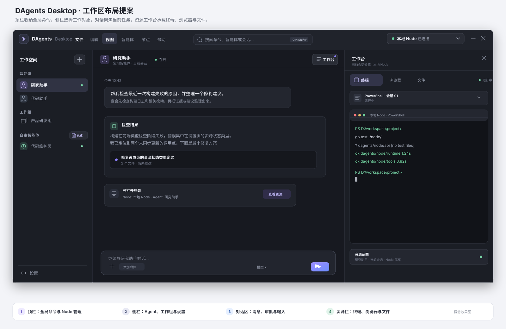

# DAgents Desktop 与 Node 分离技术方案

> **状态**：技术提案快照，更新：2026-09-23。第 3.5–3.7 节，以及后文涉及三栏、右侧资源面板、Auto 总览和 Node 快切的描述与验收条目，属于较早的界面设想；Desktop 界面以本资料包的最新原型为准。本文保留当时的方案论证，不作为当前代码结构或产品行为的说明。
>
> 本方案把 Desktop 定义为唯一的人机界面，把 Node 定义为无头 Agent 执行引擎。目标 Shell 采用现有 Rust/Tauri 2 轨并扩展为 Windows、macOS、Linux 产品；Node 不再嵌入产品 UI。2026-09-23 当时的实现仍以 Windows、本机 Node 和 `/ui/` 为主，文中目标架构需要按阶段迁移，不能当作当前行为说明。
>
> 本文是历史提案快照；Go Shell 已从当前产品和构建树移除。当前产品路线见 [2026-10-14 产品收束方向](../product-direction-simplification-2026-10-14.md)，实际支持范围以根目录 README 和 Windows 安装说明为准。
>
> 2026-10-20 决策：Desktop 仅连接同机 Node，远程 Node 与 SSH tunnel 不进入当前产品路线。本文中远程连接、身份与隧道章节仅供理解历史方案；现行实现与待办见[Desktop 与 Node 交互评估](../desktop-node-interaction-review-2026-10-20.md)。

> 2026-10-22 实施状态：Node `/ui/` 浏览器入口与旧 `node/webui/frontend` 源码包已退役；Desktop Vue 源码统一位于 `desktop/tray-tauri/src/ui`，Node 不依赖前端构建。本文中 `desktop/ui` 的目录设想是此前的迁移中间态，不是当前路径。

## 1. 决策结论

DAgents Desktop 默认连接本机 Node，也可以保存并切换到远程 Node。Desktop 同一时间只允许一个活动 Node，但可以保存多个 Node 连接配置。

技术决策：继续使用 **Rust + Tauri 2 + Vue** 作为统一桌面壳，而不是新建 C# WPF Windows 壳。原因是项目已存在 Tauri 2、Vue 继续承载复杂 UI、并且明确需要 Windows/macOS/Linux；Tauri 可共享窗口生命周期、连接层和 UI，同时调用各平台原生 WebView。C# WPF 会改善 Windows 专属原生体验，却需要再维护 macOS/Linux Host，当前没有足以抵消重复实现的收益。若性能问题出现，以真实负载基准决定是否将特定窗口或解码工作下沉到 Rust/原生组件，不预先重写 UI。

三个关键边界：

- **应用 UI WebView 只运行受信任的 DAgents UI**；网页浏览不导航到这个带宿主能力的 WebView。
- **浏览器实际页面由当前 Node 的 Playwright 会话持有**；Desktop 显示页面帧并在用户接管后把操作送回 Node。
- **文件预览是 Desktop 的受限 renderer 层**；文件内容通过 Node 授权的流式资源 API 获取，绝不把 Node 文件路径当成本机路径。

最终运行关系：

```text
┌──────────────────────── DAgents Desktop ────────────────────────┐
│ Vue UI · NodeConnectionManager · Desktop Gateway                 │
│ 文件选择 · 窗口 · 通知 · 剪贴板 · 本机截图 · 更新器             │
└──────────────────────────────┬─────────────────────────────────┘
                               │ HTTP / SSE / WebSocket
                    当前活动 Node（本地或远程）
                               │
        ┌──────────────────────┴──────────────────────┐
        │ Agent Runtime · Workspace · Tools · Policy   │
        │ Session · Memory · Auto · Trigger · LLM      │
        └─────────────────────────────────────────────┘
```

Node 不再把 Web UI 作为产品职责。Node 只提供 API、SSE、WebSocket、健康检查和版本/能力协商。Node 可以运行在 Windows、Linux 或服务器环境，没有 Desktop 也能继续执行 Agent、Trigger 和 Auto。

## 2. 为什么采用这个边界

当前 Node 通过 `go:embed` 嵌入 Web UI，Tauri Shell 再打开 Node 的 `/ui/`。这种方式适合单机原型，但不适合一个可以连接多个 Node 的 Desktop：

- UI 与 Node 的生命周期被绑定；
- UI 默认只能面向当前 Node 的同源 API；
- 远程 Node 需要额外处理跨域、鉴权和版本差异；
- 本机文件、远程文件、Node 屏幕和 Desktop 屏幕容易混淆；
- Node 需要携带 UI 静态资源，影响无头部署和独立升级。

分离后，Node 成为稳定的数据和执行权威，Desktop 成为连接与交互层。Desktop 可以升级 UI 和原生体验而不改变 Node 的运行时；Node 可以在服务器上无 UI 运行而不影响 Auto 和长期任务。

这不会减少系统总功能，而是把原本混在一个 HTTP 来源中的职责拆开，形成清晰的协议边界。

### 2.1 当前实现基线

- `desktop/tray-tauri` 是当前推荐的 Windows Tauri 2 Shell，内嵌 WebView 仍导航到 Node `/ui/`；Go `desktop/tray` 是 Windows 兼容轨。它们共享 Desktop bridge，但尚未提供 Node 连接档案和单活动远程 Node 模型。[Tauri Shell README](../../../../desktop/tray-tauri/README.md) [Go Shell README](../../../../desktop/tray/README.md)
- Node 使用 `go:embed` 带入 Web UI，所以 Node 构建目前仍需先构建静态 UI。
- Tauri 当前 `tauri.conf.json` 的 CSP 为 `null`，主要用于第一方同源 UI；改造成 Desktop 独立 UI 和文件 viewer 前必须配置严格 CSP、capabilities 和来源校验。[Tauri 配置](../../../../desktop/tray-tauri/src-tauri/tauri.conf.json)
- Node 已有 per-session `BrowserManager`，经 HTTP 调用本机 Playwright sidecar；`browser_call`/`browser_evaluate` 是主 Agent 的同步工具，profile 在 Node `.runtime/browser/profiles`。浏览器工具目前无 Desktop 实时 viewport API。[Node BrowserManager](../../../../node/internal/browser/README.md) [Browser sidecar](../../../../browser-service/README.md) [Playwright lock](../../../../browser-service/requirements.lock)
- 现有 sidecar 默认 `headed: true`；Windows 工作站浏览器能力文档要求 Windows 11+。这与“跨平台 Desktop 支持”是两个独立矩阵：Desktop 可以运行在 macOS/Linux，同时连接另一台支持浏览器的 Node；不得以 Desktop OS 推断 Node Browser capability。

## 3. Desktop 技术选型与 Shell

### 3.1 统一跨平台 Host：Rust + Tauri 2

Tauri 2 的 Rust Host 管应用生命周期和小而明确的本机能力；Vue 管产品界面。Tauri 在 Windows 使用 WebView2，在 macOS 使用 WKWebView，在 Linux 使用 WebKitGTK。因此桌面壳可共享，渲染引擎仍受 OS 版本影响；Linux 的 WebKitGTK 运行时依赖和 macOS 系统 WebKit 版本是明确的发布与测试成本。[Tauri 架构](https://v2.tauri.app/concept/architecture/) [Tauri WebView 版本](https://v2.tauri.app/reference/webview-versions/)

选择理由：

- 当前已有 Tauri 2 Rust Shell，可在现有产品轨上逐步增强，不需再维护 Go/C# 两个功能重叠的 Shell。
- 用户明确需要后续多平台支持；统一 Host 能共享连接状态、Gateway、托盘菜单语义、Vue UI 和主要测试。
- Tauri 使用系统 WebView，不将完整 Chromium runtime 随每个平台都复制一份；实际 CPU、内存和启动速度仍应按本文的基准测试验收，不能仅凭框架宣传判断。
- Rust 负责进程隔离、代理、二进制流和平台适配；复杂 UI 继续复用 Vue，避免用原生控件重写全部页面。

平台代价：Windows WebView2 可由 Evergreen Runtime 独立更新；macOS WebKit 跟随 OS；Linux 依赖发行版的 WebKitGTK。UI 必须按共同 Web 平台能力开发，启动时检测最低兼容能力，不能假设三个平台的渲染器版本一致。官方 Tauri 文档说明了各平台 WebView 差异和安装依赖。[Tauri prerequisites](https://v2.tauri.app/start/prerequisites/)

### 3.2 为什么暂不采用 C# WPF/WinUI 或 Electron

- **C# WPF/WinUI + WebView2**：若产品只服务 Windows 且将深度 Windows 原生集成作为首要指标，这是有吸引力的路线；但 WPF/WinUI 本身不提供 macOS/Linux Host。若再各建一套 Host，窗口、协议、安全策略、托盘、更新、文件能力和 QA 需要多份实现。用 C# 承载同一 Vue/WebView UI，也不会自动消除 WebView 的渲染和资源开销。
- **Electron**：能跨平台并固定 Chromium 行为，但捆绑 Chromium 会增加安装体积、常驻内存、更新面和安全维护责任。当前功能不需要独立 Chromium 内核作为产品主窗口。
- **Go Shell**：保留为迁移期 Windows 兼容轨；不扩展为第二个完整 Desktop。Tauri 达成发布验收后停止新功能并归档。

若测量发现 Tauri 某个平台无法满足关键原生体验，先为那项能力做 Rust 平台插件或独立本机 helper；只有验证证明整个平台 Host 必须替换，才重新开 ADR 比较 C#、Swift 和 GTK/Qt。

### 3.3 Shell 的职责与进程

```text
DAgents Desktop (Tauri/Rust)
├── Main UI WebView       只加载随应用签名的 Vue UI
├── Shell Runtime         单实例、窗口、托盘、快捷键、通知、生命周期
├── Node Supervisor       仅管理本机 Node 的启动/健康/升级，不管理远端 Node
├── Node Connection       多个连接档案、唯一活动 Node、版本/能力握手
├── Desktop Gateway       当前 Node 的 HTTP/SSE/WS 与文件流传输适配
├── Credential Store      平台安全存储的 Node 凭据和 Gateway secret
├── Platform Adapter      文件选择、默认程序、剪贴板、Desktop 截图
└── Update Coordinator    校验、下载、安装和回滚

Agent Node (Go)           Agent/Session/Turn/Policy/Workspace/Auto/Trigger 真相源
Browser sidecar           当前 Node 主机上的 Playwright/Chromium
Manage                    可选控制面和多 Node 管理服务
```

Shell 不保存 Agent、Session、Trigger 或审批的业务事实；Node 是它们的唯一权威。Desktop 关闭或升级时不能连带取消 Node 的 Auto/Trigger。默认退出 UI 后 Node 继续运行；用户可在设置中选择退出时停止本机 Node。Node Supervisor 不能停止或升级远端 Node。

目标目录先沿用 `desktop/tray-tauri`，降低迁移成本；确认跨平台版可发布后再改名为 `desktop/app`。Vue 从 `node/webui/frontend` 迁至 `desktop/ui`；迁移期通过 workspace 或临时构建脚本共享源码，但最终 Node 构建不依赖前端产物。Go 兼容轨仅保留安全修复和必要安装兼容。

Shell 可调用的本机功能用窄接口表达：`pick_desktop_file`、`open_desktop_path`、`notify`、`capture_desktop_screen` 等；禁止提供泛化 `run_command`、任意路径读写、任意 URL 代理或可由外部网页调用的宽权限宿主对象。Tauri capabilities 按窗口最小授权，命令仍在 Rust 实现中校验参数与作用域。[Tauri capabilities](https://v2.tauri.app/security/capabilities/)

目录选择分属两端：Desktop 的文件选择器挑选**本机文件**用于上传；Node 的工作目录选择由 Node 在 Node 主机上调用原生目录选择器。远程 Linux Node 没有可交互桌面时，应由用户提供 Node 路径或管理员预配目录，不能弹出 Desktop 的本地目录选择器冒充远程选择。

### 3.4 建议代码分层

```text
desktop/
├── ui/                         # Vue：页面和产品状态
├── tray-tauri/
│   ├── src/                     # Vue Shell bootstrap
│   └── src-tauri/src/
│       ├── app/                 # lifecycle、single-instance、tray、window
│       ├── connection/          # NodeConnectionManager、bootstrap、capability
│       ├── gateway/             # HTTP/SSE/WS/文件流
│       ├── supervisor/          # local Node 生命周期
│       ├── platform/            # windows/macos/linux feature adapters
│       ├── credentials/         # 系统凭据库封装
│       └── updater/             # 发布更新协调
├── protocol-fixtures/           # Node/Desktop JSON contract fixtures
└── viewer-fixtures/             # 文件格式和边界样本
```

模块依赖只向内：`ui → Desktop transport → Gateway/Connection → Node`。平台适配器不访问 Agent 数据库；Gateway 不自己计算 Agent 状态。跨平台行为由 traits/interfaces 抽象，OS 特定代码集中在 `platform/{windows,macos,linux}`。

### 3.5 工作区 UI 布局

采用**单行合并顶栏 + 三栏工作区**：应用菜单与窗口标题栏合并为一行，品牌、全局菜单、命令搜索、Node 状态和窗口控制同处一条顶栏，不再上下叠放两个栏。左侧导航选择“跟谁工作”，中间对话进行“当前工作”，右侧资源工作台查看“工作正在使用什么工具/文件”。资源栏是一个可折叠、可调整宽度的面板，不再另做永久占宽的第三条导航 rail；资源类型用面板顶部的标签切换。



菜单与侧栏的明确分工：

- **顶栏菜单**只放全局、低频或需要键盘可发现的命令：

  | 菜单 | 放在这里的命令 |
  |---|---|
  | 文件 | 新建会话、将本机文件附加到当前会话、导出会话、退出。添加附件也保留在 Composer，作为主要入口。 |
  | 编辑 | 撤销/重做、剪切/复制/粘贴、对话内查找；遵守当前焦点控件语义，不截获输入框的标准编辑快捷键。 |
  | 视图 | 命令面板、显示/隐藏侧栏与资源工作台、切换终端/浏览器/文件、重置布局、缩放与全屏。 |
  | 智能体 | 创建 Agent、打开当前 Agent 设置、进入 Agent 配置；不在菜单中塞完整 Agent 清单，也不把自主智能体总览从侧栏搬走。 |
  | 节点 | 添加、切换、断开 Node，查看能力；当前 Node 名称和连接状态常驻合并顶栏，点状态胶囊可快速切换。 |
  | 帮助 | 快捷键列表、文档、诊断信息与版本信息。 |

- **左侧栏只负责选择和管理工作对象**：按“智能体 / 工作组 / 自主智能体”分组显示条目；条目用于进入对应 Agent 或工作组，分组旁的新增按钮执行该组的创建动作。自主智能体分组旁保留独立的“总览”悬浮按钮（receipt-text 图标），用于查看所有 Auto 的状态。侧栏底部只放“设置”。
- **以下内容不塞进顶栏菜单或侧栏**：当前 Node 身份是合并顶栏中的状态胶囊；消息、审批、附件和输入留在对话栏；终端、浏览器、文件留在右侧资源工作台。资源可从 `视图` 菜单切换，但实际内容只在工作台中呈现。

所有菜单项与按钮、快捷键进入同一个命令注册表，命令声明可用条件、当前焦点要求与平台快捷键；不在菜单、工具栏和页面各自实现一套动作逻辑。`Ctrl/Cmd+Shift+P` 打开命令面板；其余高频快捷键在帮助菜单中可查，并允许用户自定义。菜单可由键盘完整访问，焦点离开菜单后正确回到原控件。

- **中间对话栏**：是视觉优先级最高、默认始终保留的主栏，负责消息历史、工具卡片、审批、Agent 状态和输入框。切换资源、打开文件、隐藏资源栏都不离开当前 Agent/Session；Composer 固定在对话栏底部，不被右侧面板覆盖。
- **右侧资源工作台**：由对话标题栏中的“工作台”按钮打开/收起，固定顶部标签 `终端 / 浏览器 / 文件`，只展示当前 `node_id + agent_id + session_id` 的资源。收起时标题栏按钮保留活动点/未读数。Agent 启动浏览器/终端或产生文件时，可以首次自动打开相应面板；若用户已经固定/切换到另一个资源，则只更新对应标签的活动点/未读标记，不抢焦点。
- **终端视图**：列出当前 Node/Agent 的终端会话，显示 Node 名称、shell 和运行状态；可在视图内切换 terminal session。退出面板只断开 UI stream，不杀掉 Node 终端进程。
- **浏览器视图**：显示 Node 侧 Browser session 的页面标签、域名、加载状态和控制权；这不是外部 URL 在 Desktop WebView 中打开。用户接管控件置于浏览器自身工具栏。
- **文件视图**：先列出当前会话可见的 NodeFile/Artifact，再以嵌入 viewer 预览所选项；Viewer 有自己的返回文件列表、下载和本机打开按钮。它不展示 Desktop 全盘文件，上传本机文件从 Composer 附件/明确的“上传到当前 Node”入口发起。

默认任何时刻右侧只激活一个资源主视图，避免浏览器帧、终端和 PDF worker 同时占用资源；用户在足够宽的窗口中可显式启用“两资源分屏”，分屏状态是临时的。浏览器多页面和终端多 session 属于各自资源内的子标签，不额外增加全局导航层级。

### 3.6 响应式与栏宽规则

布局依据 WebView 的实际 CSS 宽度，不依据显示器型号。初始建议左栏 240px（可收至 64px 图标栏）、对话栏最小 560px、资源栏默认 420px/最小 360px；宽度可拖动并保存为 Desktop 本机偏好。内容区加起来无法容纳时按下列规则收缩，不能压缩 Composer 或把 3 栏挤成难读的窄列：

| WebView 可用宽度 | 布局 | 行为 |
|---|---|---|
| ≥ 1360px | 三栏 | 左侧导航 + 对话 + 资源工作台并存；资源栏可调宽 |
| 900–1359px | 两栏优先 | 导航默认收为图标栏；资源工作台按需打开/关闭，对话始终可回到 |
| < 900px | 单主视图 | 导航改抽屉；打开资源时以工作台页面替换对话画布，提供明显“返回对话”入口；输入焦点和 Session 状态保留 |
| < 600px（若纳入支持范围） | 单主视图 + 菜单溢出 | 顶部菜单收敛为一个菜单按钮，按原分组展示；命令面板快捷键和无障碍名称保留 |

高 DPI、窄窗口和系统字体放大时以 CSS 实际布局阈值重新计算；窄屏不维持并排小窗。三个平台的视觉结构都只有一条合并顶栏，菜单、命令搜索、Node 状态和窗口控制横向排布；Windows/Linux 使用可拖动的自定义窗口顶栏，macOS 使用融合窗口标题区域的顶栏实现。平台适配负责系统拖动区、窗口控制、菜单键盘行为和安全区，不得再额外增加一条菜单行或标题栏。资源标签显示资源所属 Node，避免用户在远程工作时误以为文件或 Terminal 位于本机。

### 3.7 资源面板生命周期和状态

- 面板显隐/宽度是 Desktop 全局偏好；选中的资源类型、Browser page、Terminal session、文件预览标签按 `node_id + agent_id + session_id` 隔离。
- 切换 Agent 时先切换主 Session，再 hydrate 新 Session 的资源列表；旧 Browser/Terminal 的服务端任务继续由 Node 管理，但关闭旧 stream、清空旧 Agent 的画面和缓存，绝不短暂显示在新 Agent 下。
- 切换 Node 时清空所有右侧资源标签、关闭 SSE/WS/文件 stream，再握手新 Node；不得恢复旧 Node 的 Browser page、Terminal output 或 resource id。
- 隐藏 Browser 停止画面订阅但不停止 Page；隐藏 Terminal 断开显示流但不退出进程；关闭文件预览取消 Range 请求、worker 并释放对象 URL。只有显式“停止/关闭资源”才要求 Node 清理相应资源。
- 若 Agent 在后台生成新资源，右侧标签显示数量或未读点；用户点开后再加载内容。工具事件可以提示并定位资源，但不能因每个工具调用抢走当前输入焦点。
- 任何面板重连都以 Node 快照/hydrate 为准，事件只做增量更新；不能依靠 UI 内存中长期排队的流事件恢复状态。

## 4. UI、Shell 与 Node API 契约

Vue UI 不感知具体 Node endpoint、Bearer token 或操作系统路径。定义 `DesktopTransport`（请求、SSE、WS、文件流、取消）和 `DesktopHost`（选本机文件、通知、剪贴板、开默认程序、截图）两个接口；Tauri Host 是正式实现，浏览器/Web UI dev adapter 只供迁移和本地开发。

```text
Vue Feature
  ├── NodeClient (业务 DTO / SSE / WS / resource handles)
  │     └── DesktopTransport (Gateway transport)
  └── DesktopHost (narrow typed native operations)
        └── Tauri Rust commands / channels
```

NodeClient 只能访问当前活动 Node 的稳定 API；不能在各页面拼 endpoint 或读取 Shell 配置。UI 业务对象仍由 Node API 定义，Desktop UI 维护自己的 view state。Node/Desktop contract fixture 放在 `desktop/protocol-fixtures`，Node Go 测试和 Desktop Rust/TypeScript 测试共同消费。

Node API 至少提供版本化 bootstrap、agent/session/turn、消息流与恢复、终端 WS、附件/资源流、截图/平台能力、浏览器 session metadata/frame relay。静态 UI 不再是 Node API 的一部分。Node API、Desktop API 与 browser session API 使用一致的 `node_id + agent_id + session_id + resource_id` 关联键，事件与缓存都带 `node_id`。

## 5. Desktop Gateway 与同源问题

Desktop 不需要和某个 Node 保持同源；**但仍需要处理 Desktop 自己的来源、CSRF 和宿主桥权限**。推荐由 Tauri Rust Host 启动仅绑定 loopback 的 Desktop Gateway，由它同时提供签名构建内的 `desktop/ui` 静态资源和 `/desktop-api/*`。WebView 只访问这个 Desktop origin，避免 UI 分别跨域直连本地/远程 Node：

```text
Tauri Main WebView
    ↓ http://127.0.0.1:<随机端口>/ (Vue assets + /desktop-api/*)
Desktop Gateway (Rust, 127.0.0.1 only)
    ↓ HTTP / SSE / WebSocket / streaming files
当前活动 Node
```

这样 Node token 保存在 Rust 进程内，UI 不直接接触 Node token，也不需要为每个远程 Node 配置 CORS。Gateway 需要支持：

- 普通 HTTP 请求转发；
- SSE 长连接转发；
- Agent Terminal、消息流等 WebSocket 转发；
- 当前 Node 切换时关闭旧连接；
- 只允许转发已保存且当前激活的 Node；
- 防止任意 URL、内网扫描、SSRF 和跨 Node 混流；
- 回环地址绑定、每次启动随机端口/nonce、来源校验和单实例校验；
- 拒绝 Host 重绑定、非预期 Origin、跨站 WebSocket 握手和无授权上传；
- 采用背压、流超时、请求体大小限制和断连清理，不缓存无限 SSE/WS 数据。

本地 Gateway 同时服务 UI 与 API，因此 Desktop UI 内部是同源的；这是**Desktop 自己的同源**，并不恢复“UI 与 Node 同源”的旧架构。首屏通过一次性启动票据初始化会话，票据不放 URL、持久 localStorage 或日志。Gateway 不做通用反代，只接受固定的 `/desktop-api/current/v1/...` 路由表并将请求转发给当前 Node。Node 访问令牌只保存在 Rust 内存和系统凭据存储中。Tauri CSP 应配置为最小白名单，不允许任意 remote script；当前 Tauri 配置的 `csp: null` 必须在迁移首阶段改为显式 CSP。Tauri 和 WebView2 官方安全指南均建议收紧 Web 内容权限并把所有网页内容视为不可信。[Tauri CSP](https://v2.tauri.app/security/csp/) [WebView2 安全建议](https://learn.microsoft.com/en-us/microsoft-edge/webview2/concepts/security)

UI 侧的 API 统一变成：

```text
/desktop-api/current/v1/agents/...
/desktop-api/current/v1/streams
/desktop-api/current/v1/agents/.../terminals/ws
```

Node 侧继续保持业务 API 的 `/v1/*` 结构。Desktop Gateway 是传输适配器，不得复制 Node 的 Agent、Session、Turn 或权限状态机。

## 6. 单活动 Node 模型

Desktop 保存多个连接档案，但只允许一个连接进入活动态：

```text
NodeConnectionProfile
├── id
├── display_name
├── endpoint
├── auth_reference
├── connection_scope      # managed_local | remote | unknown
├── local_launch_proof    # Desktop process owns this Node, else absent
├── last_node_id
└── last_capabilities

DesktopState
└── active_node_profile_id
```

切换 Node 的规则：

1. 停止旧 Node 的 SSE 和 WebSocket 订阅；
2. 不自动取消旧 Node 正在运行的 Turn；
3. 清理当前 UI 的 Agent、Terminal、工具卡片和审批视图；
4. 连接新 Node 并执行握手；
5. 根据新 Node 的 Agent 列表和能力重建 UI；
6. 所有缓存键使用 `node_id + agent_id + session_id`，不能只使用 `agent_id`。

Desktop 可以展示保存的 Node 的在线状态，但只有活动 Node 可以产生消息流、打开 Agent 对话和执行 UI 操作。

## 7. Node 握手、版本和能力

新增或整理一个 Desktop 专用握手接口：

```text
GET /v1/desktop/bootstrap
```

返回示例：

```json
{
  "node_id": "node-linux-01",
  "node_version": "0.12.0",
  "api_version": "v1",
  "min_desktop_version": "0.12.0",
  "capabilities": {
    "agent_chat": true,
    "node_terminal": true,
    "browser": true,
    "browser_view": true,
    "resource_stream": true,
    "node_screenshot": false,
    "remote_file_transfer": true,
    "auto": true,
    "mcp": true
  }
}
```

`connection_scope` 属于 Desktop 的 NodeConnectionProfile，不由远端 Node 自我声明为“本机”。Bootstrap 只描述 Node 身份、协议兼容和执行能力。

Desktop 只能基于 `capabilities` 显示功能。Node 仍然是最终权限边界，Desktop 隐藏按钮不能替代 Node 的鉴权、Policy 和审批。

版本策略：

- Node API 使用明确的协议版本，例如 `v1`；
- 新字段必须向后兼容，破坏性变化进入 `v2`；
- Desktop 在握手阶段检查最小版本；
- Desktop 新功能可以在 capability 不存在时隐藏；
- Node 不应依赖某个 Desktop 版本才能执行长期任务；
- 本地 Node 可由 Desktop 更新，远程 Node 只能由用户或远程运维流程更新。

## 8. 本地 Node 与远程 Node 的识别

不能把网卡 MAC 的 MD5 作为安全证明。MAC 地址可能随机化，也会因为虚拟机、容器、网卡更换而变化；MD5 也不适合作为认证算法。

推荐使用分层判断：

### 8.1 强判断：Desktop 启动的本地 Node

Desktop 启动本地 Node 时生成随机一次性 `launch_nonce`，通过受保护的环境变量或启动参数传入。Node 在握手时返回基于该 nonce 的证明：

```text
Desktop starts Node with launch_nonce
        ↓
Node /v1/desktop/bootstrap proves possession
        ↓
Desktop marks connection_scope = local
```

这是最可靠的同机判断，尤其适合 Windows 本地安装包。

### 8.2 未能证明时的归属

不要比对 MAC、MachineGuid、IOPlatformUUID 或 `/etc/machine-id` 来决定文件访问、剪贴板、截图等权限；稳定 ID 可被虚拟机克隆、容器共享或伪造，也会带来隐私问题。对比 MD5 更不能证明同机。每个安装使用随机 salt 的 HMAC 也无法由两个独立安装直接比较，不能作为位置证明。

默认用连接档案声明 `managed_local`、`remote` 或 `unknown`；只有 Desktop 创建的 `launch_nonce` 能给出 `managed_local` 强证据。用户手动输入 localhost 地址、SSH port forward、VPN endpoint 或共享主机 fingerprint 都不能自动授予 Desktop 能力。无法证明时返回 `unknown`，按远端能力最小化处理。

### 8.3 远程连接默认策略

用户手动添加的非回环 endpoint 默认标记为 `remote`。即使指纹碰巧一致，也不能因此开放本机文件、截图或本地终端能力。

## 9. 文件、路径和 Artifact 边界

必须把文件分成三类资源：

```text
NodeFile      Node 工作区中的文件
DesktopFile   用户当前电脑中的文件
Artifact      Node 或 Desktop 生成的可传输结果
```

NodeFile 示例：

```json
{
  "type": "node_file",
  "node_id": "node-linux-01",
  "agent_id": "agt-123",
  "path": "reports/summary.md"
}
```

DesktopFile 示例：

```json
{
  "type": "desktop_file",
  "desktop_instance_id": "desktop-local",
  "file_id": "dfile_ephemeral_id",
  "name": "summary.md",
  "media_type": "text/markdown",
  "size": 8192
}
```

规则：

- Agent 只使用 Node Workspace 相对路径；
- Desktop 不向模型暴露本机绝对路径；
- Desktop 文件选择器只选择 DesktopFile；系统返回的绝对路径由 Rust Host 持有，不传给模型，Web UI 只拿短时 `file_id`；
- Node Workspace 浏览必须通过 Node API；
- Node 不接受 Desktop 直接传来的任意绝对路径；
- Node 校验目标相对路径、Agent 归属和工具权限；
- UI 必须展示文件所属 Node 或“本机”。
- 预览/打开操作使用不透明 `resource_id`，不把 Node 绝对路径、Desktop 绝对路径或临时认证 URL写入消息历史。

上传流程：

```text
Desktop 文件选择器
    ↓ Tauri Dialog (Rust)，仅持有用户明确选中的 file handle
Desktop 以受控 chunk 从本机文件读取
    ↓
POST /v1/agents/{agent_id}/files/upload
    ↓
Node 校验目标相对路径和大小
    ↓
写入 Node Workspace
    ↓
返回 NodeFile / Artifact 引用
```

文件选择优先在 Rust 侧调用 Tauri Dialog API；限制为用户选择的文件，不给 WebView 全盘文件系统 scope。上传流由 Rust/Gateway 读取选中文件句柄并直通当前 Node，前端只显示 basename、MIME、大小和上传进度。[Tauri Dialog Plugin](https://v2.tauri.app/plugin/dialog/)

远程模式下可以保留“上传到远程工作区”，但不能继续显示成没有目标的“上传文件”。如果产品决定暂时关闭远程上传，应根据 `remote_file_transfer` 能力隐藏该入口，而不是在 Node 中实现第二套限制。

打开路径的行为：

| 资源 | 默认行为 |
|---|---|
| DesktopFile | 调用 Desktop 默认程序或文件管理器 |
| 本地 NodeFile | 下载/预览后由 Desktop 打开，不能直接假设路径可访问 |
| 远程 NodeFile | 预览或下载到 Desktop 临时目录后打开 |
| Node 目录 | 通过 Node 文件浏览器查看，不能调用 Desktop 本机资源管理器打开 |

#### 9.1 文件预览资源协议

Node 提供受 Agent、Workspace、Node 身份约束的只读资源接口，例如：

```text
GET /v1/agents/{agent_id}/resources/{resource_id}/metadata
GET /v1/agents/{agent_id}/resources/{resource_id}/content
GET /v1/agents/{agent_id}/resources/{resource_id}/content (Range: bytes=...)
```

`resource_id` 是服务端解析的句柄，不是可拼接路径。服务端每次读取都校验 Node/Agent/Workspace 归属、会话授权、大小和 MIME；Range 支持按需预览大 PDF/视频，不允许 symlink escape。Desktop Gateway 按流转发，不把整个大文件读入内存。上传走有大小上限、目标 workspace 相对路径与校验和的分块/可恢复传输；文件落地成功才返回 NodeFile/Artifact 资源句柄。

```json
{
  "resource_id": "res_opaque_id",
  "node_id": "node-linux-01",
  "agent_id": "agt-123",
  "name": "design.pdf",
  "media_type": "application/pdf",
  "size": 2840012,
  "checksum": "sha256:...",
  "range_supported": true,
  "expires_at": "..."
}
```

metadata 响应可以进入 UI 缓存；内容使用短时 stream ticket 或 Gateway 内部 Node 凭据读取，不能把长效签名 URL 放进 DOM、日志或对话 transcript。取消预览后立即关闭流和临时对象。

#### 9.2 Desktop 文件展示能力

实现独立 `PreviewRegistry`，根据 MIME、扩展名和文件大小挑选 renderer；扩展名只能作为提示，不能替代 MIME 检查。Renderer 只接收授权资源句柄和字节流，不接收 Node 路径。第一阶段格式范围：

| 类型 | 预览方式 | 大文件/不支持时 |
|---|---|---|
| Markdown、纯文本、JSON、CSV | 安全文本视图、语法/表格展示；Markdown 禁止原始脚本 | 分页读取/虚拟滚动，提供下载 |
| 源码、日志、diff | 只读代码视图，按需加载，长行裁剪/折叠 | 超阈值提示下载，不一次渲染全文件 |
| PNG/JPEG/WebP/GIF | 图片预览、缩放；动画有播放控制 | 限制像素尺寸，解码失败可下载 |
| PDF | 内置 PDF.js viewer，页面懒渲染、搜索、缩放、打印/下载 | Range 拉取；资源密集文件可提示外部打开 |
| MP3/WAV/MP4/WebM | 系统 WebView 原生 `<audio>/<video>` 控件 | 只传输需要的 Range，显示下载选项 |
| DOCX/XLSX/PPTX | 第一阶段仅下载或用 Desktop 默认应用打开 | 后续评估本地转换器/独立 viewer；不默认上传第三方云转换 |
| HTML/SVG/未知类型/压缩包 | 默认显示源码/元信息或下载 | HTML 和 SVG 绝不直接注入有 Tauri 权限的主 UI；压缩包首版不自动解包 |

PDF.js 是 Mozilla 的 HTML5 PDF viewer，可作为 PDF renderer 的候选；引入时必须审查许可证、CSP、worker 打包方式和 WebKit 兼容性。[Mozilla PDF.js](https://github.com/mozilla/pdf.js/)

文件 renderer 运行在 Desktop 的普通内容层，不调用 Tauri host APIs；HTML 等主动内容需放入无权限沙箱（独立 origin 或严格 sandbox iframe）或只显示源码。未知文件始终提供显式“下载/用本机应用打开”，预览失败不能阻塞聊天与 Node 工作流。

## 10. 内置浏览器：让 Desktop 显示 Node 所拥有的页面

目标体验接近 Codex：用户和 Agent 能共同看见当前网页，用户可观察 Agent 的动作，必要时登录或接管。技术实现不把网站加载到带有 Tauri bridge 的主 WebView，而是复用 Node 已有的 `BrowserManager → dagents-browser → Playwright` 会话。这样浏览器网络访问、Cookie、Auto 任务和页面工具都留在同一 Node 安全边界内，切换远程 Node 后也不需要把远程浏览器迁回 Desktop。

```text
Agent browser_call / browser_evaluate ─┐
                                       ├─ Node BrowserManager (per-session lock)
Desktop browser viewer / takeover ─────┘       ↓
                                     dagents-browser / Playwright Page
                                       ↓ frames + tab metadata
Desktop Gateway → Vue BrowserPane (canvas/image renderer)
```

### 10.1 页面显示与交互协议

1. Agent 通过现有 `browser_call` 启动/操作主页面；Node 建立不透明的 `browser_session_id` 和 `page_id`，页面仍只归对应 Node/Agent/session 所有。
2. Desktop 用当前活动 Node 鉴权订阅浏览器视图。新接口建议采用 WebSocket：JSON 控制/metadata 帧加 JPEG 二进制画面帧；Gateway 负责 Node↔Desktop 隧道，不解码帧、不存截图。
3. Browser sidecar 用 Playwright `page.screencast` 的 `on_frame` 生成实时 JPEG 帧，回送 Node，再经 Gateway 转发。当前锁定的 Playwright Python 1.63 已包含该 API（从 1.59 引入）；实现前仍需在支持的 headed/headless 环境测量帧率、CPU、尺寸和内存。[Playwright Screencast API](https://playwright.dev/python/docs/api/class-screencast)
4. 浏览器面板显示标签、URL/域名、页面标题、加载状态、Agent/用户控制状态和 Agent 操作标记；地址栏的导航必须通过 Node 的浏览器 API，而不是 Desktop 去请求 URL。
5. MVP 只读观看；后续启用接管时，用户点击/键盘/滚动操作经 Gateway 回到 Node，映射到 Playwright 的 Page 操作。只接受有界、类型化的输入协议，不开放 CDP/WebSocket 直通浏览器，不开放页面任意 JavaScript。

WebSocket 初版采用 latest-frame 背压：慢端丢弃排队旧帧，只保留最新画面；UI 隐藏、Agent idle 且无人观察时停止帧采集。首版控制频率和画质以可见、可操作优先，远程高延迟场景再评估 WebRTC；不能因加入实时浏览器而让终端/SSE 被图像帧堵塞。

### 10.2 人机控制仲裁

浏览器会话有明确状态：`agent_controlled`、`viewer_read_only`、`user_takeover`、`disconnected`。Agent 操作和用户输入复用 Node 的同一 per-session 锁，永不并行点按或键入。MVP 允许观看，不允许注入输入；第二阶段只有在 Agent 浏览器动作到达安全边界后才能短时接管。接管时冻结浏览器工具，发放有期限的 lease；归还后撤销 lease、刷新 URL/截图/DOM snapshot 并使旧 ref 失效。接管超时或 Desktop 断线时自动还权给 Agent，并记录状态事件。

不要强行停止整个 Agent Turn 来实现浏览器接管。若当下 Turn 正等一个浏览器调用，Node 应将浏览器工具置为可恢复的暂停/等待态，UI 明确提示；Turn 取消仍按现有 Node 生命周期协议执行。浏览器审批必须由 Node 的现有 Policy/HITL 决定，Desktop 的视觉画面和控件不构成授权。

### 10.3 Browser profile、权限与能力降级

- 浏览器 profile 留在 Node 的 `.runtime/browser/profiles/`，按既有 Session key 隔离；Desktop profile 和用户日常 Chrome profile 不自动混用。用户在远程 Node 登录后，Cookie 留在远程 Node 主机，UI 必须明确显示“登录资料存储于此 Node”。
- 提供清除 Cookie/缓存/历史和停止 Browser 的入口；profile 保留时长、容量配额、异常退出清理策略需可配置。凭据不得进入 prompt、截图日志或 telemetry。
- Browser `capability` 只有在 Node 能启动受支持的 Chromium/Playwright 环境时才为 true。当前 `browser-service` 文档标注 Windows 工作站需 Windows 11 或更高版本，旧系统必须禁用此能力或提示升级，不能用 Shell UI 假装可用。
- 网站 origin allow/deny、上传/下载和敏感操作确认在 Node 策略层实施，并按 Node 管理员配置收紧。网页文字永远是不可信输入。开发者模式的 full CDP 若未来提供，应作为额外高风险 capability 单独审批、审计和默认关闭。
- 原生网页对话框、文件选择和系统权限弹窗不是网页帧的一部分，需由 Node 浏览器 API 返回类型化待处理事件；文件上传必须走已授权的 Node Artifact 流，不能模拟键盘路径或把 Desktop 全盘路径发给远程页面。
- 接管输入内容、密码字段、Cookie 与下载不得进入普通 Agent action log。用户输入可以让站点接收，但不能将原始按键文本再回显进 prompt/telemetry。
- 下载始终落在 Node Artifact/NodeFile 空间；需要保存到 Desktop 时显式通过文件流下载，确认目标路径。上传本机文件需单独批准并进入指定 Node Workspace。

## 11. 终端、剪贴板和截图

### 11.1 终端

- Agent Terminal 永远执行在当前 Node；
- Local Terminal 是 Desktop 可选能力；
- 远程模式默认隐藏 Local Terminal；
- Terminal 页面显示执行归属，例如 `Node · Linux Server`；
- Desktop 不能代替 Node 执行 Shell，也不能绕过 Node policy。

### 11.2 截图

```text
Node Screenshot
  Node 工具截取 Node 所在机器的屏幕

Desktop Screenshot
  Desktop 原生能力截取用户当前电脑的屏幕
```

两者使用不同的工具名、权限和 Artifact 归属。远程 Linux 没有图形环境时，Node Screenshot 根据 capability 禁用；Desktop Screenshot 仍然可以使用，但结果属于 Desktop，不应写入 Node Workspace，除非用户明确上传。

### 11.3 剪贴板

- Desktop 剪贴板属于 Desktop；
- Node 工具需要访问剪贴板时，必须通过明确的 Node capability 和受保护 bridge；
- 远程 Node 默认不能直接读取 Desktop 剪贴板；
- 用户在 UI 中复制文本或文件，是 Desktop 行为，不等于授予 Node 剪贴板权限。

## 12. Node API 的安全边界

Desktop 是客户端，不是可信业务服务。Node 必须继续独立执行：

- Agent、Session 和 Workspace 归属校验；
- 工具组和 Policy；
- 文件路径限制；
- Shell、Terminal、Browser 和 MCP 审批；
- Auto、Trigger 和 Dreaming 的状态机；
- Token、TLS 和连接权限。

远程连接要求：

- HTTPS/WSS 或通过可信 VPN；
- token 不存入 WebView localStorage；
- Windows 使用 DPAPI 或 Credential Manager 保存凭据；
- Gateway 不允许任意 URL 代理；
- 断开 Node 时清理内存中的访问令牌和流连接；
- 日志不记录 token、完整 endpoint 密钥或文件内容。

## 13. 仓库和构建调整

目标目录：

```text
desktop/
├── ui/                    # 从 node/webui/frontend 迁移
├── tray-tauri/             # Rust/Tauri 2 跨平台 Host，迁移期沿用现目录
└── protocol-fixtures/     # Desktop/Node 契约 fixture

node/
├── cmd/dagents-node/
├── internal/              # API、Runtime、Tools、Session
└── （移除 webui/ 和 internal/webui/）
```

构建关系改为：

```text
build Node API
build Desktop UI
build Desktop Host for target OS/architecture
build Browser Service
assemble local assistant bundle
```

Node 构建不再依赖前端构建产物。Desktop 与 Node 独立版本。Windows 本机安装包包含：

```text
bin/dagents-node.exe
bin/dagents-desktop.exe
bin/dagents-browser.exe        # 仅当本机 Node 启用 Browser capability
```

macOS/Linux 同样可选择包含对应本机 Node 和 Browser sidecar 的组合包，或只安装 Desktop 并连接用户已有 Node。远程 Node 的 Node/Browser 不进入 Desktop 安装包。Desktop 包不因用户当前连接的远程 Node 而重新捆绑其可执行文件。

Desktop 只负责本机 Node 的启动、停止、升级和连接。远程 Node 不随 Desktop 安装包复制或修改。

Windows 初期沿用现有 Inno Setup 和 Node 更新回滚流程，Tauri 只替代当前 Windows Shell 并扩展其他平台，不同时更换 Windows 安装体系。macOS/Linux 使用 Tauri 对应签名包和系统原生安装方式，统一 Release manifest 和升级签名格式。

## 14. 运行效率与资源管理

Desktop 的目标是轻量常驻 UI；Agent、Browser 和模型请求不会转到 WebView 主线程执行。Rust 侧异步处理连接、SSE/WS、文件流和 Node Supervisor；Vue 侧限制大型 DOM、消息和编辑器开销。

性能约束：

- 不随 Desktop 再捆绑一套 Chromium；主界面使用 Tauri 的系统 WebView，Playwright Chromium 只安装/运行在启用 Browser 的 Node 上。
- 列表与长对话使用虚拟滚动；历史分页 hydrate；不把整个对话、文件或截图一次性读入 JS heap。
- 代理层对大文件使用 streaming + Range，设置最大并发/每 Node 带宽和超时；断线关闭上游响应体，避免占用内存。
- 浏览器画面用二进制 JPEG/WebP（是否 WebP 以支持度测试为准），不可 base64；帧率/分辨率可按链路延迟和 UI 是否可见自适应；采用 latest-frame 背压。
- 文件预览做页面懒加载、图片像素/文件大小限制、文本虚拟滚动、媒体播放时才读取；切换文件或 Node 时及时 revoke object URL、取消 worker 和释放缓存。
- 内存文件缓存和下载缓存按 Node+resource id 隔离，设置 LRU 总配额与 TTL；绝不缓存明文 Node token。
- 窗口隐藏时停掉绘制和非必要订阅，但持续任务仍留 Node 跑；恢复时从 Node hydrate，而不是依赖无限期 UI event queue。

建立发布前性能基线，而不是写死未经测量的框架指标。CI/手工矩阵记录：冷启动/唤醒、空闲 10 分钟 CPU 与 RSS、1000 条对话滚动、50MB 文本/100MB PDF 懒加载、远程 Node 100ms/1% 丢包、Browser 视图开关时的 Node/Sidecar/Desktop CPU 与带宽；在 1920/1440/1280/1024/800 CSS px 窗口宽度反复调整三栏布局，检查重排、滚动和资源画面订阅开关。每次版本和最低支持 OS 上至少回归一次；超基线回退则阻断发版。目标预算由第一轮 Windows 中端机实测后写入 `docs/development.md`，再复制到 macOS/Linux。

## 15. 多平台发布与兼容矩阵

### 15.1 支持策略

正式目标为 Windows、macOS、Linux Desktop；Node 与 Desktop 独立版本。首发平台建议 Windows 优先，Linux 随第二阶段，macOS 在签名/公证链路就绪后开放。所有平台共享 Rust/Tauri Host 与 Vue UI，平台差异集中在 `platform` 模块与能力协商。

具体最低 OS 版本须在 beta 前冻结，并在 CI runner 与真实硬件/VM 矩阵验证。版本策略必须覆盖：Windows WebView2 Evergreen、macOS WKWebView/WebKit 跟随 OS、Linux WebKitGTK 与 GTK 依赖。若某个平台组件缺失，桌面壳报告精确诊断，关闭对应 capability，不崩溃也不把 Desktop 的可用性绑到 Browser capability。

### 15.2 平台能力矩阵

| 能力 | Windows | macOS | Linux | 缺失时的策略 |
|---|---|---|---|---|
| 主 WebView | WebView2 | WKWebView | WebKitGTK | 安装/系统诊断；不可用时不启动 UI |
| 托盘、菜单、单实例 | Tauri + Windows adapter | Tauri + macOS adapter（菜单栏行为适配） | Tauri + 桌面环境适配 | UI 仍可前台运行；Auto 留 Node |
| Desktop 本机文件选择 | Tauri Dialog | Tauri Dialog | Tauri Dialog/系统对话框 | 禁用本机上传并显示原因 |
| Node 工作目录选择 | Node 在 Windows 主机打开系统目录选择器 | Node 在 macOS 主机打开系统目录选择器 | Node 在有图形会话时打开系统目录选择器 | Headless Node 使用明确的路径输入或管理员预配；Desktop picker 不冒充 Node picker |
| 本机默认程序打开 | Tauri opener plugin | opener/LaunchServices | opener/xdg-open | 显示复制路径/下载 |
| 凭据存储 | Windows Credential Manager/DPAPI | Keychain | Secret Service；无法用时加密凭据/会话提示 | 远端 credential 要求每次输入或配置可用 store |
| 通知/剪贴板 | 原生 adapter | 原生 adapter | portal/桌面环境依赖 | 隐藏或禁用对应入口 |
| 本机截图 | Windows capture adapter | ScreenCaptureKit/权限提示 | PipeWire/portal 或显式 capability | capability=false，不影响 Node screenshot |
| 本地 Node supervisor | Windows process/job object | launchd/进程组 | systemd user/进程组 | Node 可由用户单独启动，Desktop 可连接 |

Tauri dialog/updater plugin 官方列出 Windows、macOS、Linux 支持；托盘的菜单与点击细节仍有平台差别，所以必须单测能力和菜单行为。[Tauri Dialog](https://v2.tauri.app/plugin/dialog/) [Tauri Updater](https://v2.tauri.app/plugin/updater/) [Tauri Tray API](https://v2.tauri.app/reference/javascript/api/namespacetray/)

### 15.3 Build/签名/升级

- 每个目标 OS 在原生 GitHub Actions runner 上构建，不把 Windows/macOS 安装包从 Linux 交叉拼装。
- Windows：沿用现有 Inno Setup 主安装器以兼容 Node/Browser/desktop 的进程升级次序；安装 Tauri Shell 为主产品，Go Shell 过渡期可选。安装和更新在标准用户权限下完成。
- macOS：输出签名 `.app`/`.dmg`，配置 Developer ID 签名和 notarization；更新包校验签名。
- Linux：先选 AppImage + 一个主流 deb 系包作为主分发；明确 WebKitGTK/GTK 系统依赖和桌面门户要求。rpm/Flatpak 仅在实际需求验证后增加。
- Desktop 与 Node 分开发布、版本和回滚。更新任何一个组件时不得覆盖用户 `.runtime`；本地 Node 升级可由 Desktop 编排，远端 Node 更新由远端管理员处理。
- 更新清单按 OS/架构/渠道描述签名 artifact。Tauri updater 要求签名；私钥放 CI secret/离线受控，不进仓库或安装包。[Tauri Updater signing](https://v2.tauri.app/plugin/updater/)

### 15.4 跨 WebView 测试

UI 代码以最低公共 Web API 为基线；目标设备矩阵至少覆盖 Windows WebView2、macOS WKWebView、Ubuntu LTS WebKitGTK。浏览器内核差异通过 `desktop_capabilities` 报告；文件、媒体、剪贴板、系统对话框和拖放都要做真机验收，不以 Chromium 单一 E2E 代替 macOS/Linux 验收。

## 16. 分阶段实施

### 阶段 0：协议与威胁模型先行

- 固定 `/v1` Node API 契约；
- 增加 `/v1/desktop/bootstrap`；
- 增加 capability 和 API version；
- 定义 NodeFile、DesktopFile、Artifact；
- 定义本地 launch nonce 握手；
- 增加 Node-Desktop contract fixtures；
- 固定预览资源授权规则；
- 设计本地 Gateway origin、nonce、CSP、来源校验和任意网页隔离。

### 阶段 1：Desktop 连接层

- 在现有 Tauri 中实现 `NodeConnectionManager`、单活动 Node 和本机 Node Supervisor；
- UI API 全部经过统一 client；
- 支持默认本地 Node 和一个远程 Node；
- 实现远程/本地能力切换；
- 建立 Windows、macOS、Linux 编译与启动 CI，先有可运行空壳再扩展原生能力；
- 不改变 Node Runtime。

### 阶段 2：UI 搬迁与 Gateway

- 将 Vue UI 抽到 `desktop/ui`，优先打通 agent/turn/approval/terminal 与当前 Node 的流；
- Tauri Gateway 同源托管静态 UI 与 Desktop API，并移除 WebView 直连 Node token；
- 实现文件选择、上传、下载、Node 与 Desktop 路径展示的资源类型边界；
- 先通过 Windows 主平台验收，macOS/Linux 同步跑基础 UI 与协议兼容测试。

### 阶段 3：内置浏览器与文件预览

- Node 浏览器视图只读订阅、WebSocket 二进制帧、tab 状态和背压；
- 支持 user takeover lease 与 Agent/用户操作串行；
- 上线文本、Markdown、JSON、CSV、代码、图片、PDF、音视频 renderer；
- DOCX/XLSX/PPTX 首期通过下载/本机默认应用打开，不实现在线/云转换；
- 扩展 Browser origin policy、清理 profile、Node 侧下载/上传审批。

### 阶段 4：Node UI 脱离与多平台发布

- Desktop 覆盖全部用户流程；
- Node headless 启动和恢复文档完善；
- 移除 `go:embed` Web UI；
- 移除 `/ui/` 路由和旧 Node UI 构建依赖；
- 归档 Go Shell；
- 在 Windows/macOS/Linux 分别验证打包、签名、升级与回滚后发布；
- 更新本地助手、安装器和运维文档。

## 17. 验收标准

必须至少通过以下场景：

1. Desktop 启动本地 Node，自动连接并打开 Agent；
2. Desktop 添加远程 Linux Node，切换后只显示远程能力；
3. 切换 Node 时旧 SSE/WebSocket 不污染新 Node；
4. 两个 Node 中存在同名 Agent 时，消息和缓存不串线；
5. 本地文件上传到本地 Node Workspace；
6. 本地文件上传到远程 Node Workspace，并显示明确目标；
7. 远程 Node 文件下载后由 Desktop 打开；
8. Node Screenshot 与 Desktop Screenshot 在 UI 中明确区分；
9. 远程 Node 不支持截图、Auto 或文件传输时，UI 正确降级；
10. Node API 版本不兼容时，Desktop 阻止连接并给出升级提示；
11. Desktop 退出后，本地和远程 Node 的 Auto/Trigger 状态不受影响；
12. Node 无 UI 启动时，所有 API、Trigger、Auto、Terminal 和恢复测试仍通过；
13. Agent Browser 与 BrowserPane 始终指向同一 Node 页面；观看不会改变页面，接管/归还无并发输入且会刷新状态；
14. Browser 断流、切换 Node、关闭面板和无 Chromium capability 时能恢复/降级，无帧队列堆积；
15. 本机/远程 PDF、超大文本、图片、视频都能按流预览；文件内容、资源句柄和缓存按 Node 隔离；
16. HTML/SVG 恶意样本不能调用 Tauri bridge、读本机文件或访问其他 Node；
17. Windows WebView2、macOS WKWebView、Ubuntu WebKitGTK 的 smoke/E2E 通过；平台缺失能力准确降级；
18. 1920/1440px 下三栏可同时工作；1280/1024px 下导航与资源栏按规则收缩/折叠；800px 下资源工作台替换对话画布且可明确返回；若支持 600px 以下窗口，顶栏菜单可收敛到溢出按钮；所有宽度下 Composer 不遮挡消息、不被资源栏挤出视口；
19. 隐藏/重开资源工作台、切换终端 session、浏览器 page、文件预览后状态正确；切换 Agent 或 Node 不泄露上一上下文的资源、消息或缓存；
20. Agent 产生工具/资源事件时，对话输入焦点不会被抢占；用户已选定/固定的资源标签不被自动跳转，未读状态正确更新；
21. 拖动栏宽、收起侧栏、切换两资源分屏后，布局偏好按 Desktop 保存；高 DPI 与系统字体缩放时无重叠、截断或不可达控件；
22. 顶栏只包含全局命令；侧栏只显示智能体/工作组/自主智能体、Auto 总览与设置；Node 快速切换在合并顶栏，终端/浏览器/文件只在资源工作台；
23. 菜单、顶栏按钮与快捷键触发同一命令；菜单支持键盘操作，输入控件保留系统编辑快捷键；Windows、macOS、Linux 都只显示一条合并顶栏，窗口控制和拖动区域正常；
24. 性能矩阵达到首轮基线预算，无 idle 高 CPU、持续帧堆积或预览内存无限增长。

## 18. 主要风险与处理

| 风险 | 处理 |
|---|---|
| Desktop Gateway 变成第二套业务后端 | Gateway 只做传输、认证和连接路由，不保存 Agent 事实状态 |
| 多 Node 造成数据串线 | 所有缓存、路由和事件携带 `node_id` |
| UI 与旧 Node API 不兼容 | 握手返回 API 版本和 capability；破坏性变化升级协议版本 |
| 远程文件被误当成本机文件 | 显式 NodeFile/DesktopFile/Artifact 类型和来源标签 |
| Desktop 退出影响 Auto | Auto、Trigger 和状态只由 Node 持有，Desktop 只是观察者 |
| OS WebView 行为不一致 | 最低公共 Web API、三平台 fixture 和 capability；beta 前冻结最低 OS 版本 |
| Tauri 插件缺少某平台原生能力 | 按 `platform` trait 增加薄 Rust adapter，不重复建设整套 UI Host |
| 页面流占用带宽/CPU | latest-frame 背压、隐藏即暂停、质量/分辨率自适应；高帧率再评估 WebRTC |
| 文件预览解析不可信内容 | renderer 最小权限、大小限制、主动内容隔离，失败时退回下载 |
| 远程 Node 保存登录 Cookie 引发误解 | UI 常驻 Node 归属标识，说明资料位置并提供 profile 清理；不自动导入 Desktop profile |
| 当前 Tauri CSP 关闭 | 安全审查前不向第三方 Node 开放；首阶段配置 CSP、来源校验和窄 capabilities |
| Node UI 脱离影响现有用户 | 先 Desktop feature parity 和双轨灰度，再移除 Node `/ui/` 与 Go Shell |

## 19. 建议的第一批开发任务

1. 定稿 Desktop ADR：Rust/Tauri 2 统一跨平台 Host；确认 Windows/macOS/Linux beta 基线和最低 OS；
2. 新增 `desktop/bootstrap` API、版本/capability schema 和 contract fixtures；
3. 把当前 Web UI 的 API 调用集中到 `NodeClient`/`DesktopTransport`；
4. 实现 Tauri 单活动 Node、Gateway、local nonce 和凭据保管；
5. 落地 NodeFile/DesktopFile/Artifact/resource stream 并完成人工路径误导测试；
6. 做 Browser screencast 实验：当前 Playwright 1.63 headed/headless、Windows 11/远程 Linux、延迟与 CPU；
7. 做文件 viewer benchmark：PDF.js、50MB 文本、100MB PDF、远程 Range、内存上限；
8. 建三个目标平台的 CI build/smoke、签名与 release artifacts；
9. 完成真实本地 Windows Node、远程 Linux Node 与各平台 Desktop 的端到端验收；
10. Desktop 功能覆盖并灰度稳定后，才删除 Node `/ui/` 与 Go Shell 兼容轨。
