# Desktop 原生窗口视觉验收 · 2026-10-09

> 后续整改已完成本轮主要问题，见 [整改复验记录与 9 张新截图](recheck/README.md)。下文保留整改前的原始证据和问题清单，不用作最新界面的截图。

**结论：部分通过，核心方向保留，页面规范仍需收束。**

本次检查真实 Tauri 窗口，逻辑尺寸为 1183 × 763，覆盖主要工作台状态、所有一级设置页及 Auto 配置。以下 26 张截图为本轮原生窗口的直接截图。没有修改配置、发送消息或创建资源；验收后恢复普通智能体对话页。鼠标附近的蓝色光晕来自验收工具，不属于产品配色。

Manage 和浏览器功能当前未启用，文件工作区为空。已有工作组内容、浏览器实际页面、文件编辑器、运行中的终端，以及实时生成和审批状态，本轮没有取得有效视觉证据，须在后续验收中补齐。未验证多种窗口尺寸、键盘全流程、屏幕阅读器或量化对比度；不能据此宣称完整无障碍或响应式验收通过。

## 已通过、应保留的设计

- 菜单与标题栏合并，布局清晰，侧边栏没有额外搜索栏或底部设置按钮。
- 黑灰色操作图标、简洁上箭头发送按钮，整体克制；状态颜色作为局部提示使用。
- 侧边栏分组、子项缩进、浅色选中背景与左侧标记协调。折叠后保留入口图标和展开按钮。
- 空对话的图标和说明位于消息区域中央，普通对话不附加头像和角色名。
- 对话与资源页面分离，资源页右下角浮动输入区保留联系当前智能体的入口。
- 设置页外围与内容区域底色连续，主要配置遵循一项一行。

## 待整改清单

P1 为下一轮优先处理项；P2 为其后的细节打磨项。这里是整改建议，本轮未修改产品代码。

| 编号 | 优先级 | 证据 | 问题与建议 |
| --- | --- | --- | --- |
| V01 | P1 | 08、09 | 当前页面与侧栏选中状态不一致：工作组页仍高亮之前的 Auto 智能体。浏览器未启用的配置入口进入模型与连接，而开关位于能力页。明确当前页面选中状态，并直接定位可恢复该状态的设置。Manage 不可用时，新建工作组应禁用或说明前置条件。 |
| V02 | P1 | 07、08、09、15 | 空状态和不可用状态缺少统一规范：终端为深色小卡片、浏览器为大面积红色警示、工作组为红色裸文本、反馈为黄色说明。配置未启用使用中性引导；真实错误才使用红色。终端的深色留给实际终端内容，空状态使用统一浅色布局。 |
| V03 | P1 | 04、20 | Auto 在侧栏采用四角星，但智能体设置列表中仍有机器人式标记。统一类型图标为既定四角星，减少重复的 Auto／自主任务文字标识。 |
| V04 | P1 | 11、12、22、23 | 设置标题层级过多且重复，实际控件起点过低。压缩为页面标题、必要分区标题、配置行。Auto 的窄下拉框、左侧开关和下方保存按钮，与全局设置的右侧控件、标题区保存按钮不一致；统一控件列和主操作位置。 |
| V05 | P1 | 06、14、22 | 浮动卡片细节文字过小，部分次要文字过浅；渐隐区域会覆盖仍可见的导航项。增加关键状态的字号与对比度，渐隐限于非完整条目，并为完整条目留出缓冲空间。对比度需另行量化确认。 |
| V06 | P2 | 10 | 单个 Auto 的总览弹窗接近满屏，下半部大量空白，统计、筛选、分页占据明显空间。高度随内容增长并设上限；少量数据时简化统计，只有需要分页时才显示翻页控件。 |
| V07 | P2 | 01、06 | 主输入框把快捷键及附件提示全部放进占位文字；浮动卡片空状态仍列出最近消息和最近工具。缩短占位文案，快捷键放帮助提示；没有内容时隐藏空的详情行。 |
| V08 | P2 | 05 | 文件目录区与预览区的分隔和层级不够明确，空提示散落在两侧。增加轻量边界，或在空工作区统一展示一处引导。 |
| V09 | P2 | 21 | 定时任务列表展示原始秒数、长唤醒语句和多个 UUID，信息密度偏高。使用“30 分钟”等可读频率，默认展示摘要，技术细节按需展开。 |
| V10 | P2 | 20、26 | 帮助文案仍带有 WebUI 入口假设，例如从对话页新增智能体、状态栏 thinking 按钮。按 Desktop 的实际顶栏菜单与控件更新说明。 |

## 逐页证据

### 01 · 普通对话

黑灰操作图标、消息无额外头像和角色名、简洁发送按钮通过。输入占位说明太长；菜单和辅助文案偏小。保持现有消息结构，先调整信息密度。

### 02 · 侧栏折叠

分组图标、当前组标记与底部在线点保留，顶部展开入口有图标。布局通过；后续补验键盘和悬停名称提示。

### 03 · 折叠侧栏弹出列表

弹出列表的边框、圆角和浅色选中状态与主界面协调。后续补验长名称及多项列表。

### 04 · 空对话

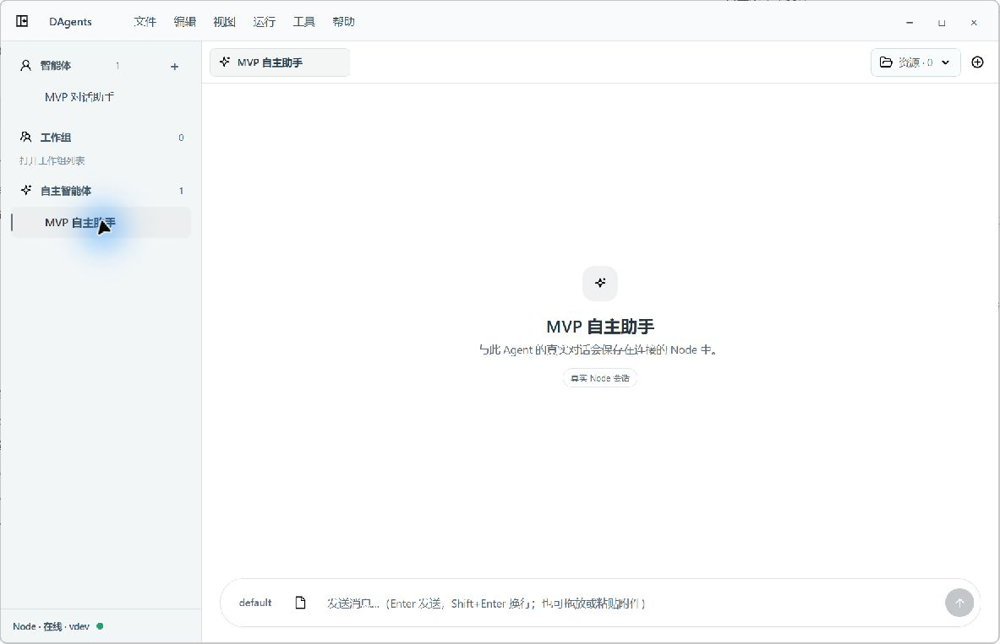

图标与说明位于可用消息画布中央，四角星符合 Auto 的既定方案。通过。

### 05 · 空文件工作区

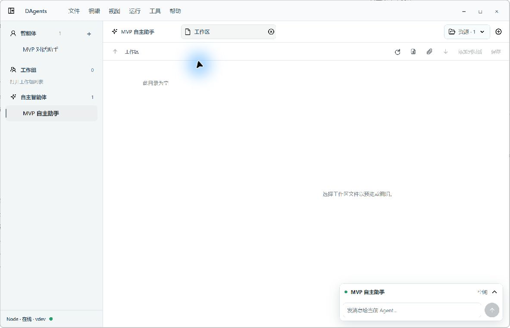

资源页占据主区域，右下角输入区不阻塞主体。目录与预览的分区边界弱，两处空提示较分散；建议统一空工作区引导或增强分隔。

### 06 · 展开浮动消息卡

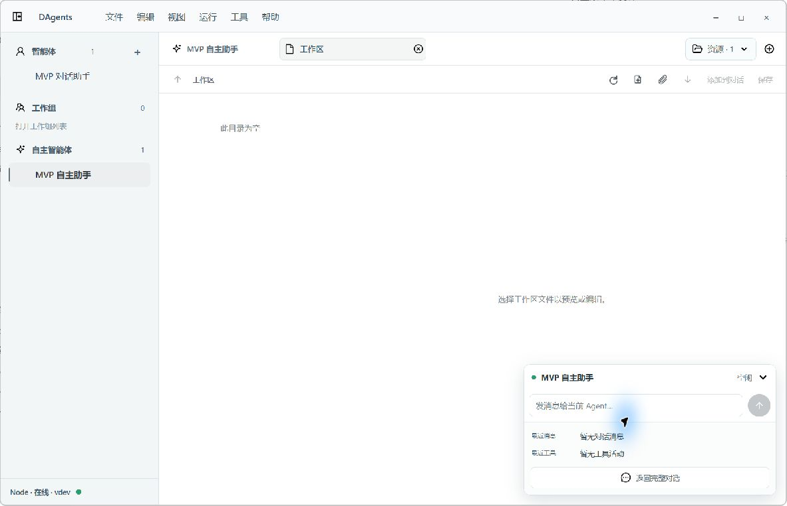

能够看到智能体状态、输入、最近消息和工具以及返回对话入口。空详情行增加无效高度，细节文字偏小；空状态应收敛。

### 07 · 空终端

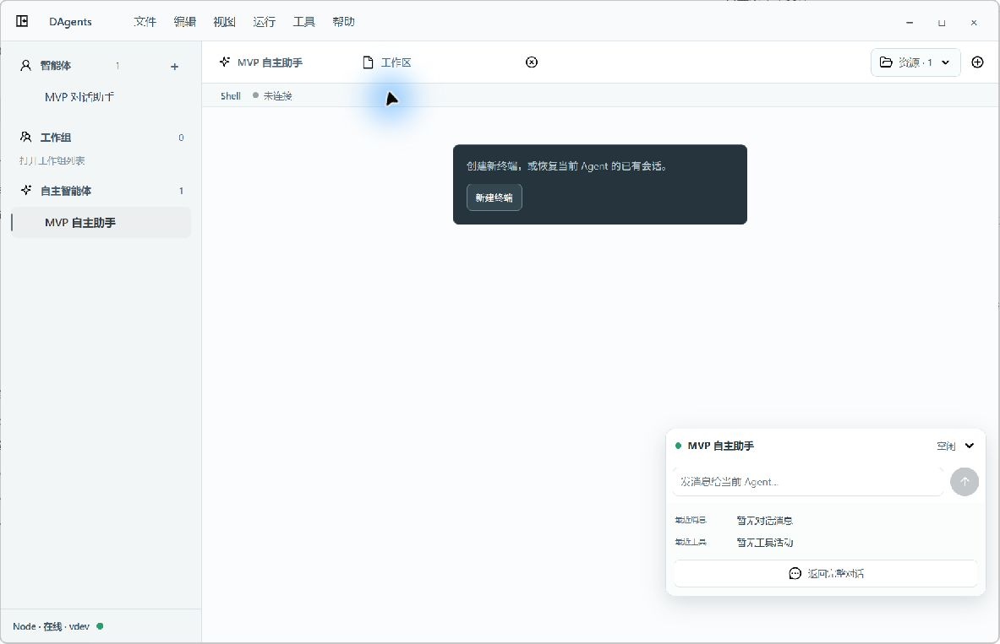

浅色资源画布上方出现深色小卡片，视觉割裂，位置也不属于统一居中的空状态。改为浅色引导，把深色用于真正的终端输出区域。

### 08 · 浏览器未启用

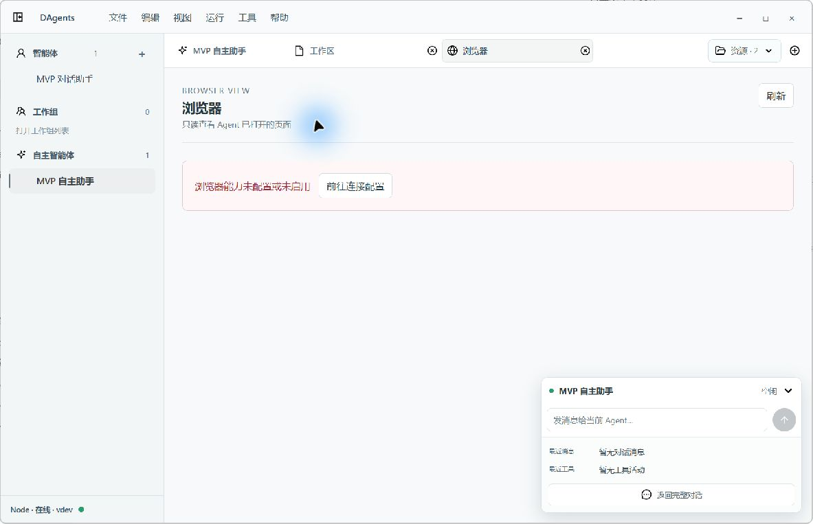

资源页尺寸合理，但未配置状态采用大面积红色，重复的英文眉题和页面标题增加高度。配置入口应直达能力页的浏览器设置。

### 09 · 工作组不可用

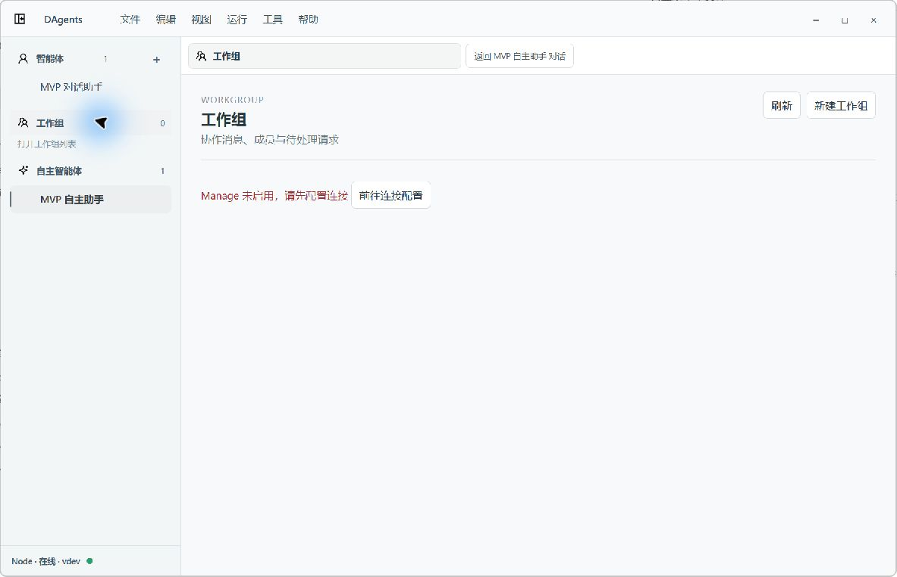

红色裸文本与其他不可用状态不一致；侧栏仍选中此前的 Auto 智能体。新建入口在 Manage 不可用时仍呈可操作状态，需要更明确的前置条件。未点击创建按钮。

### 10 · Auto 总览

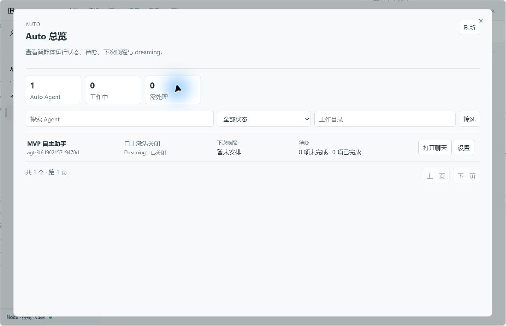

名称、状态、下次唤醒和待办可辨认。单行数据撑开接近全屏的弹窗，固定高度与始终显示的分页造成空旷。建议内容自适应高度、条件分页、紧凑统计。

### 11 · 智能体基本设置

控件按行排列，背景连续。页面标题、说明、分区导航、核心配置、基本设置和基础信息叠加，使首个控件位置过低；应减少重复层级。

### 12 · 通用设置

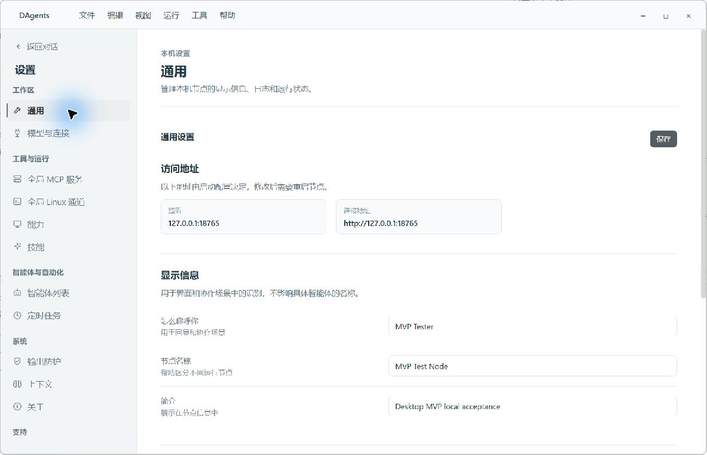

外围与内容底色一致，标题区保存入口明确。标题重复，访问地址占据较多首屏空间，实际编辑字段被推到下方；只读信息可压缩。

### 13 · 模型与连接

开关靠右、配置列一致，通过。重复标题可移除；Manage 未启用的提示需与资源页同一规范。

### 14 · 设置导航滚动

隐藏滚动条并使用边缘渐隐的方向合理，但完整可见的边缘入口也会被淡化。调整渐隐范围与上下留白，确保可点击条目清晰。

### 15 · 帮助与反馈

类型、标题按行展示，反馈正文保持宽度，背景统一。Manage 不可用的说明语气比红色错误更合适。标题与说明占用较多高度，提交区容易落在首屏之外；操作位置应统一。未提交反馈。

### 16 · MCP 服务

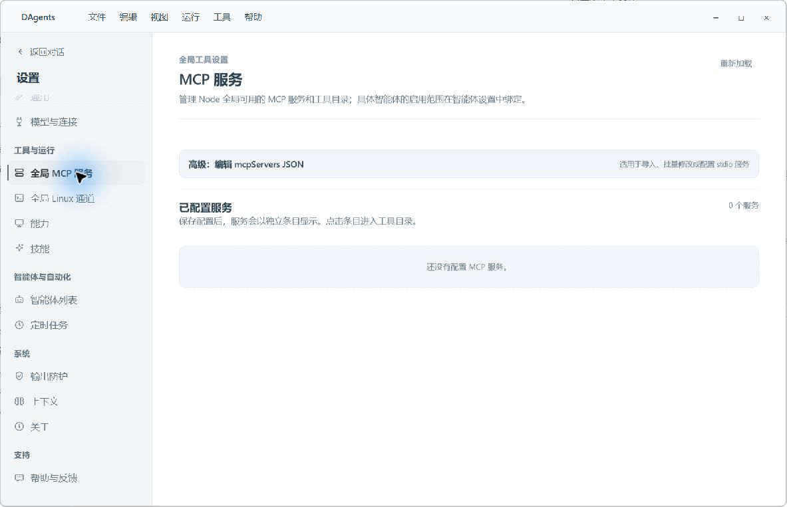

高级 JSON 编辑入口和空列表清楚。淡蓝信息卡与其他页的中性色略有差异，可一并纳入统一信息卡规范。

### 17 · Linux 通道

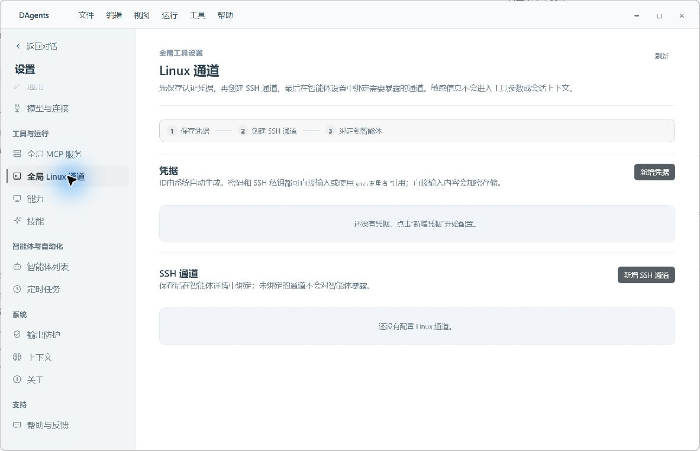

凭证、SSH 与绑定的步骤结构清楚。辅助说明较长、字号偏小；信息卡颜色与全局规范同步即可。未执行连接操作。

### 18 · 能力

开关在右侧，单项单行，通过。浏览器启用开关确实位于此页，资源页引导应定位这里。

### 19 · 技能

信息说明与空状态可理解。文本密度较高，信息卡颜色应统一；技术说明可放次级帮助区。

### 20 · 智能体列表

行式展示和操作区域清楚。Auto 图标仍与侧栏四角星不同，类型说明重复。新增入口的文案带有 WebUI 假设，需要按 Desktop 菜单更新。

### 21 · 定时任务

默认唤醒归属可识别，但原始秒数、完整激活文本、智能体和会话 UUID 增加阅读负担。主列表保留可读摘要，细节展开。

### 22 · Auto 设置

职责、频率、最大工具轮次和 dreaming 的业务分区清楚。标题偏多；开关和下拉框靠右列左边，与其他设置页的控件排列不统一。

### 23 · 经验与手册

经验只读、手册目录可查看，文件系统形态明确。Auto 保存操作在正文左侧，而其他设置在标题右侧；手册目录另有独立保存操作，需要说明作用范围并统一主次层级。

### 24 · 输出防护

全宽控件与靠右开关一致，按行排列通过。重复标题和辅助文案密度可按共同规范收束。未修改防护策略。

### 25 · 上下文

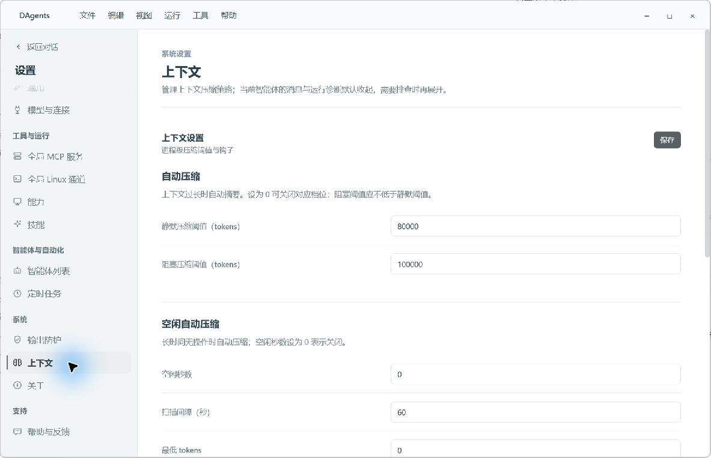

配置列和保存入口一致，主要结构通过。仍有标题与长说明的首屏占用问题。

### 26 · 关于

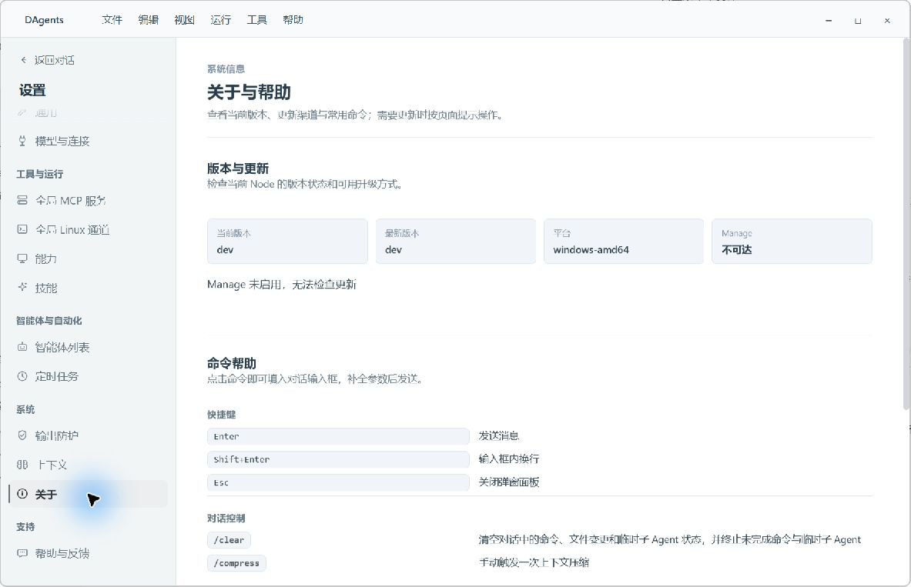

版本和帮助分区可读，淡蓝信息卡可统一中性色。快捷说明中有 Desktop 当前控件不具备的 WebUI 表述，需校正文案。

## 下一轮验收顺序

1. 修复导航选中与恢复入口，统一 Auto 图标。
2. 统一空状态、标题层级、控件列和主操作位置。
3. 收紧 Auto 总览与浮动输入卡，再检查文字对比度和渐隐导航。
4. 在真实数据下补验工作组、文件编辑、浏览器、终端、工具执行、待审批与生成中的状态；同时补验小窗口、最大化及键盘导航。
