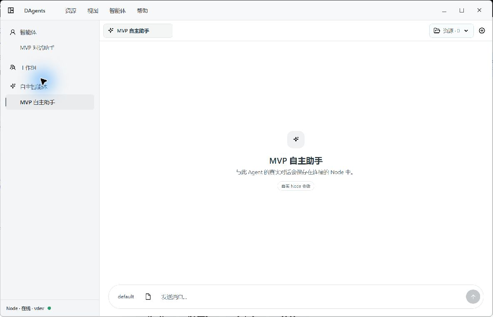
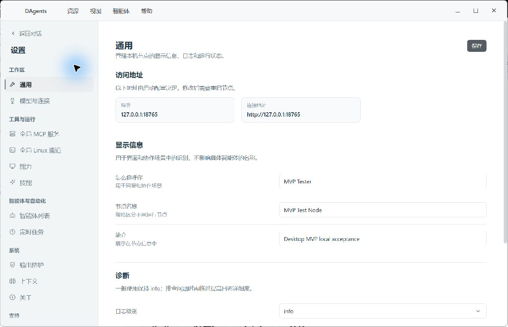
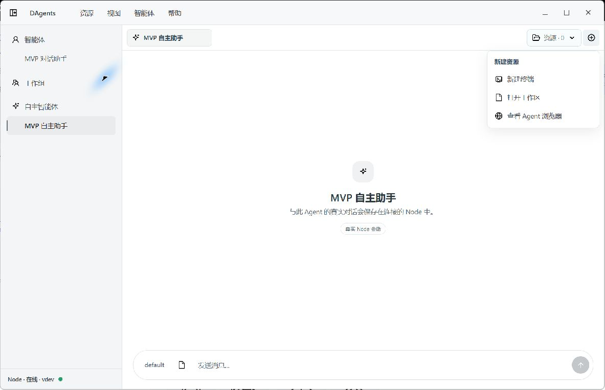

# Desktop 图标风格评估

日期：2026-10-09。结论：生产图标的中性色、轮廓式表达和低装饰程度与 Desktop 相符，但光学尺寸、视觉重量和跨页面语义仍未完全统一。建议保留已确认图形，做小范围整理。

范围：本轮真实 Tauri 窗口的工作台、设置导航、资源菜单，以及 shared/icons 中对应生产 SVG 与引用代码。182 个文件包含历史样稿与变体，不等同于 182 个生产图标；本次没有逐个渲染所有历史资产，没有改动 SVG 或产品代码。

## 1. 工作台：整体协调，语义有重复

- 黑色/深灰图标与白色内容区、浅灰侧栏相协调，没有强烈色块干扰。
- 人形智能体、工作组轮廓、Auto 四角星、简洁向上发送箭头均可保留。
- Auto 四角星在 17px 槽位中显得比人形更小；图形内部留白不同，应按可见轮廓校准，而不是只统一 CSS 宽高。
- 输入栏附件按钮目前使用文件图标。建议采用已有 attachment 图标，与文件资源区分。

## 2. 设置导航：线性风格契合，但身份映射不一致

- 轮廓图标适合紧凑的设置导航，与轻边框和浅色界面相符。
- 未选中图标继承 muted 色并额外使用 0.82 opacity，看起来比主侧栏更淡。可减少额外透明度，让图标接近同一行文字的视觉重量。
- 技能使用 sparkles，与 Auto 的四角星几何相同。建议保留 Auto 已确认形态，为技能选择不同轮廓。
- 智能体列表使用 bot，而主侧栏普通智能体使用人形。建议同一对象跨页面保持同一图标。

## 3. 资源菜单：可辨认，局部密度与用途需校准

- 终端、文件、浏览器图标与文字组合清楚，单色轮廓风格适合菜单。
- 地球图标比文件和终端的内部线条密集，视觉重量略高；应优先在实际 16–18px 显示尺寸下比较。
- 打开工作区采用文件图标，建议使用已有文件夹轮廓，文件图标保留给具体文件资源。

## 建议顺序

1. 统一语义：普通智能体跨页面一致，技能与 Auto 区分，附件与文件区分，工作区与具体文件区分。
2. 校准光学尺寸：在 16/18/20px 下检查可见轮廓大小、居中与内留白，保留用户已选图形。
3. 校准视觉重量：不同来源图标既有 stroke，也有以 fill 绘制的轮廓；两者可以共存。不同 viewBox 本身不是问题，不应机械改成相同笔画数值。
4. 建立默认、悬浮、选中、禁用和状态色规则，以中性灰阶为主。

限制：本次是视觉与语义检查，没有测试所有 DPI、系统缩放和键盘/读屏场景，也没有做完整对比度测量。不能据此宣称全套图标或可访问性完全通过。
