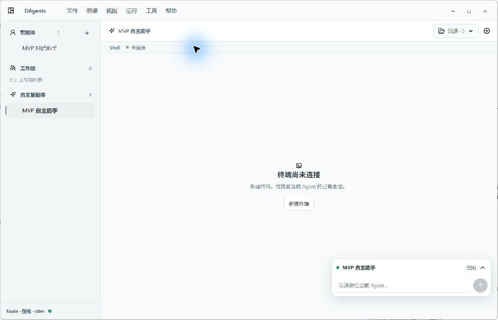
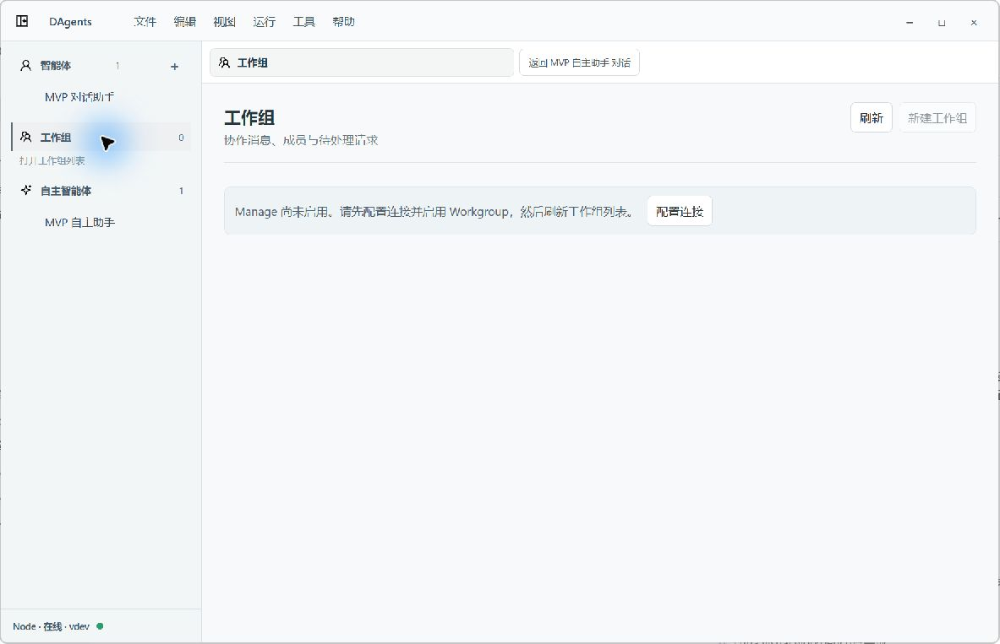
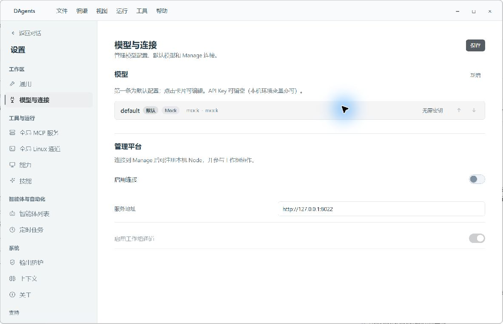
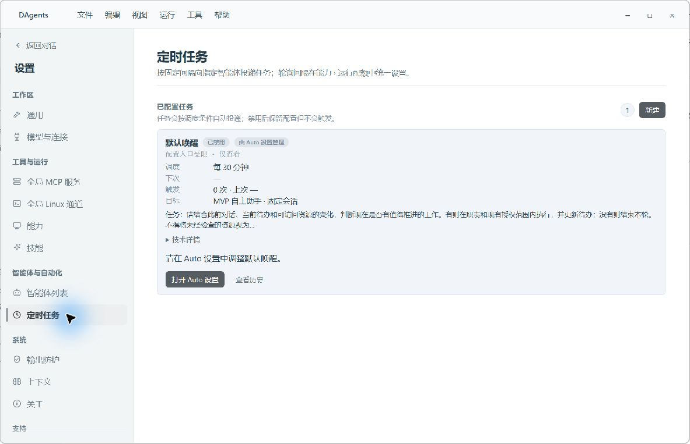
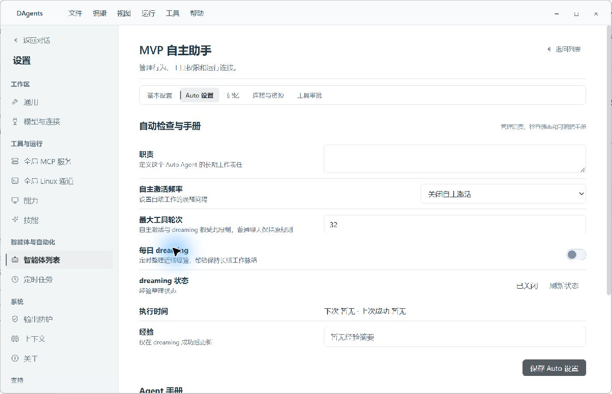
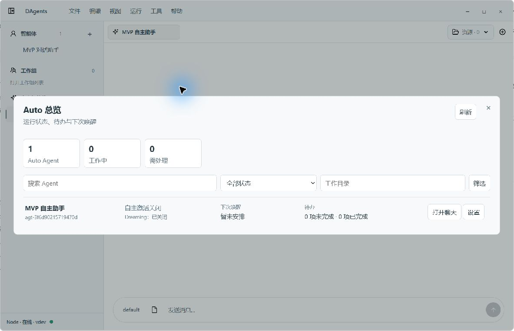
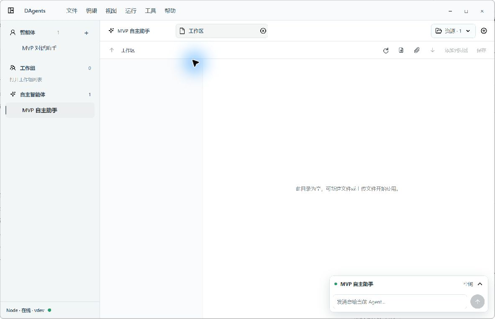
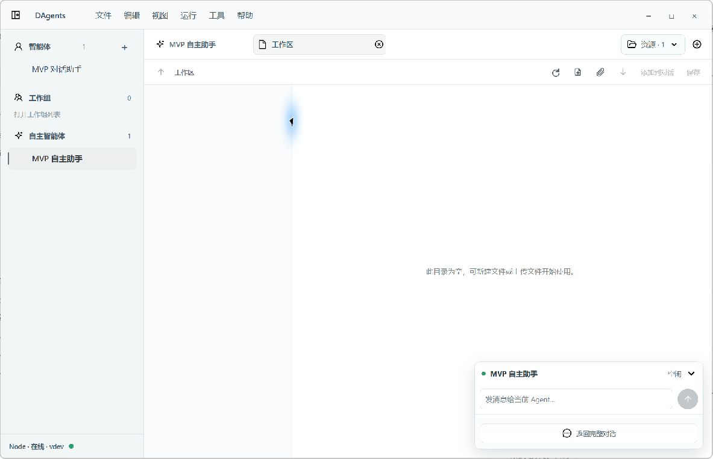
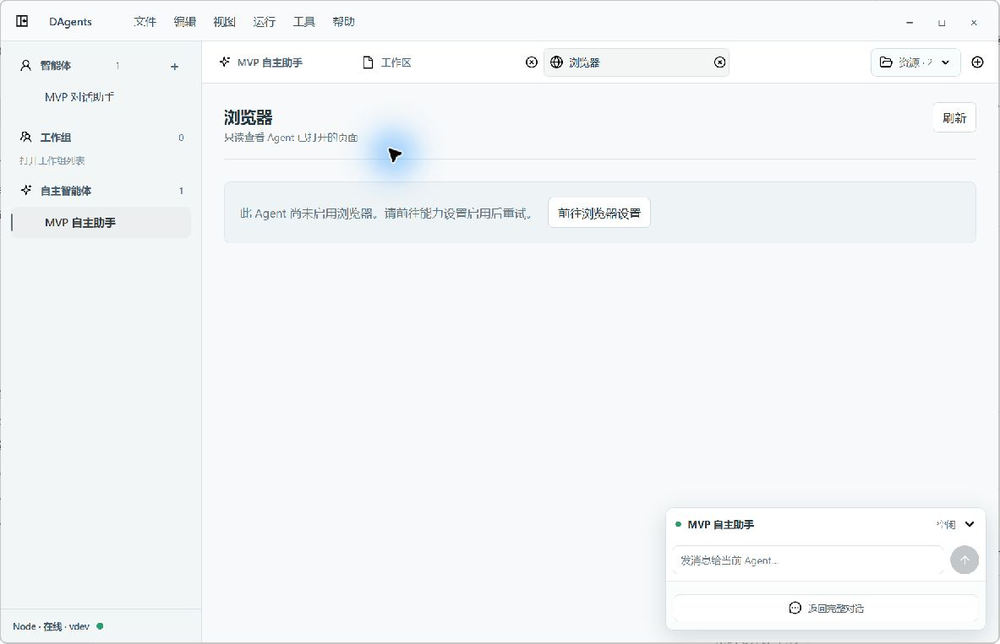

# Desktop 视觉整改与原生复验

2026-10-09。编码由 Luna 完成，主任务复核并在真实 Tauri 窗口中验收。窗口逻辑尺寸仍为 1183 × 763；下方为整改后直接截图，蓝色鼠标光晕来自验收工具。

## 本轮结果

| 原问题 | 结果 |
| --- | --- |
| V01 导航及恢复入口 | 工作组列表高亮对应分组，不再选中此前的智能体。Manage 未启用时禁用新建与创建提交。原生验证工作组配置入口进入 `/settings/connection`，浏览器入口进入 `/settings/capabilities`；两个入口已独立绑定，并增加契约回归。 |
| V02 空状态 | 空终端改为居中的浅色引导并复用终端图标；浏览器和工作组未启用时为中性说明，真实请求错误仍保留错误提示。 |
| V03 Auto 图标 | 智能体设置列表使用既定四角星，与侧栏及对话一致。 |
| V04 设置密度及对齐 | 五个一级配置页由现有配置组件标题与保存行承担页面头，移除外层重复标题；页面头统一 20px，必要说明保留。其他设置页去掉多余眉题，Auto 控件与操作右对齐，主要配置在本窗口首屏完整可见。Auto 与手册仍有各自独立保存范围，未合并为一次保存。 |
| V05 可读性 | 提高菜单与浮动卡辅助文字字号，缩小导航渐隐至 12px，并增加边缘缓冲。量化对比度、不同 DPI、小窗口及键盘可达性仍需单独验收。 |
| V06 Auto 总览 | 移除固定满屏高度，内容决定高度并设置上限；只有超过一页才显示分页。刷新按钮避让关闭按钮。 |
| V07 输入与浮动卡 | 主输入框占位缩短，快捷键与附件提示放入 title；没有实际消息或工具时不显示对应空详情行。 |
| V08 文件区 | 加强目录与预览分隔，空目录集中一处提示。悬浮卡没有让整块资源区预留大面积底部空槽；文件列表与文本编辑器仅保留滚动定位缓冲。浏览器底色填满资源区域。 |
| V09 触发器密度 | 1800 秒展示为“每 30 分钟”，目标显示名称，完整任务与技术 ID 可按需展开，实际调度逻辑保持原有实现。 |
| V10 帮助文案 | Desktop 使用顶部菜单创建智能体的说明，thinking 帮助按 Desktop 场景调整。WebUI 保留适合其入口的文案。 |

复核期间发现浏览器和工作组共用配置函数会造成入口串联，已拆开并补充回归。也移除了曾为浮动卡增加的整区 82/260px 底部预留，并清除终端空状态弃用深色规则，避免继续叠加覆盖。

## 验证

- Desktop UI 状态测试：22/22。
- Vue 定向回归：37/37（TriggersPanel 3、SimplifiedAutoPanel 15、AgentsSettings 1、WorkgroupDesktopContract 18）。
- Desktop 与 Node WebUI 生产构建均通过。
- `git diff --check` 无错误；Git 有既存换行转换提示。
- Desktop 构建仍有模块静态/动态导入与大包提示，本轮没有把性能包拆分纳入视觉整改。
- 原生导航与截图复验通过。本轮没有修改运行配置、发送消息、创建终端或文件，结束后返回普通智能体对话页。

此次结果仅覆盖当前数据与窗口尺寸。真实浏览器内容、运行中的终端、文件编辑长内容、工作组协作、实时工具与审批状态，以及缩放/小窗口仍需补验；不宣称全产品视觉与无障碍验收全部完成。

## 整改后截图

### 01 · 空终端

浅色、居中、复用终端图标，实际终端输出的深色样式保留。

### 02 · 工作组未启用

分组高亮，中性提示，新建禁用。恢复入口已实测进入连接设置。

### 03 · 模型与连接

移除重复页面头，标题、说明、保存操作清晰，首屏空间增加。

### 04 · 定时任务

可读频率、目标名称和摘要，技术信息按需展开。

### 05 · Auto 设置

压缩重复层级，开关和主操作靠右，主要配置首屏可见。

### 06 · Auto 总览

高度随当前内容收缩，单页数据没有翻页控件。

### 07 · 文件工作区

目录与预览边界清楚，没有为浮动输入缩小整块画布。

### 08 · 展开浮动卡

没有消息与工具时只保留输入及返回对话入口，避免空详情重复占用。

### 09 · 浏览器未启用

中性引导、底色连续，恢复入口已实测进入能力设置。
