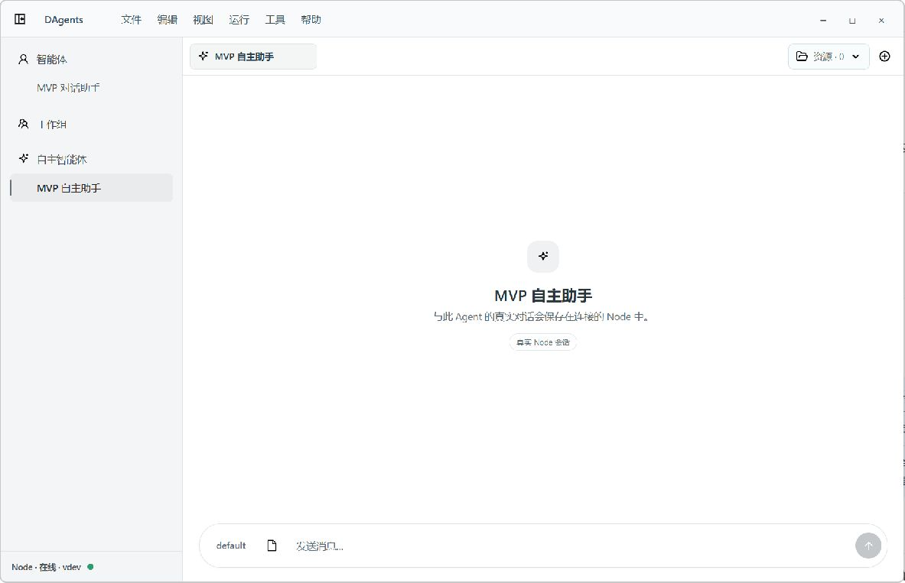
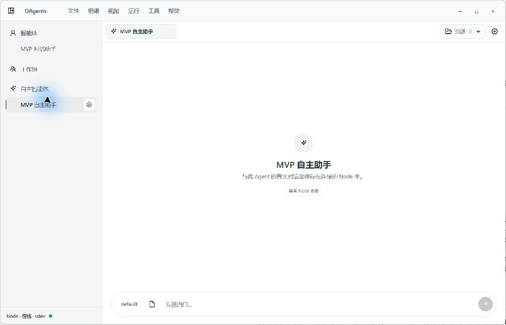
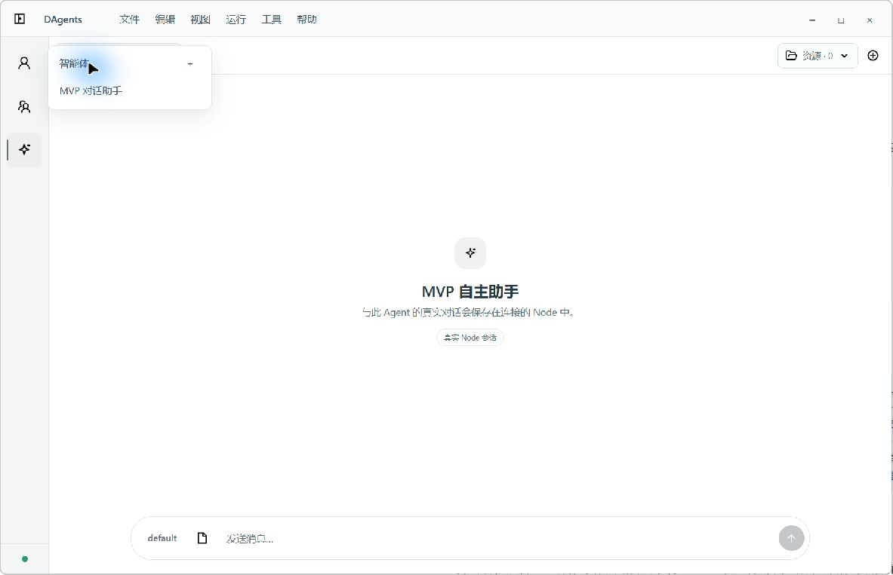
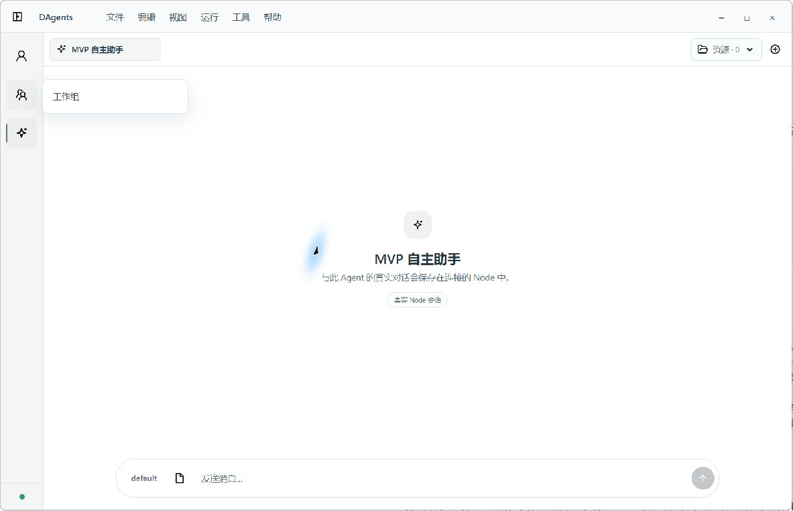
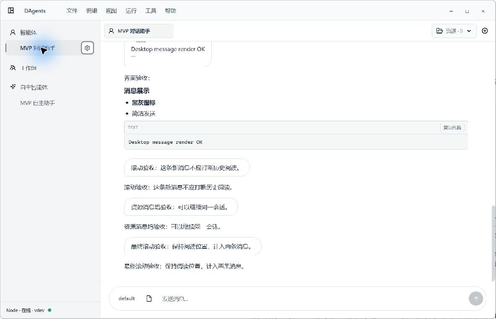
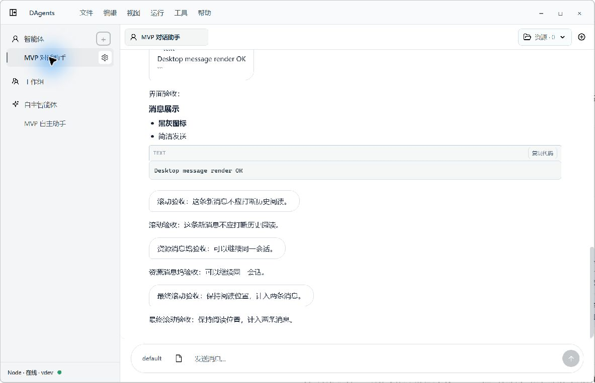
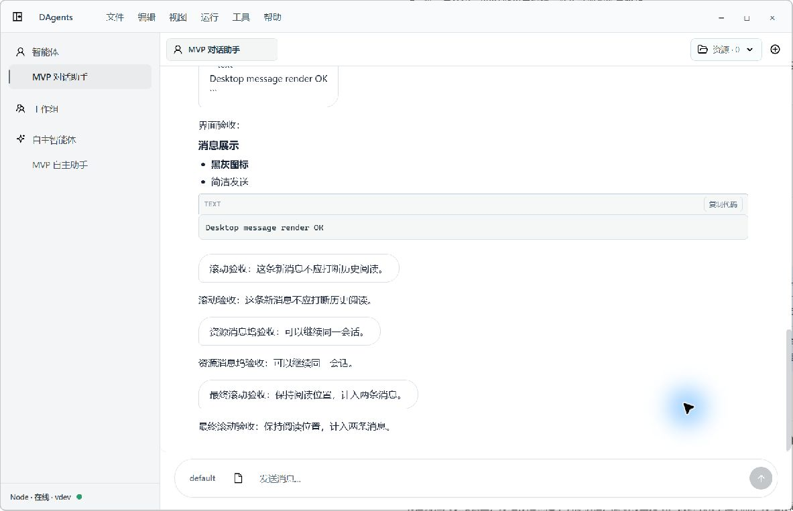

# Desktop 侧栏专项调整

2026-10-09。Luna 实施，主任务在真实 Tauri 窗口复验，尺寸 1183 × 763。只修改 Desktop 侧栏及其配置入口，WebUI 作为交互参考。

## 字体与线条判断

原文字有蓝灰倾向，分组与选中项字重都偏重。现在分组为 13px / 500、中性灰黑 `#3f4448`；普通条目 13px / 400、`#4b5156`；选中条目 500、`#25292d`。侧栏底色改为 `#f4f5f6`，分隔线 1px、`#e0e3e5`，选中项保留 2px 短竖线。既定图标轮廓不变。

按 CSS 纯色计算，普通文字与侧栏底色对比度约 7.37:1，分组文字约 9.02:1；这不等同于整页无障碍验收。新的颜色与字重在本窗口中清晰，层级不再依赖粗体叠加。

## 已完成

- 移除所有分组计数，折叠弹出层也不显示计数。
- 普通智能体新增按钮仅在悬浮或键盘聚焦时显露；折叠后仍有相同入口。
- 普通与 Auto 条目配置按钮仅在对应条目悬浮或聚焦时显露，使用现有齿轮图标。主项与配置按钮是独立按钮，不嵌套。
- 空分组只保留分组标题，不展示打开列表、暂无内容等占位文案；工作组标题仍可进入工作组页。
- 分组文字与子项文字使用同一左锚点；子项没有图标。固定预留操作宽度，悬浮不会导致名称跳动。
- 触摸设备按 coarse-pointer 规则显示可点击操作入口，本轮没有真实触摸设备验证。
- 删除废弃计数及占位样式；没有添加新的重命名或删除业务。

## 验证

Desktop UI 状态测试 22/22、Desktop 生产构建、`git diff --check` 通过。原生窗口实测分组悬浮新增、条目悬浮配置、配置跳转、折叠弹出层及空工作组。键盘 Tab 实测可到达条目配置，Shift+Tab 可到达新增，并显示焦点轮廓。没有创建或删除智能体，没有改运行配置，结束后恢复展开侧栏与普通智能体对话。

## 截图

### 常态

### 分组悬浮

### 条目悬浮

### 折叠后悬浮新增

### 空分组

### 配置按钮键盘聚焦

### 新增按钮键盘聚焦

### 最终常态

