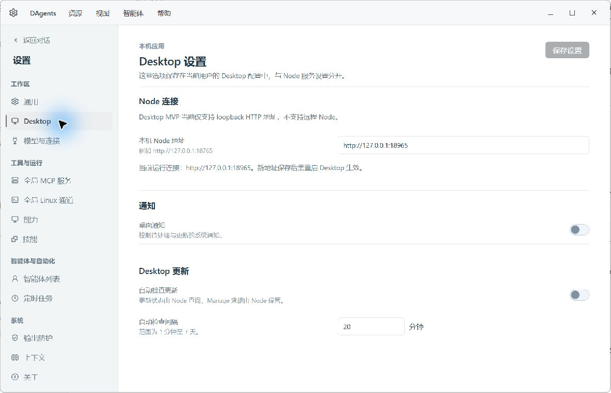

# Node 与 Desktop 配置边界验收

整理日期：2026-10-13。本记录接续本轮 2026-10-12 的实现与原生窗口证据，不包含安装、发布或生产数据迁移。

## 本轮落地范围

- Desktop 的 `node_endpoint`、通知、自动检查开关和检查间隔保存至当前用户的独立 JSON。`--config` 只指定被监护 Node 的启动文件；`--desktop-config` 指定 Desktop 设置文件。设置保存后重启 Desktop 生效。
- Node bootstrap YAML 只保存 `listen`；Node 运行配置、模型、智能体、调度、Manage 和执行策略仍由 Node 持久化。称呼进入提示词，因此继续属于 Node。
- Node 不再托管 `/ui`，也不再为剪贴板、窗口焦点或安装动作提供 Shell 代理。对应能力由本地 Tauri IPC 执行。Node 原生目录选择器保留。
- Manage token 不再回传。Manage PATCH 按字段合并，空 token 保留，显式 clear 删除；轮换或删除 token 不会顺带重置 Manage URL、启用状态、注册和 Workgroup 配置。
- Node 更新检查和安装包下载负责 Manage 鉴权；下载仅允许本机、最近候选、同源地址，拒绝重定向并验证长度和 SHA-256。Desktop 负责本机安装，不持有 Manage token。
- Desktop 只创建一个正式无边框窗口。启动、托盘、通知打开均复用该窗口。Go tray 停止发行及启动，源码仅保留为归档参考。

完整路由和接入说明见 [Node API 契约](../../../../../api/node-integration.md) 与 [OpenAPI](../../../../../architecture/openapi-node.yaml)。最终共 150 个 method/path 路由；清单包含 handler 和源码定位，非所有接口都具有逐字段 OpenAPI schema。

## 实际 HTTP 验证

使用隔离目录 `.runtime-test-api-boundary`、监听端口 `18965` 和测试智能体，未修改已有智能体或主工作区的模型凭据。

| 验证项 | 结果 |
|---|---|
| `/health`、`/v1/node/info`、`/v1/bootstrap`、`GET/PATCH /v1/settings` | 可用；读取到测试 Node 名称和监听端口 18965 |
| Node 设置中的 `local_endpoint` | 已移除 |
| `/v1/platform/capabilities` | 只返回 Node 原生目录选择能力，不包含 Desktop Shell 能力 |
| 原 `/ui`、runtime-config、setup、info、bootstrap、update、Shell 代理和安装路径 | 按实际旧 HTTP 方法请求均返回 404 |
| token 设置后读取、提交空值、显式清除 | 读取隐藏、空值保留、显式清除通过 |
| 无候选情况下下载更新包 | 返回明确错误，不返回伪成功安装包 |
| Node bootstrap 保存后内容 | 仅 `listen.host` 和 `listen.port` |

新增 Go HTTP 回归另覆盖仅修改 token 时其余 Manage 字段保持原值、下载同源限制、拒绝重定向、请求来源、大小及完整性校验。没有实际运行安装程序。

## 原生 Desktop 验证

在真实 Tauri 窗口中操作，使用独立 Desktop JSON 指向 18965，不在浏览器页面模拟 Tauri IPC。

1. 启动后只出现一个 `DAgents Desktop` 窗口，Node 在线并显示隔离智能体。
2. Node 通用页读取实际监听地址 18965；Desktop 页读取独立 JSON 的 endpoint、关闭的通知/自动检查开关及 15 分钟间隔。
3. 原生表单将间隔改为 20 分钟并保存；JSON 中 `update_check_interval_seconds` 为 1200，界面提示重启生效。
4. 离开再进入 Desktop 设置页，仍显示 20 分钟，保存按钮恢复为无改动状态。
5. 视觉复验通过：标签在左，输入与开关按行靠右；Desktop 导航使用已注册的 monitor 图标。

首次原生截图使用调试构建和 Vite 的本地前端地址，验证真实窗口与 IPC；随后按下面的内置资源方式补验。

### 内置资源补验（2026-10-13）

- 使用本地 Tauri CLI 执行 `tauri build --debug --no-bundle --features tauri/custom-protocol`。它构建并内嵌 `frontendDist`，不生成安装器。
- 确认端口 1422 没有 Vite listener，再启动该二进制。只出现一个无边框 `DAgents Desktop` 窗口，WebView 地址为 `http://tauri.localhost/`，不是 Node `/ui/` 或 Vite。
- Desktop 启动独立测试 Node，18965 上服务可用；智能体列表、Node 设置和本机 Desktop 设置均正常读取。
- 重启后的原生 Desktop 设置仍显示 20 分钟与 18965，证明本机 JSON 持久化也在内置资源方式下可用。
- 使用最终 Node 二进制重新验证 write-only token 的写入、空值保留和显式清除，Manage URL、启用状态、team 和 TTL 均保持不变。

这些验证不涉及安装器、签名或跨平台运行；最终验证用的临时进程按 PID 与可执行文件路径核实后关闭。

## 回归与限制

- 最终代码的全项目 Go 回归通过，覆盖 Node、Client、shared/config、shared/logfiles、shared/update 和 Go tray 归档源码；API 包耗时 36.443 秒。重构进行中的首次完整回归曾发生 API 超时；完整 API 单跑与最终重新执行全部包均通过，没有将首次超时计作成功。
- Node 共享前端：72 个测试文件、404 项通过，另有 6 项图标测试通过。
- Desktop UI：46 项通过；前端构建通过。
- Rust：21 项通过，格式检查通过。未设置 live smoke 环境开关的测试会直接返回，因此其单测计数不代表运行了真实终端或 LLM 链路。
- OpenAPI 与注册路由一致性检查通过；API 文档的 150 条 route/handler/source 定位逐项匹配。
- 当前仍只支持本机 Node。远程认证、身份识别、能力协商、节点生命周期归属、跨节点草稿隔离应在远程接入阶段统一设计。
- 安装、覆盖升级、签名、卸载、跨平台系统弹窗尚未进行本轮实机验收。前端源码暂在原 `node/webui/frontend` 目录复用，运行时已分离，源码目录迁移可独立安排。
